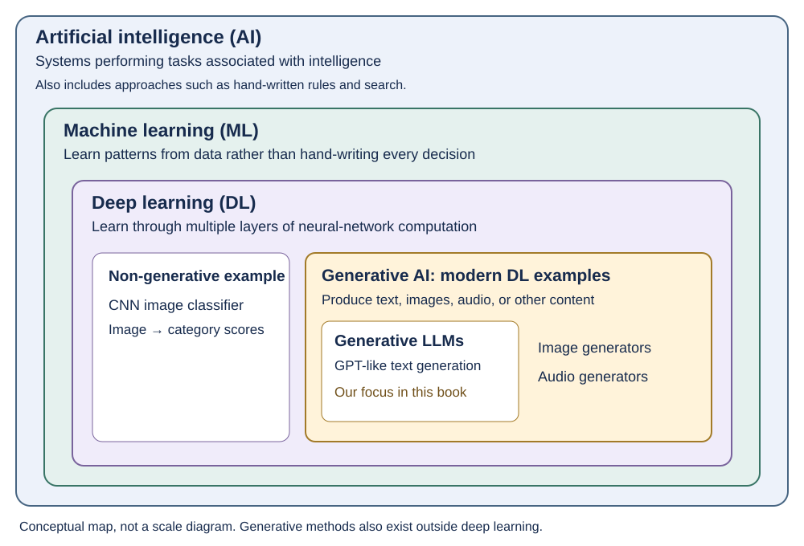
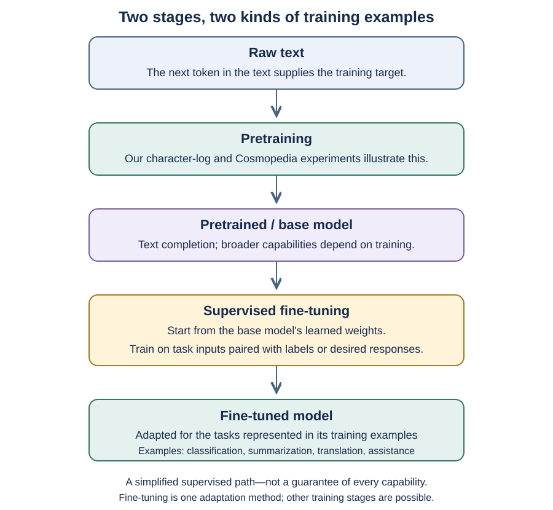
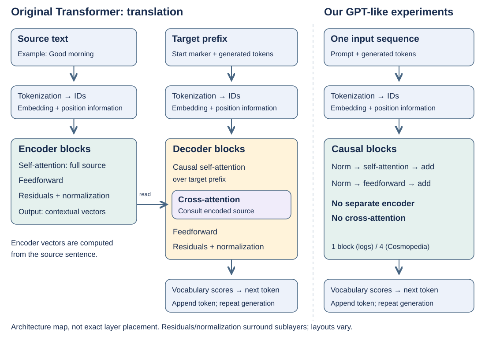
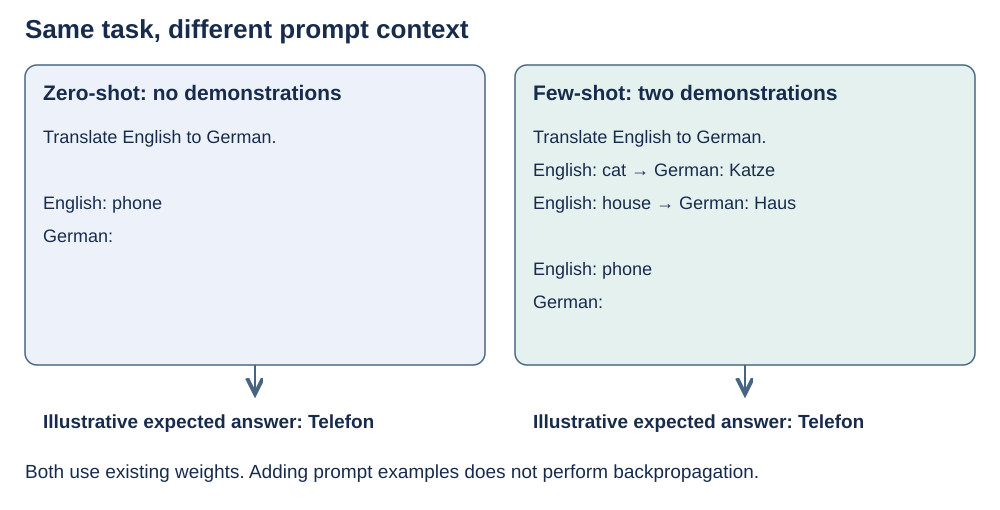
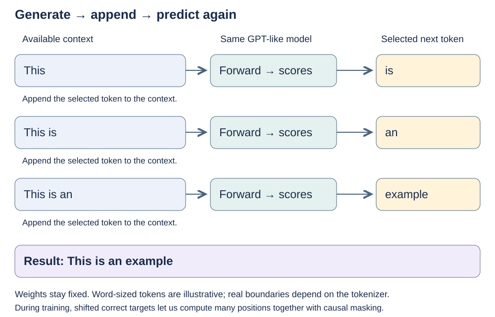

# Chapter 1 — Understanding Large Language Models

Status: reading in progress, October 16, 2026. Notes now include 1.5, “Utilizing large datasets,” and the discussion of GPT and autoregressive generation in 1.6, “A closer look at the GPT architecture.” The chapter is not complete.

The numbered headings follow the book so I can move between the reading and this companion. Smaller headings within each section organize our explanations and tangents; they are not additional book subsections.

These notes paraphrase ideas from Chapter 1 of Sebastian Raschka's *Build a Large Language Model (From Scratch)*, with our discussion and preparation experiments alongside them. They are not a transcript or a reproduction of the book's figure. See the [author's official companion repository](https://github.com/rasbt/LLMs-from-scratch).

## Before the chapter: the Python foundation 📘

In “About this book,” the emphasis on a strong Python foundation made me feel good about the time I invested in *Fluent Python* and *Data Structures and Algorithms in Python*. I have already taken steps toward that prerequisite. The new challenge is connecting familiar programming ideas to tensors, model architecture, and training.

## 1.1 What is an LLM?

### What do we mean by “understanding”?

One of the first distinctions that stood out to me is how the book uses the word **understand**. In this context, it describes a model processing and generating language in coherent, relevant ways. That is a description of behavior; it is not, by itself, evidence of human-like consciousness or comprehension.

Consciousness is a tricky subject, and I am not sure how this discussion will develop in the future. For these notes, I want to keep the practical meaning separate from the philosophical question. We can examine what a model does, how it is trained, and where it fails without treating fluent language as an answer to whether it has subjective experience.

This distinction is useful after our preparation experiments. Our Cosmopedia model started producing recognizable phrases, but also repeated them. We observed learned language patterns; that observation alone does not settle what kind of “understanding” the model has.

### From specialized NLP tasks to broader language capabilities

The contrast with earlier natural language processing (NLP) applications stood out to me. Many systems were designed and trained for particular tasks: sentiment analysis, translation, classification, and so on. LLMs can support a broader range of language tasks through the same underlying model, often guided by a prompt or additional training.

This is a shift in breadth, not a claim that all earlier NLP was limited to one task or that an LLM performs every task reliably. NLP is still the field concerned with computational work on human language; LLMs are one family of approaches within it.

### Where do these fields fit? 🧩

The basic nesting is **artificial intelligence → machine learning → deep learning**. AI is the broad field of systems performing tasks associated with intelligence; it does not require a claim of human-like consciousness. Machine learning learns patterns from data, although people still write the training code and choose the objectives. Deep learning uses neural networks with multiple layers of learned computation.



*Original companion diagram based on the relationships discussed in the opening reading. It focuses on modern deep-learning examples rather than reproducing the book's figure.*

**Generative AI describes producing content; it is not another name for LLMs.** A GPT-like language model produces text, while other generative models produce images or audio. The diagram places the generative LLMs we study inside that broader group. It also leaves room for non-generative deep learning, such as the CNN classifiers I know from earlier work.

The picture is intentionally scoped: generative methods also exist outside deep learning, and language models can be used for classification or representations rather than text generation. The labels describe related fields, model families, and uses; they are not all interchangeable levels of one universal taxonomy.

### Why does next-token prediction teach useful patterns?

The book's explanation connects next-word prediction with the sequential structure of language. To predict a plausible continuation, a model can benefit from learning grammar, topic, context, and relationships expressed in text. In our implementations, the prediction unit is a **token**, which may be a character, a word, or part of a word.

For example, consider this illustrative prefix:

```text
She put the ice cream in the ...
```

A plausible continuation depends on more than the immediately previous word. Earlier words constrain what makes sense. Training repeatedly rewards assigning probability to the actual continuation, which gives the model a reason to learn useful contextual patterns. The objective encourages those patterns; it does not guarantee factual correctness or human-like comprehension.

I see a connection here: we express ourselves through language, and the model learns from patterns in that expression. The sequential prediction task is simple to state, while the relationships needed to perform it well can be much richer.

Our experiments made the training signal concrete. We supplied input tokens and shifted next-token targets. Cross-entropy measured the probability assigned to the correct target; backpropagation and the optimizer updated the learned parameters. See the [character-log comparison](../preparation/training-comparison.md) and [Cosmopedia experiment](../preparation/cosmopedia.md).

### Selective attention in transformers

The attention explanation now connects with calculations we have already followed. At a position, a transformer can form a weighted mixture of information from other accessible positions. Those mixing amounts depend on the representations and learned query/key projections; value vectors supply the information being mixed.

“Selective attention” does not mean a conscious decision. It describes the calculated weighting. In our causal language model, future positions are masked, so a prediction can use its own position and earlier ones. Attention works alongside position information, feedforward networks, normalization, and residual connections.

The book focuses on transformer-based language models. We should read that as the architecture being studied, rather than a definition that every possible language model must use transformers. The original [Attention Is All You Need paper](https://arxiv.org/abs/1706.03762) introduced the Transformer architecture around attention mechanisms.

## 1.2 Applications of LLMs

The application that stood out in this section is chatbots: using an LLM to generate responses in a conversation. This is a brief reading note, not an exhaustive list of the section's applications.

## 1.3 Stages of building and using LLMs

### Why use a specialized or locally deployed model?

The argument I take from this section is that a model adapted to a particular task can sometimes outperform a general-purpose model on that task. It does not have to be better at everything to be useful. The comparison needs to be measured on the actual task; specialization alone does not guarantee an improvement.

Local deployment also connects to something familiar from software engineering: if a problem can be solved on the device, we can avoid a network round trip to a remote service. That can reduce latency and remote-service costs, and is part of the appeal of edge computing.

One qualification matters: **avoiding network latency does not guarantee lower total latency.** A local device can take longer to compute a response than a powerful remote server, even after including the network trip. Queueing, model size, response length, and hardware all affect the comparison. Local deployment also shifts costs toward device capacity, energy, and maintenance rather than making computation free.

“Specialized,” “local,” and “trained from scratch” are separate choices. We can fine-tune an existing pretrained model and run it locally; we do not have to pay for pretraining from scratch to gain the benefits of local deployment. A specialized model can also run on a server.

### Pretraining and fine-tuning are different stages 🧩

The figure in this section makes an important distinction: first learn from raw text, then optionally adapt the learned model using examples of a desired task or behavior.



*Original companion diagram of the supervised training path discussed in the reading; not a reproduction of the book's figure.*

During **pretraining**, the model learns to predict tokens from their preceding context. The text is often called “unlabeled” because people did not manually attach task labels to each example. But there are still training targets: the actual next tokens in the text. This is the self-supervised setup we used in our experiments.

The result is a **pretrained or base model**. At sufficient scale and with suitable training, base models can complete text and may respond to examples supplied in a prompt. That latter behavior is often called *few-shot prompting*: examples are placed in the context without updating weights. These capabilities are not guaranteed for every tiny model trained on next-token prediction. Our toy models illustrate the training mechanism; they are not broadly capable foundation models.

During **supervised fine-tuning**, we start from pretrained weights and continue training with examples chosen for a task or desired behavior. “Labeled” can mean a category label, but it can also mean a desired output sequence:

| Task | Example input | Target supplied during fine-tuning |
| --- | --- | --- |
| Classification | A customer review | A sentiment category |
| Summarization | An article | A reference summary |
| Translation | A sentence in one language | Its translation |
| Instruction following | A question or instruction | An example of an appropriate response |

These are illustrative pairings, not datasets we have prepared. A fine-tuned model is adapted toward its training tasks; fine-tuning does not automatically provide every capability in the table. For response-generation tasks, training can still use next-token prediction and cross-entropy, often focusing the loss on the desired response tokens. The data and training purpose change; the basic learning machinery need not be replaced.

Some of these abilities can already appear in a base model. Fine-tuning can make a particular behavior more reliable or better matched to a domain. This figure is one useful path, not a complete account of all later training methods.

### Instruction fine-tuning and classification fine-tuning

The book highlights two useful categories. Both adapt pretrained weights with supervised examples, but the target and expected output differ.

| Category | Example training input | Ground-truth target | Desired behavior |
| --- | --- | --- | --- |
| Instruction fine-tuning | `Translate to German: Good morning.` | `Guten Morgen.` | Generate a response that follows the instruction |
| Classification fine-tuning | An email offering an unexpected prize | `spam` | Assign a category to the input text |

An instruction example can contain an instruction, additional input text, and a desired response. The response supplies the next-token targets during training. A classification example pairs text with a label such as `spam` or `not spam`; a classifier can produce one score per category instead of next-token vocabulary scores.

These describe training approaches, not mutually exclusive capabilities. An instruction-tuned model can also be prompted to classify an email by generating a label. The distinction is how we construct the training examples and outputs. Neither kind of fine-tuning has been performed in our experiments yet. The book returns to classification in [Chapter 6](06-finetuning-for-text-classification.md) and instruction following in [Chapter 7](07-finetuning-to-follow-instructions.md); those companion pages are still scaffolds.

### Where do our experiments fit?

My interpretation is right: **both experiments so far illustrated pretraining from scratch**, rather than supervised adaptation of an existing model.

- In the [character-level tiny transformer experiment](../preparation/training-comparison.md), randomly initialized weights learned from fictional log text. Each character's target was the next character. The code lives in the [character-log experiment directory](https://github.com/kantarcise/learning-llms/tree/main/experiments/character-logs).
- In the [Cosmopedia experiment](../preparation/cosmopedia.md), randomly initialized weights learned from a public sample of synthetic text using an existing tokenizer. Reusing the tokenizer did not load pretrained model weights. The [Cosmopedia experiment directory](https://github.com/kantarcise/learning-llms/tree/main/experiments/cosmopedia) contains the implementation and reports.

The fictional logs having a consistent format does not make them supervised instruction examples. Likewise, Cosmopedia being generated by another model does not make our training run fine-tuning: we used its text as next-token training material and started our weights from scratch.

We have not yet taken either trained model and adapted it with labeled task examples. A useful distinction to keep is that **more training is not automatically fine-tuning**: resuming the same pretraining objective can simply continue pretraining. Our planned resumable checkpoints concern saving training state, not changing the training stage.

## 1.4 Introducing the transformer architecture

### Why do encoder and decoder feel like black boxes?

This figure initially felt harder to follow than our detailed walkthrough. We had already unpacked tokenization, embeddings, normalization, attention, residual connections, and feedforward layers. Now the book groups many operations into two large boxes: **encoder** and **decoder**.

The important bridge is that the figure describes the **original encoder–decoder Transformer**, while both our experiments use a **GPT-like, decoder-only architecture**. We did not accidentally leave an encoder out of an otherwise identical translation model.



*Original companion illustration. Tokenization, lookup, and position information are grouped together at the input; block internals are expanded enough to connect to our walkthrough. Normalization order and other details vary across implementations.*

### The original translation model: two streams

In the original Transformer, the encoder receives the source sentence and builds context-dependent vectors using self-attention and feedforward layers. Source positions can attend across the source sentence. The decoder receives the target prefix, uses causal self-attention over that prefix, and uses **cross-attention** to consult the encoder's output. Its output scores predict the next target token. Both stacks also have residual connections and normalization. During generation, selected target tokens are fed back as the prefix grows. See [Attention Is All You Need](https://arxiv.org/abs/1706.03762).

For an illustrative translation, the source might be `Good morning`, while the decoder starts with a start marker and then receives its generated German prefix. The two streams are different sequences. During training, shifted correct target tokens can be supplied so losses at many positions are computed together, while causal masking still hides future target positions.

The encoder's output is a **sequence of contextual vectors**, not one label or one fixed vector for the whole sentence. It is also different from the initial embedding lookup: those vectors have already been transformed by the encoder blocks. “Encoding” here does not mean merely converting text into token IDs.

Cross-attention is the new connection in that drawing: the decoder uses its current representations to query information from the encoded source. We can leave its matrix arithmetic for later. For now, distinguish it from self-attention, which mixes information within one sequence.

### What does that mean for our code?

Our models have **no separate encoder stack and no encoder–decoder cross-attention**. They take one sequence of token IDs and transform it through causal blocks:

```text
Token IDs
    ↓
Token embeddings + position embeddings
    ↓
Causal transformer blocks
    normalization → self-attention → residual addition
    normalization → feedforward   → residual addition
    ↓
Final normalization → vocabulary projection → next-token logits
```

That is the path we already traced in `TinyTransformer.forward` for the [character-log model](https://github.com/kantarcise/learning-llms/blob/main/experiments/character-logs/model.py) and `LanguageModel.forward` for the [Cosmopedia model](https://github.com/kantarcise/learning-llms/blob/main/experiments/cosmopedia/model.py). The former has one block; the latter has four. The existing experiment pages explain the [character-log run](../preparation/training-comparison.md) and [Cosmopedia run](../preparation/cosmopedia.md).

The name **decoder-only** refers to the causal, output-generating model family. It does not mean the model receives vectors from a separate encoder, and it is not identical to copying the original decoder unchanged. Also, a tokenizer's `decode` function merely turns token IDs back into text; it is not a Transformer decoder stack.

We already know the operations inside our blocks. For this reading, the new idea is how those operations are arranged into different model families. We do not need to redo the attention mathematics before continuing; [Chapter 3](03-coding-attention-mechanisms.md) is where the book develops attention in detail.

### BERT-like versus GPT-like models

My initial picture was “BERT fills masked words; GPT continues a prefix.” That is a useful starting point, with two refinements: the units are tokens, and these describe typical **pretraining objectives**, not a requirement that every later use contain a mask or an unfinished sentence.

| Question | BERT-like encoder model | GPT-like causal model |
| --- | --- | --- |
| Which context can a position use? | Both earlier and later visible input positions | Its own position and earlier positions |
| Typical pretraining exercise | Recover selected hidden/corrupted tokens | Predict the next token at each position |
| Illustrative input | `The cat sat on the [MASK].` | `The cat sat on the` |
| Illustrative target | `mat`, using context on either side where available | The next token, such as ` mat` |
| Our experiments? | No | Yes, simplified versions |

BERT's masked-language modeling trains representations using context on both sides; its original training also used another objective. Not every selected token is literally replaced by `[MASK]`. During downstream classification, an encoder can receive an ordinary unmasked input. See the [BERT paper](https://arxiv.org/abs/1810.04805).

For GPT-style training, we can supply a complete text window and calculate next-token loss at many positions in parallel. The **causal attention mask** makes each position behave as though only its prefix is visible. This connects directly to our shifted `job=orde` / `ob=order` example. At generation time, we extend the available prefix one token at a time; the initial prefix can itself be a complete sentence or instruction.

I wondered whether BERT-like models are useful anymore. Encoder models still have roles in classification, retrieval, and representation learning. For example, the authors of [ModernBERT](https://huggingface.co/blog/modernbert) describe a newer encoder family evaluated on classification and retrieval tasks. That is a reason to keep the architecture distinction, rather than treating encoder models as an obsolete step toward chat models. We do not need a separate encoder experiment to continue this chapter.

### Zero-shot and few-shot: examples in the prompt

These terms describe how many demonstrations of the requested task are included in the prompt. In the setting discussed here, **the model's weights remain fixed**. “Few-shot learning” is also called *in-context learning* in this usage; it is different from fine-tuning with backpropagation. The [GPT-3 paper](https://arxiv.org/abs/2005.14165) evaluates zero-, one-, and few-shot settings without gradient updates for these prompt demonstrations.



*Illustrative prompts and expected answers, not outputs measured from our toy models.*

**Zero-shot does not prove the task was absent from pretraining.** It means we supplied no demonstrations in this prompt. A model may already have encountered translation data or related tasks during training. A few-shot prompt adds examples that help indicate the pattern, format, or intended meaning; it does not create an optimizer update.

This helps separate three ideas:

- **Pretraining:** update weights from a broad text-prediction objective.
- **Fine-tuning:** update pretrained weights using additional training examples for an adaptation goal.
- **Zero-/few-shot prompting:** use existing weights, with zero or a few demonstrations in the input context.

### Transformer is an architecture, not a synonym for LLM

The distinction at the end of this section is useful: not all Transformers are language models. A Transformer can process other kinds of sequences, such as image patches in the [Vision Transformer paper](https://arxiv.org/abs/2010.11929). That connects back to my computer-vision background.

In this book, the focus is transformer-based language models similar to GPT. That scope does not make “Transformer” and “LLM” interchangeable terms.

## 1.5 Utilizing large datasets

### Corpus size is not the same as the training budget

A **corpus** is a collection of text gathered for study or training; the plural is **corpora**. Our six fictional log sequences form a tiny corpus. Cosmopedia and Dolma are much larger examples. See the [glossary](../preparation/glossary.md#corpus).

The GPT-3 table prompted a question: if the available sources totaled 499 billion tokens, why did training process 300 billion?

| GPT-3 source | Available tokens |
| --- | ---: |
| Filtered Common Crawl | 410 billion |
| WebText2 | 19 billion |
| Books1 | 12 billion |
| Books2 | 55 billion |
| Wikipedia | 3 billion |
| **Total** | **499 billion** |

Common Crawl is **410 billion**, correcting the spoken transcription of 4 billion. The original [GPT-3 paper, section 2.2](https://arxiv.org/html/2005.14165v4#S2.SS2) explains unequal sampling: sources considered higher quality were revisited, while Common Crawl and Books2 received less than a complete pass. Thus 300 billion tokens processed does not mean 300 billion distinct tokens selected once.

We did not find a definitive explanation for the precise 300-billion cutoff. The paper does connect its training choices to then-current scaling-law guidance favoring larger models trained on fewer tokens. Later [Chinchilla research](https://arxiv.org/abs/2203.15556) revised the model-size/training-data balance; it does not reveal the original team's exact decision process.

This connects to our [Cosmopedia run](../preparation/cosmopedia.md): available text and tokens processed during training are different quantities, especially when batches can repeat.

### Dolma is available, but version and units matter

[Dolma](https://huggingface.co/datasets/allenai/dolma) is a publicly released corpus from AI2, with [open-source processing tools](https://github.com/allenai/dolma). The corpus uses the ODC-BY data license. The dataset card lists these **gzip-compressed** sizes:

| Release | Compressed size | Context |
| --- | ---: | --- |
| v1.5 | 6.4 TB | Described as roughly 3 trillion tokens |
| v1.6 | 5.4 TB | Updated corpus |
| v1.7 | 4.5 TB | Listed as the default release when checked |
| v1.6 sample | 16.4 GB | Roughly 10 billion tokens |

Source: [official version table](https://huggingface.co/datasets/allenai/dolma#versions), checked October 16, 2026. These are download sizes, not decompressed or tokenized storage requirements. We have not downloaded Dolma; it is a reading reference, not a new experiment to complete.

### The encouraging part: reuse pretrained weights

The section ends with a useful practical point: we do not need to repeat enormous pretraining runs for every application. Available pretrained models can be adapted to particular tasks using much smaller task-specific datasets. The required data and resulting quality still depend on the task and starting model.

This differs from both our experiments: we initialized their weights randomly. Reusing a trained model would start from language patterns already learned, then adapt them. The preparation runs helped expose the mechanism; they were not meant to reproduce the capabilities or training budgets in this table.

## 1.6 A closer look at the GPT architecture

### Self-supervised learning: the text supplies its own targets

The phrase **self-supervised learning** connects to something that surprised me during preparation. In my supervised CNN/object-detection work, someone had to provide labels or bounding boxes. For next-token pretraining, the text already contains the answer at the next position.

```text
Input positions:   j o b = o r d e
Target positions:  o b = o r d e r
```

There are still targets and a loss. We construct them by shifting the text, rather than manually labeling each prediction. That is the self-labeling idea here; the model is not inventing its own ground truth. Text collection, cleaning, and filtering still require work. CNNs can also be trained with self-supervised objectives, so the distinction is the training setup rather than images versus text.

Our [shifted-target walkthrough](../preparation/first-conversation.md#eight-next-token-tasks-and-one-weight-update) explains those eight prediction tasks; the [training comparison](../preparation/training-comparison.md) records the subsequent runs.

### Autoregressive generation: predict, append, repeat

Yes, **token** is the more precise unit than word. Our first model generated characters. The Cosmopedia tokenizer can represent word fragments, whole words, and punctuation. A word-by-word illustration is helpful as long as we do not assume those are the actual token boundaries.

An **autoregressive** language model predicts the next token conditioned on the available preceding tokens. At generation time, a selected output token is appended to that context and becomes input for the next prediction.



*Original companion illustration of the sequence described during reading. It assumes each displayed word addition is one token for clarity; actual token boundaries depend on the tokenizer. These are illustrative outputs, not results from our models.*

Each row uses the **same model and weights**. We perform another forward pass to calculate scores, select the next token, and extend the input. There is no `backward()` or optimizer update in this generation loop. At each causal attention position, only that position and its predecessors are accessible.

Generation is sequential across newly produced tokens. Pretraining is different: correct tokens from the dataset supply the shifted targets and prefixes, so many positions can be trained together with a causal mask. We do not have to generate a sentence token by token to calculate its training loss.

### This is what we were building all along

The book describes GPT as decoder-style rather than an encoder–decoder translation model. As discussed in [1.4](#14-introducing-the-transformer-architecture), that means our models do not need a separate encoder or encoder–decoder cross-attention. “Decoder-only” is not the original decoder copied unchanged.

The familiar path remains:

```text
Token IDs → embeddings + positions → causal transformer blocks
          → final normalization → vocabulary scores → next token
```

That explains why our preparation began with attention, one transformer block, and a tiny language model. We were building **small GPT-like architectures and pretraining them from scratch**. The assistant should have named that overall connection more explicitly at the beginning.

The [character-log model](https://github.com/kantarcise/learning-llms/blob/main/experiments/character-logs/model.py) has one block. The [Cosmopedia model](https://github.com/kantarcise/learning-llms/blob/main/experiments/cosmopedia/model.py) has four blocks and multiple attention heads. Both connect the book's concepts to code we can inspect. They illustrate shared foundations, not every detail or capability of larger GPT models.

“Relatively simple” is a comparison of architectural structure. It does not mean training a capable language model is easy, or that every later model uses exactly the same design. The next-token objective and the block structure give us a useful foundation to recognize as the book develops them.

**Current reading position, October 16:** section 1.5 is discussed, and notes now include these observations from 1.6. No claim is made that the whole chapter or its exercises are complete.

## Questions to carry forward

- How should I distinguish useful language competence from the different meanings of “understanding”?
- As I read, how does next-token prediction connect to the broader abilities demonstrated by larger models?

The consciousness question is worth keeping, but we do not need to resolve it to follow the architecture. For now, continue the chapter and bring the next passages that stand out.

## End of chapter

Not reached yet. No chapter exercises or end-of-chapter conclusions are recorded as completed.
