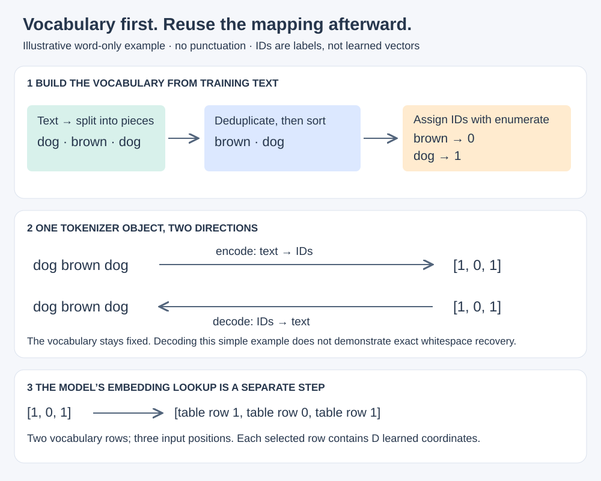

# Chapter 2 — Working with Text Data

Status: reading in progress. Notes cover the chapter overview, 2.1, “Understanding word embeddings,” and reading through 2.3, “Converting tokens into token IDs.” Section 2.4 is next; no exercises are recorded as independently completed.

These notes follow Sebastian Raschka's *Build a Large Language Model (From Scratch)*, with explanations from our discussion and links to our experiments. See the [author's Chapter 2 code](https://github.com/rasbt/LLMs-from-scratch/tree/main/ch02).

The chapter introduces text preparation, word and subword tokenization, byte pair encoding (BPE), sliding-window training examples, and the vectors supplied to a language model. These are the steps before the transformer blocks we explored during preparation.

Section names and numbering follow [Manning’s published contents](https://www.manning.com/preview/build-a-large-language-model-from-scratch/chapter-3). Numbered headings are book sections; unnumbered headings contain our companion notes. Unwritten sections are placeholders, not completed reading.

## 2.1 Understanding word embeddings

Text stored in a computer is already digital. The additional problem is giving a neural network a numerical representation on which useful computations can be learned. Characters and token IDs identify categories; their arbitrary numeric IDs do not measure meaning.

My earlier analogy was “digitizing something.” That captured the bridge from data to numbers, but it needs refining: **an embedding maps an input to a vector representation**, usually learned in the neural-network settings we are discussing. It is not analog-to-digital conversion. Audio samples and image pixels can already be numeric before an embedding model processes them.

### Token IDs are addresses; embeddings are vectors

Our character model makes the distinction concrete:

```text
Text character    Token ID       Looked-up vector
     j      →        12     →    [0.12, -0.40, 0.08, 0.91, ...]
                                  32 coordinates in total
```

The vector values above are illustrative, not a checkpoint dump. ID 12 selects row 12 of the learned embedding table. It does not mean that `j` has a magnitude of twelve, or that the next ID represents a similar character.

The table begins randomly initialized and is updated through training. Looking up a row during a forward pass does not itself update it. Subsequent transformer blocks produce contextual representations from these starting vectors.

**Vocabulary size tells us how many rows. Width tells us how many coordinates per row.** Our [character-log model](../preparation/training-comparison.md) has 25 rows and 32 coordinates per row. The [Cosmopedia model](../preparation/cosmopedia.md) has 49,152 rows and 256 coordinates per row.

### Does every model need a separate embedding model?

No separate service or pretrained embedding model was needed for either of our language models. Their `nn.Embedding` layers are part of the models themselves and are trained with the rest of the parameters. Reusing a tokenizer in Cosmopedia did not import pretrained embedding weights.

An external text-embedding model serves a different use case: it can turn a whole query or passage into a vector for comparison and retrieval. An image or audio encoder can likewise produce learned representations from its own input format. Some multimodal systems train representations into a shared space, so different data types do not necessarily require unrelated, separately deployed models.

Not every machine-learning system uses learned dense embeddings. A system might use hand-designed numeric features or sparse word counts. The key distinction here is between an embedding layer inside a language model and a model whose output is an embedding for another application.

### Words, sentences, passages, and documents

The represented unit matters:

| Representation | What one vector represents | Example use |
| --- | --- | --- |
| Token embedding | One vocabulary entry, such as a character or subword | Starting representation inside our GPT-like models |
| Contextual token representation | One position after processing surrounding accessible context | Next-token prediction |
| Sentence or passage embedding | A span of text | Comparing a query with candidate passages |
| Document embedding | A document, within the embedding model's input limits | Document similarity or retrieval |

A sentence embedding is not simply the token ID of a longer string. An encoder processes the text and produces a representation, for example through pooling. Long documents may need splitting into passages rather than squeezing everything into one vector. Similarity is useful only to the extent that the representation and its training objective support the comparison.

### A brief RAG connection

I wondered whether retrieval-augmented generation had faded along with the hype. There is concrete evidence of continued use: [Claude's project documentation](https://support.claude.com/en/articles/11473015-retrieval-augmented-generation-rag-for-projects) describes RAG for project knowledge, and [Anthropic's context-engineering article](https://www.anthropic.com/engineering/effective-context-engineering-for-ai-agents) discusses retrieval as part of selecting useful model context. These examples establish ongoing use, not an industry-wide adoption trend.

```text
Question → retrieve relevant passages → give passages + question to the LLM
                                     → generate an answer using that context
```

Embedding similarity is one retrieval method. Keyword search and hybrid approaches can also supply passages. Retrieving text does not update the language model's weights. A larger context window may let us include more material directly, but does not automatically eliminate the value of selecting relevant material from a large or changing collection.

For this chapter, the useful distinction is **token vectors inside the LLM versus passage vectors used to find context for it**. Building a RAG system can wait.

### Word2Vec and embedding width

[Word2Vec](https://arxiv.org/abs/1301.3781) introduced efficient ways to learn word vectors from relationships between words and their surrounding context. Its common formulations include predicting a word from its context and predicting context words from a word. A conventional Word2Vec table gives a word a fixed vector; a transformer can produce different contextual representations for that word in different sentences.

Yes, the dimensionality discussed here connects directly to our earlier questions about vector width. More coordinates can give a representation more capacity, but do not guarantee better results. Training data, objective, model design, and compute budget matter too. Individual coordinates are not normally assigned human-readable meanings.

For a vocabulary of 25 entries:

| Chosen width | Token embedding table | Stored numbers |
| --- | --- | ---: |
| 32 | 25 × 32 | 800 |
| 64 | 25 × 64 | 1,600 |

Changing width has consequences beyond the embedding table. A square attention projection grows from 32 × 32 = 1,024 weights to 64 × 64 = 4,096 weights when width doubles. This is why width can make later matrix computations grow much faster than the embedding-table size. Vocabulary size and width remain independently chosen dimensions.

## 2.2 Tokenizing text

Reading reached the end of this section. The examples below follow the [author's section 2.2 notebook](https://github.com/rasbt/LLMs-from-scratch/blob/cdbd33e6d57a71e20ea31434841095fac50cecd8/ch02/01_main-chapter-code/ch02.ipynb), with our explanations alongside them. They are reference snippets checked by the assistant, not exercises recorded as independently completed by Sezai.

### Why do we need this step?

I am still looking for the complete reasoning behind tokenization. “The model needs numbers” explains part of it, but does not explain why we split the text into these particular pieces.

Our model consumes a sequence of vocabulary IDs and returns a score for each possible next ID. We therefore need a consistent rule for **what counts as one position and one prediction unit**. Tokenization supplies that rule. Later, mapping tokens to IDs makes them usable as lookup addresses; embedding lookup supplies learned vectors.

```text
Text → token pieces → integer IDs → embedding vectors → transformer
       this section   section 2.3    section 2.7
```

Characters, bytes, words, and subwords are different choices of unit. Character-level input worked in our first experiment; splitting into whole words is not a requirement of every LLM. The book's regex tokenizer is a small, inspectable starting point. BPE in section 2.5 introduces another way to choose pieces, with different tradeoffs in sequence length, vocabulary size, and handling unfamiliar words.

### Read a story into a Python string

The sample is Edith Wharton's *The Verdict*, available as [`the-verdict.txt` in the official repository](https://github.com/rasbt/LLMs-from-scratch/blob/cdbd33e6d57a71e20ea31434841095fac50cecd8/ch02/01_main-chapter-code/the-verdict.txt). Once that file is present in the working directory, the reading step is ordinary Python:

```python
with open("the-verdict.txt", "r", encoding="utf-8") as f:
    raw_text = f.read()

print(len(raw_text))
print(raw_text[:99])
```

The checked file contains **20,479 Python string characters**, not 20,479 tokens or necessarily 20,479 bytes. UTF-8 decoding creates the string; it is not the model's tokenizer. No embeddings or model calculations have happened yet.

The upstream notebook also includes download code. Its current downloader may differ from the printed book; the reading and splitting examples here follow the linked revision without adding a dependency to our project.

### Start with whitespace, then handle punctuation

```python
import re

text = "Hello, world. This, is a test."
result = re.split(r'(\s)', text)
print(result)
```

```text
['Hello,', ' ', 'world.', ' ', 'This,', ' ', 'is', ' ', 'a', ' ', 'test.']
```

`\s` matches a whitespace character, including spaces, tabs, and newlines. The parentheses form a capturing group: with `re.split`, that means the matched separators are included in the result. Punctuation is still attached to words, so the next version splits on commas and periods too:

```python
result = re.split(r'([,.]|\s)', text)
result = [item for item in result if item.strip()]
```

The character class `[,.]` matches either punctuation mark; `|` means “or.” Splitting can produce empty strings where separators meet or occur at an edge. `if item.strip()` filters out empty and whitespace-only strings. This version yields:

```text
['Hello', ',', 'world', '.', 'This', ',', 'is', 'a', 'test', '.']
```

### Expand the punctuation rule

The author's next example keeps more punctuation as separate pieces:

```python
text = "Hello, world. Is this-- a test?"
result = re.split(r'([,.:;?_!"()\']|--|\s)', text)
result = [item.strip() for item in result if item.strip()]
print(result)
```

```text
['Hello', ',', 'world', '.', 'Is', 'this', '--', 'a', 'test', '?']
```

The rule matches one listed punctuation character, a double hyphen, or a whitespace character. Because the alternatives are inside a capturing group, punctuation survives the split; the following comprehension removes whitespace and empty pieces.

These punctuation pieces are different from **special model-control tokens**, such as an end-of-text marker. Section 2.4 introduces those. This regex is also not an exhaustive tokenizer for every language or punctuation mark.

### Why preserve capitalization? What about whitespace?

Lowercasing would erase distinctions we may want the model to learn. For example, `May` can be a name or month, while `may` can express possibility. Capitals also carry clues about sentence boundaries and the output formatting we want. We leave the case intact rather than collapsing these forms before training.

Whitespace is a separate decision. In this exercise we remove it, simplifying the token list. The cost is that exact original formatting is no longer recoverable from those pieces alone. For example, `a b` and `a\n\nb` yield the same pieces despite different layout. Indentation in Python is an especially concrete reason whitespace can matter.

A tokenizer can preserve spaces directly or include them within larger tokens; it does not need one separate token for every space. The choice depends on the application and representation. Our character-log experiment retained spaces and newlines as characters, while this teaching example deliberately discards whitespace.

### Apply the same rule to the story

```python
preprocessed = re.split(r'([,.:;?_!"()\']|--|\s)', raw_text)
preprocessed = [item.strip() for item in preprocessed if item.strip()]

print(preprocessed[:10])
print(len(preprocessed))
```

```text
['I', 'HAD', 'always', 'thought', 'Jack', 'Gisburn', 'rather', 'a', 'cheap', 'genius']
4690
```

The assistant reproduced **4,690 token occurrences** using the linked story revision. That is the sequence length after this split, not the number of unique vocabulary entries. Repeated words count repeatedly. We have a list of strings; integer IDs, embedding vectors, and training windows are still later steps.

Next: [2.3 Converting tokens into token IDs](#23-converting-tokens-into-token-ids).

## 2.3 Converting tokens into token IDs

Reading reached the end of this section. `vocab` is a mapping from token strings to integer IDs: we look up a token to get its ID. That is the same bridge our character experiment built with its 25 distinct characters.

### Build a vocabulary without rearranging the input

The [author's code](https://github.com/rasbt/LLMs-from-scratch/blob/cdbd33e6d57a71e20ea31434841095fac50cecd8/ch02/01_main-chapter-code/ch02.ipynb) collects the distinct pieces from section 2.2 and gives them a consistent order:

```python
all_words = sorted(set(preprocessed))
vocab = {token: token_id for token_id, token in enumerate(all_words)}
```

`set` removes duplicates, `sorted` orders the distinct strings, and `enumerate` assigns consecutive integers starting at zero. The story has **4,690 token occurrences but 1,130 distinct vocabulary entries** under this tokenizer. Punctuation is included despite the variable name `all_words`.

[](../assets/chapter-02/vocabulary-and-tokenizer.svg)

*Original companion illustration with invented example text, not a reproduction of the book's figure. Open for a larger view.*

For simple lowercase words, `brown` sorts before `dog`. More precisely, Python's default string sorting uses Unicode code-point order, not language-aware dictionary order. Uppercase letters and punctuation affect the order too.

**Alphabetical sorting is not required for tokenization.** It gives this example a deterministic assignment. Other tokenizers use their own construction rules and saved mappings. What matters is consistent reuse: the tokenizer's IDs must match the model's embedding rows and output scores. Reordering a vocabulary after training without corresponding model changes breaks that relationship.

Sorting the vocabulary does not sort the story. The input keeps its original order and repetitions; repeated tokens reuse the same ID.

### A tokenizer object holds both directions

Below is a typed adaptation of the author's `SimpleTokenizerV1`, with explanatory docstrings. It uses the same splitting and punctuation-cleanup rules:

```python
import re


class SimpleTokenizerV1:
    def __init__(self, vocab: dict[str, int]) -> None:
        self.str_to_int = vocab
        self.int_to_str = {token_id: token for token, token_id in vocab.items()}

    def encode(self, text: str) -> list[int]:
        """Split text and look up IDs; an unknown piece raises KeyError."""
        pieces = re.split(r'([,.:;?_!"()\']|--|\s)', text)
        pieces = [piece.strip() for piece in pieces if piece.strip()]
        return [self.str_to_int[piece] for piece in pieces]

    def decode(self, ids: list[int]) -> str:
        """Join token strings and clean some punctuation spacing.

        This does not restore original whitespace discarded during encoding.
        """
        text = " ".join(self.int_to_str[token_id] for token_id in ids)
        return re.sub(r'\s+([,.?!"()\'])', r'\1', text)
```

A small example we can inspect completely:

```python
tokenizer = SimpleTokenizerV1({"brown": 0, "dog": 1})
ids = tokenizer.encode("dog brown dog")
print(ids)                    # [1, 0, 1]
print(tokenizer.decode(ids))   # dog brown dog
```

The inverse mapping is possible because each vocabulary entry has a unique ID. `encode` includes splitting plus lookup; `decode` includes inverse lookup plus text assembly. Neither method trains embeddings. Our model's separate `nn.Embedding` layer turns those IDs into learned vectors.

When an LLM generates, its forward method returns logits, not text. A selection step chooses a token ID from those scores, and the tokenizer can decode the resulting sequence. This is how the same mapping connects model inputs and generated outputs.

### What if a token is missing?

```python
tokenizer.encode("cat")  # KeyError: 'cat'
```

The lookup fails because this vocabulary has no `cat` entry and V1 has no fallback. A larger word vocabulary covers more cases, but cannot enumerate every new name, typo, compound, or word in every language. Nor should we casually add IDs during inference: the model needs corresponding trained input/output parameters.

!!! tip "Looking ahead: how byte-based tokenizers avoid unknown words"

    Our word-based tokenizer fails when a whole piece is missing from its vocabulary. Byte-based tokenizers such as [tiktoken](https://github.com/openai/tiktoken#what-is-bpe-anyway) can represent unfamiliar text using smaller pieces:

    ```text
    Unicode text → UTF-8 bytes → byte-based tokenization → token IDs
                                                          ↓
                                                 model embedding lookup
                                                          ↓
                                                       vectors
    ```

    For example, `list("ş".encode("utf-8"))` produces `[197, 159]`. These are **two byte values, not token IDs**. Together they encode the Turkish character. The tokenizer may have one token covering both bytes; otherwise, basic byte pieces can represent them.

    **UTF-8 encoding plus coverage of all 256 byte values** provides a route to represent any valid Unicode text. UTF-8 alone does not solve a missing-vocabulary problem. Common byte sequences can be combined into larger tokens for efficiency. Decoding joins the token's byte pieces back together before interpreting the bytes as UTF-8 text.

    This is a preview, not a rule about every tokenizer. Being able to encode a language does not guarantee that the model understands it well—or represents it with few tokens. Section 2.5 will develop BPE in more detail.

We can leave the detailed algorithms for the next sections: **2.4 introduces special tokens**, including an unknown-token approach, and **2.5 introduces BPE**. The immediate lesson is why the simple whole-piece lookup needs an explicit policy for missing entries.

## 2.4 Adding special context tokens

Notes to come as we read this section.

## 2.5 Byte pair encoding

Notes to come as we read this section.

## 2.6 Data sampling with a sliding window

Notes to come as we read this section.

## 2.7 Creating token embeddings

Notes to come as we read this section.

## 2.8 Encoding word positions

Notes to come as we read this section.

## Connection to our experiment tooling: checkpoints

The planned [resumable Cosmopedia training work](https://github.com/kantarcise/learning-llms/issues/14) saves and restores model parameters, optimizer state, progress, and randomness/sampling state. It does not require changing layers or the forward computation, so the architecture drawings remain valid. Weight values may change with training while shapes stay the same.

If we later change the number of blocks, vector width, vocabulary, or another architectural choice, we should update the drawings separately. Current inference-only checkpoints cannot restore optimizer state that was never saved.

## Questions to carry forward

- How does BPE choose useful subword pieces?
- How do sliding windows produce input/target pairs from a longer text?
- How will the book's embedding implementation connect to our existing `nn.Embedding` lookup?

## End of chapter

Not reached yet. Continue reading; this page records the opening discussion, not a completed chapter.
