# Chapter 3 — Coding Attention Mechanisms

Status: reading started. These notes cover the chapter introduction and sections 3.1–3.2, and the self-attention walkthroughs in 3.3.1–3.3.2. The introduction to 3.4 is covered; its step-by-step implementation and sections 3.5–3.6 are still ahead.

[Chapter 2](02-working-with-text-data.md) prepared the inputs: text became token IDs, training windows, and vectors carrying token and position information. Now we move into the model architecture itself and study **attention**: how a token's representation gathers information from other accessible positions.

These notes follow Sebastian Raschka's [Build a Large Language Model (From Scratch)](https://sebastianraschka.com/llms-from-scratch/). The [author's Chapter 3 code](https://github.com/rasbt/LLMs-from-scratch/tree/main/ch03) accompanies the implementation.

Section names and numbering follow [Manning’s published contents](https://www.manning.com/preview/build-a-large-language-model-from-scratch/chapter-3). Numbered headings are book sections; unnumbered headings contain our companion notes. Unwritten sections are placeholders, not completed reading.

### Where we are in the book's roadmap

We are at **step 2, “Attention mechanism,” within Stage 1** of the author's roadmap. This is not Stage 2, which concerns pretraining and the foundation model. Data preparation gave us the inputs; attention is the next architectural component to unpack.

<figure markdown="1">

[](https://sebastianraschka.com/images/LLMs-from-scratch-images/mental-model.jpg)

<figcaption markdown="span">Sebastian Raschka's [book roadmap](https://sebastianraschka.com/llms-from-scratch/), embedded from his website. We are focusing on step 2, “Attention mechanism.” Open the image for a full-size view.</figcaption>
</figure>

### Four implementations, one gradual progression

The chapter introduces four variations. We will follow the progression rather than unpacking the most advanced version immediately.

<figure markdown="1">

[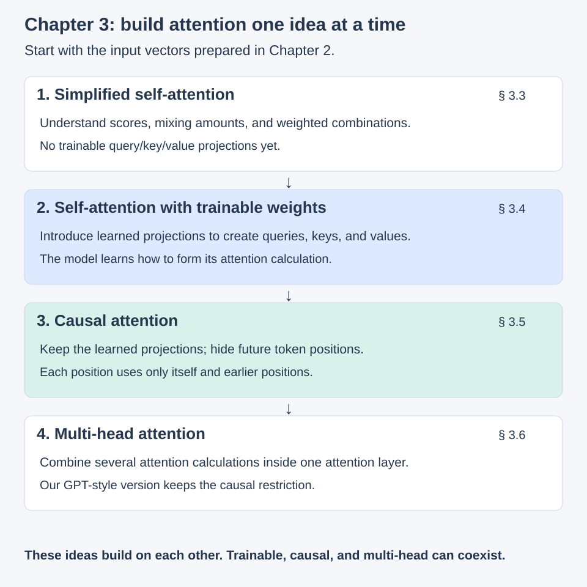](../assets/chapter-03/attention-progression.svg)

<figcaption markdown="span">Original companion figure explaining the same progression as Figure 3.2 in Sebastian Raschka's book, using our own layout and wording. These are cumulative teaching steps, not mutually exclusive categories: the final GPT-style multi-head attention also has trainable weights and a causal mask.</figcaption>
</figure>

A **head** is one attention calculation; multiple heads perform several such calculations in parallel and combine their outputs. Heads are not successive transformer blocks. That is enough terminology for the introduction—we will work through the details in section 3.6.

Our preparation already touched queries, keys, values, and causal masking. The book now gives us an ordered path to implement them. Sections 3.1 and 3.2 first motivate attention before the simplified calculation in 3.3.

## 3.1 The problem with modeling long sequences

Starting with the problem makes the architecture easier to motivate. Translation cannot generally be handled by replacing each source word with its dictionary equivalent and keeping the same order. The target sentence needs the appropriate meaning and grammar, and the relevant source information may occur earlier or later than the word currently being generated.

### Translation is not a row of independent substitutions

Consider our own German-to-English example:

```text
German:                    Ich habe das Buch gelesen.
Literal, source-order:     I have the book read.
Natural English:           I have read the book.
```

The final German word, `gelesen`, contributes `read`, which appears before `the book` in the English translation. This short example isolates reordering; longer sentences also require resolving meaning and relationships across much greater distances. Not every translation needs reordering, but a general translation system must support it.

<figure markdown="1">

[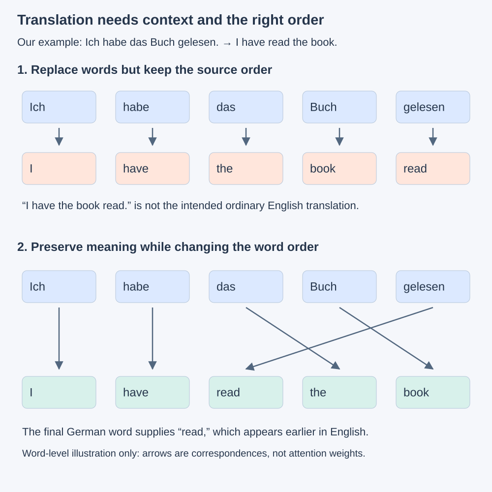](../assets/chapter-03/translation-order.svg)

<figcaption markdown="span">Original companion illustration inspired by the problem in the book's Figure 3.3, using a different sentence and our own layout. Arrows show illustrative word correspondences, not measured attention scores. Words are used for readability; actual models operate on tokens.</figcaption>
</figure>

Having access to a later word in the **source sentence** is not the same as peeking at a future **target answer**. A translation encoder can read the complete source before decoding begins, while the decoder generates the target from its available prefix. This connects to the [encoder–decoder distinction in Chapter 1](01-understanding-large-language-models.md#the-original-translation-model-two-streams).

### The basic recurrent encoder–decoder

Before Transformers, recurrent neural networks (RNNs) were used for neural translation. In the basic design discussed here, an **encoder** processes the source sequence and a **decoder** generates the target sequence. These are roles in the model, not the tokenizer's `encode` and `decode` methods.

The encoder reads one token representation at a time and updates its **hidden state**: a vector of computed values carrying information from the sequence processed so far. The state is an activation, not a new set of learned weights. The same recurrent computation and learned weights are reused at each step.

```text
Current token vector + previous encoder state → updated encoder state
```

After the final source token, the last encoder state supplies the source summary used to initialize the decoder in this schematic. The decoder then updates its own state and predicts target tokens one at a time, using the previous target token as input (a start marker is used first).

<figure markdown="1">

[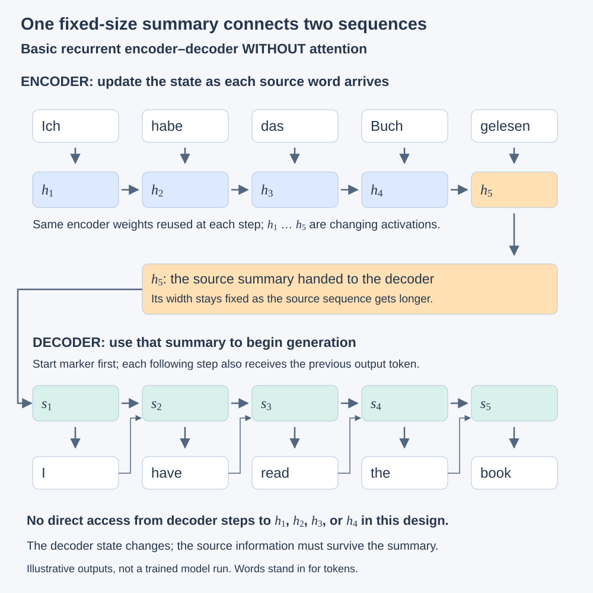](../assets/chapter-03/rnn-context-bottleneck.svg)

<figcaption markdown="span">Original companion illustration of the basic recurrent encoder–decoder bottleneck discussed in Figure 3.4. Encoder and decoder boxes represent steps through time, not separate layers with independent weights. This simplified design has no attention; outputs are illustrative, not measured results. Recurrent variants can carry additional state, such as an LSTM's cell state.</figcaption>
</figure>

### Why a fixed-size summary becomes a bottleneck

My initial interpretation was that we are trying to keep the whole context in a very small thing. More precisely, **the state has a fixed width while the input can keep getting longer**. It might contain hundreds or thousands of numbers; the issue is that more source information must be carried through the same-sized representation.

For illustration, a 256-coordinate encoder state still has 256 coordinates after reading either 5 or 100 tokens. Each update must preserve information that will be useful later. Earlier details can become difficult to retain and recover, particularly when the translation depends on distant parts of a long sentence. This is a learned compression bottleneck, not a literal rule that each coordinate stores one word or that a particular length always fails.

In this **basic model without attention**, the decoder has no direct route back to individual earlier encoder states. It does not repeatedly read an unchanging decoder state: its own state evolves as it generates. But the source information available through that state must have survived the encoder's final summary and subsequent decoder updates.

This limitation is not true of every RNN. Attention was introduced into recurrent encoder–decoder systems before the Transformer: the [Bahdanau, Cho, and Bengio paper](https://arxiv.org/abs/1409.0473) motivates attention as a way to consult relevant source representations instead of relying exclusively on one fixed-length source summary.

That gives us the question for attention: **when producing a particular output token, could the decoder consult the source positions it needs?** Section 3.2 develops that idea. We do not need to implement an RNN first to follow the motivation.

## 3.2 Capturing data dependencies with attention mechanisms

The fixed-summary encoder–decoder can work well on short sequences, but retaining and recovering relevant details becomes harder as sequences grow. This is not a sharp length cutoff or a statement that every RNN fails on long text. The limitation here is the basic decoder's lack of direct access to the earlier source representations.

Attention adds that access. The encoder still builds representations for the source positions, but the decoder can consult them again while producing each target token. It does not need every source detail to survive exclusively in the final encoder state.

### Consult different source positions at each output step

Return to our example, `Ich habe das Buch gelesen` → `I have read the book`. Suppose the generated target prefix is `I have`, and we are about to generate `read`.

The decoder can compute mixing amounts over the source representations, combine those representations into a **context vector**, and use that vector to help produce the next output. In our illustration, the representation associated with `gelesen` receives the largest weight. These numbers are invented to explain the mechanism, not extracted from a model.

<figure markdown="1">

[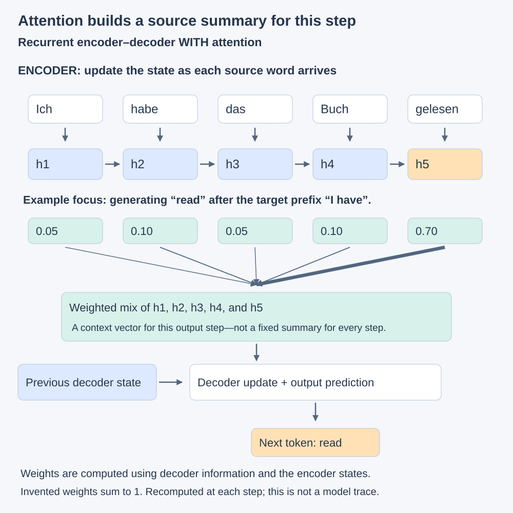](../assets/chapter-03/rnn-with-attention.svg)

<figcaption markdown="span">Original companion illustration inspired by Figure 3.5, extending our previous recurrent encoder–decoder drawing. Thicker arrows indicate larger illustrative mixing weights. The decoder computes a new mixture at each output step. This is a conceptual sketch, not the exact Bahdanau implementation; start/end markers, token feedback wiring, and some internal operations are omitted.</figcaption>
</figure>

The context vector still has a fixed width. The improvement is that **its contents can be recomputed from all available encoder states for each output step**, rather than requiring one source summary to serve every prediction. The model retains multiple source representations, so this extra access also requires storage and computation.

“Access to words” is shorthand: the attention calculation works with their **encoder representations**, not raw text or a dictionary. Each encoder representation can already contain contextual information. The mixture is usually soft: several positions can contribute, rather than the model selecting exactly one word.

The mixing weights depend on the current computation. They are not permanent importance scores attached to source words, and a large weight is not a complete explanation of why a model chose an output. We will calculate attention weights explicitly in the following sections.

### From recurrent attention to the Transformer

The [Bahdanau, Cho, and Bengio paper](https://arxiv.org/abs/1409.0473) was first posted in **2014** and presented at ICLR 2015. It introduced an influential attention-based neural translation approach that lets a recurrent decoder use relevant source representations. This is the historical example here, not a claim that every idea called attention originated in that paper.

In **2017**, [Attention Is All You Need](https://arxiv.org/abs/1706.03762) introduced the Transformer, showing that strong translation models could be built without recurrent layers. Attention handled interactions between positions alongside feedforward layers and other components. “Without recurrence” does not mean “without sequence order”: positional information and causal masking still matter.

The progression is:

```text
Basic recurrent encoder–decoder
    → one final source summary

Recurrent encoder–decoder with attention
    → consult source representations for each output step

Transformer
    → use attention-based blocks without recurrent layers
```

The translation example has a decoder attending to an encoder's representations. That is attention **between two sequences**. The self-attention calculation we implement next mixes positions **within one sequence**. The shared idea is a context-dependent weighted combination; the architectures and exact calculations differ.

!!! tip "What self-attention adds"

    **Self-attention builds context-aware representations by letting each position in a sequence weigh and combine information from positions in that same sequence.** Without a mask, all positions can interact; with a causal mask, each position can use only itself and earlier positions.

    Here, “better representations” means that a token's vector can reflect its surrounding context. It does not mean that attention necessarily takes less computation.

Before calculating attention, locate it in the complete model. Chapter 2 prepared input vectors from text. This chapter develops the attention mechanism that mixes information between positions. Chapter 4 assembles the full GPT-like architecture around it.

<figure markdown="1">

[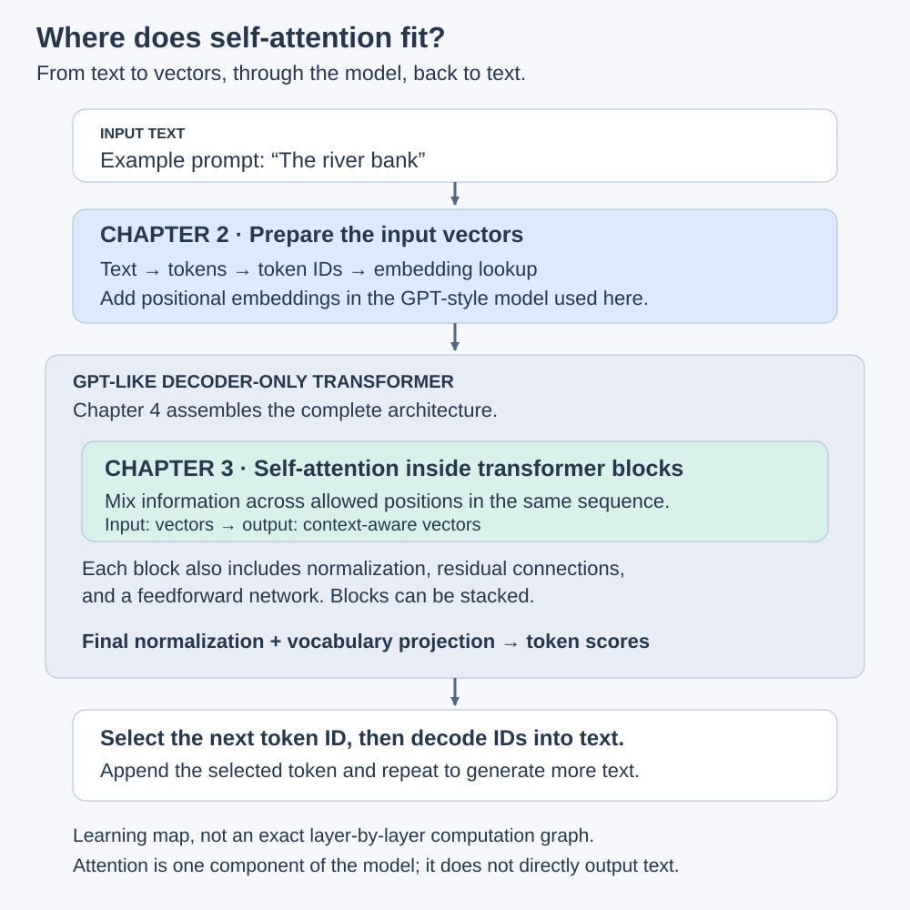](../assets/chapter-03/attention-in-model.svg)

<figcaption markdown="span">Original companion illustration inspired by Figure 3.6 in [Sebastian Raschka's book](https://sebastianraschka.com/llms-from-scratch/), using our own layout and example. This is a learning map, not an exact execution graph: normalization, residual connections, and feedforward operations surround attention within each block. The input phrase is illustrative; no tokenization or prediction result is claimed.</figcaption>
</figure>

**Attention receives vectors and produces vectors.** It does not directly produce words or token IDs. The complete model eventually projects its representations into vocabulary scores; selecting token IDs and decoding them gives us generated text.

## 3.3 Attending to different parts of the input with self-attention

!!! note "What does the self in self-attention mean?"

    **Self means that the positions being related belong to the same sequence.** It does not mean a token attends only to itself. A token can incorporate information from other positions as well as its own.

    In the translation example from section 3.2, a decoder attends to representations from a separate encoder sequence. That is **cross-attention**. Both are attention mechanisms; the distinction is where their inputs come from. Image models can likewise use self-attention between representations of image patches.

### 3.3.1 A simple self-attention mechanism without trainable weights

The goal is to turn each input vector into a **context vector**: a representation that incorporates information from the other available positions, including the position itself. Calling it an “enriched embedding” is a useful intuition. In this simplified calculation, it is a weighted combination of the input vectors, not an extra row permanently written into the token embedding table.

#### First, what are we trying to do?

We already have a sequence of input vectors. Choose **one position** and ask:

> What information from this sequence should contribute to the new representation at this position?

The vector asking that question is called the **query**. For example, in our companion sentence “Small models learn patterns,” we will choose the position labeled “models.” Its input vector becomes the query because we want to calculate context **for that position**. “Question” is an analogy for its role in a numerical calculation; the model is not forming a literal question.

The calculation has three steps:

| Step | What we do | What we get |
| --- | --- | --- |
| **Compare** | Take the query's dot product with every available input vector, including itself. | One **score** for each contributing position. |
| **Normalize** | Apply softmax across those scores. | **Mixing amounts**, called attention weights, that sum to one. |
| **Mix** | Multiply each input vector by its mixing amount, then add the weighted vectors coordinate by coordinate. | One **context vector** for the chosen position. |

```text
Choose the position whose context we want
    ↓
Use its input vector as the query
    ↓
Compare with every input vector, including itself
    ↓
Scores → softmax → mixing amounts
    ↓
Use those amounts to combine the input vectors
    ↓
A context vector for the chosen position
```

**A score is a comparison result. A mixing amount tells us how much a vector contributes to the sum.** Keeping those two stages separate makes the calculation easier to follow. We will first demonstrate simple division by the score sum, then replace it with softmax.

The result is still a vector of the same width in this example. It now contains contributions from positions in the sequence. We have calculated **one new representation**, not predicted the next token or updated the stored embedding table. The calculation for another query position produces that position's own scores, weights, and context vector.

This already counts as **self-attention**: the query and the vectors it consults belong to the same sequence. “Self” does not restrict attention to the query's own position.

#### Why is this version simplified?

**We use the input vectors themselves to decide how to mix the input vectors themselves.** They do two jobs: provide the numbers being compared, and provide the information being mixed. No learned query/key/value projections separate those jobs yet.

If you followed the [character-log experiment](../preparation/training-comparison.md), we previously explored attention inside a complete transformer block, alongside normalization, residual additions, and a feedforward network. Here we are zooming into the attention component and temporarily removing some machinery so we can see its core calculation.

| Job | This simplified version | Version with learned projections |
| --- | --- | --- |
| Ask for information at a position | That position's input vector | A query vector produced using W<sub>Q</sub> |
| Supply vectors to compare against | The input vectors | Key vectors produced using W<sub>K</sub> |
| Supply information to mix | The input vectors | Value vectors produced using W<sub>V</sub> |

The learned version retains **compare → normalize → mix**, but learns how to prepare the vectors for those jobs. We will introduce those projections in section 3.4; causal masking follows in 3.5. For now, all positions in the example are accessible. The attention output still needs the rest of the model before it becomes vocabulary scores for predicting a token.

With that purpose in mind, we can follow the symbols and arithmetic below. Section 3.3.1 works through **one query position**; section 3.3.2 extends the calculation to **every position**.

#### Follow one position through the calculation

Keep these symbols separate:

| Symbol | Meaning | Small example |
| --- | --- | --- |
| `T` | Number of token positions in this sequence | 4 positions |
| `d` | Number of coordinates in each input vector | 3 numbers per vector |
| x<sup>(2)</sup> | Input vector at the second position; the number is a position, not an exponent | `[0, 2, 1]` |
| z<sup>(2)</sup> | Context vector computed for the second position | Also 3 numbers here |
| α<sub>23</sub> | Mixing weight for input position 3 when computing the output for position 2 | One scalar, not a vector |

The book uses six word-labeled positions for “Your journey starts with one step.” Its input tensor therefore has six rows, each containing three numbers. In general, **the input shape is `[T, d]`: positions × coordinates per vector**. This is one sequence, with no batch axis in this example. Word labels help us read the example; a real tokenizer may split words into multiple tokens.

For our companion drawings, use four word-labeled positions and deliberately simple, invented vectors. These are teaching inputs, not representations from a trained model:

```python
import torch

# One sequence: T=4 positions, d=3 coordinates per vector.
# These are floating-point vectors already, not integer token IDs.
inputs = torch.tensor([
    [1.0, 0.0, 1.0],  # Small   — position 1
    [0.0, 2.0, 1.0],  # models  — position 2
    [1.0, 1.0, 0.0],  # learn   — position 3
    [0.0, 1.0, 2.0],  # patterns — position 4
])
```

<figure markdown="1">

[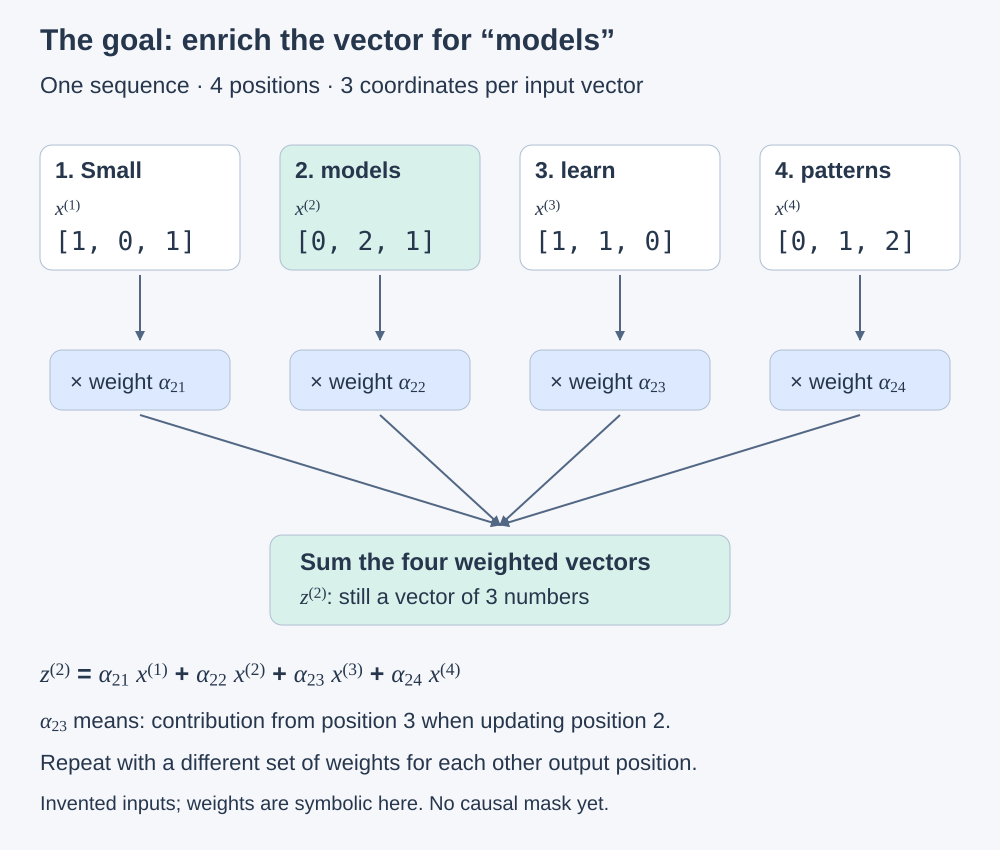](../assets/chapter-03/self-attention-context.svg)

<figcaption markdown="span">Original companion illustration inspired by Figure 3.7 in [Raschka's book](https://sebastianraschka.com/llms-from-scratch/), using a different sentence and invented vectors. The weights are symbolic: this drawing shows the goal before we calculate the mixing amounts. All four positions are accessible because this example has no causal mask.</figcaption>
</figure>

We focus on z<sup>(2)</sup> first, but the eventual goal is **one context vector per input position**. There is no concatenation here: multiplying each three-coordinate vector by a scalar and summing the results still produces three coordinates. Four input positions will ultimately produce four context vectors.

**First calculate scores, not mixing amounts.** Use the second input vector as the query—the position for which we want context—and take its dot product with each input vector. In this simplified version, “query” describes the role of an input vector; we have not introduced a learned query projection yet.

```python
# Python index 1 selects position 2: [0, 2, 1], shape [3].
query = inputs[1]

# For each row, multiply matching coordinates and add them.
# inputs has shape [4, 3]; query has shape [3]; scores has shape [4].
scores = inputs @ query
print(scores)  # tensor([1., 5., 2., 4.])
```

<figure markdown="1">

[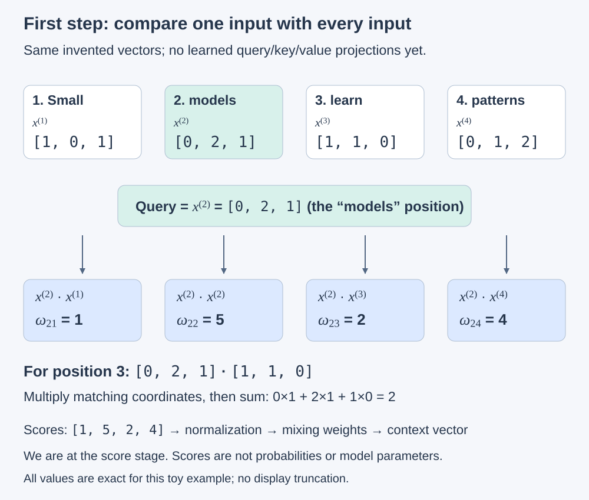](../assets/chapter-03/self-attention-scores.svg)

<figcaption markdown="span">Original companion illustration inspired by Figure 3.8, using the same invented inputs as our preceding figure. The displayed scores are exact for these inputs. A score is an intermediate comparison value; it is not yet a normalized attention weight.</figcaption>
</figure>

For example, the score comparing position 2 with position 3 is `0×1 + 2×1 + 1×0 = 2`. These dot products depend on the vectors and their magnitudes; with invented inputs, we should not read semantic understanding into the resulting rankings.

!!! tip "Attention weights are not the same as trainable model weights"

    This section has no learned query/key/value matrices. It still computes attention scores and, subsequently, mixing weights from the inputs. Those mixing weights are computed activations, not stored parameters adjusted directly by the optimizer. In a full model, the input embeddings can themselves be learned even when a particular attention operation has no trainable projections.

The book's figures shorten the displayed decimal values to save space. Two rows can therefore look identical in a drawing while differing in the actual tensor. Use the full values from the code for calculations; do not expect dot products of truncated display values to reproduce the original scores exactly.

#### Reading the book's notation

The raised parenthesized number is a **position label, not a power**: x<sup>(2)</sup> means the input vector at position 2. More generally, x<sup>(T)</sup> is the last input vector when the sequence has T positions. The corresponding context vector is z<sup>(2)</sup>.

- **ω (omega)** denotes an attention score: ω<sub>23</sub> = x<sup>(2)</sup> · x<sup>(3)</sup>.
- **α (alpha)** denotes a normalized attention weight: α<sub>23</sub> is how much position 3 contributes to the context vector for position 2.
- The first subscript identifies the query position; the second identifies the contributing position. These figures use omega and alpha, not theta.

A dot product multiplies matching coordinates and sums the products. It measures alignment **and depends on vector magnitudes**. If we double a vector without changing its direction, its dot product with the query doubles. So a higher score is not automatically evidence of a closer semantic relationship. In this example, larger positive scores will receive larger mixing weights after normalization.

#### From scores to weights that sum to one

For our query at position 2, the scores are `[1, 5, 2, 4]`. A first, simple normalization divides each score by their sum, `12`:

```python
# scores: shape [4], one scalar per input position for this query.
# All four scores in this toy example are positive.
attention_weights = scores / scores.sum()
print(attention_weights)  # tensor([0.0833, 0.4167, 0.1667, 0.3333])
print(attention_weights.sum())  # tensor(1.)
```

<figure markdown="1">

[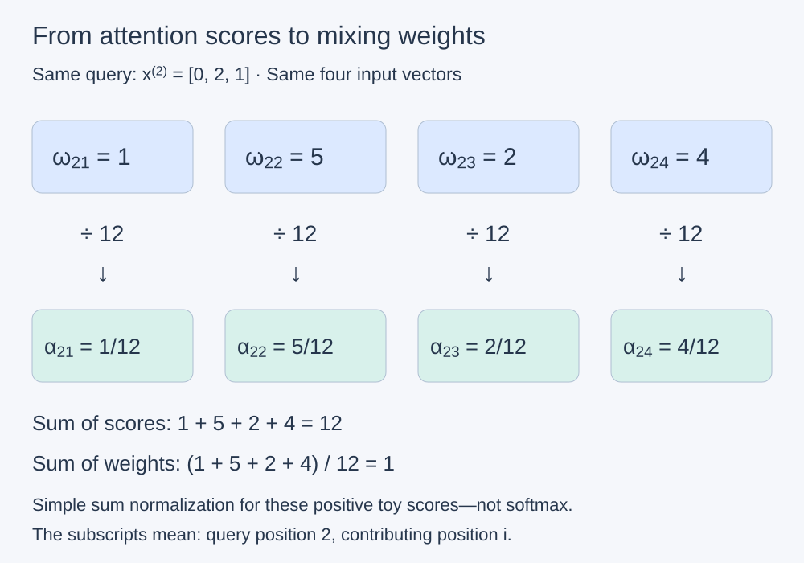](../assets/chapter-03/self-attention-normalization.svg)

<figcaption markdown="span">Original companion illustration inspired by Figure 3.9 in [Raschka's book](https://sebastianraschka.com/llms-from-scratch/). We retain our four-position example and show exact fractions to avoid rounding ambiguity. This figure demonstrates simple division by the score sum, not softmax.</figcaption>
</figure>

The weights describe how to distribute the mixture across the input vectors: position 2 receives `5/12` of the weight, position 4 receives `4/12`, and so on. This makes the combination interpretable as a weighted average and prevents its scale from growing merely because we add more equally weighted contributors. **This normalization is across positions for one query; it is not LayerNorm across a token vector's coordinates.**

!!! warning "This first normalization is only a teaching step"

    Arbitrary dot products can be negative, and their sum can be zero or very close to zero. Dividing by that sum is therefore not a general solution for attention. Softmax will give us nonnegative weights summing to one even when scores are negative. Normalization alone does not guarantee stable training.

#### Reproduce the book's six-token example

Our diagrams use four simple vectors to make the arithmetic easy to inspect. To compare directly with the book, here are the six input vectors and the score/normalization calculation from the [official Chapter 3 notebook, section 3.3.1](https://github.com/rasbt/LLMs-from-scratch/blob/main/ch03/01_main-chapter-code/ch03.ipynb). The code below adapts that example with explicit names and comments; it is independent of the four-position example above.

```python
import torch

# Floating-point input vectors, not token IDs.
# T=6 token positions; d=3 coordinates per vector; shape [6, 3].
book_inputs = torch.tensor([
    [0.43, 0.15, 0.89],  # Your
    [0.55, 0.87, 0.66],  # journey
    [0.57, 0.85, 0.64],  # starts
    [0.22, 0.58, 0.33],  # with
    [0.77, 0.25, 0.10],  # one
    [0.05, 0.80, 0.55],  # step
])

# Position 2 is Python row index 1. This query has shape [3].
book_query = book_inputs[1]

# Allocate six score slots. torch.empty does not initialize their values;
# the loop fills every slot before we read or print the tensor.
book_scores = torch.empty(book_inputs.shape[0])
for position_index, input_vector in enumerate(book_inputs):
    # Two vectors of shape [3] -> one scalar dot product.
    book_scores[position_index] = torch.dot(input_vector, book_query)

# Shape [6]: omega_21 through omega_26, in input-position order.
print(book_scores)

# Divide each score by the sum of all six scores for this query.
# Shape stays [6]: alpha_21 through alpha_26.
book_weights = book_scores / book_scores.sum()
print(book_weights)
print(book_weights.sum())
```

```text
tensor([0.9544, 1.4950, 1.4754, 0.8434, 0.7070, 1.0865])
tensor([0.1455, 0.2278, 0.2249, 0.1285, 0.1077, 0.1656])
tensor(1.0000)
```

For the first score, ω<sub>21</sub>, the calculation is `0.43×0.55 + 0.15×0.87 + 0.89×0.66 = 0.9544`. The score sum is `6.5617`, so α<sub>21</sub> is `0.9544 / 6.5617 ≈ 0.1455`. These printed decimals are rounded; the calculation uses the tensor's stored precision. The last printed sum may display as `1.` or `1.0000` depending on floating-point and display details.

The loop makes each comparison visible. `book_inputs @ book_query` computes the same six scores at once, which is the form used in our smaller example. This remains simple sum normalization, not softmax.

#### Use softmax for attention weights

Instead of dividing the raw scores by their sum, softmax first exponentiates each score and divides by the sum of those exponentials. For finite scores, the resulting weights are nonnegative and sum to one, even when some scores are negative. This is a smooth, differentiable transformation; changing one score also affects the other weights through the shared denominator. It does not guarantee that gradients will always be large or that training will always be stable.

Continuing with `book_scores` from the six-token example, the [official notebook](https://github.com/rasbt/LLMs-from-scratch/blob/main/ch03/01_main-chapter-code/ch03.ipynb) first demonstrates a naive implementation. Here it has a type hint and a shape explanation:

```python
def softmax_naive(scores: torch.Tensor) -> torch.Tensor:
    """Normalize a floating-point score vector [T] into weights [T].

    T is the number of input positions for one query. This direct
    exponential formula illustrates softmax but is not numerically stable.
    """
    exponentials = torch.exp(scores)
    return exponentials / exponentials.sum(dim=0)

book_weights_naive = softmax_naive(book_scores)
print(book_weights_naive)
print(book_weights_naive.sum())
```

```text
tensor([0.1385, 0.2379, 0.2333, 0.1240, 0.1082, 0.1581])
tensor(1.)
```

Directly exponentiating large positive scores can overflow. A stable implementation subtracts the largest score before exponentiation; this leaves the mathematical result unchanged while avoiding that overflow for ordinary finite inputs. In practice, use PyTorch's implementation:

```python
# book_scores has shape [6]. Axis 0 is its only axis: input positions.
# Normalize across those six positions for the single query "journey".
book_weights_softmax = torch.softmax(book_scores, dim=0)
print(book_weights_softmax)
print(book_weights_softmax.sum())
```

This prints the same weights as the naive implementation for our modest scores. It is **not** the same result as the earlier division by the raw score sum. The context-vector calculation below uses these **softmax weights**. Our experiment models also use PyTorch softmax; here we are unpacking the operation one step at a time.

#### Finish one context vector: multiply, then sum

For z<sup>(2)</sup>, multiply each input vector x<sup>(i)</sup> by its scalar weight α<sub>2i</sub>, then add the resulting vectors coordinate by coordinate. The parenthesized superscript still labels the position, not a power.

```python
# book_query has shape [3]: d=3 coordinates per vector.
# Begin with three zeros to accumulate the weighted contributions.
book_context_2 = torch.zeros_like(book_query)
for position_index, input_vector in enumerate(book_inputs):
    # One scalar weight times one [3] vector produces another [3] vector.
    weighted_input = book_weights_softmax[position_index] * input_vector
    book_context_2 += weighted_input

print(book_context_2)
# tensor([0.4419, 0.6515, 0.5683])
```

Those are **three numbers: 0.4419, 0.6515, and 0.5683**. Six input vectors of width three contribute to one output vector of width three. For example, its first coordinate is approximately `0.1385×0.43 + 0.2379×0.55 + 0.2333×0.57 + 0.1240×0.22 + 0.1082×0.77 + 0.1581×0.05 = 0.4419`. The code uses full-precision weights, not the rounded ones displayed here.

<figure markdown="1">

[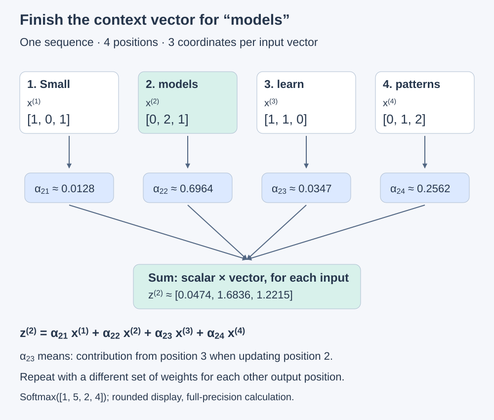](../assets/chapter-03/self-attention-weighted-sum.svg)

<figcaption markdown="span">Original companion illustration inspired by Figure 3.10 in [Raschka's book](https://sebastianraschka.com/llms-from-scratch/). The diagram continues our four-position toy example; the code above reproduces the book's separate six-position example. Weights and output coordinates are rounded for display, but the calculation uses full precision. These weights come from softmax, replacing the simple sum normalization illustrated earlier.</figcaption>
</figure>

The same weighted sum can be expressed compactly as `book_weights_softmax @ book_inputs`: shape `[6] @ [6, 3]` gives `[3]`. The loop exposes each contribution; the matrix operation combines them in one expression.

We have calculated the context vector for **one position**. Section **3.3.2** extends the calculation to all input positions simultaneously.

### 3.3.2 Computing attention weights for all input tokens

**The calculation has not changed; the query position now changes.** In 3.3.1, we used “journey” at position 2 as the query and calculated one set of mixing weights and one context vector. Now each of the six positions takes a turn as the query. Every query still consults all six original input vectors, including itself.

We do not feed the first context vector into the calculation of the second. All output rows are computed from the **same input matrix**. This is why we can calculate them together.

#### Read the rows and columns before the code

For our six-position example, both the score matrix and weight matrix have shape `[6, 6]`:

- **Row i:** the query position whose context we want to compute.
- **Column j:** the input position being compared or contributing information.
- **ω<sub>ij</sub>:** the dot-product score for that pair.
- **α<sub>ij</sub>:** the mixing amount for input j when constructing context vector z<sup>(i)</sup>.

For example, α<sub>23</sub> sits in the second row and third column: how much “starts” contributes to the context vector for “journey.” In Python, that cell is `all_weights[1, 2]`, because indexing starts at zero.

<figure markdown="1">

[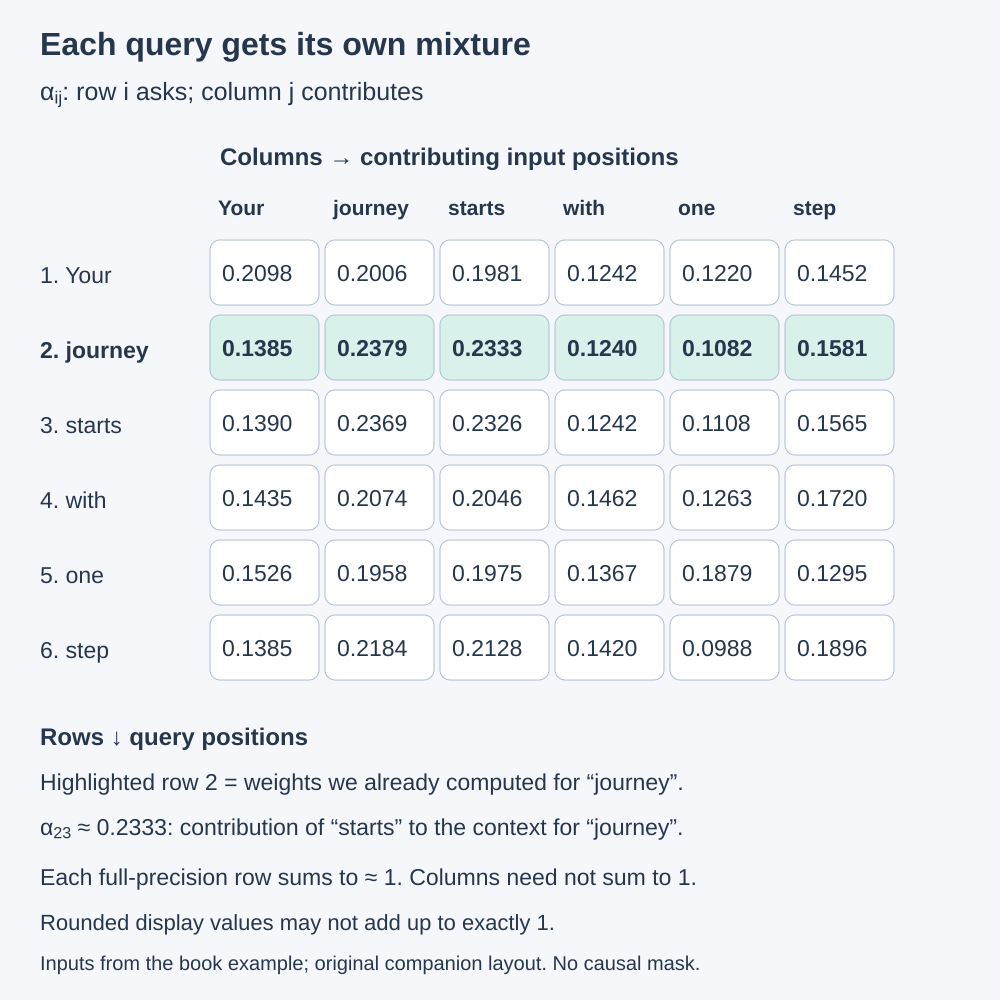](../assets/chapter-03/all-position-weights.svg)

<figcaption markdown="span">Original companion layout inspired by Figure 3.11 in [Raschka's book](https://sebastianraschka.com/llms-from-scratch/). Values are computed from the book's six input vectors and rounded to four decimal places for display. Each full-precision row sums to approximately one; displayed rounding can change the last digit of its sum. The highlighted row is the single-query calculation from 3.3.1.</figcaption>
</figure>

**Each row of attention weights sums to one because softmax distributes that query's mixture across its available input positions.** Raw score rows need not sum to one. Columns of the weight matrix need not sum to one either. The whole weight matrix sums to approximately six: six separate mixtures, each with a total weight of one. The book truncates its displayed values, so adding those shortened numbers may give a total below one.

#### Step 1: compute all pairwise scores

The following code adapts the [official Chapter 3 notebook, section 3.3.2](https://github.com/rasbt/LLMs-from-scratch/blob/main/ch03/01_main-chapter-code/ch03.ipynb). Continue with `book_inputs` from the six-token example above: shape `[6, 3]`, meaning six positions and three coordinates per vector. These are already floating-point vectors, not token IDs.

```python
# T is the number of token positions in this one sequence, here 6.
num_positions = book_inputs.shape[0]
all_scores_loop = torch.empty(num_positions, num_positions)

# The outer loop selects the query: one complete output row at a time.
for query_index, query_vector in enumerate(book_inputs):
    # The inner loop compares that query with every input position.
    for input_index, input_vector in enumerate(book_inputs):
        all_scores_loop[query_index, input_index] = torch.dot(
            query_vector, input_vector
        )

print(all_scores_loop)
```

```text
tensor([[0.9995, 0.9544, 0.9422, 0.4753, 0.4576, 0.6310],
         [0.9544, 1.4950, 1.4754, 0.8434, 0.7070, 1.0865],
         [0.9422, 1.4754, 1.4570, 0.8296, 0.7154, 1.0605],
         [0.4753, 0.8434, 0.8296, 0.4937, 0.3474, 0.6565],
         [0.4576, 0.7070, 0.7154, 0.3474, 0.6654, 0.2935],
         [0.6310, 1.0865, 1.0605, 0.6565, 0.2935, 0.9450]])
```

There are **36 scalar scores**, not 36 context vectors. Row 2 contains the six scores we already computed for “journey.” Each row is another instance of the same calculation.

We can replace both loops with one matrix multiplication:

```python
# [6, 3] @ [3, 6] -> [6, 6]: query positions × compared positions.
all_scores = book_inputs @ book_inputs.T
print(torch.allclose(all_scores, all_scores_loop))  # True
```

Why transpose? Each input vector starts as a **row**. Matrix multiplication computes the dot product of a row on the left with a column on the right. `.T` places each input vector in a column, so output cell `[i, j]` is exactly the dot product of input rows i and j. For these two-dimensional inputs, `.T` swaps the two axes; it does not change the coordinate values or introduce any learned weights. `@` means matrix multiplication, whereas `*` would mean element-wise multiplication.

This is the bridge to [NumPy and PyTorch](https://github.com/kantarcise/numpyandpytorch): the mathematical operation is explicit, and the framework executes it using optimized numerical routines instead of making Python dispatch every individual dot product. The work still exists—here, 36 comparisons—but it can be organized efficiently and run in parallel where the hardware supports it. It is not a different attention algorithm, and a tiny example is not a meaningful performance benchmark.

#### Step 2: normalize each query's row independently

```python
# all_scores: [6, 6], axes are [query position, compared position].
# dim=-1 selects the LAST axis: the six columns within each row.
all_weights = torch.softmax(all_scores, dim=-1)
print(all_weights[1])  # The previously calculated weights for query 2.
print(all_weights.sum(dim=-1))  # One sum per query row: shape [6].
```

```text
tensor([0.1385, 0.2379, 0.2333, 0.1240, 0.1082, 0.1581])
tensor([1.0000, 1.0000, 1.0000, 1.0000, 1.0000, 1.0000])
```

For this two-dimensional matrix, `dim=-1` and `dim=1` select the same column axis. Softmax takes six scores from **one row**, computes six weights for that row, and repeats independently for the other rows. `dim=0` would normalize down the query rows within each column, which is not the mixture we want. `all_weights.sum()` without a dimension would collapse the whole matrix into one scalar instead of checking individual rows.

In 3.3.1 our scores were a one-dimensional vector `[6]`, so `dim=0` was its only axis. **The dimension argument follows the tensor's shape, not a permanent rule that attention always uses axis 0 or axis 1.**

#### Step 3: mix the original input vectors for every query

```python
# [6, 6] @ [6, 3] -> [6, 3]: one three-coordinate vector per query.
all_context_vectors = all_weights @ book_inputs
print(all_context_vectors)

# Python row 1 is position 2. Compare with the prior single-query result.
print(torch.allclose(all_context_vectors[1], book_context_2))  # True
```

```text
tensor([[0.4421, 0.5931, 0.5790],
         [0.4419, 0.6515, 0.5683],
         [0.4431, 0.6496, 0.5671],
         [0.4304, 0.6298, 0.5510],
         [0.4671, 0.5910, 0.5266],
         [0.4177, 0.6503, 0.5645]])
True
```

This multiplication does the weighted sum for every row. For example, the second output row is still:

z<sup>(2)</sup> = α<sub>21</sub>x<sup>(1)</sup> + α<sub>22</sub>x<sup>(2)</sup> + … + α<sub>26</sub>x<sup>(6)</sup>.

For a particular output coordinate, matrix multiplication multiplies the six weights in that query's row by that coordinate from each of the six input vectors, then adds the products. It repeats this for all three coordinates and all six queries. **Each output row is a vector with three coordinates—not a location in physical three-dimensional space and not a vocabulary prediction.**

<figure markdown="1">

[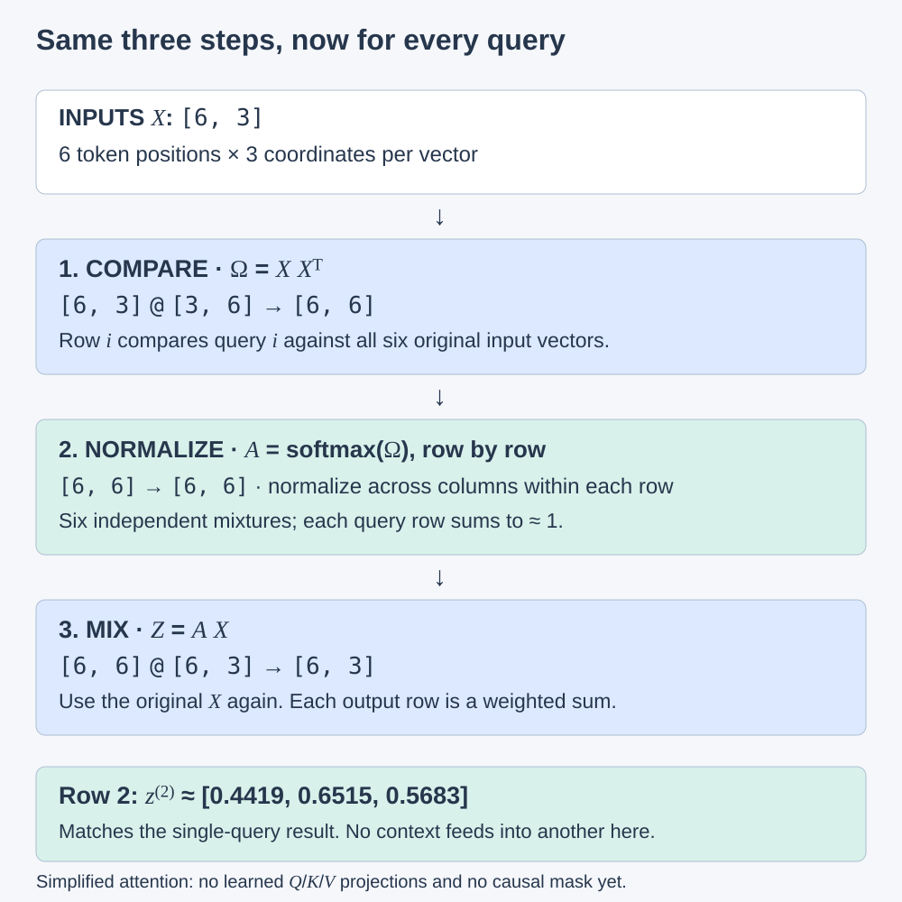](../assets/chapter-03/all-position-flow.svg)

<figcaption markdown="span">Original companion illustration inspired by Figure 3.12, with explicit shapes and the second query highlighted. The same original input matrix supplies both comparisons and information to mix. This is the simplified attention calculation: no learned Q/K/V projections or causal mask have been introduced.</figcaption>
</figure>

All six contexts are now available, but the core operation is unchanged: **compare → normalize → mix**. Section 3.4 introduces learned transformations for the vectors performing these jobs.

## 3.4 Implementing self-attention with trainable weights

The next mechanism is **scaled dot-product attention**, the attention calculation introduced in the original Transformer. We now add trainable projections to the calculation we have been studying; this section develops the single-head building block before causal masking and multiple heads.

Figure 3.13 in the book revisits the roadmap: we are still at **step 2, Attention mechanism, within Stage 1**. Within this chapter, we move from simplified self-attention to self-attention with trainable weights. The complete model architecture and training loop are separate steps.

<figure markdown="1">

[](../assets/chapter-03/attention-progression.svg)

<figcaption markdown="span">Our chapter progression figure, reused to mark the transition highlighted in Figure 3.13 of [Raschka's book](https://sebastianraschka.com/llms-from-scratch/). The focus is now the second card: introducing learned query, key, and value projections. See the [overall book roadmap](#where-we-are-in-the-books-roadmap) for the larger architecture and training stages.</figcaption>
</figure>

The goal stays familiar: **produce a context vector for each query position by combining information from available input positions**. The important change is that the model can learn how to prepare that information. Stored matrices W<sub>Q</sub>, W<sub>K</sub>, and W<sub>V</sub> transform inputs into query, key, and value vectors. The weighted sum will combine the **value vectors**, which are transformed inputs, rather than the original input vectors directly.

These matrices are model parameters updated during training. They are different from the **attention weights** calculated from the current queries and keys on each forward pass. Training learns the transformations; each forward pass uses them to calculate input-dependent scores and mixtures.

The word **scaled** refers to dividing query–key dot-product scores by the square root of the key-vector width before softmax. We will work through that calculation and its reason in 3.4.1. Scaling and softmax are separate operations; scaling alone does not make the scores sum to one.

#### From individual calculations to a reusable component

The section has two parts: first implement the calculations step by step, then collect them into a compact Python class that the LLM architecture can use. This matches the approach in our [character-log experiment](../preparation/training-comparison.md).

In [`experiments/character-logs/model.py`](https://github.com/kantarcise/learning-llms/blob/main/experiments/character-logs/model.py), the composition is:

```text
TinyTransformer
    └── TransformerBlock
            ├── Normalization and residual connections
            ├── CausalAttention
            └── Feedforward network
```

`TinyTransformer` creates a `TransformerBlock`; that block creates a `CausalAttention` instance and calls it on normalized input vectors. [`experiments/character-logs/train.py`](https://github.com/kantarcise/learning-llms/blob/main/experiments/character-logs/train.py) creates the complete `TinyTransformer` and runs training through it. The attention class owns its learned projections and implements its forward calculation; the training script handles the loss, backpropagation, and optimizer steps.

Our existing `CausalAttention` already includes future-position masking and an output projection. The book's section 3.4 class is an earlier component in that progression, so we should not expect it to match our implementation line for line. Packaging a calculation in a class makes it reusable; it does not change the mathematics.

## 3.5 Hiding future words with causal attention

Notes to come as we read this section.

## 3.6 Extending single-head attention to multi-head attention

Notes to come as we read this section.

## Questions to bring to the chapter

- How do multiple heads differ from multiple transformer blocks in the code? Revisit this in section 3.6, after the single-head calculation is clear.

## End of chapter

<!-- Summarize what became clear, link exercises, and record unresolved questions. -->
