# Chapter 4 — Implementing a GPT Model from Scratch to Generate Text

[Chapter 2](02-working-with-text-data.md) prepared text as token IDs and embedding vectors. [Chapter 3](03-coding-attention-mechanisms.md) built masked multi-head attention. Now we assemble these pieces into a **GPT-like language model**: a model that produces scores for the next token at every input position.

These notes follow Sebastian Raschka's [Build a Large Language Model (From Scratch)](https://sebastianraschka.com/llms-from-scratch/) and the [author's Chapter 4 implementation](https://github.com/rasbt/LLMs-from-scratch/tree/main/ch04). The chapter develops normalization, feedforward networks, shortcut connections, and transformer blocks, then puts them together and examines parameter counts, storage requirements, and text generation. Unwritten sections below remain placeholders.

### Where we are in the book's roadmap

We are at **step 3, “LLM architecture,” within Stage 1**. We already built the attention component; this chapter builds the model around it. Chapter 5 adds the training loop and pretraining.

<figure markdown="1">

[](https://sebastianraschka.com/images/LLMs-from-scratch-images/mental-model.jpg)

<figcaption markdown="span">Sebastian Raschka's [book roadmap](https://sebastianraschka.com/llms-from-scratch/), embedded from his website. As in Figure 4.1, our focus is step 3 of Stage 1: assembling the architecture. Open the image for a full-size view.</figcaption>
</figure>

## 4.1 Coding an LLM architecture

**GPT** stands for **Generative Pre-trained Transformer**. During generation, it takes the available token sequence, computes scores for possible next tokens, and uses a selection rule to choose one. We append that token and repeat. The model's `forward` calculation produces scores; the surrounding generation code handles selection and repetition.

### From an attention module to a whole model

The architecture is easier to follow when we separate its nested parts:

- **The GPT model** contains embedding layers, a stack of transformer blocks, final normalization, and a vocabulary output projection.
- **Each transformer block** contains masked multi-head attention and a feedforward network, with normalization and residual (shortcut) connections around these computations.
- **Multi-head attention** is the component we implemented in Chapter 3. It is inside a transformer block, not the entire block.

<figure markdown="1">

[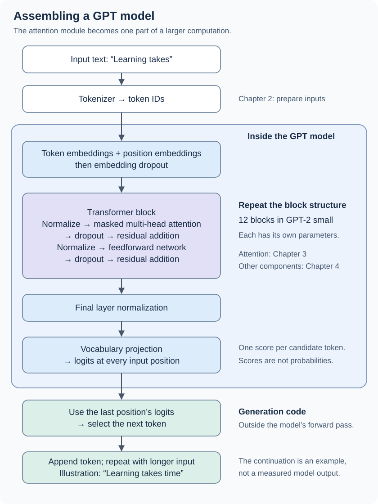](../assets/chapter-04/gpt-architecture-overview.svg)

<figcaption markdown="span">Original companion illustration of the architecture introduced in the book's Figure 4.2, with our own layout and an explicit separation between the model and generation code. This is an overview; the following sections implement the internals. Example text is illustrative, not output from a trained model. Open the image for a full-size view.</figcaption>
</figure>

Many parts repeat, which makes a large model's structure manageable. **Repeated structure does not mean shared weights:** successive transformer blocks normally have separate learned parameters. Each block receives the updated vectors from the previous block.

This is the same overall organization we explored in [Character Logs](../preparation/training-comparison.md#model-architecture-drawn-from-the-code) and [Cosmopedia](../preparation/cosmopedia.md). Character Logs has one transformer block with one attention head; Cosmopedia has four transformer blocks with four heads per block. The book now walks through the building blocks systematically, using GPT-2 as its reference architecture.

### Scaling up the example: GPT-2 small

Earlier calculations used short vectors so that we could follow every number. The book now targets the smallest GPT-2 variant, commonly called **GPT-2 small / 124M**. Its vector width is **768**, and it has **12 transformer blocks**, each with **12 attention heads**. These are different architectural choices: 12 heads are inside each of the 12 blocks.

The GPT-2 tokenizer vocabulary contains **50,257 tokens**, not necessarily whole words. The token embedding table therefore has 50,257 rows and 768 coordinates per row. **Vocabulary size tells us how many rows; width tells us how many coordinates per row.**

!!! note "GPT-2 parameter-count names"

    The original GPT-2 report used counts such as 117M and 345M; OpenAI later [acknowledged a counting error](https://github.com/openai/gpt-2#readme). The [released checkpoints](https://github.com/openai/gpt-2/blob/master/DEVELOPERS.md) are named **124M, 355M, 774M, and 1558M**. Older counts such as 345M, 762M, and 1542M can still appear in explanations. We will use the released checkpoint names when discussing weight loading.

    “124M” names the reference model, not a guarantee that every teaching implementation has exactly that count. Bias choices and whether input embeddings and the output projection share parameters affect the total; we will count our implementation once it is assembled.

### What exactly counts as a parameter?

This is the same idea as in a convolutional neural network: **parameters are the stored, trainable numbers** that the optimizer updates. Embedding-table entries, attention projection weights, feedforward weights and biases, and normalization's learned scale and shift are all examples.

A weight matrix with 2,048 rows and 2,048 columns contains:

```text
2,048 × 2,048 = 4,194,304 learned numbers
```

That counts the **matrix alone**. A linear layer with an additional bias of length 2,048 would have 4,196,352 parameters in total. The input vectors, computed queries/keys/values, attention weights, and output logits are activations calculated using those parameters; they do not each add new trainable parameters.

!!! tip "Why learn with GPT-2 rather than GPT-3?"

    GPT-2 has [publicly released pretrained weights and reference code](https://github.com/openai/gpt-2), so we can build the architecture and later load real learned parameters. Its smallest variant is also much more manageable for local experiments than the largest GPT-3 model (175 billion parameters).

    Both use the decoder-only transformer approach, so the building blocks we learn transfer. That does not make every architectural detail identical, or make training a GPT-2 model to its original quality a quick laptop task. Implementing the model, running inference, and fully pretraining it have very different compute requirements.

For the later weight-loading step, follow [Section 5.5](05-pretraining-on-unlabeled-data.md#55-loading-pretrained-weights-from-openai) and the [author's Chapter 5 code](https://github.com/rasbt/LLMs-from-scratch/tree/main/ch05). The introductory passage in this PDF points to Chapter 6, but the companion's section map places weight loading in 5.5; Chapter 6 covers classification fine-tuning.

### The configuration: seven choices, seven different meanings

The book collects the model settings in one dictionary. These are **hyperparameters we choose**, not learned weight values. The following examples adapt Listing 4.1 and the surrounding examples from the [author's Chapter 4 notebook](https://github.com/rasbt/LLMs-from-scratch/blob/main/ch04/01_main-chapter-code/ch04.ipynb), adding type hints, comments, and explicit shapes.

```python title="Configuration for the GPT-2-small teaching architecture"
from typing import TypedDict


class GPTConfig(TypedDict):
    vocab_size: int
    context_length: int
    emb_dim: int
    n_heads: int
    n_layers: int
    drop_rate: float
    qkv_bias: bool


GPT_CONFIG_124M: GPTConfig = {
    "vocab_size": 50_257,
    "context_length": 1_024,
    "emb_dim": 768,
    "n_heads": 12,
    "n_layers": 12,
    "drop_rate": 0.1,
    "qkv_bias": False,
}
```

`TypedDict` describes the expected keys and value types for readers and type checkers. The actual object is still an ordinary Python dictionary; this annotation does not validate it at runtime.

| Setting | Meaning in this model | Concrete consequence |
| --- | --- | --- |
| `vocab_size = 50_257` | Number of token IDs in the GPT-2 vocabulary | Token IDs range from 0 to 50,256. The embedding table has 50,257 rows; the output has 50,257 scores per position. |
| `context_length = 1_024` | Maximum number of positions the model supports | The learned position table has 1,024 rows. A four-token input uses only rows 0–3. This is not the batch size or vector width. |
| `emb_dim = 768` | Coordinates in each token representation | Both embedding tables have 768 columns. Transformer blocks preserve this width. |
| `n_heads = 12` | Attention heads **inside each** transformer block | The real attention module splits width 768 into 12 heads of width 64 each. The placeholder does not perform this operation yet. |
| `n_layers = 12` | Number of successive transformer blocks | The model sends its vectors through 12 blocks in sequence. This does not mean 12 attention heads total. |
| `drop_rate = 0.1` | Dropout probability during training | Each affected element has a 10% chance of being zeroed; survivors are scaled by `1 / 0.9`. This is not a guarantee that exactly 10% vanish in each call. `model.eval()` disables dropout. |
| `qkv_bias = False` | Whether the query, key, and value projections have additive bias vectors | We still learn all three weight matrices. This setting does not disable biases throughout the model. It will matter when we implement the real blocks and later load pretrained weights. |

The name `GPT_CONFIG_124M` describes the architecture we are working toward. **The dummy model is not yet the complete 124M-parameter model:** its placeholder blocks have no attention or feedforward parameters.

### First build the outline, then fill in its components

<figure markdown="1">

[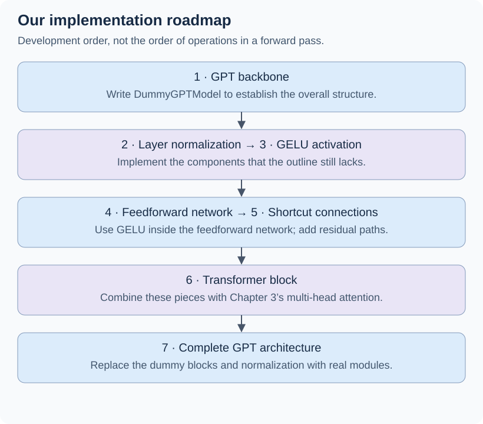](../assets/chapter-04/implementation-order.svg)

<figcaption markdown="span">Original companion illustration of the development order in Figure 4.3. These numbers describe the order we implement components, not the order that tensors pass through layers. GELU will be inside the feedforward network; shortcuts will wrap sublayers.</figcaption>
</figure>

`DummyGPTModel` **inherits from** `nn.Module`. This gives PyTorch a way to register its child modules and parameters, move them between devices, and propagate training/evaluation mode. It is an ordinary subclass, not an abstract class. Calling `model(batch)` uses PyTorch's module machinery to invoke `forward(batch)`.

We define the placeholder classes first so this code can be read and run from top to bottom. For all three classes below:

- `B` = batch size: how many examples.
- `T` = sequence length: how many token positions per example.
- `D` = embedding width: how many coordinates per token vector.
- `V` = vocabulary size: how many candidate next tokens.

```python title="Placeholder components and DummyGPTModel — adapted from Listing 4.1"
import torch
from torch import nn


class DummyTransformerBlock(nn.Module):
    """Pass floating-point vectors [B,T,D] through unchanged.

    B = examples, T = token positions, D = vector width.
    No attention, normalization, feedforward network, or shortcuts yet.
    """

    def __init__(self, cfg: GPTConfig) -> None:
        super().__init__()
        # Accept the future block's configuration, but do not use it yet.

    def forward(self, x: torch.Tensor) -> torch.Tensor:
        """Return the same [B,T,D] tensor: examples, positions, coordinates."""
        return x


class DummyLayerNorm(nn.Module):
    """Placeholder for normalization; it does not normalize anything yet."""

    def __init__(self, normalized_shape: int, eps: float = 1e-5) -> None:
        super().__init__()
        # Arguments mirror the interface we will need; neither is used yet.

    def forward(self, x: torch.Tensor) -> torch.Tensor:
        """Return floating-point [B,T,D] unchanged: examples, positions, width."""
        return x


class DummyGPTModel(nn.Module):
    """Assemble the model outline with identity placeholders inside it."""

    def __init__(self, cfg: GPTConfig) -> None:
        super().__init__()
        # Independent learned tables: token identity versus sequence position.
        self.tok_emb = nn.Embedding(cfg["vocab_size"], cfg["emb_dim"])
        self.pos_emb = nn.Embedding(cfg["context_length"], cfg["emb_dim"])
        self.drop_emb = nn.Dropout(cfg["drop_rate"])

        # Construct 12 distinct block objects; Sequential calls them in order.
        # The * unpacks the list into individual constructor arguments.
        self.trf_blocks = nn.Sequential(
            *[DummyTransformerBlock(cfg) for _ in range(cfg["n_layers"])]
        )
        self.final_norm = DummyLayerNorm(cfg["emb_dim"])

        # At every position, map D coordinates to V vocabulary scores.
        # This output "head" is not an attention head.
        self.out_head = nn.Linear(cfg["emb_dim"], cfg["vocab_size"], bias=False)

    def forward(self, in_idx: torch.Tensor) -> torch.Tensor:
        """Map torch.long token IDs [B,T] to floating-point logits [B,T,V].

        B = examples, T = positions, V = vocabulary size, D = vector width.
        IDs must be in [0,V); 1 <= T <= the configured context length.
        Inputs and model must be on the same device. These are caller
        requirements, not checks performed by the type annotations.
        This computes activations; it does not update learned parameters.
        """
        _batch_size, seq_len = in_idx.shape
        # Each ID retrieves a row: [B,T] -> [B,T,D].
        tok_embeds = self.tok_emb(in_idx)

        # arange makes integer positions [0, ..., T-1], not embeddings.
        positions = torch.arange(seq_len, device=in_idx.device)
        pos_embeds = self.pos_emb(positions)  # [T] -> [T,D]

        # Broadcast the same position rows across B examples; add, not concat.
        x = tok_embeds + pos_embeds  # [B,T,D]
        x = self.drop_emb(x)  # Random dropout in train mode; identity in eval.
        x = self.trf_blocks(x)  # Currently unchanged by all dummy blocks.
        x = self.final_norm(x)  # Currently unchanged: no normalization yet.
        logits = self.out_head(x)  # [B,T,D] -> [B,T,V]
        return logits
```

`nn.Sequential` does not itself invent attention or a feedforward network. It just calls its contained modules in order. Since every dummy block returns `x`, even twelve of them leave `x` unchanged. The embedding tables and output projection are real trainable layers; the dropout layer is real too.

!!! warning "Runnable does not mean a working GPT yet"

    This outline can return correctly shaped logits, but it has **no cross-token attention**. Each position's scores depend on its own token and position embeddings (and training-mode dropout), not the preceding tokens. The dummy normalization also leaves values untouched. We are checking the wiring before replacing these placeholders with real computations.

### A batch of two texts: watch the shapes

Use the same two short inputs as the book so the token IDs are easy to compare. Run these snippets in order, in an environment with the repository's `experiments` and `book` dependency groups (PyTorch and tiktoken).

```python
import tiktoken

# Tokenization happens outside the model; embedding lookup happens inside it.
tokenizer = tiktoken.get_encoding("gpt2")
texts = ["Every effort moves you", "Every day holds a"]
encoded = [torch.tensor(tokenizer.encode(text), dtype=torch.long) for text in texts]
batch = torch.stack(encoded, dim=0)
print(batch)
print(batch.shape)
```

```text
tensor([[6109, 3626, 6100,  345],
        [6109, 1110, 6622,  257]])
torch.Size([2, 4])
```

Each text happens to encode to four tokens. `torch.stack` adds a batch axis and requires equal-sized tensors; it does not pad unequal sequences automatically. Both rows begin with ID 6109, so they retrieve the same initial token vector at position zero.

<figure markdown="1">

[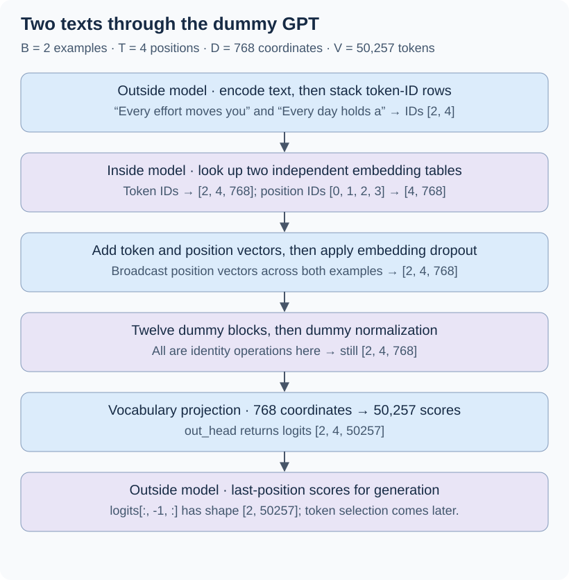](../assets/chapter-04/dummy-gpt-data-flow.svg)

<figcaption markdown="span">Original companion figure expanding the input/output overview in Figure 4.4. Here we explicitly distinguish 768-coordinate hidden representations from 50,257-coordinate vocabulary logits and show the actual dummy behavior. Batch examples remain separate.</figcaption>
</figure>

There is an important distinction in Figure 4.4's terminology: the hidden vectors flowing through the transformer retain width **768**, but the complete `DummyGPTModel.forward` returns **50,257 scores per position**, after `out_head`. Those scores are logits, not 768-coordinate context vectors, token IDs, or probabilities.

```python
# Fix initialization randomness, then create the model described above.
torch.manual_seed(123)
model = DummyGPTModel(GPT_CONFIG_124M)
logits = model(batch)
print("Output shape:", logits.shape)
```

```text
Output shape: torch.Size([2, 4, 50257])
```

For example, `logits[0, 3]` contains 50,257 scores at the fourth position of the first input. In the completed causal GPT, those scores will predict what comes **after** `"Every effort moves you"`, using that whole available prefix. Our dummy model cannot yet use the whole prefix because its attention is missing.

The model does not automatically return the word `"forward"` shown in the book's illustration. That is an intended continuation, not evidence that these randomly initialized placeholders can generate meaningful text. We will add the real components before training or loading pretrained weights.

## 4.2 Normalizing activations with layer normalization

The difficulty of training deep networks is familiar from CNNs: gradients can become very small or very large as they propagate through many layers, making useful parameter updates harder. The forward-pass values also need care. **Activations** are the values computed as data passes through the network; they are distinct from the learned parameters used to compute them.

Layer normalization helps control the scale of those activations. It often makes optimization more stable and can help training converge. It is one part of the design, alongside choices such as residual connections, initialization, and the optimizer; it does not guarantee stable training or solve every gradient problem by itself.

### What does “mean zero, variance one” mean?

Take one token's vector. Normalization calculates statistics **across the coordinates of that vector**, subtracts their mean, and divides by their standard deviation (with a small numerical-stability adjustment in the implementation).

- **Mean zero:** the coordinates are centered around zero; this does not mean each coordinate becomes zero.
- **Variance one**, or **unit variance:** their spread has a standardized scale; this does not mean every coordinate becomes one.
- **Same shape:** a vector with 768 coordinates still has 768 coordinates afterward.

<figure markdown="1">

[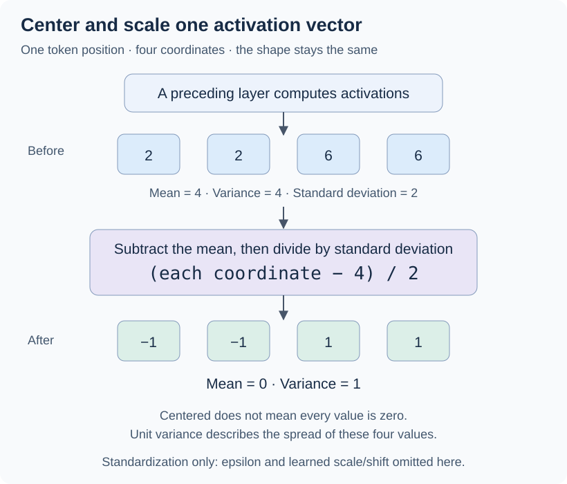](../assets/chapter-04/layer-normalization-intuition.svg)

<figcaption markdown="span">Original companion illustration of the normalization idea in Figure 4.5, using our own four-coordinate example. Variance here divides by the number of coordinates. The drawing isolates standardization before learned scale and shift, and omits the small epsilon term for clean arithmetic. These are illustrative values, not recorded model activations.</figcaption>
</figure>

Our example starts with `[2, 2, 6, 6]`. Its mean is 4. Subtracting 4 gives `[-2, -2, 2, 2]`; the original vector's standard deviation is 2, so dividing by 2 gives `[-1, -1, 1, 1]`. The values still differ, but their center and spread have changed. We have transformed the representation, not erased it.

For a GPT tensor shaped `[B, T, D]`, **B is the number of examples, T is the number of token positions, and D is vector width**. Layer normalization in this model works along the last axis, D. Each example's token position gets its own mean and variance. It does not pool statistics across tokens or across the batch, as one might initially imagine from familiarity with batch normalization in CNNs.

!!! note "Standardization is the first part of LayerNorm"

    The full layer also applies a learned scale and shift for each coordinate, which we will implement as we continue Section 4.2. Consequently, its final output does not have to retain mean zero and variance one. The small epsilon term used for numerical stability also makes the standardized variance approximately one rather than exactly one; a constant vector is a special case with zero variance.

    The mean and variance are calculated from the current input vector. The scale and shift are stored model parameters learned during training. These are different kinds of numbers.

### Where it sits in our GPT architecture

“Before and after attention” is a useful first orientation, but the residual additions matter. The GPT-2-style block we are building follows this sequence:

```text
Block input
    │
    ├── save as the first residual shortcut
    ↓
LayerNorm → masked multi-head attention → dropout
    ↓
Add the first shortcut
    │
    ├── save as the second residual shortcut
    ↓
LayerNorm → feedforward network → dropout
    ↓
Add the second shortcut → block output
```

The second LayerNorm acts on the result **after the first residual addition** and prepares it for the feedforward network. These are two separate LayerNorm instances with their own learned scale and shift parameters. After the whole stack of transformer blocks, one more LayerNorm sits before the vocabulary output projection—the position currently occupied by `DummyLayerNorm` in our outline.

This specifies the architecture we are implementing. Other transformer designs can change the normalization type or its placement. For now, the next step is to calculate the statistics on a small example and turn the identity placeholder into a real operation.

### Inspecting a layer's outputs before normalization

The book now uses a small standalone network to make the statistics visible. This is a demonstration, not a change to GPT's embedding width. We have **two examples with five input features each**, and a linear layer produces **six output features per example**. ReLU then replaces negative values with zero; its outputs are **nonnegative**, including zero.

```python
import torch
from torch import nn

torch.manual_seed(123)
batch_example = torch.randn(2, 5)  # [examples, input features]
layer = nn.Sequential(nn.Linear(5, 6), nn.ReLU())
out = layer(batch_example)  # [2,5] -> [2,6] -> [2,6]
print(out)
```

```text
tensor([[0.2260, 0.3470, 0.0000, 0.2216, 0.0000, 0.0000],
        [0.2133, 0.2394, 0.0000, 0.5198, 0.3297, 0.0000]],
       grad_fn=<ReluBackward0>)
```

These are the outputs from running the book's example locally. Each row belongs to one example. `nn.Linear(5, 6)` has learned weights and, by default, a bias; ReLU has no learned parameters. Nothing has been trained here: the layer starts with random parameters, and the seed makes this run reproducible in the same environment. The printed `grad_fn` indicates that PyTorch tracked the operation for backpropagation; it does not mean a backward pass already occurred.

We now calculate statistics from **`out`, the six output activations in each row**, rather than from the five original input features:

```python
mean = out.mean(dim=-1, keepdim=True)
var = out.var(dim=-1, keepdim=True)
print("Mean:\n", mean)
print("Variance:\n", var)
```

```text
Mean:
 tensor([[0.1324],
        [0.2170]], grad_fn=<MeanBackward1>)
Variance:
 tensor([[0.0231],
        [0.0398]], grad_fn=<VarBackward0>)
```

The first mean and variance describe the first row; the second pair describes the second row. Calculating these statistics does not yet normalize or change `out`.

!!! note "Why these variances differ from our earlier example"

    This snippet follows the book and uses `torch.var`'s default correction: with six values, it divides the sum of squared deviations by five. Our earlier illustration divided by the number of coordinates. The final LayerNorm implementation will also divide by the number of coordinates, using `unbiased=False` (equivalently, `correction=0`). With that setting, these rows have variances approximately 0.0192 and 0.0332. Keep the convention consistent when comparing results; the book discusses the choice later in this section.

### `dim` chooses which axis to reduce

For this two-dimensional tensor, axis 0 indexes examples (rows), and axis 1 indexes features (columns). **A reduction collapses the chosen axis** by combining its values:

| Operation on `out`, shape `[2,6]` | Which values are combined? | Result with `keepdim=True` |
| --- | --- | --- |
| `out.mean(dim=1, keepdim=True)` | The six features within each row | `[2,1]`: one mean per example |
| `out.mean(dim=-1, keepdim=True)` | The last axis, also the six features here | `[2,1]`: the same result |
| `out.mean(dim=0, keepdim=True)` | The two examples within each column | `[1,6]`: one mean per feature across examples |

<figure markdown="1">

[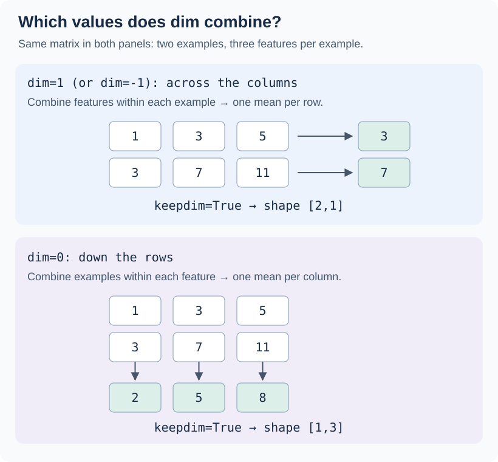](../assets/chapter-04/mean-reduction-axes.svg)

<figcaption markdown="span">Original companion illustration of the axis distinction in Figure 4.6, using our own small integer matrix. Both panels start with the same values. Results retain the reduced axis with `keepdim=True`; arrows show which values are averaged.</figcaption>
</figure>

For GPT's `[B,T,D]` tensors, the last axis is axis 2: **B = batch examples, T = token positions, D = vector width**. `dim=-1` continues to mean “across each token vector's coordinates,” whereas `dim=1` would now combine token positions. This is why the negative index is useful beyond this two-dimensional demonstration.

### `keepdim=True` keeps the shape convenient for subtraction

PyTorch spells the argument **`keepdim`**, singular. It retains the reduced axis with length one; it does not preserve its original length or prevent the reduction.

```text
Original out:          shape [2,6]

keepdim=False:         shape [2]       [0.1324, 0.2170]
keepdim=True:          shape [2,1]     [[0.1324],
                                      [0.2170]]
```

Both results contain the same two means. A tensor of shape `[2]` is **one-dimensional with two elements**; a tensor of shape `[2,1]` is **two-dimensional with two rows and one column**. “Two numbers” and “two axes” are different ideas.

The practical benefit appears when we subtract: `[2,6] - [2,1]` broadcasts each row's mean across that row's six features. `[2,6] - [2]` fails because broadcasting aligns dimensions from the right, and lengths six and two do not match. Keeping the axis lets the forthcoming normalization formula express exactly which mean belongs to which example.

### Applying the normalization and checking the result

Continue with `out`, `mean`, and `var` from the preceding example. The square root of variance is standard deviation:

```python
out_norm = (out - mean) / torch.sqrt(var)
print(out_norm)
print(out_norm.mean(dim=-1, keepdim=True))
print(out_norm.var(dim=-1, keepdim=True))
```

```text
tensor([[ 0.6159,  1.4126, -0.8719,  0.5872, -0.8719, -0.8719],
        [-0.0189,  0.1121, -1.0876,  1.5173,  0.5647, -1.0876]],
       grad_fn=<DivBackward0>)
tensor([[-5.9605e-08],
        [ 1.9868e-08]], grad_fn=<MeanBackward1>)
tensor([[1.0000],
        [1.0000]], grad_fn=<VarBackward0>)
```

These outputs were verified locally. Negative values are expected: a coordinate below its row's mean becomes negative when we subtract that mean, even though ReLU's original outputs were nonnegative. The variance check uses the same default correction as the variance used in the denominator.

`-5.9605e-08` means approximately **-0.000000059605**. Floating-point arithmetic has finite precision, so calculations that give exactly zero on paper can leave a tiny remainder. This is why a numerical check normally allows a small tolerance instead of requiring exact equality with zero.

PyTorch also lets us change how tensors are displayed:

```python
# Formatting only: the stored tensor values do not change.
torch.set_printoptions(precision=4, sci_mode=False)
print(out_norm.mean(dim=-1, keepdim=True))
```

```text
tensor([[-0.0000],
        [ 0.0000]], grad_fn=<MeanBackward1>)
```

The displayed `-0.0000` is the same tiny negative value rounded for printing. Turning scientific notation off does not improve numerical accuracy or make the stored mean exactly zero. The print setting also affects subsequent tensor displays in this Python session; `torch.set_printoptions(profile="default")` restores the defaults.

### Replacing the placeholder with a real `LayerNorm`

This class adapts the book's Listing 4.2 with type hints and comments. It uses **population variance**, dividing by the number of coordinates, as discussed above. That differs from the introductory calculation's default sample correction.

```python title="LayerNorm — standardization followed by learned scale and shift"
class LayerNorm(nn.Module):
    """Normalize each vector's last axis, then apply learned scale and shift.

    For floating-point input [B,T,D], B = examples, T = token positions,
    and D = embedding width. Also accepts [B,D]. The output shape is
    unchanged, and the last axis must have length emb_dim.
    """

    def __init__(self, emb_dim: int) -> None:
        super().__init__()
        self.eps = 1e-5  # Fixed stability constant, not a learned parameter.
        # One learned scale and one learned shift per coordinate.
        self.scale = nn.Parameter(torch.ones(emb_dim))
        self.shift = nn.Parameter(torch.zeros(emb_dim))

    def forward(self, x: torch.Tensor) -> torch.Tensor:
        """Map [B,T,D] to [B,T,D], or [B,D] to [B,D], without mixing rows.

        B = examples, T = positions, D = coordinates. Statistics are
        recalculated from x; scale and shift are stored learned parameters.
        """
        mean = x.mean(dim=-1, keepdim=True)
        var = x.var(dim=-1, keepdim=True, unbiased=False)
        # Epsilon goes inside the square root, added to the variance.
        norm_x = (x - mean) / torch.sqrt(var + self.eps)
        # [D] broadcasts across every example and token position.
        return self.scale * norm_x + self.shift
```

Epsilon prevents division by zero for a constant vector and limits amplification when variance is very small. With epsilon included, standardized variance is generally slightly below one; a constant vector standardizes to zeros.

### Why learn scale and shift after normalizing?

Normalization gives the next computation a controlled starting scale. The learned transformation lets training adjust **how each coordinate should be presented to the next layer**. We preserve a predictable normalization rule while allowing a useful coordinate-wise adjustment.

For a width of four, imagine this example **after standardization**:

```text
Standardized vector:   [-1,  -1,   1,   1]
Learned scale:         [ 2,   1, 0.5,   1]
Learned shift:         [ 0,   1,   0,  -1]
                       ------------------
Output:                [-2,   0, 0.5,   0]
```

Each coordinate gets its own multiplication and addition. For example, the second coordinate becomes `1 × (-1) + 1 = 0`. These scale/shift values are illustrative, not a recorded training result. At initialization, our class uses all-one scales and all-zero shifts, so it initially returns the standardized values without this extra adjustment.

| Quantity | Where does it come from? | When does it change? |
| --- | --- | --- |
| Mean and variance | Calculated from the current vector | Every forward pass, according to the input |
| Scale and shift | Stored `nn.Parameter` vectors | Updated by the optimizer during training |
| Epsilon | A chosen small constant | Stays fixed in this implementation |

`nn.Parameter` registers scale and shift as trainable members of the module. When the module belongs to the full GPT model, they are included in `model.parameters()`. Backpropagation computes their gradients from the model's loss, and the optimizer uses those gradients to update them, just as it updates attention weights or embeddings. Calling `forward` alone does not update them, and gradient updates do not guarantee that every individual training step improves the loss.

A LayerNorm with width 768 therefore contributes **768 scales + 768 shifts = 1,536 parameters**. Its mean and variance add no stored trainable parameters. The same scale/shift pair is used at every token position and for every example in that layer; a different LayerNorm instance has its own pair.

!!! tip "The bridge to CNN normalization"

    Many batch-normalization layers used in CNNs also have learned scale and shift. The idea may already have been present in the framework's layer even if we did not implement those parameters ourselves. What differs is which values supply the normalization statistics. Our LayerNorm computes them independently for each token vector and uses the same rule during training and evaluation; it does not maintain running batch statistics.

The learned scale and shift can move the final mean away from zero and the final variance away from one. This is intentional. They also cannot generally undo normalization for every input: they are shared learned values, while each input vector has its own calculated mean and variance.

!!! note "Biased variance: why divide by n?"

    Here **n is the number of coordinates in one vector**, not the batch size. We sum the squared differences from that vector's mean and divide by n. Setting `unbiased=False`, or equivalently `correction=0`, selects that calculation.

    Bessel's correction divides by n − 1 instead. It is useful when estimating an unknown population variance from an independent sample whose mean was also estimated. In LayerNorm, our immediate goal is to rescale the current feature vector, rather than make that statistical estimate. “Biased” is a statistical term here, not a claim that normalization is faulty.

    For `[2, 2, 6, 6]`, the squared deviations sum to 16: dividing by 4 gives variance 4; dividing by 3 gives about 5.3333. With 768 coordinates, the n − 1 result is larger by a factor of 768/767, about 0.13%. The difference shrinks as width grows, but we still match the model's intended computation.

    The original [GPT-2 TensorFlow implementation](https://github.com/openai/gpt-2/blob/master/src/model.py) explicitly averages squared deviations, using the n denominator. [PyTorch LayerNorm](https://docs.pytorch.org/docs/2.15/generated/torch.nn.LayerNorm.html) uses this convention too. Matching it is one requirement for reproducing the computation expected by pretrained weights; matching shapes alone is insufficient. Weight loading is covered in [Section 5.5](05-pretraining-on-unlabeled-data.md#55-loading-pretrained-weights-from-openai).

### Trying the completed LayerNorm module

Apply our class to the same two rows of six activations in `out`. At initialization the scales are ones and the shifts are zeros:

```python
ln = LayerNorm(emb_dim=6)
out_ln = ln(out)  # [2,6] -> [2,6]: two examples, six features each.
mean = out_ln.mean(dim=-1, keepdim=True)
var = out_ln.var(dim=-1, unbiased=False, keepdim=True)
print("Mean:\n", mean)
print("Variance:\n", var)
```

```text
Mean:
 tensor([[-0.0000],
        [-0.0000]], grad_fn=<MeanBackward1>)
Variance:
 tensor([[0.9995],
        [0.9997]], grad_fn=<VarBackward0>)
```

These locally verified outputs use the print options set earlier. Each row's mean is approximately zero, and its variance is approximately one. The values **0.9995 and 0.9997 are expected**: epsilon is added to the variance in the denominator. Before the learned scale/shift changes, the resulting population variance is approximately `var / (var + eps)`, which is slightly less than one for a nonconstant vector. This check uses `unbiased=False`, consistently with the class.

!!! note "Layer normalization versus batch normalization"

    In our GPT, LayerNorm normalizes across the features of **one token at a time**. Changing which other examples are in the batch does not change that token's normalization statistics. Training and evaluation use the same input-based rule.

    In a CNN, BatchNorm typically calculates statistics for each channel across **batch examples and spatial locations** during training. With its default running-statistics setting, evaluation uses accumulated statistics instead. Thus “across the batch” is a useful shorthand, but it omits the spatial axes in the CNN case. See [PyTorch BatchNorm2d](https://docs.pytorch.org/docs/2.15/generated/torch.nn.BatchNorm2d.html).

    Both can have learned scale and shift. The distinction is which values contribute to their statistics and how those statistics are handled during training and evaluation.

### Does that reasoning still hold for today's LLMs?

**Yes, but distributed training is one practical benefit rather than the whole explanation.** The useful property is that the normalization operates independently on each token representation.

- **Changing batches:** normalization does not couple a token to unrelated examples, including when training uses small batches per device or serving processes one request at a time.
- **Autoregressive processing:** token-wise normalization does not aggregate over future positions. Naively applying a batch-normalization operation that pools across the sequence during training could expose future-token information through its statistics. This is a consequence of those axes, not a claim that every possible BatchNorm design must leak information.
- **Distributed training:** no cross-example statistics need to be synchronized for this operation. BatchNorm can also work in distributed systems; [SyncBatchNorm](https://docs.pytorch.org/docs/2.15/generated/torch.nn.SyncBatchNorm.html) explicitly synchronizes statistics across its process group during training. LayerNorm does not remove the need to synchronize model gradients, and splitting a token's feature dimension across devices can still require communication.

!!! tip "Modern example: RMSNorm keeps the per-token idea"

    As checked in November 2026, the [Qwen3 implementation in Transformers](https://github.com/huggingface/transformers/blob/main/src/transformers/models/qwen3/modeling_qwen3.py) uses RMSNorm for its decoder-block normalization. It scales a token vector using its root mean square and a learned scale, without subtracting the mean or adding a learned shift in that implementation. Thus it does **not** enforce zero mean.

    GPT-2's LayerNorm remains the right implementation for this book. The transferable idea is normalization across each token's coordinates; the exact formula can differ between architectures.

### Two building blocks covered; GELU and feedforward come next

<figure markdown="1">

[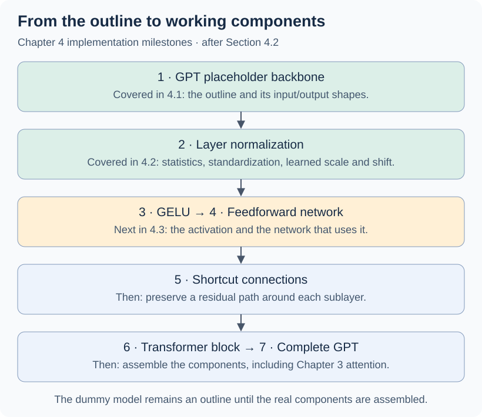](../assets/chapter-04/implementation-progress-layernorm.svg)

<figcaption markdown="span">Original companion progress diagram corresponding to Figure 4.7. “Covered” refers to the chapter's code walkthrough: the earlier dummy model listing remains an outline, and complete model assembly comes later. These are implementation milestones, not forward-pass operations.</figcaption>
</figure>

We now have the model outline and a real normalization component. Section 4.3 develops **GELU and the feedforward network** that will go inside each transformer block.

## 4.3 Implementing a feed forward network with GELU activations

### What the curve changes for one coordinate

The feedforward network uses an activation function between two learned linear layers. From CNNs, we already know ReLU: it keeps positive inputs and sets negative ones to zero. Look at two nearby inputs on the negative side of its curve. Moving from −0.5 to −0.4 leaves the ReLU output at zero. GELU's output moves from about −0.154 to −0.138. **The slope tells us how sensitive the output is to a small change in the input.** Backpropagation multiplies the incoming gradient by that local slope. A single negative input blocks the gradient through that ReLU activation on this pass. GELU usually passes some gradient there, though it can be very small. Smoothness alone does not guarantee better training.

**GELU** stands for *Gaussian Error Linear Unit*. Its exact definition is **GELU(x) = x Φ(x)**. Read Φ(x) as the fraction of a standard normal distribution to the left of x. For x = 1, that fraction is about 0.8413, so GELU(1) is about 0.8413. For x = −1, the fraction is about 0.1587, so GELU(−1) is about −0.1587. The calculation is deterministic. [Original GELU paper](https://arxiv.org/abs/1606.08415)

The book follows GPT-2's tanh approximation to that curve. The constants specify the approximation. Training learns the linear layers on either side of it. This companion version of Listing 4.3 uses a Python scalar for the constant so the calculation also follows the input tensor's device. [GPT-2 reference implementation](https://github.com/openai/gpt-2/blob/master/src/model.py)

```python title="GELU with the GPT-2 tanh approximation"
import math

import torch
from torch import nn


class GELU(nn.Module):
    def forward(self, x: torch.Tensor) -> torch.Tensor:
        """Apply GELU to each floating-point coordinate, preserving all axes."""
        inner = math.sqrt(2 / math.pi) * (x + 0.044715 * x.pow(3))
        return 0.5 * x * (1 + torch.tanh(inner))
```

<figure markdown="1">

[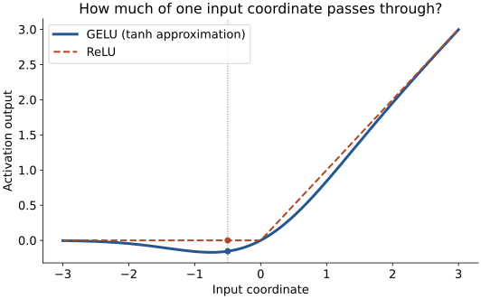](../assets/chapter-04/gelu-vs-relu.svg)

<figcaption markdown="span">Companion plot for Figure 4.8. Both curves use the same axes. The dotted guide marks the same negative input on both functions.</figcaption>
</figure>

To plot the curves yourself with the class above:

```python
import matplotlib.pyplot as plt

x = torch.linspace(-3, 3, 401)
plt.plot(x, GELU()(x), label="GELU")
plt.plot(x, torch.relu(x), "--", label="ReLU")
plt.xlabel("Input coordinate")
plt.ylabel("Activation output")
plt.legend()
plt.show()
```

!!! note "Where SwiGLU differs"

    SwiGLU (Swish-Gated Linear Unit) gives the same token vector to **two learned input projections**. Call their outputs `a` and `b`. It applies Swish to `a`, then multiplies corresponding coordinates: `hidden = (a * sigmoid(a)) * b`. A final linear layer projects that result back to the model width. One branch thus modulates how much of the other branch passes through. In this chapter's GPT-2 network, one input projection followed by GELU supplies the hidden features. [GLU Variants Improve Transformer](https://arxiv.org/abs/2002.05202)

### Follow one token through the feedforward network

Take one token's 768 numbers. The first linear layer learns 3,072 different combinations of them. GELU transforms each of those 3,072 numbers separately. The second linear layer learns how to combine them into 768 output coordinates. The output has the right width for the residual addition we'll meet in Section 4.4. Its values can differ from the input. Without the nonlinear activation, the two linear layers and their biases could be expressed as a single linear layer with a bias.

```python title="FeedForward — companion to Listing 4.4"
class FeedForward(nn.Module):
    def __init__(self, cfg: GPTConfig) -> None:
        super().__init__()
        width = cfg["emb_dim"]
        hidden_width = 4 * width
        self.layers = nn.Sequential(
            nn.Linear(width, hidden_width),
            GELU(),
            nn.Linear(hidden_width, width),
        )

    def forward(self, x: torch.Tensor) -> torch.Tensor:
        """Transform floating-point [B,T,D] to [B,T,D].

        B counts examples, T counts positions, and D is the model width.
        Each position uses the same weights independently.
        """
        return self.layers(x)
```

<figure markdown="1">

[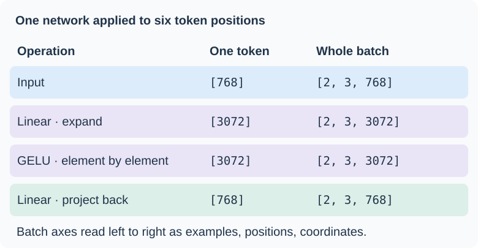](../assets/chapter-04/feedforward-shapes.svg)

<figcaption markdown="span">Original shape trace for Figure 4.9. Read down one column to follow a single token or the whole batch. The linear layers mix features within each token. Attention is where different token positions exchange information.</figcaption>
</figure>

Use the `GPT_CONFIG_124M` dictionary and `GPTConfig` type from Section 4.1. Random vectors stand in for the block's input so we can try the submodule on its own:

```python
ffn = FeedForward(GPT_CONFIG_124M)
x = torch.rand(2, 3, 768)  # Two examples, three positions each.
out = ffn(x)
print(out.shape)
```

```text
torch.Size([2, 3, 768])
```

### What did the wider vector buy us?

Think back to the last character of `job=` in Character Logs. Attention has already given that position information from earlier characters. After the second normalization, the feedforward network receives **32 numbers for that one position**. Each of its 64 hidden units has its own set of 32 weights and a bias, so each can respond to a different combination of those numbers. GELU transforms the 64 responses individually. Each output coordinate then has its own learned way of combining all 64 responses.

That is the sense in which the hidden representation is *richer*: the network has more intermediate features available when constructing its update. Training determines what those features respond to. The final 32 numbers can encode a different representation from the 32 that went in. In this setup, generalization is something we evaluate on held-out examples, as we did with the character logs.

<figure markdown="1">

[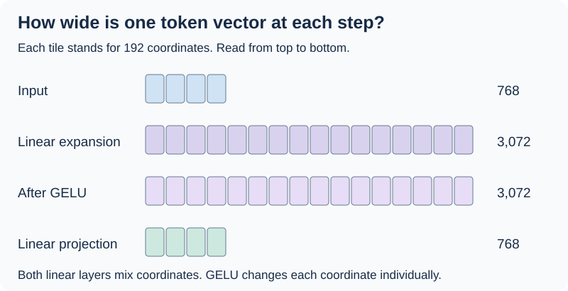](../assets/chapter-04/feedforward-width.svg)

<figcaption markdown="span">Our companion to Figure 4.10. Bar length shows the number of coordinates at one position. Each hidden coordinate can depend on every input coordinate, and each output coordinate can depend on every activated hidden coordinate.</figcaption>
</figure>

| Model and architecture drawing | Input width | Hidden width at GELU | Output width |
| --- | ---: | ---: | ---: |
| [Character Logs](../preparation/training-comparison.md#model-architecture-drawn-from-the-code) | 32 | 64 | 32 |
| [Cosmopedia](../preparation/cosmopedia.md#model-architecture-drawn-from-the-code) | 256 | 1,024 | 256 |
| Book's GPT-2 small | 768 | 3,072 | 768 |

Both experiments use PyTorch's `nn.GELU()` between their linear layers. The book implements the tanh approximation to GELU. You can find the layers in [Character Logs’ model.py](https://github.com/kantarcise/learning-llms/blob/main/experiments/character-logs/model.py) and [Cosmopedia’s model.py](https://github.com/kantarcise/learning-llms/blob/main/experiments/cosmopedia/model.py).

### Finding the shortcut in our experiment drawing

Follow the first block of Character Logs. At the addition on the third line, the shortcut carries **y**, the representation that already includes the attention update:

```text
x      = token embedding + position embedding
y      = x + attention(norm1(x))
z      = y + feedforward(norm2(y))
logits = vocabulary_projection(final_norm(z))
```

For each position, `y` has width 32, so the feedforward update must also have width 32 for this addition. Cosmopedia uses the same two additions at width 256 and passes the result to the next block, applying final normalization and vocabulary projection after the fourth block. Returning to the model width makes both residual addition and stacking straightforward.

<figure markdown="1">

[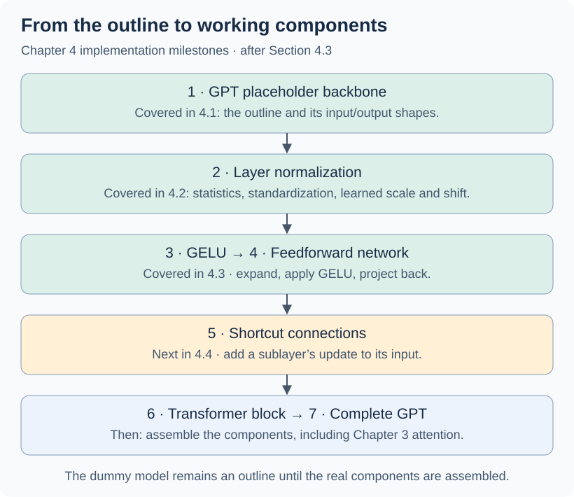](../assets/chapter-04/implementation-progress-feedforward.svg)

<figcaption markdown="span">Our companion to Figure 4.11. Section 4.4 takes up the two additions visible in the experiment drawing before the book assembles the transformer block.</figcaption>
</figure>

## 4.4 Adding shortcut connections

The shortcut here is the **residual connection** familiar from ResNet. Consider a layer whose input and output each have three coordinates. Call its learned transformation `F`. The plain layer returns `F(x)`. With a shortcut, it returns `x + F(x)`: each output coordinate receives its original input value plus a learned update. In the [Character Logs block](../preparation/training-comparison.md#model-architecture-drawn-from-the-code), the same pattern appears twice, once around attention and once around the feedforward network.

### Why an addition helps the backward pass

During backpropagation, the chain rule multiplies the local derivatives along a path. When those products become very small, the loss supplies little gradient to weights early in the network. This is the **vanishing gradient** problem. For a hand calculation, imagine five successive scalar operations each with local slope 0.1. A gradient of 1 at the output becomes 0.00001 at the input along that path.

Now take just one scalar stage, `y = x + F(x)`. If a gradient of 1 arrives at `y`, the addition sends 1 back along each branch. At `x`, their contributions add: the direct path contributes 1 and the learned path contributes the local slope of `F`. If that slope is 0.1, the gradient reaching `x` is 1.1. For vectors the direct path likewise passes the incoming gradient back coordinate by coordinate. The learned branch can reinforce or partly cancel it. This explains how shortcuts help gradients reach earlier layers even when the learned path has small derivatives.

### Five layers with a switch for shortcuts

In this companion version of the [book's Listing 4.5](https://github.com/rasbt/LLMs-from-scratch/blob/main/ch04/01_main-chapter-code/ch04.ipynb), each stage is a linear layer followed by the `GELU` class from Section 4.3. The list `[3, 3, 3, 3, 3, 1]` gives six boundary widths and therefore five stages. PyTorch's `ModuleList` registers the stages and their parameters. Writing the loop ourselves lets us decide where to add each shortcut.

```python title="ExampleDeepNeuralNetwork — five stages with optional residual additions"
class ExampleDeepNeuralNetwork(nn.Module):
    def __init__(self, layer_sizes: list[int], use_shortcut: bool) -> None:
        super().__init__()
        self.use_shortcut = use_shortcut
        self.layers = nn.ModuleList(
            nn.Sequential(nn.Linear(in_width, out_width), GELU())
            for in_width, out_width in zip(layer_sizes, layer_sizes[1:])
        )

    def forward(self, x: torch.Tensor) -> torch.Tensor:
        """Map floating-point [B,3] to [B,1] for the example widths.

        B counts examples. At each stage x holds that stage's input.
        """
        for layer in self.layers:
            update = layer(x)
            if self.use_shortcut and x.shape == update.shape:
                x = x + update
            else:
                x = update
        return x
```

For the first four stages the widths are 3 → 3, so the corresponding coordinates can be added directly. At the fifth stage, 3 → 1, the shape check selects `x = update`. This preserves the intended single output per example. Each shortcut carries the input to **its own stage**.

<figure markdown="1">

[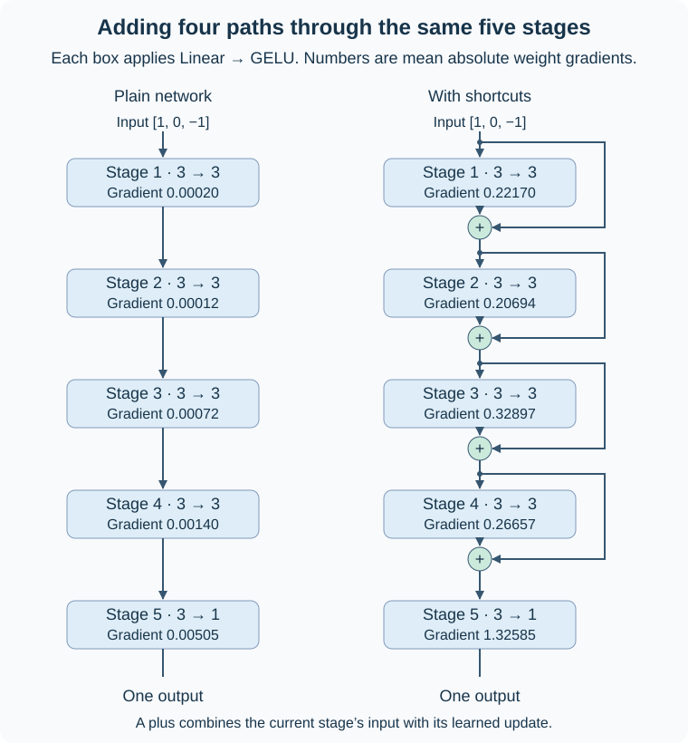](../assets/chapter-04/five-stage-shortcuts.svg)

<figcaption markdown="span">Original companion to Figure 4.12. Arrows follow the forward pass from top to bottom. Each number summarizes the magnitude of the loss gradient for that stage’s linear weights, measured in a single backward pass with the book’s settings.</figcaption>
</figure>

**How to read a gradient label.** Stage 1 has a 3 × 3 weight matrix. Backpropagation produces nine derivatives, one per weight. Taking their absolute values and averaging gives one number for the drawing. Absolute values keep positive and negative derivatives from cancelling in that summary. The direct path described above carries an **activation gradient** back to the stage input. The labels measure **weight gradients**, which also depend on the activations and the loss.

For the comparison we used the same initial weights (seed 123), input `[1, 0, -1]`, and a mean squared error loss against target zero. The shortcut changes the forward output and therefore the loss as well as the backward path. The figure illustrates a single example before an optimizer step. The following function reproduces those measurements.

### Measuring what reaches each layer

For this single example the network returns one prediction, and the chosen target is zero. Mean squared error therefore reduces to `(prediction - 0) ** 2`. Calling `loss.backward()` runs backpropagation from that scalar loss. PyTorch follows the operations recorded during the forward pass and stores each trainable parameter's derivatives in its `.grad` tensor.

```python
def print_gradients(model: nn.Module, x: torch.Tensor) -> None:
    """Print the mean absolute loss gradient for each linear weight matrix.

    x is a floating-point batch [B,3], with B examples and three features.
    The model predicts one scalar per example, giving shape [B,1].
    """
    model.zero_grad(set_to_none=True)  # Make each call a fresh measurement.
    prediction = model(x)
    target = torch.zeros_like(prediction)
    loss = nn.functional.mse_loss(prediction, target)
    loss.backward()

    for name, parameter in model.named_parameters():
        if name.endswith(".weight") and parameter.grad is not None:
            magnitude = parameter.grad.abs().mean().item()
            print(f"{name}: {magnitude:.5f}")


layer_sizes = [3, 3, 3, 3, 3, 1]
sample_input = torch.tensor([[1.0, 0.0, -1.0]])

for use_shortcut in (False, True):
    torch.manual_seed(123)  # Both constructors draw identical initial weights.
    model = ExampleDeepNeuralNetwork(layer_sizes, use_shortcut)
    print(f"use_shortcut={use_shortcut}")
    print_gradients(model, sample_input)
```

Read the table from the output back toward the input, the direction in which the gradient travels. For instance, `layers.0.0.weight` names the linear weight matrix in the first stage.

| Stage | Without shortcuts | With shortcuts |
| --- | ---: | ---: |
| 5 · nearest the output | 0.00505 | 1.32585 |
| 4 | 0.00140 | 0.26657 |
| 3 | 0.00072 | 0.32897 |
| 2 | 0.00012 | 0.20694 |
| 1 · nearest the input | 0.00020 | 0.22170 |

In the plain network the first stage's mean gradient magnitude is about **25 times smaller** than the last stage's. There is a small rise from stage 2 to stage 1. With shortcuts the last stage still has the largest value, and the first four are all between 0.20 and 0.33. This illustrates gradient attenuation for these weights and this input. Measuring how the two networks learn over time would require optimizer steps and repeated measurements. The book points to Appendix A.4 and A.7 for more on gradients and training.

!!! tip "Where we saw this before the book"

    In the Character Logs walkthrough we followed a single entry in the embedding table. After `loss.backward()`, its stored gradient was **−0.016659** and its weight was still **0.501100**. AdamW then used the gradient in `optimizer.step()` to update the weight. Here we pause at that same point after backward and inspect a whole weight matrix. [Character Logs · follow one learned number](../preparation/training-comparison.md#before-training-follow-one-learned-number)

    We also ran the pieces that Section 4.5 will assemble. Look at the middle of either experiment drawing: the first shortcut adds the attention update to the block input. The second adds the GELU feedforward update to that result. Each learned branch starts with its own LayerNorm. Character Logs used one such block and Cosmopedia stacked four. [Character Logs architecture](../preparation/training-comparison.md#model-architecture-drawn-from-the-code) · [Cosmopedia architecture](../preparation/cosmopedia.md#model-architecture-drawn-from-the-code)

## 4.5 Connecting attention and linear layers in a transformer block

GPT-2 small stacks **12 transformer blocks**. Each block has its own parameters, accepts one 768-coordinate vector per input position, and returns one updated vector per position. Inside each block, the 12 attention heads work in parallel. The blocks themselves run in sequence.

### Why does the author contrast attention with the feedforward network?

Take the last token in our toy phrase `money at bank`, treating each word as one token. **Attention lets `bank` gather information from earlier positions. The feedforward network then transforms the resulting `bank` vector on its own.**

To compute the attention update for `bank`, we need the keys and values from all three rows. Now pause after the first residual addition and cover the `money` and `at` rows. We can still compute the feedforward update for `bank`: everything its LayerNorm and feedforward network read is in that one updated row.

<figure markdown="1">

[](../assets/chapter-04/transformer-block.svg)

<figcaption markdown="span">Original companion to Raschka’s Figure 4.13. Follow the left-hand paths to see what each addition carries forward. A batch of two four-token examples enters and leaves with shape <code>[2, 4, 768]</code>. Only the feedforward hidden features temporarily widen to 3,072 in the illustrated feedforward branch.</figcaption>
</figure>

### Assembling the block in PyTorch

This companion to Listing 4.6 uses the real `MultiHeadAttention` from [Section 3.6.2](03-coding-attention-mechanisms.md#362-implementing-multi-head-attention-with-weight-splits), plus the `GPTConfig`, `LayerNorm`, `GELU`, and `FeedForward` definitions above. Run those definitions before this listing. The book calls this arrangement **Pre-LayerNorm** because the learned branch starts by normalizing its input.

```python title="TransformerBlock — two learned updates and two shortcuts"
class TransformerBlock(nn.Module):
    def __init__(self, cfg: GPTConfig) -> None:
        super().__init__()
        width = cfg["emb_dim"]
        self.att = MultiHeadAttention(
            d_in=width,
            d_out=width,  # Joined heads produce a width-matched update.
            context_length=cfg["context_length"],
            num_heads=cfg["n_heads"],
            dropout=cfg["drop_rate"],  # Dropout on attention weights.
            qkv_bias=cfg["qkv_bias"],
        )
        self.ff = FeedForward(cfg)
        # Each LayerNorm learns its own scale and shift.
        self.norm1 = LayerNorm(width)
        self.norm2 = LayerNorm(width)
        self.drop_shortcut = nn.Dropout(cfg["drop_rate"])

    def forward(self, x: torch.Tensor) -> torch.Tensor:
        """Transform floating-point [B,T,D] to [B,T,D].

        B counts examples, T counts token positions, D is the model width.
        """
        # First shortcut carries x around the attention branch.
        attention_update = self.att(self.norm1(x))
        y = x + self.drop_shortcut(attention_update)

        # Second shortcut carries y, including the attention update.
        # The feedforward network acts separately on every normalized row.
        feature_update = self.ff(self.norm2(y))
        return y + self.drop_shortcut(feature_update)
```

Despite the name `drop_shortcut` in the listing, look at the argument on each call: dropout acts on the **computed update**. The identity path carries `x` or `y` straight to the addition. You can trace those same two additions in our [Character Logs block drawing](../preparation/training-comparison.md#model-architecture-drawn-from-the-code).

### Where does LayerNorm sit relative to the shortcut?

Follow one sublayer, with dropout omitted here to make the ordering visible. Let `F` be attention or the feedforward network, and `x` the input to that particular sublayer.

| Design | One sublayer | What gets normalized? |
| --- | --- | --- |
| Pre-LayerNorm (our GPT-2 block) | `x + F(norm(x))` | The input to the learned branch |
| Post-LayerNorm (original Transformer) | `norm(x + F(x))` | The sum of the shortcut and the learned update |

In our block the first addition carries the block input around attention. The second carries the **result of the first addition** around the feedforward network. On the backward pass, each addition gives the gradient a direct path to that sublayer’s input.

Pre-LayerNorm can make optimization easier at initialization. Xiong and colleagues found that Post-LayerNorm can produce large gradients near the output at initialization, making early updates sensitive to the learning rate. Pre-LayerNorm gave better-behaved initial gradients in their analysis. This gives “better” a specific meaning here: ease of starting training. Final model quality also depends on the training setup. [On Layer Normalization in the Transformer Architecture](https://proceedings.mlr.press/v119/xiong20b.html)

### Running one configured block

Use the configuration and classes above. The random input stands in for the vectors supplied by the embedding layer or the preceding block.

```python
torch.manual_seed(123)
x = torch.rand(2, 4, 768)  # Two examples, four positions, 768 features.
block = TransformerBlock(GPT_CONFIG_124M)
output = block(x)
print("Input shape:", x.shape)
print("Output shape:", output.shape)
```

```text
Input shape: torch.Size([2, 4, 768])
Output shape: torch.Size([2, 4, 768])
```

Why keep the same shape? Both residual additions need coordinate-aligned vectors, and the next block expects the same three axes. Internally, the feedforward branch can still expand to 3,072 features per position. Its second linear layer returns those rows to width 768 before the addition.

**One output row per input position** tells us where to find the updated representation. In our example, the output row for `at` can carry information from `money at`. The output row for `bank` can carry information from `money at bank`. Only the last position has access to the entire input in a causal block.

<figure markdown="1">

[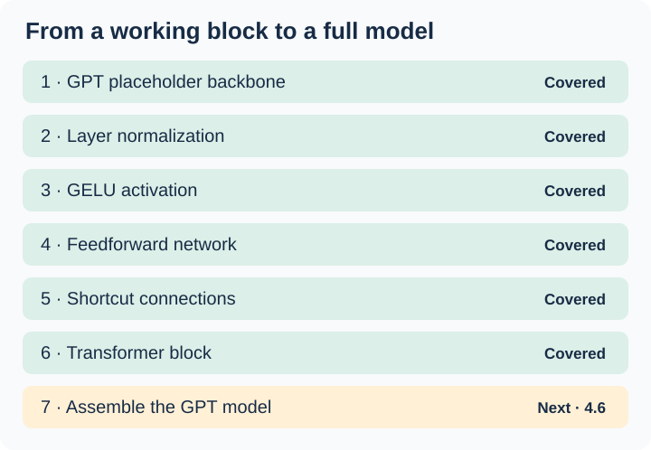](../assets/chapter-04/implementation-progress-block.svg)

<figcaption markdown="span">Original companion to Figure 4.14. The block is ready to use. Section 4.6 puts twelve instances inside GPT-2 small and connects the stack to the embedding and output layers.</figcaption>
</figure>

## 4.6 Coding the GPT model

In Section 4.1, `DummyGPTModel` already accepted token IDs and returned vocabulary scores. Its transformer blocks simply passed their inputs along. We now give each block the implementation from Section 4.5 and put our learned LayerNorm from Section 4.2 after the stack. This is the architecture into which we can later load pretrained parameters. Calling `GPTModel(cfg)` creates a fresh instance. In Python, `__new__` creates the instance and `__init__` initializes it. Raymond Hettinger illustrates this distinction with `Circle.__init__` assigning `self.radius` in [slide 10 of his PyCon 2013 talk](https://speakerdeck.com/pyconslides/pythons-class-development-toolkit-by-raymond-hettinger?slide=10). Here the initializer calls `super().__init__()` to set up PyTorch’s module machinery, then assigns the embedding tables, blocks, final normalization, and output head as child modules. [Python data model](https://docs.python.org/3/reference/datamodel.html#object.__init__)

<figure markdown="1">

[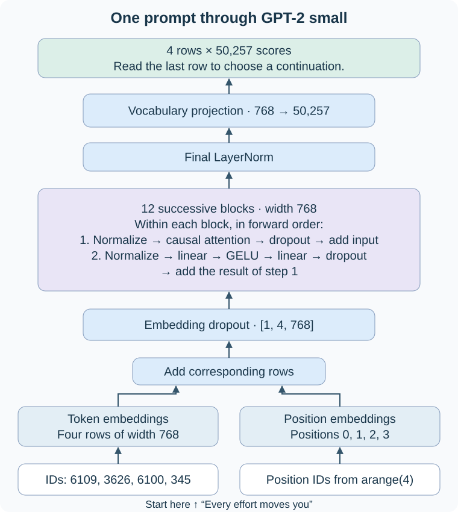](../assets/chapter-04/assembled-gpt.svg)

<figcaption markdown="span">Original companion to Figure 4.15. Follow one prompt from the bottom up. The middle panel opens one of the twelve blocks. Each block receives the previous block’s output and owns its own weights.</figcaption>
</figure>

### Which row predicts “forward”?

Our GPT-2 tokenizer splits `Every effort moves you` into four tokens. Follow the row for ` you`. It starts as a token embedding plus the embedding for position 3. After twelve causal transformer blocks, that row can carry information from all four tokens. Final LayerNorm preserves its width of 768. The linear output layer turns those 768 coordinates into **50,257 logits**, one score for each possible next token in the vocabulary.

The book’s **4 × 50,257** view shows the four rows for one prompt. In PyTorch we keep the batch axis, so this prompt produces shape `[1, 4, 50257]`. The first row predicts what follows `Every`. The fourth row, `logits[0, -1]`, predicts what follows the whole prompt. With greedy selection, the index of the largest score in that row is the next token ID. For sampling, softmax turns the scores into probabilities from which we draw an ID. The tokenizer decodes the resulting IDs into text. The book illustrates the desired continuation with ` forward`, including the leading space. A freshly initialized model still needs training or pretrained weights to produce useful predictions.

### The assembled model

This companion to Listing 4.7 uses `GPTConfig` from Section 4.1 and the real `TransformerBlock` and `LayerNorm` classes defined above. The GPT-2 small configuration sets `n_layers=12`; the largest GPT-2 variant stacks 48 blocks. Within the small model, `n_heads=12` is a separate setting for attention inside each block. [Author’s Chapter 4 implementation](https://github.com/rasbt/LLMs-from-scratch/blob/main/ch04/01_main-chapter-code/ch04.ipynb)

```python title="GPTModel — from token IDs to next-token scores"
class GPTModel(nn.Module):
    def __init__(self, cfg: GPTConfig) -> None:
        super().__init__()
        width = cfg["emb_dim"]
        self.tok_emb = nn.Embedding(cfg["vocab_size"], width)
        self.pos_emb = nn.Embedding(cfg["context_length"], width)
        self.drop_emb = nn.Dropout(cfg["drop_rate"])

        # Each call constructs a separate block with its own parameters.
        self.trf_blocks = nn.Sequential(
            *[TransformerBlock(cfg) for _ in range(cfg["n_layers"])]
        )
        self.final_norm = LayerNorm(width)
        self.out_head = nn.Linear(width, cfg["vocab_size"], bias=False)

    def forward(self, in_idx: torch.Tensor) -> torch.Tensor:
        """Map torch.long IDs [B,T] to floating-point logits [B,T,V].

        B counts examples, T positions per example, V vocabulary entries.
        IDs must be valid vocabulary indices and T must fit the context window.
        """
        positions = torch.arange(in_idx.shape[1], device=in_idx.device)
        # Add the position rows [T,D] to each example's token rows [B,T,D].
        # D is the model width, 768 for GPT-2 small.
        x = self.tok_emb(in_idx) + self.pos_emb(positions)
        x = self.drop_emb(x)

        # Sequential passes each block's [B,T,D] result into the next block.
        x = self.trf_blocks(x)
        x = self.final_norm(x)
        return self.out_head(x)  # One vocabulary score vector per position.
```

On a call to `model(in_idx)`, token IDs select rows from the token table and position indices select rows from the position table. After adding those vectors and applying embedding dropout, `self.trf_blocks(x)` runs the twelve blocks in sequence. Inside each block the attention branch starts with its own LayerNorm. After the twelfth block, `self.final_norm(x)` normalizes each row once more. The bias-free `self.out_head` maps that row to raw vocabulary scores. This is where `forward` ends and generation can use the result.

### Run the assembled model and count its parameters

Reuse the two texts from Section 4.1. Each row of `batch` holds four GPT-2 token IDs. The seed makes the random initialization reproducible in this environment.

```python
torch.manual_seed(123)
model = GPTModel(GPT_CONFIG_124M)
logits = model(batch)
print(batch.shape)   # torch.Size([2, 4])
print(logits.shape)  # torch.Size([2, 4, 50257])
```

For one example, `logits[0]` has shape `[4, 50257]`. Its four rows correspond to the four input positions. Each row contains the scores for the token that follows that position.

`numel()` means *number of elements*. A weight tensor of shape `[3, 2]` contains six scalar parameters. Summing this count over the parameter tensors gives the total. We used the same expression to print **10,848** at the start of our [Character Logs training run](../preparation/training-comparison.md).

```python
total = sum(p.numel() for p in model.parameters())
print(f"{total:,}")                 # 163,009,536
print(model.tok_emb.weight.shape)  # torch.Size([50257, 768])
print(model.out_head.weight.shape) # torch.Size([50257, 768])
```

### Why the 124M configuration gives 163M parameters

Follow row 345, the token for ` you` in our example. At the input, the embedding lookup **reads** that row to get 768 coordinates. At the output, the last hidden vector takes a **dot product** with row 345 of the output matrix to produce the score for choosing ` you` next. It does this for every candidate in the vocabulary.

The chapter model gives these two jobs separate matrices. **Weight tying** gives them the same parameter tensor, so a training update to row 345 affects both jobs. The original GPT-2 uses this arrangement, as does our Cosmopedia model through `F.linear(x, self.token_embedding.weight)`. [Cosmopedia implementation](https://github.com/kantarcise/learning-llms/blob/main/experiments/cosmopedia/model.py)

| Count for this configuration | Parameters |
| --- | ---: |
| Model with separate input and output weights | 163,009,536 |
| One vocabulary matrix (50,257 × 768) | 38,597,376 |
| Model if the two uses share that matrix | 124,412,160 |

Subtracting the matrix size answers a counting question. Actually sharing the weights in this PyTorch class would require assigning `model.out_head.weight = model.tok_emb.weight`. The chapter keeps the separate matrices for its implementation. Sharing reduces weight storage and the number of independent parameters to update. The dense output projection still computes all 50,257 scores. Whether separate weights help prediction quality is an empirical question for a given training setup.

Modern checkpoints make different choices even within one family. Qwen3-0.6B enables embedding tying, while Qwen3-32B disables it. We are tracking the implementation and memory implications in [the weight-tying follow-up](https://github.com/kantarcise/learning-llms/issues/46). [0.6B configuration](https://huggingface.co/Qwen/Qwen3-0.6B/blob/main/config.json) · [32B configuration](https://huggingface.co/Qwen/Qwen3-32B/blob/main/config.json)

### Exercise 4.1 — Feedforward versus multi-head attention

Count **one transformer block** first. For every `nn.Linear`, multiply the input width by the output width for its weights, then add one bias per output coordinate if enabled. Here the model width is 768, the feedforward hidden width is 3,072, and `qkv_bias=False`.

| Module and layer | Weights | Biases | Total |
| --- | ---: | ---: | ---: |
| Feedforward expansion | 768 × 3,072 | 3,072 | 2,362,368 |
| Feedforward contraction | 3,072 × 768 | 768 | 2,360,064 |
| **Feedforward total** | | | **4,722,432** |
| Query, key, and value projections together | 3 × 768 × 768 | 0 | 1,769,472 |
| Attention output projection | 768 × 768 | 768 | 590,592 |
| **Multi-head attention total** | | | **2,360,064** |

Why do twelve heads fit into that count? Each projection produces 768 coordinates in total and splits them into twelve heads of 64 coordinates each. The attention mixing weights are calculated from the current input. GELU also introduces zero trainable parameters.

```python
# Select the first transformer block. Its attention and feedforward modules
# have separate parameters, so we can count one module at a time.
block = model.trf_blocks[0]


def count_parameters(module: nn.Module) -> int:
    """Print each parameter tensor's shape and return the total scalar count."""
    total = 0
    for name, parameter in module.named_parameters():
        # Example: the expansion weight has 3,072 rows and 768 columns.
        elements = parameter.numel()
        print(f"{name}: {tuple(parameter.shape)} -> {elements:,}")
        total += elements
    return total


feedforward_count = count_parameters(block.ff)
attention_count = count_parameters(block.att)
print(f"Feedforward: {feedforward_count:,}")  # 4,722,432 in one block
print(f"Attention:   {attention_count:,}")    # 2,360,064 in one block
```

The feedforward module has **about twice** as many parameters here. Ignoring biases makes the arithmetic especially clear: its two projections each hold four 768 × 768 matrices’ worth of weights, while attention uses four such matrices overall. Across all twelve blocks, the respective totals are **56,669,184** and **28,320,768**. The normalization layers, embeddings and vocabulary head sit outside this two-module comparison.

### How much memory holds the parameters?

Start with the **untied** model from Listing 4.7. A float32 scalar occupies 32 bits, or 4 bytes. Multiply the number of independent scalars by their storage size:

```python
weight_bytes = sum(
    parameter.numel() * parameter.element_size()  # scalar count × bytes per scalar
    for parameter in model.parameters()
)
print(f"{weight_bytes:,} bytes")            # 652,038,144 bytes
print(f"{weight_bytes / (1024 ** 2):.2f} MiB")  # 621.83 MiB
```

The book labels the result MB. Dividing by 1,048,576 gives **MiB**. Using decimal MB gives **652.04 MB** for the same bytes. At two bytes per scalar, float16 or bfloat16 weights occupy **310.92 MiB**. Using each tensor’s actual element size also handles a mixture of floating-point types.

This is the **parameter storage** portion of the budget. Inference additionally uses memory for buffers such as causal masks, temporary activations, and a KV cache in models that implement caching. Training also stores gradients, activations needed by backward, and optimizer state. Batch size, sequence length, precision and runtime allocation affect the peak. For the same shapes and dtype, the raw parameter-byte calculation applies in PyTorch and JAX alike.

!!! note "PyTorch on Google's TPUs"

    A TPU is an accelerator. TorchTPU is the PyTorch-native backend for Google Cloud TPU workloads. It integrates PyTorch operations with the TPU compiler and runtime. That choice can affect supported operations, temporary allocations and performance. [Google Cloud’s PyTorch on TPU guide](https://docs.cloud.google.com/tpu/docs/pytorch-on-tpu)

### Exercise 4.2 — Initialize the larger GPT-2 configurations

The model class already reads its width, depth, and head count from the dictionary. For Medium, change the width to 1,024, create 24 blocks, and give each block 16 heads. Each head receives 1,024 ÷ 16 = 64 coordinates. Large and XL use the same idea. Run this after defining the chapter’s classes and configuration:

```python
# Each row gives (name, coordinates per token, number of blocks, heads per block).
variants = [
    ("Small",   768, 12, 12),
    ("Medium", 1024, 24, 16),
    ("Large",  1280, 36, 20),
    ("XL",     1600, 48, 25),
]

for name, width, blocks, heads in variants:
    # Start with the chapter settings, including the vocabulary and context length.
    cfg = GPT_CONFIG_124M.copy()
    cfg.update(emb_dim=width, n_layers=blocks, n_heads=heads)

    # For this counting exercise PyTorch only needs tensor shapes. The meta
    # device constructs the full module tree without allocating weight storage.
    with torch.device("meta"):
        variant = GPTModel(cfg)

    # Listing 4.7 creates two independent vocabulary matrices. If tied, one
    # matrix serves both roles, so subtract one copy for the comparison.
    independent = sum(parameter.numel() for parameter in variant.parameters())
    shared = independent - variant.out_head.weight.numel()
    print(f"{name:6}  {independent:>14,}  {shared:>14,}")
```

| Variant | Width | Blocks | Heads per block | Listing 4.7 parameters | Parameters if tied |
| --- | ---: | ---: | ---: | ---: | ---: |
| Small | 768 | 12 | 12 | 163,009,536 | 124,412,160 |
| Medium | 1,024 | 24 | 16 | 406,212,608 | 354,749,440 |
| Large | 1,280 | 36 | 20 | 838,220,800 | 773,891,840 |
| XL | 1,600 | 48 | 25 | 1,637,792,000 | 1,557,380,800 |

These are exact counts for the chapter configuration, including `qkv_bias=False`. To initialize actual random weights for computation on a machine with enough memory, use `variant = GPTModel(cfg)` on the desired device outside the meta context. The XL untied model alone needs about 6.10 GiB of float32 weight storage before runtime allocations.

## 4.7 Generating text

The tokenizer gives us both directions of a lookup: `encode` maps text to IDs and `decode` maps IDs back to text. The model returns a score for **every** vocabulary ID at every input position. Between the model and `decode` we therefore need a **selection rule**. The book starts with greedy decoding: pick the ID with the highest score at the last input position.

### One new token becomes part of the next input

<figure markdown="1">

[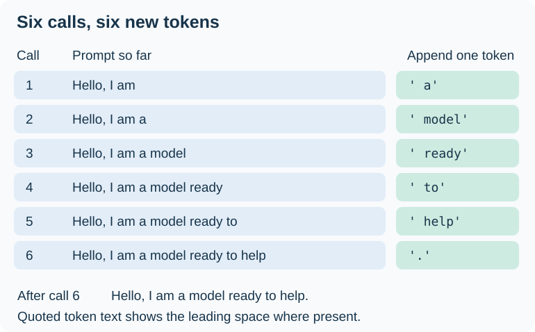](../assets/chapter-04/generation-iterations.svg)

<figcaption markdown="span">Companion to Figure 4.16. Read each row as one call to the model. The middle column shows the text represented by the IDs before that call. The right column shows the one token appended afterward. The continuation is illustrative.</figcaption>
</figure>

The first call sees the IDs for `Hello, I am`. Suppose it selects the token ` a`, including its leading space. The second call now sees the IDs for `Hello, I am a` and can use that extra position to predict what follows. Six iterations add six IDs to the original four. The period counts as one token here.

### Zoom in on the first iteration

<figure markdown="1">

[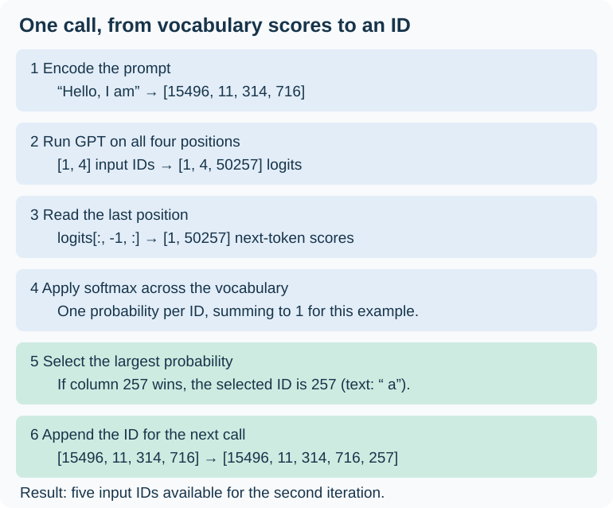](../assets/chapter-04/greedy-next-id.svg)

<figcaption markdown="span">Original companion to Figure 4.17. The prompt IDs and the decoding of ID 257 use the GPT-2 tokenizer. The highlighted choice illustrates what happens if ID 257 wins. These are example steps, not a prediction recorded from our initialized model.</figcaption>
</figure>

There are two indexing operations here. First, choose the **last position** in the input. Its score row uses the entire available prompt. Then, within that row, find the **vocabulary index** with the largest probability. That index is already the token ID. For example, if index 257 wins, append the integer 257. The tokenizer can display it as ` a`. The next model call consumes the integer sequence directly.

### A commented generation loop

This companion to Listing 4.8 uses the `GPTModel` above. **B** counts examples, **T** counts positions fed to the model on this iteration, and **V** is vocabulary size. Use `model.eval()` for generation so dropout is disabled. The `no_grad` context below saves the work of tracking gradients during the forward pass.

```python title="generate_text_simple — one greedy token per example per iteration"
def generate_text_simple(
    model: GPTModel,
    idx: torch.Tensor,
    max_new_tokens: int,
    context_size: int,
) -> torch.Tensor:
    """Extend torch.long prompt IDs [B,P] to [B,P + max_new_tokens].

    B counts examples and P is their nonempty prompt length. Use a positive
    context_size within the model's position-table capacity and a nonnegative
    max_new_tokens. The model and IDs must be on the same device.
    """
    for _ in range(max_new_tokens):
        # Keep every example (:), then take its most recent context_size IDs.
        # idx keeps the full history. Only this model call receives the crop.
        idx_cond = idx[:, -context_size:]

        with torch.no_grad():
            logits = model(idx_cond)  # [B,T,V]: a score row at every position.

        # Keep every example and vocabulary entry, selecting the last position.
        next_scores = logits[:, -1, :]  # [B,V]

        # Normalize across the vocabulary separately for each example.
        probabilities = torch.softmax(next_scores, dim=-1)

        # The winning column is a token ID. keepdim=True gives one column
        # per batch row, so it can be joined to the two-dimensional ID tensor.
        next_ids = torch.argmax(probabilities, dim=-1, keepdim=True)  # [B,1]

        # Join along positions (axis 1). With a four-ID prompt the first
        # iteration builds five IDs, which the next iteration can read.
        idx = torch.cat((idx, next_ids), dim=1)

    return idx  # Original prompt followed by all the generated IDs.
```

The softmax step lets us inspect probabilities. For greedy selection, taking the maximum directly over the logits gives the same ordering mathematically. The loop stops after the requested number of new tokens. To display its result for the first example, pass the completed sequence of IDs to `tokenizer.decode(result[0].tolist())`.

### Why softmax is optional for greedy decoding

Suppose a tiny vocabulary has three IDs and their logits are `[1, 3, 2]`. Softmax gives probabilities of about `[0.090, 0.665, 0.245]`. Column 1 wins both times. Exponentiation preserves the order of the scores, and every entry in the row is divided by the same positive sum. For greedy selection, we can therefore write:

```python
# Inside generate_text_simple, next_scores holds one row per example.
next_ids = next_scores.argmax(dim=-1, keepdim=True)
```

The highest-scoring ID is a **local choice for this step**. Sampling, which the book revisits in Chapter 5, draws an ID from a distribution. In the example above, it could also select ID 0 or ID 2.

### From four prompt IDs to ten output IDs

```python
# Use the GPT-2 tokenizer from Section 4.1.
prompt_ids = tokenizer.encode("Hello, I am")  # [15496, 11, 314, 716]
idx = torch.tensor(prompt_ids, dtype=torch.long).unsqueeze(0)
# unsqueeze(0) adds the batch axis: four IDs [4] become one example [1,4].
```

<figure markdown="1">

[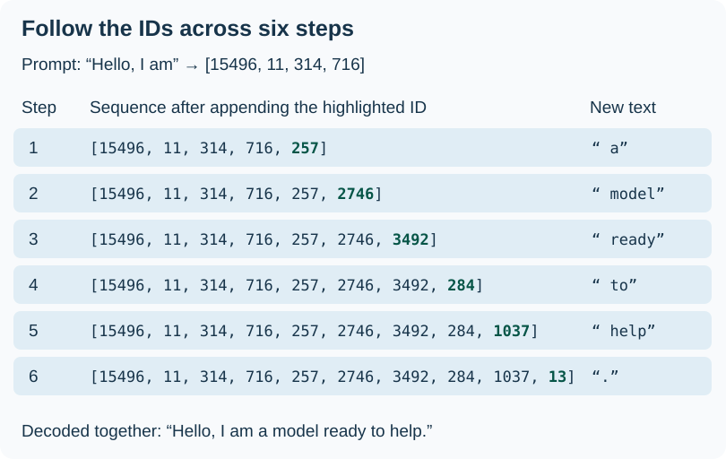](../assets/chapter-04/token-id-trace.svg)

<figcaption markdown="span">Companion to Figure 4.18. Read downward to see the growing ID sequence after each append. The text column decodes only the newly added ID, with its leading space visible inside quotes. This is the book’s illustrative continuation.</figcaption>
</figure>

Now try the same loop with the chapter model’s actual weights. A fresh initialization makes the example reproducible. Evaluation mode disables dropout. Inside the loop, `torch.no_grad()` lets PyTorch omit the gradient-tracking work.

```python
torch.manual_seed(123)
model = GPTModel(GPT_CONFIG_124M)
model.eval()

result = generate_text_simple(
    model=model,
    idx=idx,
    max_new_tokens=6,
    context_size=GPT_CONFIG_124M["context_length"],
)
# Select the single batch row, then convert its integers to a Python list.
ids = result[0].tolist()
print(ids)
print(tokenizer.decode(ids))
```

Locally reproduced CPU output:

```text
[15496, 11, 314, 716, 27018, 24086, 47843, 30961, 42348, 7267]
Hello, I am Featureiman Byeswickattribute argue
```

The first four IDs reproduce the prompt. Look at the fifth ID: the model ranked **27018** highest where the illustration used **257**. Decoding faithfully displays what the model chose. The architecture can already generate IDs, but its randomly initialized weights have yet to learn which continuations fit English text.

### Exercise 4.3 — Give each dropout site its own setting

With one `drop_rate`, changing embedding dropout also changes attention and residual-branch dropout. The exercise asks us to make those choices independent. In the `GPTConfig` type, replace `drop_rate: float` with three float fields named `embedding_dropout`, `attention_dropout`, and `residual_dropout`. Make the corresponding edit in the configuration dictionary. These example values are deliberately distinct so we can check the wiring:

```python
# Entries inside the edited GPT_CONFIG_124M dictionary
"embedding_dropout": 0.10,
"attention_dropout": 0.20,
"residual_dropout": 0.30,
```

| In the earlier listings | Use this setting | What dropout acts on during training |
| --- | --- | --- |
| `GPTModel.__init__`: `self.drop_emb = nn.Dropout(cfg["embedding_dropout"])` | 0.10 | The sum of token and position embeddings |
| `TransformerBlock.__init__`: pass `dropout=cfg["attention_dropout"]` to `MultiHeadAttention` | 0.20 | Attention weights after masked softmax, before they mix the values |
| `TransformerBlock.__init__`: `self.drop_shortcut = nn.Dropout(cfg["residual_dropout"])` | 0.30 | Each computed update immediately before its residual addition |

Build a fresh model **after** making those edits. The first block lets us inspect the two dropout modules nested inside the stack:

```python
model = GPTModel(GPT_CONFIG_124M)
block = model.trf_blocks[0]
print(model.drop_emb.p, block.att.dropout.p, block.drop_shortcut.p)
# 0.1 0.2 0.3
```

During training, the attention and feedforward updates each pass through `drop_shortcut` on a separate call. The saved shortcut vector goes straight to the addition. During generation, `model.eval()` disables dropout throughout the stack. Comparing the effect of these rates on learning would require training runs and validation results.

## End of chapter

These seven points follow the order of Raschka’s Chapter 4 summary (printed page 127).

1. **Layer normalization helps stabilize training.** For each token, LayerNorm centers and scales the coordinates in its vector, then applies a learned scale and shift. In our GPT block, each learned branch receives a normalized input.
2. **Shortcut connections give gradients a direct path.** In `y = x + F(x)`, the addition carries the input forward and lets a gradient travel back along the identity path. In our five-layer example, the first layer received a larger weight gradient with shortcuts enabled.
3. **A transformer block combines two kinds of updates.** Masked attention lets the row for `bank` gather information from earlier tokens. The feedforward network then expands that updated row, applies GELU, and projects it back to the model width.
4. **GPT gains depth by stacking blocks.** GPT-2 small passes the sequence through 12 successive blocks. Each accepts and returns a 768-coordinate vector per position and has its own learned weights. Across GPT sizes, those weights and the other model parameters add up to millions or billions of numbers.
5. **One model class supports several sizes.** In Exercise 4.2 we used the same `GPTModel` for Small, Medium, Large, and XL. Changing the configuration took us from 12 blocks of width 768 to 48 blocks of width 1,600.
6. **Generation appends one token ID per step.** The vocabulary head produces scores at every input position. Our greedy loop takes the highest-scoring ID from the last position, appends it, and runs the model again. The tokenizer decodes the resulting sequence into text.
7. **Fluent generation depends on learned weights.** Our randomly initialized model took the four IDs for `Hello, I am` and generated six more. They decoded to `Hello, I am Featureiman Byeswickattribute argue`. The loop worked. Pretraining will teach the model which continuations fit a given context.

Continue with [Chapter 5 — Pretraining on unlabeled data](05-pretraining-on-unlabeled-data.md).
