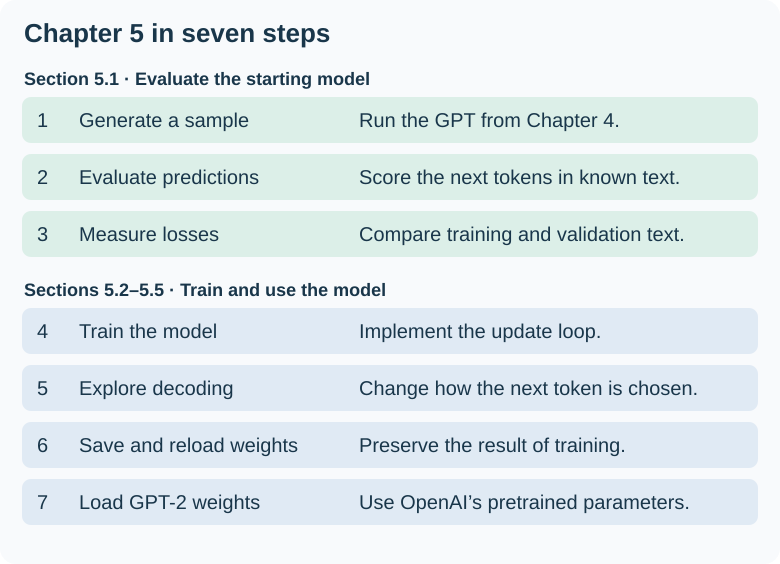
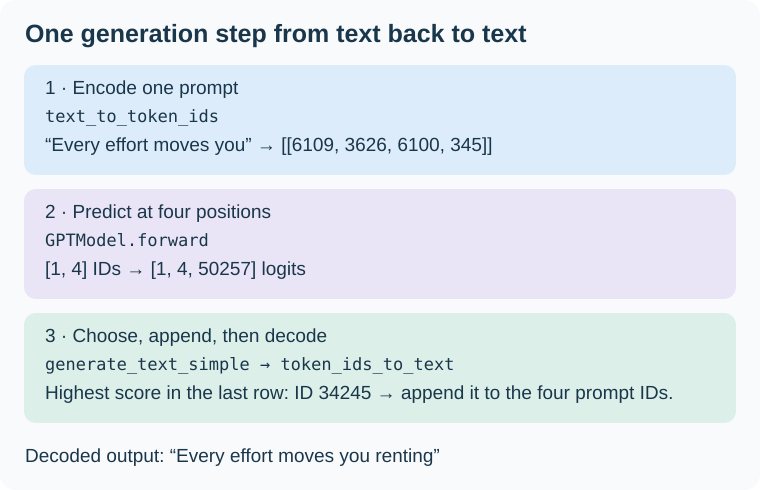
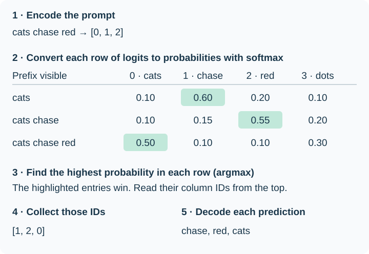

# Chapter 5 — Pretraining on Unlabeled Data

Our GPT could already extend `Hello, I am` by six tokens at the end of Chapter 4. Its random weights ranked ` Feature` highest for the first new token. Chapter 5 asks how to give that same architecture a learning signal. In **pretraining on unlabeled text**, the next token in the source supplies the target. Each training window therefore gives us predictions we can score before an optimizer updates the weights. [Chapter 4 generation example](04-implementing-a-gpt-model.md#47-generating-text)

<figure markdown="1">

[](https://sebastianraschka.com/images/LLMs-from-scratch-images/mental-model.jpg)

<figcaption markdown="span">Sebastian Raschka’s [book roadmap](https://sebastianraschka.com/llms-from-scratch/), embedded from his website. Figure 5.1 puts us at **Stage 2**. Step 4 is pretraining, supported by the training loop (5), evaluation (6), and loading weights (7).</figcaption>
</figure>

We will implement the training loop, monitor training and validation losses, and save what the model learns so we can reload it later. Then we will load OpenAI’s released GPT-2 weights into our implementation. Those weights give us a pretrained starting point for the fine-tuning chapters. [Author’s Chapter 5 code](https://github.com/rasbt/LLMs-from-scratch/tree/main/ch05)

!!! note "Weight parameters"

    In our GPT, “weights” often means all the numbers the optimizer can learn. PyTorch also uses `.weight` as a specific attribute. For example, `model.out_head.weight` is the vocabulary projection matrix we counted in Chapter 4. A linear layer configured with a bias also has a separate `.bias` parameter.

    `model.parameters()` iterates over the registered parameters throughout the model, including the embedding tables and LayerNorm’s learned scale and shift. We already used it to count the model’s parameters. In the training loop, we will pass those parameters to the optimizer so it can update them using the gradients computed by `loss.backward()`.

## 5.1 Evaluating generative text models

Reading a generated sample tells us something about that particular continuation. To track learning over many examples, we also need a numerical question: **How much probability did the model assign to the next token that actually occurred?** We will first revisit generation, then score predictions against known next tokens, and finally compare average losses on training and held-out validation text. A validation pass measures the current weights without taking an optimizer step.

<figure markdown="1">

[](../assets/chapter-05/chapter-plan.svg)

<figcaption markdown="span">Original companion to Figure 5.2. The first three steps establish how we will evaluate the model. The remaining four show where those measurements fit into the chapter.</figcaption>
</figure>

We saw this distinction in Character Logs. Generated text began to resemble log entries, while the validation loss helped us choose the epoch 8 checkpoint. Here we will build the evaluation code that produces those measurements. [Character Logs results](../preparation/training-comparison.md#reading-the-curves-together)

### 5.1.1 Using GPT to generate text

Chapter 4 gave us two pieces we can reuse: `GPTModel` maps IDs to logits, and `generate_text_simple` takes the last position’s logits, chooses the highest-scoring ID, and appends it to the prompt. For this walkthrough, use those [Chapter 4 definitions](04-implementing-a-gpt-model.md#47-generating-text) and make a copy of the configuration:

```python
cfg = GPT_CONFIG_124M.copy()
cfg["context_length"] = 256
torch.manual_seed(123)
model = GPTModel(cfg)
model.eval()  # Disable dropout while inspecting this initial model.
```

The width stays at 768, with 12 heads in each of 12 blocks. What changes is how many positions a training example can contain. With full-length examples and the same batch size, one attention head now forms a 256 × 256 score matrix instead of 1,024 × 1,024: one sixteenth as many score entries. This reduces memory and computation for the laptop exercise. A four-token prompt still occupies just four positions.

The new position embedding table has 256 rows. Later, to use GPT-2’s pretrained weights, we will construct a model with the original 1,024-position configuration and load the matching weights. Editing the dictionary after an instance exists does not resize that instance’s table.

#### Two helpers around the generation loop

<figure markdown="1">

[](../assets/chapter-05/text-id-helpers.svg)

<figcaption markdown="span">Original companion to Figure 5.3. This trace shows one verified greedy step with the chapter’s randomly initialized, 256-position model in evaluation mode. The output helper decodes the entire sequence, including the prompt.</figcaption>
</figure>

The two helpers in Listing 5.1 handle the boundary between a **Python string** and the **batch of integer IDs** that the generation loop accepts and returns. Both use the same GPT-2 tokenizer. The argument `allowed_special` lets the tokenizer recognize the literal end-of-text marker if present in the input.

```python title="Listing 5.1 companion — conversion for a single example"
import tiktoken


def text_to_token_ids(text: str, tokenizer: tiktoken.Encoding) -> torch.Tensor:
    """Encode one string as torch.long IDs [1,T], where T counts tokens."""
    ids = tokenizer.encode(text, allowed_special={"<|endoftext|>"})
    return torch.tensor(ids, dtype=torch.long).unsqueeze(0)  # [T] -> [1,T]


def token_ids_to_text(token_ids: torch.Tensor, tokenizer: tiktoken.Encoding) -> str:
    """Decode one sequence of integer IDs [1,T] into a string."""
    ids = token_ids.squeeze(0)  # [1,T] -> [T]: remove the single batch axis.
    return tokenizer.decode(ids.tolist())
```

For `Every effort moves you`, encoding produces the list `[6109, 3626, 6100, 345]`. Adding the batch axis gives `[[6109, 3626, 6100, 345]]`, shape `[1, 4]`. GPT returns shape `[1, 4, 50257]`. The generation loop reads the fourth row and appends its chosen ID. Only then does `token_ids_to_text` remove the outer axis and decode the resulting list. With several examples, decode each batch row separately.

Now run ten greedy steps with the model initialized above. At each step, the last position has one logit (an unnormalized score) per vocabulary entry. Softmax would turn those scores into probabilities. For greedy generation, the highest score already identifies the token ID to append.

```python
tokenizer = tiktoken.get_encoding("gpt2")
prompt_ids = text_to_token_ids("Every effort moves you", tokenizer)
result = generate_text_simple(model, prompt_ids, 10, cfg["context_length"])
print(token_ids_to_text(result, tokenizer))  # Four prompt IDs plus ten new IDs.
```

```text
Every effort moves you rentingetic wasnم refres RexMeCHicular stren
```

The tokenizer can decode every ID the model chose. The continuation reads like gibberish because the randomly initialized model has yet to learn which tokens tend to follow this prompt. To measure learning, we can give the model a passage with a known next token. Even if its top choice stays the same, raising the probability of the actual next token lowers the loss for that prediction. Section 5.1.2 develops that calculation.

### 5.1.2 Calculating the text generation loss

Suppose our source sentence is **cats chase red dots**. Give GPT the first three tokens. In one forward pass it produces three rows of logits. The causal mask lets the first position see only `cats`, the second see `cats chase`, and the third see the whole prompt. Each row answers the same question for a different prefix: **which token comes next?**

<figure markdown="1">

[](../assets/chapter-05/next-token-rows.svg)

<figcaption markdown="span">Original companion to Figure 5.4, using a four-token vocabulary and illustrative probabilities. Each column is one possible next token. Each row sums to one. Our GPT-2 tokenizer gives each row 50,257 columns.</figcaption>
</figure>

**For generation**, read the last row. Its highest probability is 0.50 in column 0, so greedy decoding appends `cats`. The earlier rows show predictions for shorter prefixes that were already supplied in the prompt.

**For loss**, the source sentence tells us the next tokens were `chase`, `red`, and `dots`. Read those columns in their respective rows and you get 0.60, 0.55, and **0.30**. That last number is the probability the model gave the actual next token, even though it would have generated `cats`. These three probabilities give us the starting point for the loss calculation.

#### Two examples, three next-token predictions each

The book uses seven vocabulary entries in Figure 5.4. In the code, the GPT-2 tokenizer has **50,257 tokens**, with IDs from 0 through 50,256. Take two four-token passages and slice each one twice, just as we did with the sliding windows in Chapter 2. The first three tokens are the input. The last three are the targets.

```python
inputs = torch.tensor([
    [16833, 3626, 6100],  # "every effort moves"
    [   40, 1107,  588],  # "I really like"
])
targets = torch.tensor([
    [3626, 6100,   345],  # " effort moves you"
    [1107,  588, 11311],  # " really like chocolate"
])

with torch.no_grad():
    logits = model(inputs)
    probabilities = torch.softmax(logits, dim=-1)
```

Both outputs have shape `[2, 3, 50257]`. The first two axes tell us **which example** and **which input position**. Inside the transformer, each of those six positions has 768 coordinates. The output head turns those coordinates into 50,257 logits, one score per possible next token. Softmax works across that last axis, so each position gets its own distribution that sums to one.

For example, `probabilities[1, 2]` contains all the next-token probabilities after `I really like`. The target at that position is ID 11311, so `probabilities[1, 2, 11311]` is the single probability assigned to `" chocolate"`. The leading space belongs to the token.

## 5.2 Training an LLM

Notes to come as we read this section.

## 5.3 Decoding strategies to control randomness

Notes to come as we read this section.

## 5.4 Loading and saving model weights in PyTorch

Notes to come as we read this section.

## 5.5 Loading pretrained weights from OpenAI

Notes to come as we read this section.

## Questions to bring to the chapter

<!-- Add actual questions during reading. -->

## End of chapter

<!-- Summarize what became clear, link exercises, and record unresolved questions. -->
