# Chapter 5 — Pretraining on Unlabeled Data

Our GPT could already extend `Hello, I am` by six tokens at the end of Chapter 4. Its random weights ranked ` Feature` highest for the first new token. Chapter 5 asks how to give that same architecture a learning signal. In **pretraining on unlabeled text**, the next token in the source supplies the target. Each training window therefore gives us predictions we can score before an optimizer updates the weights. [Chapter 4 generation example](04-implementing-a-gpt-model.md#47-generating-text)

<figure markdown="1">

[](https://sebastianraschka.com/images/LLMs-from-scratch-images/mental-model.jpg)

<figcaption markdown="span">Sebastian Raschka’s [book roadmap](https://sebastianraschka.com/llms-from-scratch/), embedded from his website. Figure 5.1 puts us at **Stage 2**. Step 4 is pretraining, supported by the training loop (5), evaluation (6), and loading weights (7).</figcaption>
</figure>

We will implement the training loop, monitor training and validation losses, and save what the model learns so we can reload it later. Then we will load OpenAI’s released GPT-2 weights into our implementation. Those weights give us a pretrained starting point for the fine-tuning chapters. [Author’s Chapter 5 code](https://github.com/rasbt/LLMs-from-scratch/tree/main/ch05)

!!! note "Weight parameters"

    In our GPT, “weights” often means all the numbers the optimizer can learn. PyTorch also uses `.weight` as a specific attribute. For example, `model.out_head.weight` is the vocabulary projection matrix we counted in Chapter 4. A linear layer configured with a bias also has a separate `.bias` parameter.

    `model.parameters()` iterates over the registered parameters throughout the model, including the embedding tables and LayerNorm’s learned scale and shift. We already used it to count the model’s parameters. In the training loop, we will pass those parameters to the optimizer so it can update them using the gradients computed by `loss.backward()`.

## 5.1 Evaluating generative text models

Reading a generated sample tells us something about that particular continuation. To track learning over many examples, we also need a numerical question: **How much probability did the model assign to the next token that actually occurred?** We will first revisit generation, then score predictions against known next tokens, and finally compare average losses on training and held-out validation text. A validation pass measures the current weights without taking an optimizer step.

<figure markdown="1">

[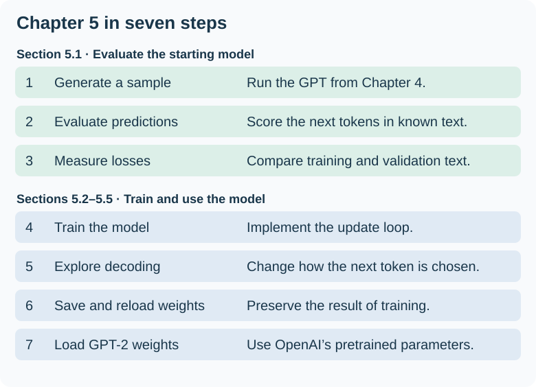](../assets/chapter-05/chapter-plan.svg)

<figcaption markdown="span">Original companion to Figure 5.2. The first three steps establish how we will evaluate the model. The remaining four show where those measurements fit into the chapter.</figcaption>
</figure>

We saw this distinction in Character Logs. Generated text began to resemble log entries, while the validation loss helped us choose the epoch 8 checkpoint. Here we will build the evaluation code that produces those measurements. [Character Logs results](../preparation/training-comparison.md#reading-the-curves-together)

### 5.1.1 Using GPT to generate text

Chapter 4 gave us two pieces we can reuse: `GPTModel` maps IDs to logits, and `generate_text_simple` takes the last position’s logits, chooses the highest-scoring ID, and appends it to the prompt. For this walkthrough, use those [Chapter 4 definitions](04-implementing-a-gpt-model.md#47-generating-text) and make a copy of the configuration:

```python
cfg = GPT_CONFIG_124M.copy()
cfg["context_length"] = 256
torch.manual_seed(123)
model = GPTModel(cfg)
model.eval()  # Disable dropout while inspecting this initial model.
```

The width stays at 768, with 12 heads in each of 12 blocks. What changes is how many positions a training example can contain. With full-length examples and the same batch size, one attention head now forms a 256 × 256 score matrix instead of 1,024 × 1,024: one sixteenth as many score entries. This reduces memory and computation for the laptop exercise. A four-token prompt still occupies just four positions.

The new position embedding table has 256 rows. Later, to use GPT-2’s pretrained weights, we will construct a model with the original 1,024-position configuration and load the matching weights. Editing the dictionary after an instance exists does not resize that instance’s table.

#### Two helpers around the generation loop

<figure markdown="1">

[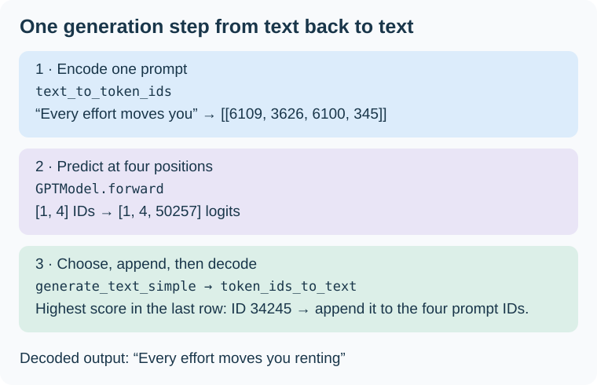](../assets/chapter-05/text-id-helpers.svg)

<figcaption markdown="span">Original companion to Figure 5.3. This trace shows one verified greedy step with the chapter’s randomly initialized, 256-position model in evaluation mode. The output helper decodes the entire sequence, including the prompt.</figcaption>
</figure>

The two helpers in Listing 5.1 handle the boundary between a **Python string** and the **batch of integer IDs** that the generation loop accepts and returns. Both use the same GPT-2 tokenizer. The argument `allowed_special` lets the tokenizer recognize the literal end-of-text marker if present in the input.

```python title="Listing 5.1 companion — conversion for a single example"
import tiktoken


def text_to_token_ids(text: str, tokenizer: tiktoken.Encoding) -> torch.Tensor:
    """Encode one string as torch.long IDs [1,T], where T counts tokens."""
    ids = tokenizer.encode(text, allowed_special={"<|endoftext|>"})
    return torch.tensor(ids, dtype=torch.long).unsqueeze(0)  # [T] -> [1,T]


def token_ids_to_text(token_ids: torch.Tensor, tokenizer: tiktoken.Encoding) -> str:
    """Decode one sequence of integer IDs [1,T] into a string."""
    ids = token_ids.squeeze(0)  # [1,T] -> [T]: remove the single batch axis.
    return tokenizer.decode(ids.tolist())
```

For `Every effort moves you`, encoding produces the list `[6109, 3626, 6100, 345]`. Adding the batch axis gives `[[6109, 3626, 6100, 345]]`, shape `[1, 4]`. GPT returns shape `[1, 4, 50257]`. The generation loop reads the fourth row and appends its chosen ID. Only then does `token_ids_to_text` remove the outer axis and decode the resulting list. With several examples, decode each batch row separately.

Now run ten greedy steps with the model initialized above. At each step, the last position has one logit (an unnormalized score) per vocabulary entry. Softmax would turn those scores into probabilities. For greedy generation, the highest score already identifies the token ID to append.

```python
tokenizer = tiktoken.get_encoding("gpt2")
prompt_ids = text_to_token_ids("Every effort moves you", tokenizer)
result = generate_text_simple(model, prompt_ids, 10, cfg["context_length"])
print(token_ids_to_text(result, tokenizer))  # Four prompt IDs plus ten new IDs.
```

```text
Every effort moves you rentingetic wasnم refres RexMeCHicular stren
```

The tokenizer can decode every ID the model chose. The continuation reads like gibberish because the randomly initialized model has yet to learn which tokens tend to follow this prompt. To measure learning, we can give the model a passage with a known next token. Even if its top choice stays the same, raising the probability of the actual next token lowers the loss for that prediction. Section 5.1.2 develops that calculation.

### 5.1.2 Calculating the text generation loss

Suppose our source sentence is **cats chase red dots**. Give GPT the first three tokens. In one forward pass it produces three rows of logits. The causal mask lets the first position see only `cats`, the second see `cats chase`, and the third see the whole prompt. Each row answers the same question for a different prefix: **which token comes next?**

<figure markdown="1">

[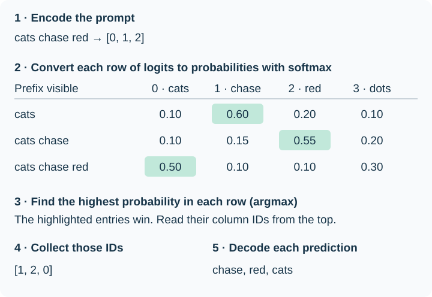](../assets/chapter-05/next-token-rows.svg)

<figcaption markdown="span">Original companion to Figure 5.4, using a four-token vocabulary and illustrative probabilities. Each column is one possible next token. Each row sums to one. Our GPT-2 tokenizer gives each row 50,257 columns.</figcaption>
</figure>

**For generation**, read the last row. Its highest probability is 0.50 in column 0, so greedy decoding appends `cats`. The earlier rows show predictions for shorter prefixes that were already supplied in the prompt.

**For loss**, the source sentence tells us the next tokens were `chase`, `red`, and `dots`. Read those columns in their respective rows and you get 0.60, 0.55, and **0.30**. That last number is the probability the model gave the actual next token, even though it would have generated `cats`. These three probabilities give us the starting point for the loss calculation.

#### Two examples, three next-token predictions each

The book uses seven vocabulary entries in Figure 5.4. In the code, the GPT-2 tokenizer has **50,257 tokens**, with IDs from 0 through 50,256. Take two four-token passages and slice each one twice, just as we did with the sliding windows in Chapter 2. The first three tokens are the input. The last three are the targets.

```python
inputs = torch.tensor([
    [16833, 3626, 6100],  # "every effort moves"
    [   40, 1107,  588],  # "I really like"
])
targets = torch.tensor([
    [3626, 6100,   345],  # " effort moves you"
    [1107,  588, 11311],  # " really like chocolate"
])

with torch.no_grad():
    logits = model(inputs)
    probabilities = torch.softmax(logits, dim=-1)
```

Both outputs have shape `[2, 3, 50257]`. The first two axes tell us **which example** and **which input position**. Inside the transformer, each of those six positions has 768 coordinates. The output head turns those coordinates into 50,257 logits, one score per possible next token. Softmax works across that last axis, so each position gets its own distribution that sums to one.

For example, `probabilities[1, 2]` contains all the next-token probabilities after `I really like`. The target at that position is ID 11311, so `probabilities[1, 2, 11311]` is the single probability assigned to `" chocolate"`. The leading space belongs to the token.

#### Read the predictions, then score the targets

Figure 5.4 ends by selecting an ID and decoding it. Here we do that at all six positions in one batch. Each position has its own row of 50,257 probabilities. `argmax` gives the column index of the largest probability in that row, and that index is a token ID.

```python
predicted_ids = probabilities.argmax(dim=-1, keepdim=True)  # [2, 3, 1]
rows = predicted_ids.squeeze(-1)  # [2, 3]: one winning ID per position
print(rows.tolist())  # [[16657, 339, 42826], [49906, 29669, 41751]]

# Take the first example, keeping the batch axis our decoding helper expects.
print(repr(token_ids_to_text(rows[:1], tokenizer)))     # ' Armed heNetflix'
print(repr(token_ids_to_text(targets[:1], tokenizer)))  # ' effort moves you'
```

Read the first prediction as “given `every`, the model chose ` Armed`.” For the second prediction it saw the supplied prefix `every effort` and chose ` he`. The three decoded pieces sit next to each other for inspection. Each came from a different position in the same forward pass.

<figure markdown="1">

[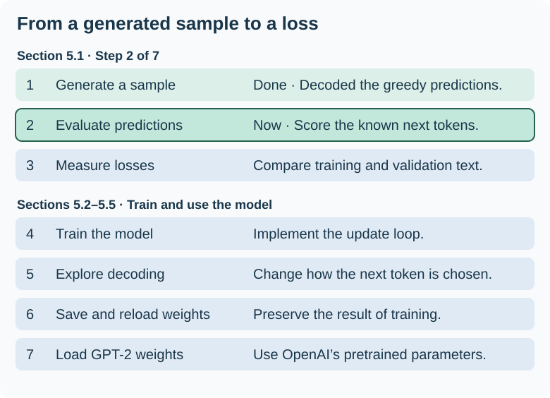](../assets/chapter-05/evaluation-roadmap.svg)

<figcaption markdown="span">Original companion to Figure 5.5. Step 1 gave us text to inspect. In step 2 we keep the probabilities so we can measure how well each prediction fits its target.</figcaption>
</figure>

For the first position, the correct next token was ` effort`. The untrained model assigned it a probability of about **0.0000745**. If training raises that probability, the loss for this position falls, even if ` Armed` still wins. This is why the training loop will compute loss from the model’s scores and the known target IDs. During evaluation we record that loss. During training we also backpropagate through it so the optimizer can update the weights.

#### Read one target probability per position

Think of a CNN classifying an image labeled “cat.” The label tells us which class probability to inspect, even when the highest score goes to “dog.” In language modeling, the source text supplies a label at **each token position**. That label is an ID we use as a column index. The numerical distance between two IDs has no bearing on the loss.

<figure markdown="1">

[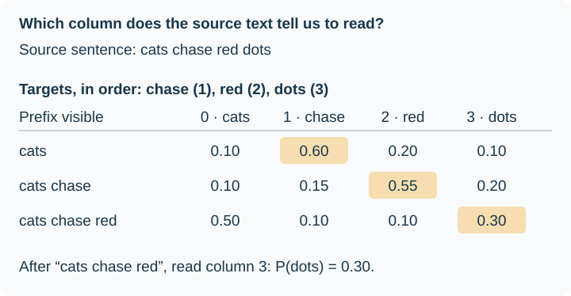](../assets/chapter-05/target-probabilities.svg)

<figcaption markdown="span">Original companion to Figure 5.6. Compare the last row with our Figure 5.4. The probabilities are identical. The highlight moves from the model’s top choice, `cats`, to the observed next token, `dots`.</figcaption>
</figure>

The book illustrates this with seven tokens. If probability were spread evenly, each token would receive `1 / 7 ≈ 0.14`. With GPT-2’s 50,257 tokens the corresponding baseline is **about 0.0000199**. This is also the mean across vocabulary entries in each probability row, since they sum to one. Individual probabilities from a randomly initialized model vary around that scale.

Here is the same lookup for the batch above. Each list of three target IDs pairs up with the three positions in its example:

```python
positions = [0, 1, 2]
for example in range(len(targets)):
    target_ids = targets[example]
    # Pair position 0 with target_ids[0], position 1 with target_ids[1],
    # and position 2 with target_ids[2].
    print(probabilities[example, positions, target_ids])
```

```text
tensor([7.4541e-05, 3.1061e-05, 1.1563e-05])
tensor([1.0337e-05, 5.6776e-05, 4.7559e-06])
```

The last value is the probability assigned to `" chocolate"` after `I really like`. Raising that probability lowers the loss for this example’s last position. Greedy decoding will select `" chocolate"` once it has the highest score.

#### Turn six target probabilities into one loss

!!! note "Where backpropagation fits"

    During evaluation, the forward pass gives us a loss we can read. During training, we run the forward pass with gradient tracking enabled. Then `loss.backward()` computes how the loss changes with each trainable parameter, and the optimizer uses those gradients to update the weights.

<figure markdown="1">

[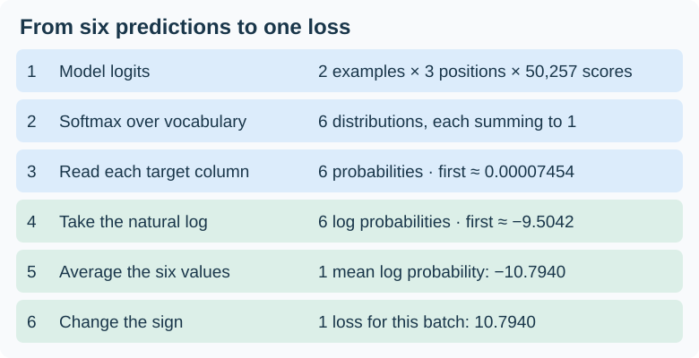](../assets/chapter-05/batch-cross-entropy.svg)

<figcaption markdown="span">Original companion to Figure 5.7. Follow the count down the right side. Choosing each observed token leaves six numbers. Taking logs preserves that count. Averaging turns the six values into one measurement.</figcaption>
</figure>

Why take logs? The likelihood of a sequence multiplies the probabilities assigned to its successive tokens given their prefixes. Products of small probabilities quickly become tiny. Taking the natural log turns that product into a sum, and dividing by the number of targets gives a per-token average. A confident correct prediction contributes little loss: at probability 0.9, its negative log is about 0.105. At 0.01, the penalty is about 4.605.

```python
target_probs = probabilities.gather(-1, targets.unsqueeze(-1)).squeeze(-1)
# One selected probability per observed token, still arranged as two rows of three.
log_probs = target_probs.log()
manual_loss = -log_probs.mean()
print(manual_loss)  # tensor(10.7940)
```

!!! note "Cross-entropy loss"

    A single observed target gives all the label probability to one vocabulary entry. Cross-entropy therefore reads the model’s log probability at that entry and changes its sign. With one target ID per position and equal weight for all six positions, batch cross-entropy is exactly their mean negative log probability.

**Where does flattening come from?** Think of the CNN classification case: PyTorch can take a table with one row of class scores per image and a list with one class ID per image. Here, **each token position is one classification example**. The model has already computed its contextual representation and its logits. For the loss we can lay those predictions out as six rows:

| Flat row | Prefix that produced the scores | Target token | Target ID |
| ---: | --- | --- | ---: |
| 0 | every | ` effort` | 3626 |
| 1 | every effort | ` moves` | 6100 |
| 2 | every effort moves | ` you` | 345 |
| 3 | I | ` really` | 1107 |
| 4 | I really | ` like` | 588 |
| 5 | I really like | ` chocolate` | 11311 |

```python
# Merge the example and position axes. Keep all vocabulary scores in each row.
scores = logits.flatten(0, 1)  # [2, 3, 50257] → [6, 50257]
labels = targets.flatten()     # [2, 3] → [6], in the same row order
loss = torch.nn.functional.cross_entropy(scores, labels)
torch.testing.assert_close(loss, manual_loss)
```

For example, `scores[3]` contains exactly the logits from `logits[1, 0]`, and `labels[3]` still holds 1107. Flattening keeps that prediction paired with its target. It changes the layout after attention has finished. Give the function the raw logits so it can compute log probabilities in a numerically stable way.

!!! tip "An optional detour into Appendix B"

    Appendix B is a chapter-by-chapter reading list. For **why we take logarithms**, go to the Chapter 5 entry on printed page 293. For **why a single class ID is enough to compute cross-entropy**, the lecture and code example follow on page 294. [Logistic Regression Loss Function](https://www.youtube.com/watch?v=GxJe0DZvydM) · [OneHot Encoding and Multi-category Cross Entropy](https://www.youtube.com/watch?v=4n71-tZ94yk)

!!! note "Perplexity gives the same loss a different scale"

    Imagine the model gives the observed next token a probability of ¼ at every position. Its mean cross-entropy is `−ln(¼) ≈ 1.386`. Exponentiating that loss gives a perplexity of **4**. Its predictions score as well on this text as a uniform guess among four choices that include the correct token.

    In our actual batch the six target probabilities differ. Perplexity is the reciprocal of their **geometric mean**. Run `torch.exp(loss).item()` on the full-precision loss tensor and you get **48,725.82**. A uniform prediction over the GPT-2 vocabulary would give **50,257**. On these six targets, the untrained model scored a little better than that baseline. The number describes average performance across those positions. It does not count how many candidate tokens the model considered at any single position.

    Exponentiation preserves order, so a lower mean cross-entropy always gives a lower perplexity on the same evaluation tokens. Section 5.1.3 takes that measurement beyond our six predictions to the training and validation sets.

### 5.1.3 Calculating the training and validation set losses

We already know how to score six next-token predictions. Now we want two measurements from the same model. **Training loss** asks how well it predicts the text used to fit its weights. **Validation loss** asks how well those same weights predict held-out text. Both use the same cross-entropy calculation. The choice of text gives each number its meaning.

<figure markdown="1">

[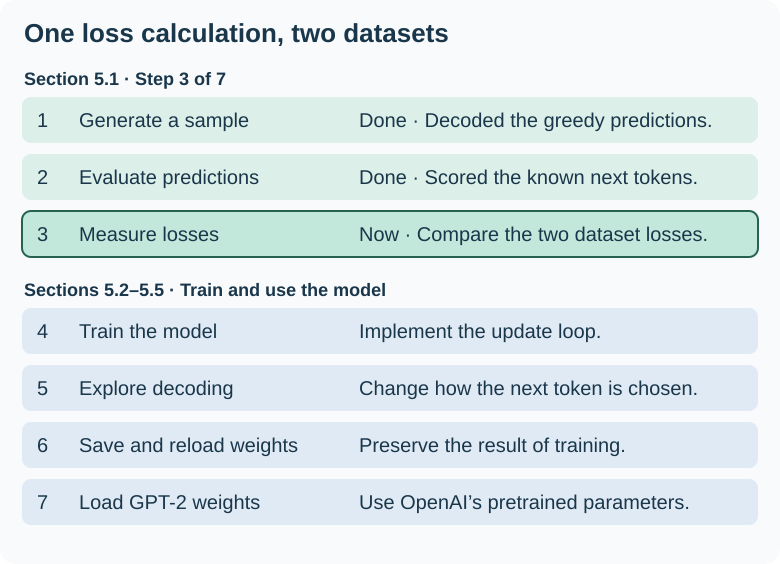](../assets/chapter-05/dataset-loss-roadmap.svg)

<figcaption markdown="span">Original companion to Figure 5.8. Step 3 takes the loss we worked out for one batch and applies it separately to each split. The training loop comes in step 4.</figcaption>
</figure>

Think back to our Character Logs checkpoint. Its epoch 8 validation loss was 1.9086. Exponentiating gives a perplexity of about **6.74**. That means its predictions on the held-out characters scored like uniform guessing among roughly seven choices containing the correct character. By epoch 30, validation loss reached 2.4473, or **11.56** effective choices. The optimizer used cross-entropy during training. Perplexity lets us read that same outcome on a different scale. [Character Logs comparison](../preparation/training-comparison.md#reading-the-curves-together)

#### Count the story before splitting it

We return to Edith Wharton’s public-domain short story *The Verdict* from Chapter 2. Download the author’s copy as `the-verdict.txt` in the directory where you run this snippet. The count depends on the exact text and tokenizer. [Story file](https://raw.githubusercontent.com/rasbt/LLMs-from-scratch/main/ch02/01_main-chapter-code/the-verdict.txt)

```python
from pathlib import Path
import tiktoken

text_data = Path("the-verdict.txt").read_text(encoding="utf-8")
tokenizer = tiktoken.get_encoding("gpt2")
print(len(text_data))                    # 20,479 characters
print(len(tokenizer.encode(text_data)))  # 5,145 tokens
```

One story keeps the training loop practical to run on a laptop. Later in this chapter we will load pretrained GPT-2 weights into our model implementation. For a larger corpus, the author’s supplement describes preparing Project Gutenberg books. [Project Gutenberg training supplement](https://github.com/rasbt/LLMs-from-scratch/tree/main/ch05/03_bonus_pretraining_on_gutenberg)

!!! note "What does a pretraining run cost?"

    The book’s Llama 2 7B example processed **2 trillion tokens** using **184,320 A100 GPU-hours**. At its historical assumption of $30 per hour for an eight-GPU server, the arithmetic is `184,320 ÷ 8 × $30 = $691,200`. Dividing by eight converts GPU-hours to server-hours. [Llama 2 report](https://arxiv.org/abs/2307.09288)

    A later open-weight example is **DeepSeek-V3** (December 2024). Its team reports **14.8 trillion tokens** and **2,664,000 H800 GPU-hours** for pretraining. They used their HAI-LLM framework with FP8 mixed precision and distributed the mixture-of-experts model across a cluster of 2,048 GPUs. Their assumed rate was already per GPU-hour, so the estimate is `2,664,000 × $2 = $5,328,000` for pretraining alone. This excludes later training stages and earlier research experiments. The models, hardware and accounting assumptions differ, so the two estimates show scale rather than relative efficiency. [DeepSeek-V3 technical report, Table 1 and §3](https://arxiv.org/abs/2412.19437)

#### Split the story, then build two loaders

<figure markdown="1">

[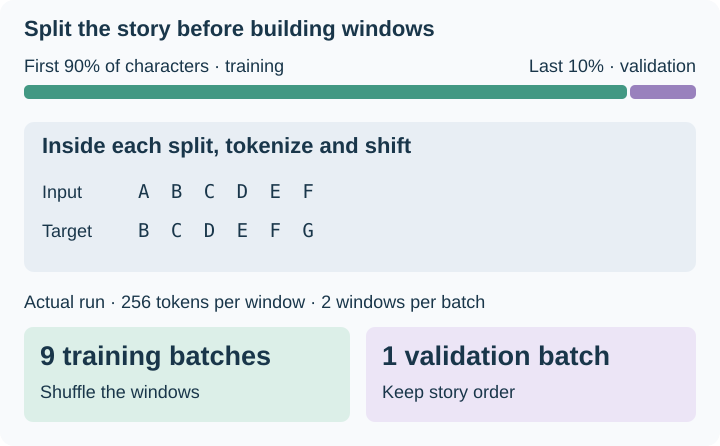](../assets/chapter-05/story-to-batches.svg)

<figcaption markdown="span">Companion to Figure 5.9. Follow one training window through the middle panel. The letters stand for consecutive token IDs. The validation loader applies the same shift to its own portion of the story.</figcaption>
</figure>

Split the **original string** at 90% of its characters. Then tokenize each piece separately. The training loader can shuffle whole examples safely because every target stays paired with its input. Validation keeps the windows in story order. Here we reuse the [Chapter 2 dataset class](02-working-with-text-data.md#26-data-sampling-with-a-sliding-window) directly with PyTorch’s loader, the two components inside the book’s helper.

```python
from torch.utils.data import DataLoader

cut = int(0.9 * len(text_data))
width = cfg["context_length"]  # 256 positions in our Chapter 5 model
train_set = GPTDatasetV1(text_data[:cut], tokenizer, max_length=width, stride=width)
val_set = GPTDatasetV1(text_data[cut:], tokenizer, max_length=width, stride=width)

torch.manual_seed(123)
train_loader = DataLoader(train_set, batch_size=2, shuffle=True, drop_last=True)
val_loader = DataLoader(val_set, batch_size=2, shuffle=False, drop_last=False)

for name, loader in [("training", train_loader), ("validation", val_loader)]:
    print(name, len(loader), "batches")
    for inputs, targets in loader:
        assert inputs.shape == targets.shape == (2, 256)  # True for this story.
        assert torch.equal(inputs[:, 1:], targets[:, :-1])
```

The training loader yields **9 batches**, each with 2 windows × 256 positions, so we score **4,608 next tokens**. The validation loader yields **1 batch** with **512 next tokens**. These counts reflect the complete windows available in each split.

!!! tip "Why keep windows the same length?"

    Equal lengths let PyTorch stack windows into a single rectangular tensor. A causal model already sees short prefixes within each window. Training on examples of varying lengths can also expose it to the length patterns it will encounter in use. To batch unequal lengths, one option is to pad each batch and exclude padded targets from the loss.

#### Measure a batch, then average across a loader

```python title="Listing 5.2 companion — batch and loader loss"
from itertools import islice


def calc_loss_batch(
    inputs: torch.Tensor, targets: torch.Tensor, model: nn.Module, device: torch.device
) -> torch.Tensor:
    """Return scalar mean loss for integer IDs [batch, positions]."""
    logits = model(inputs.to(device))  # One vocabulary score row per position.
    return torch.nn.functional.cross_entropy(
        logits.flatten(0, 1), targets.to(device).flatten()
    )


def calc_loss_loader(
    loader: DataLoader, model: nn.Module, device: torch.device,
    num_batches: int | None = None,
) -> float:
    """Average the scalar batch losses over all batches or a positive limit."""
    if num_batches is not None and num_batches < 1:
        raise ValueError("num_batches must be positive")
    count = len(loader) if num_batches is None else min(num_batches, len(loader))
    if count == 0:
        return float("nan")  # An empty loader has no measured loss.

    total = 0.0
    for inputs, targets in islice(loader, count):
        total += calc_loss_batch(inputs, targets, model, device).item()
    return total / count
```

Each batch here contributes 512 targets, so averaging the nine training batch means gives each scored token equal weight. With unequal-sized batches, a token-level mean needs to weight each batch by its number of scored targets. Setting `num_batches=2` gives a quicker estimate from the first two available batches.

```python
device = torch.device("cuda" if torch.cuda.is_available() else "cpu")
model.to(device)
model.eval()  # Disable dropout so both splits measure the same fixed model.
with torch.no_grad():  # Evaluation only needs forward passes.
    train_loss = calc_loss_loader(train_loader, model, device)
    val_loss = calc_loss_loader(val_loader, model, device)
print(f"Training {train_loss:.4f} | Validation {val_loss:.4f}")
```

The seeded, untrained GPT gives **10.9876 training loss** and **10.9811 validation loss**. For scale, a uniform guess among 50,257 tokens has loss about 10.825. We now have a baseline to measure against when the optimizer starts updating weights.

<figure markdown="1">

[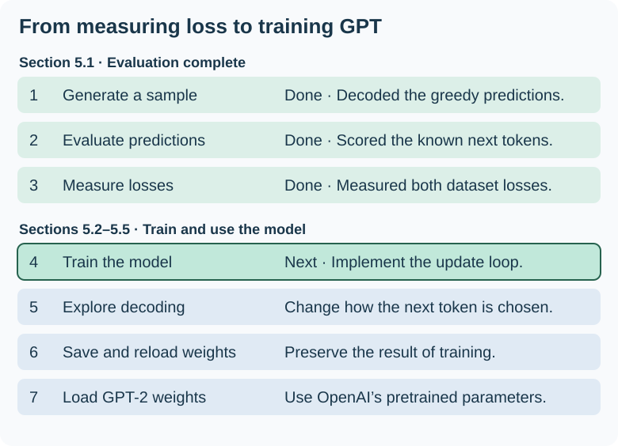](../assets/chapter-05/training-loop-roadmap.svg)

<figcaption markdown="span">Companion to Figure 5.10. Step 3 measured the starting weights on both splits. In step 4, training batches supply gradients and held-out batches let us track how those updates affect validation loss.</figcaption>
</figure>

## 5.2 Training an LLM

Section 5.1.3 gave us nine training batches from *The Verdict*. What changes when we train the GPT model from Chapter 4? Take the first batch. The model scores 512 next-token targets, and cross-entropy averages those predictions into one loss. Calling `loss.backward()` computes how that loss changes with each trainable parameter. Then `optimizer.step()` uses the gradients to update the weights. The second batch sees those updated weights. With this loader, **one epoch means nine optimizer steps**.

<figure markdown="1">

[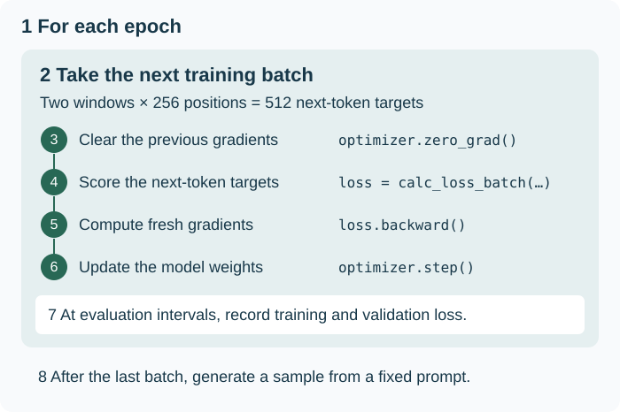](../assets/chapter-05/one-training-update.svg)

<figcaption markdown="span">Original companion to Raschka’s Figure 5.11 (p. 146). Steps 3–6 repeat for every training batch. Steps 7 and 8 let us inspect what the updates accomplished. Validation measures the current weights without updating them.</figcaption>
</figure>

### What counts as one training example?

Suppose we have **1,000 sentences**. How many updates make one epoch? We need to tokenize the sentences, decide how to cut the token stream into windows, and decide how many windows to put in a batch. A single window can span a sentence boundary.

1. **Start with tokens.** For a small example, suppose tokenization gives us nine tokens in order. Call them `A B C D E F G H I`. Each letter stands for one token.
2. **Build windows.** Choose a window length of four and a stride of four. Each row below is one training example. At `D`, the model predicts which token follows `A B C D`. The target is `E` because that is what actually follows in the source text. That same `E` starts the next input window.

    | Example | Input tokens | Next-token targets |
    | --- | --- | --- |
    | 1 | A B C D | B C D E |
    | 2 | E F G H | F G H I |

3. **Batch the rows.** With batch size two, the loader returns both rows together. Cross-entropy averages eight next-token losses, and the optimizer updates the model once. Those nine source tokens supplied **two windows, one batch, one update**.
4. **Scale up the same arithmetic.** Suppose we start with **256,001 tokens**, use 256-token windows and a stride of 256, and keep only full windows. We get exactly **1,000 training examples**. The extra token supplies the final target. At 100 windows per batch, each step scores 25,600 targets and one epoch takes ten steps.

**One DeepSeek-V3 update.** First picture one row containing **4,096 token positions**. During the main pretraining run, the global batch grew from 3,072 rows to **15,360 rows**. At that later setting, the devices together processed **15,360 × 4,096 = 62,914,560 token positions** per optimizer update. “Global” counts the rows across the whole training cluster. The **8** in our toy batch and the **62,914,560** in DeepSeek’s larger batch count the same thing: token positions processed for one optimizer step. DeepSeek reports progress in tokens processed, which captures the fivefold increase in tokens per step as the batch grew. [DeepSeek-V3 Technical Report, §4.2](https://arxiv.org/html/2412.19437v2#S4.SS2)

!!! tip "Where Appendix D fits"

    **Learning-rate warmup** starts the optimizer with a small learning rate and raises it during the opening steps. **Cosine annealing** then lowers the rate along a smooth curve toward a chosen minimum. **Gradient clipping** fits between steps 5 and 6. If the combined gradient norm exceeds a threshold, clipping scales the gradients down before the optimizer uses them. You can follow Listing 5.3 first and return to Appendix D to see where each change belongs. [Author’s Appendix D notebook](https://github.com/rasbt/LLMs-from-scratch/tree/main/appendix-D)

### Reading Listing 5.3 one batch at a time

Follow three clocks in `train_model_simple`: **update** on every training batch, **measure loss** at selected updates, and **generate text** at the end of each epoch. The indentation shows which clock each line follows. This companion uses the loss and token conversion helpers from §5.1. [Author’s Chapter 5 implementation](https://github.com/rasbt/LLMs-from-scratch/tree/main/ch05/01_main-chapter-code)

```python title="Listing 5.3 companion — train_model_simple"
def train_model_simple(
    model: nn.Module, train_loader: DataLoader, val_loader: DataLoader,
    optimizer: torch.optim.Optimizer, device: torch.device, num_epochs: int,
    eval_freq: int, eval_iter: int, start_context: str, tokenizer: tiktoken.Encoding,
) -> tuple[list[float], list[float], list[int]]:
    """Return training loss, validation loss and tokens seen at each evaluation."""
    train_losses, val_losses, tokens_at_eval = [], [], []
    tokens_seen = 0
    global_step = -1  # The book labels the first completed update step 0.

    for epoch in range(num_epochs):
        model.train()  # Enable training behavior, including dropout.
        for inputs, targets in train_loader:
            # Gradients accumulate in PyTorch. Start this batch with a clean slate.
            optimizer.zero_grad()
            loss = calc_loss_batch(inputs, targets, model, device)
            loss.backward()   # Compute the gradient for each participating parameter.
            optimizer.step()  # AdamW uses those gradients to change the weights.

            # For this unpadded loader: 2 windows × 256 positions = 512 tokens.
            tokens_seen += inputs.numel()
            global_step += 1

            # eval_freq controls WHEN to measure. eval_iter limits HOW MANY
            # batches from each loader go into that measurement.
            if global_step % eval_freq == 0:
                train_loss, val_loss = evaluate_model(
                    model, train_loader, val_loader, device, eval_iter
                )
                train_losses.append(train_loss)
                val_losses.append(val_loss)
                tokens_at_eval.append(tokens_seen)
                print(f"Epoch {epoch + 1}, step {global_step}: "
                      f"train {train_loss:.3f}, validation {val_loss:.3f}")

        # Outside the batch loop: one continuation per completed epoch.
        generate_and_print_sample(model, tokenizer, device, start_context)

    return train_losses, val_losses, tokens_at_eval
```

With nine batches and `eval_freq=5`, epoch one updates the weights nine times, at steps 0 through 8. The loop prints losses after steps **0 and 5**, then prints a sample after step **8**. The next epoch starts at step **9**. With `eval_iter=5`, each measurement uses five training batches and the one available validation batch.

```python title="Step 7 — evaluate_model"
def evaluate_model(
    model: nn.Module, train_loader: DataLoader, val_loader: DataLoader,
    device: torch.device, eval_iter: int,
) -> tuple[float, float]:
    """Measure the current weights on both splits during training."""
    model.eval()  # Switch off dropout for both measurements.
    with torch.no_grad():  # Save memory by skipping the backward graph.
        train_loss = calc_loss_loader(train_loader, model, device, eval_iter)
        val_loss = calc_loss_loader(val_loader, model, device, eval_iter)
    model.train()  # The next training batch needs dropout again.
    return train_loss, val_loss  # The caller records and prints these numbers.
```

```python title="Step 8 — generate_and_print_sample"
def generate_and_print_sample(
    model: nn.Module, tokenizer: tiktoken.Encoding, device: torch.device,
    start_context: str,
) -> None:
    """Print the same prompt and its greedy continuation after each epoch."""
    model.eval()
    # Each row in the position table corresponds to one supported input position.
    context_size = model.pos_emb.weight.shape[0]
    prompt_ids = text_to_token_ids(start_context, tokenizer).to(device)
    with torch.no_grad():
        output_ids = generate_text_simple(model, prompt_ids, 50, context_size)
    text = token_ids_to_text(output_ids, tokenizer)
    print(text.replace("\n", " "))  # Keep one epoch's sample on one log line.
    model.train()
```

The sample is a **sneak peek**. Keep the prompt and greedy decoding fixed, and you can see when the model starts forming words or repeating phrases. Validation loss answers a broader question by scoring every target position in the held-out batches. A fluent continuation from one prompt can coexist with worsening validation loss.

!!! note "What AdamW does at optimizer.step()"

    `loss.backward()` supplies a fresh gradient. AdamW keeps a running average of each parameter’s gradients and another of its squared gradients. The first tracks direction across batches. The second helps scale the update to the typical gradient magnitude. This history is why our resumable checkpoints save optimizer state alongside model weights.

    The **W** refers to *decoupled weight decay*. AdamW nudges a weight toward zero separately from the adaptive gradient calculation. With the book’s `lr=0.0004` and `weight_decay=0.1`, the decay part alone multiplies a weight by `1 − 0.0004 × 0.1 = 0.99996`. A weight of 1.0 therefore becomes 0.99996 before the gradient-driven adjustment. The full update can still make that weight larger. Decay is one way to regularize training, and validation loss lets us check how well the resulting model generalizes. [Original AdamW paper](https://arxiv.org/abs/1711.05101)

    AdamW is a common choice for language-model pretraining. DeepSeek-V3 is a documented example. The loop accepts an optimizer object, so its choice is independent of the GPT architecture. [DeepSeek-V3 training hyperparameters](https://arxiv.org/html/2412.19437v2#S4.SS2)

### Run ten epochs on *The Verdict*

The earlier loss check evaluated random weights. For the training run, start from a fresh model and construct AdamW after moving the model to the device. On our Mac, `mps` selects the Apple GPU. The batch-loss helper moves the input and target tensors there too.

```python
device = torch.device("mps")  # Apple GPU for the measured run below.
torch.manual_seed(123)
model = GPTModel(cfg).to(device)
optimizer = torch.optim.AdamW(model.parameters(), lr=0.0004, weight_decay=0.1)

train_losses, val_losses, tokens_seen = train_model_simple(
    model, train_loader, val_loader, optimizer, device,
    num_epochs=10, eval_freq=5, eval_iter=5,
    start_context="Every effort moves you", tokenizer=tokenizer,
)
```

Ten epochs × nine batches gives **90 optimizer updates**. Each batch contains 512 target positions. The model therefore sees 46,080 training positions across ten passes through the same small training split. The loop evaluates after updates 1, 6, 11, …, 86. The last printed loss is from update 86 (step 85), while the final text sample uses all 90 updates.

<figure markdown="1">

[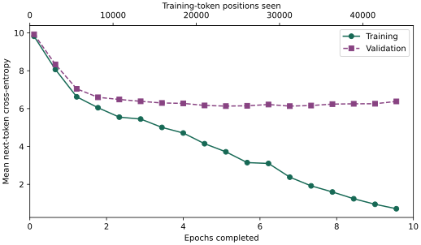](../assets/chapter-05/verdict-ten-epochs.svg)

<figcaption markdown="span">Companion to Figure 5.12. Each marker is an evaluation on the M5 run. The bottom axis counts passes through the training loader. The top axis counts training-token positions, including repeat visits. [Measured losses and samples](../assets/chapter-05/verdict-ten-epochs.json)</figcaption>
</figure>

To draw the figure from the three lists returned by the loop, use the measured token count to place every point. In particular, the first observation comes **after** the first update, one ninth of the way through epoch one.

```python title="Plot the measurements returned by train_model_simple"
import matplotlib.pyplot as plt

tokens_per_epoch = 9 * 512  # Nine full batches from this particular loader.
epochs_seen = [tokens / tokens_per_epoch for tokens in tokens_seen]
fig, ax = plt.subplots(figsize=(7.2, 4.2), layout="constrained")
ax.plot(epochs_seen, train_losses, "o-", color="#176955", label="Training")
ax.plot(epochs_seen, val_losses, "s--", color="#884382", label="Validation")
ax.set(xlabel="Epochs completed", ylabel="Mean next-token cross-entropy",
       xlim=(0, 10), xticks=range(0, 11, 2))
ax.legend()
top = ax.secondary_xaxis("top", functions=(
    lambda epochs: epochs * tokens_per_epoch,
    lambda tokens: tokens / tokens_per_epoch,
))
top.set_xlabel("Training-token positions seen")
top.set_xticks([0, 10000, 20000, 30000, 40000])
fig.savefig("verdict-ten-epochs.svg")
```

On an **Apple M5 with 16 GiB unified memory**, PyTorch 2.14.1 on MPS took **48.4 seconds** for the training loop, including the evaluations and ten samples. Setup and plotting were outside the timer. The book reports training loss **9.781 → 0.391** and validation **9.933 → 6.452**. Our first and last logged measurements were **9.818 → 0.712** and **9.923 → 6.380** respectively. The lowest measured validation loss was **6.132 at step 60**. A fixed seed makes the setup repeatable within an environment, but different devices and software can produce different trajectories.

### What the loss curves and generated text tell us

The useful signal is the change over time. During the first epoch, both curves fall. Later the model keeps improving on familiar windows while progress on held-out windows largely stalls. That widening gap is evidence of **overfitting**. The fact that validation loss is higher at one isolated measurement would tell us much less.

Our first sample continued the prompt with commas. After epoch ten it produced “quite insensible to the irony.” We removed the fixed prompt and collapsed whitespace in both the printed continuation and the first 90% of the story. **The entire 50-token continuation occurred as one contiguous passage in the training split.** Here the more grammatical sample is direct evidence of recall.

A direct check is to take a distinctive passage from a generated continuation and search the **training split**. Longer exact matches give stronger evidence of verbatim recall than everyday phrases like “he said.” A single match establishes overlap for that sample. Held-out loss answers the broader question of generalization. A larger corpus can supply more fresh text per update and require fewer repeat passes to reach the same token budget.

**Chapter roadmap (Figure 5.13).** We can now generate a sample, score next-token predictions, measure loss on two splits, and train the weights. In §5.3 we keep those weights fixed and change how we select tokens from the logits. Temperature and top-k sampling can diversify the continuation. A change in decoding leaves any memorized passages in the weights. Saving and reloading our weights comes in §5.4, followed by loading OpenAI’s GPT-2 weights in §5.5.

<figure markdown="1">

[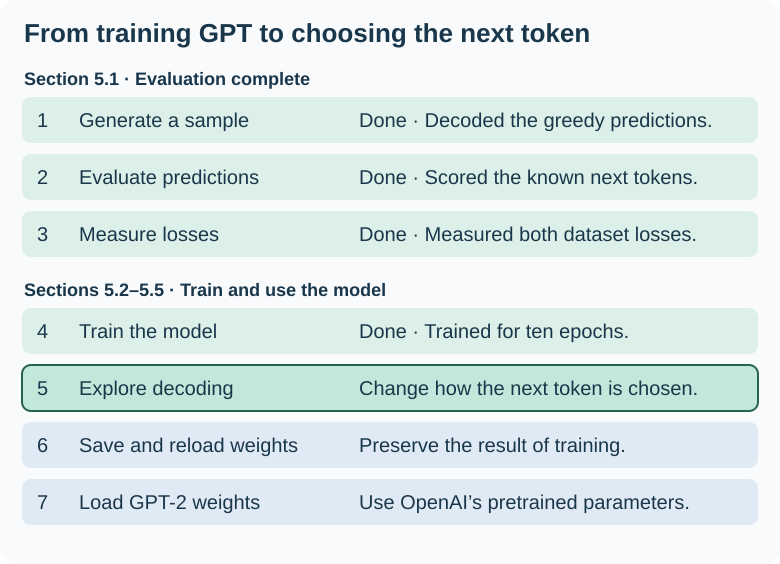](../assets/chapter-05/decoding-roadmap.svg)

<figcaption markdown="span">Companion to Figure 5.13. The trained model supplies vocabulary scores. The next section explores how we choose a token from those scores.</figcaption>
</figure>

## 5.3 Decoding strategies to control randomness

“Decode” shows up twice during generation. Suppose the prompt is `Every effort moves you`. The tokenizer **encodes** that string into IDs. GPT reads those IDs and returns a score for every possible next token. A **decoding strategy** chooses the next ID from those scores. We append that ID to the prompt and repeat. Finally, the tokenizer **decodes** the accumulated IDs into readable text. The choice that can make two continuations different happens inside the generation loop.

```python
model.to("cpu")  # The short example can run here. The prompt IDs must live here too.
model.eval()     # Switch off training-time dropout.
prompt_ids = text_to_token_ids("Every effort moves you", tokenizer).to("cpu")
output_ids = generate_text_simple(model, prompt_ids, 25, model.pos_emb.num_embeddings)
print(token_ids_to_text(output_ids, tokenizer))
```

Moving to CPU is optional. We could keep the trained model and prompt on the M5 GPU and use the same decoding strategy. Calling `eval()` is a separate decision: it disables dropout, so a forward pass uses the full network without a fresh random dropout mask. Our Chapter 4 generation helper also uses `torch.no_grad()` to avoid storing a backward graph during inference.

The current helper uses **greedy decoding**. For example, if the leading candidates have probabilities 0.45, 0.35 and 0.20, it always takes the first. With the same prompt, weights and repeatable forward passes, the first choice repeats, the next input is identical, and the same continuation follows step by step. Temperature scaling (§5.3.1) and top-k sampling (§5.3.2) give us control over the distribution we sample from. We can keep dropout off while deliberately introducing randomness at the token-choice step.

### 5.3.1 Temperature scaling

Freeze generation right after `Every effort moves you`. For this one position, Raschka gives us nine illustrative logits. Read the two rows together: token ID 3 means `forward`, and its score is 6.75. Greedy decoding picks it every time. Sampling can also pick it on the first try. The difference shows up when we repeat the choice. [Author’s Chapter 5 notebook](https://github.com/rasbt/LLMs-from-scratch/blob/main/ch05/01_main-chapter-code/ch05.ipynb)

```python
tokens = ["closer", "every", "effort", "forward", "inches", "moves", "pizza", "toward", "you"]
logits = torch.tensor([4.51, 0.89, -1.90, 6.75, 1.63, -1.62, -1.89, 6.28, 1.79])

temperature = 1.0
probabilities = torch.softmax(logits / temperature, dim=0)
chosen_id = torch.multinomial(probabilities, num_samples=1).item()
print(tokens[chosen_id])
```

Temperature sets the odds. The call to `multinomial` makes the random draw. Look at the two leading scores: `forward` leads `toward` by **0.47**. At temperature 0.1 the gap entering softmax becomes **4.7**. At temperature 5 it shrinks to **0.094**. Their ranking stays the same, but the size of the lead changes how often the runner-up gets picked. With a unique highest score, sampling approaches greedy selection as temperature approaches zero. The division requires a positive temperature.

<figure markdown="1">

[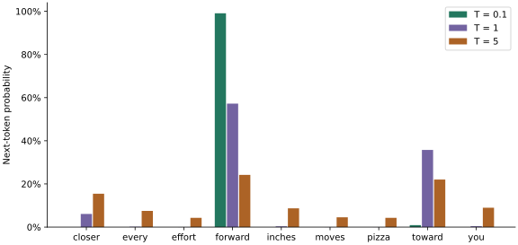](../assets/chapter-05/temperature-scaling.svg)

<figcaption markdown="span">Companion to Figure 5.14. Each group holds one token fixed while temperature changes. Bars of the same color across all nine groups add up to 100%.</figcaption>
</figure>

**Exercise 5.1.** Imagine 1,000 copies of the same unfinished sentence. Fill in exactly one next token on each copy. Count how many copies ended in `pizza`. Repeat at temperatures 1, 0.1 and 5, always starting from the same nine logits. The second part asks how you would determine the underlying chance of that outcome without relying on a particular set of 1,000 draws.

**Solution.** Use the same logits for the same blank each time. Reset the seed once per temperature, then let the random generator advance through all 1,000 draws.

```python
pizza_id = tokens.index("pizza")  # 6 in this vocabulary
for temperature in (1.0, 0.1, 5.0):
    probabilities = torch.softmax(logits / temperature, dim=0)
    torch.manual_seed(123)
    draws = [torch.multinomial(probabilities, 1).item() for _ in range(1000)]
    print(temperature, draws.count(pizza_id), probabilities[pizza_id].item())
```

| Temperature | Observed count in 1,000 draws (CPU, PyTorch 2.14.1) | Probability per draw | Expected count in 1,000 draws |
| ---: | ---: | ---: | ---: |
| 1 | 0 | 0.01012% | 0.1012 |
| 0.1 | 0 | 2.97 × 10⁻³⁶% | 2.97 × 10⁻³⁵ |
| 5 | 32 | 4.2998% | 43.0 |

The shortcut is to read `probabilities[pizza_id]` directly. Multiply it by 1,000 to get the expected count. At temperature 5, repeated experiments would average about 43 occurrences per 1,000 draws. This particular run produced 32.

### 5.3.2 Top-k sampling

In Exercise 5.1, raising the temperature gave `pizza` a chance after `Every effort moves you`. Suppose we want some variety but only among GPT’s three highest-scoring continuations. **Top-k sets who can be picked. Temperature sets the odds among those who remain.** For this prompt, `forward`, `toward`, and `closer` make the cut.

<figure markdown="1">

[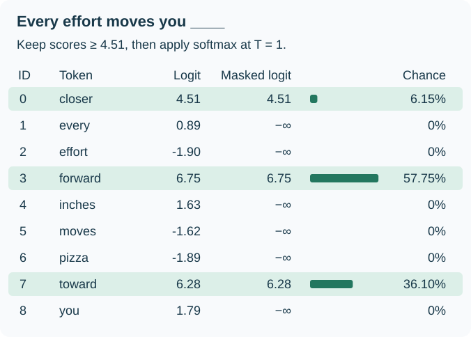](../assets/chapter-05/top-k-shortlist.svg)

<figcaption markdown="span">Original companion to Figure 5.15. Follow one token across its row. At temperature 1, masking sends the chance of drawing pizza to exactly zero and redistributes the probability across the three surviving IDs.</figcaption>
</figure>

```python
# Reuse the nine logits and the ID-ordered tokens list from §5.3.1.
top_scores, top_ids = torch.topk(logits, k=3)
print(top_ids.tolist())                 # [3, 7, 0], in descending score order
cutoff = top_scores[-1]                 # 4.51, the score for "closer"
masked = torch.where(logits < cutoff, -torch.inf, logits)

# Keep the original nine ID slots. Softmax gives exp(-inf) = 0 in six slots.
temperature = 1.0
probabilities = torch.softmax(masked / temperature, dim=0)
next_id = torch.multinomial(probabilities, num_samples=1).item()
print(tokens[next_id])
```

This threshold keeps a token whose score equals the cutoff. If several tokens tie at the boundary it can retain more than *k*. The nine scores here are distinct.

**Does this make generation static?** Imagine drawing `toward`. The next prompt is now `Every effort moves you toward`. GPT computes fresh logits for that context, so different tokens can enter the top three on the very next step. The filter uses the model’s ranking as its only evidence of suitability. It can discard an unusual but excellent word, and a highly ranked continuation can still be nonsense.

Chapter 3 used the same mathematical trick on a different axis. Causal attention masks **future positions** before mixing value vectors. Here we mask **vocabulary IDs** before choosing the next token. Section 5.3.3 puts this choice inside the generation loop. [Author’s Chapter 5 notebook](https://github.com/rasbt/LLMs-from-scratch/blob/main/ch05/01_main-chapter-code/ch05.ipynb)

### 5.3.3 Modifying the text generation function

The Chapter 4 loop already knew how to extend a prompt. Listing 5.4 changes one decision inside it: **given the scores at the last position, which ID should we append?** The same weights can now produce a greedy continuation or a sampled one. [Author’s Chapter 5 implementation](https://github.com/rasbt/LLMs-from-scratch/tree/main/ch05/01_main-chapter-code)

```python title="Listing 5.4 companion — generate for a single prompt"
@torch.no_grad()
def generate(
    model: nn.Module, idx: torch.Tensor, max_new_tokens: int, context_size: int,
    temperature: float = 0.0, top_k: int | None = None, eos_id: int | None = None,
) -> torch.Tensor:
    """Extend one prompt of integer token IDs [1, T]; T is its current length."""
    for _ in range(max_new_tokens):
        # Keep the full output in idx. Only the most recent context fits in GPT.
        context = idx[:, -context_size:]
        scores = model(context)[:, -1, :]  # [1, vocabulary size] at the last position

        if top_k is not None:
            # topk sorts the winners. The last winner gives the cutoff.
            winners = scores.topk(top_k, dim=-1).values
            cutoff = winners[:, -1:]  # [1, 1], broadcasts across the vocabulary
            scores = scores.masked_fill(scores < cutoff, -torch.inf)

        if temperature > 0:
            # Convert the remaining scores to probabilities, then draw one ID.
            probs = torch.softmax(scores / temperature, dim=-1)
            next_id = torch.multinomial(probs, num_samples=1)
        else:
            # Zero is the greedy setting. This branch avoids division by zero.
            next_id = scores.argmax(dim=-1, keepdim=True)

        # An optional end marker stops this single prompt before we append it.
        if eos_id is not None and next_id.item() == eos_id:
            break
        idx = torch.cat((idx, next_id), dim=1)  # New token becomes input next time.
    return idx
```

Here is the call for the book’s example. Set the seed once before generation so that the random generator advances with each draw.

```python
model.to("cpu").eval()
prompt_ids = text_to_token_ids("Every effort moves you", tokenizer)
torch.manual_seed(123)
output_ids = generate(model, prompt_ids, max_new_tokens=15,
                      context_size=cfg["context_length"], top_k=25, temperature=1.4)
print(token_ids_to_text(output_ids, tokenizer))
```

**Exercise 5.2 — change the token choice, keep the weights fixed.** We repeated the ten-epoch M5 training setup from §5.2 and then ran three CPU continuations from that single model. Each starts with the same prompt, generates 15 tokens, and resets the seed to 123. These are local outputs.

**Temperature 0, top-k None.**

```text
Every effort moves you?"

"Yes--quite insensible to the irony. She wanted
```

**Temperature 0.2, top-k 3.**

```text
Every effort moves you?"

"Yes--quite insensible to the fact with a laugh
```

**Temperature 1.4, top-k 25.**

```text
Every effort moves you stand," she up surprise. It is to have been an object for enough
```

Once two continuations choose different IDs, the next model inputs differ too. A single unusual choice early on can change the rest of the sentence. A setting that produces a fresh phrase can also produce awkward grammar.

| Application | Decoding choice | What matters to the user |
| --- | --- | --- |
| Route a ticket to billing, access, or support | Greedy selection or a narrow shortlist and low temperature | The same request should get a stable label. Restrict the output to the allowed labels and check it before routing. |
| Brainstorm titles for a talk | Sample several continuations with a wider shortlist and higher temperature | Different phrasings are useful because a person will compare them. Keep the ones that fit. |

A low positive temperature still permits random draws among surviving candidates. Greedy selection removes that draw. Neither setting establishes that a label is correct or an action is safe. For a critical software action, validate the output and enforce the action’s preconditions in ordinary code.

**Revisit after §5.5:** use the same prompt, settings and length with the pretrained GPT-2 weights. Compare coherence and variety separately so a surprising continuation does not automatically count as a better one.

**Exercise 5.3 — recover greedy behavior.** Fix the prompt and weights, call `model.eval()`, and assume repeatable forward passes. Two settings in Listing 5.4 give the greedy output:

- **Set `temperature=0`.** The function calls `argmax` directly. You can leave `top_k=None` or use any valid positive k because the mask always retains the highest score.
- **Set `top_k=1` with a positive temperature.** With a unique highest score, only that ID survives, so sampling must return it. The listing uses a score threshold, so an exact tie for first would retain both IDs. Use the zero-temperature branch when you want greedy tie handling as well.

A small positive temperature with several candidates can still produce different IDs. Resetting a seed can replay a sampled sequence, but that sequence can differ from the greedy one.

## 5.4 Loading and saving model weights in PyTorch

What should survive when the Python process exits? To generate another sentence tomorrow, we need the GPT architecture, its configuration, tokenizer, and learned weights. To take the **next AdamW update**, we also want the optimizer’s memory of the preceding batches.

<figure markdown="1">

[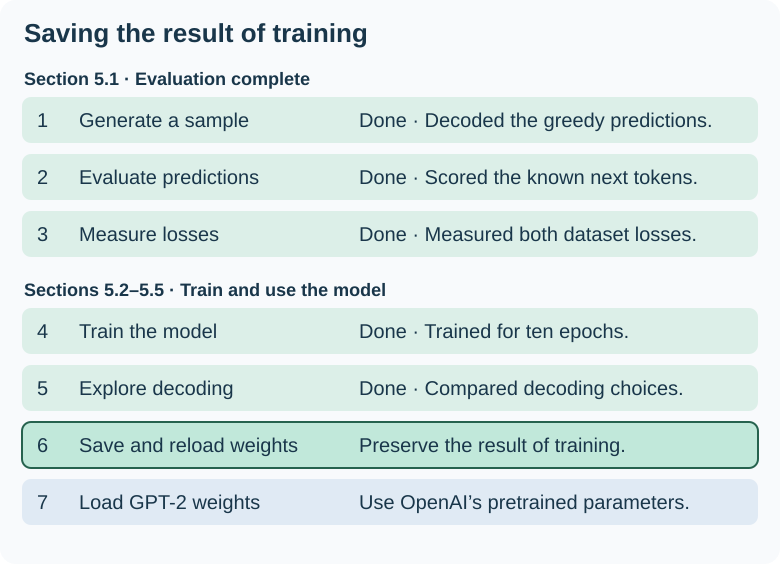](../assets/chapter-05/checkpoint-roadmap.svg)

<figcaption markdown="span">Companion to Raschka’s Figure 5.16. Step 6 preserves our trained model. Step 7 will bring someone else’s pretrained GPT-2 weights into the architecture we built.</figcaption>
</figure>

### Save the weights for inference

`model.state_dict()` maps names such as `tok_emb.weight` to tensors. It includes learned parameters and persistent buffers such as the causal attention mask. The `.pth` suffix is a filename convention. In a new session, recreate the architecture with the **same configuration** (including our 256-position embedding table), then copy the saved values into it. [PyTorch guide to saving and loading models](https://docs.pytorch.org/tutorials/beginner/saving_loading_models.html)

```python
# End of training
torch.save(model.state_dict(), "verdict-weights.pth")

# New session: import GPTModel, recreate cfg, and select the device.
model = GPTModel(cfg).to(device)
weights = torch.load("verdict-weights.pth", map_location="cpu", weights_only=True)
model.load_state_dict(weights)
model.eval()  # Disable dropout for generation.
```

Dropout samples a fresh mask during training. That temporary mask has no learned weights to save. Reconstructing the model recreates the dropout layers, and `eval()` selects their inference behavior.

### Exercise 5.4 — resume for one epoch

Think of one coordinate in the token embedding table. Its **weight** tells GPT which value to use on the next forward pass. AdamW separately stores running averages of the gradient and squared gradient for that coordinate, plus an update counter for its parameter tensor. Restoring only the model gives the same initial predictions. Starting a fresh AdamW changes how the *next* gradient updates those weights. The same distinction applies to a CNN trained with AdamW.

```python
# Session 1: immediately after ten epochs.
torch.save({
    "model": model.state_dict(),
    "optimizer": optimizer.state_dict(),
    "epochs_completed": 10,
}, "verdict-training.pth")
```

```python
# Session 2: recreate the same cfg, tokenizer and loaders from §5.1.
saved = torch.load("verdict-training.pth", map_location="cpu", weights_only=True)
model = GPTModel(cfg).to(device)
model.load_state_dict(saved["model"])

# Attach AdamW to this new model's parameters before loading its history.
optimizer = torch.optim.AdamW(model.parameters(), lr=0.0004, weight_decay=0.1)
optimizer.load_state_dict(saved["optimizer"])
model.train()

train_model_simple(model, train_loader, val_loader, optimizer, device,
                   num_epochs=1, eval_freq=5, eval_iter=5,
                   start_context="Every effort moves you", tokenizer=tokenizer)
print("Completed epoch", saved["epochs_completed"] + 1)
```

**Fresh-process check on the M5.** We saved after ten epochs (90 updates), started a second Python process and restored the checkpoint. Before taking another step, all 50,257 next-token logits for the fixed prompt matched the saved reference exactly. After one more epoch, every restored AdamW step counter had advanced from 90 to 99. Validation loss measured after update 99 was **6.4580**.

The helper initializes its own logging counters, so its first resumed line says epoch 1, step 0. AdamW’s restored counters continue from the checkpoint. For an exact replay of a shuffled, dropout-enabled training trajectory, also preserve random generator and sampler state. Our [Cosmopedia resume experiment](https://github.com/kantarcise/learning-llms/tree/main/experiments/cosmopedia/results/rtx3090-resume) tests that stronger requirement.

!!! tip "The JAX equivalent with Flax Linen"

    A JAX training program often carries its state explicitly as a tree of arrays. In Flax Linen, a standard `TrainState` groups the parameters, optimizer state and step. For a small local checkpoint, serialize that state and restore it into a freshly initialized template with the same model and optimizer. To export just the weights, serialize `state.params` and restore into `template.params`. [Flax serialization reference](https://flax-linen.readthedocs.io/en/latest/api_reference/flax.serialization.html)

    ```python
    from pathlib import Path
    from flax import serialization

    path = Path("verdict-training.msgpack")
    path.write_bytes(serialization.to_bytes(state))  # End of session 1.

    # Session 2: initialize template with the matching model and optimizer.
    state = serialization.from_bytes(template, path.read_bytes())
    ```

## 5.5 Loading pretrained weights from OpenAI

Section 5.4 put our own trained parameters back into a fresh GPT. Here we use the same idea with parameters learned by OpenAI during GPT-2 pretraining. The printed book uses TensorFlow to **read the original checkpoint format**. The model that runs the forward pass is still our PyTorch GPT.

### Inspect the checkpoint before building the model

The book’s `download_and_load_gpt2` helper returns two dictionaries. **Settings tell us what to build. Parameters supply the learned numbers to put inside it.** For GPT-2 small, the settings on page 162 are `n_vocab=50257`, `n_ctx=1024`, `n_embd=768`, `n_head=12`, and `n_layer=12`. These are dimensions and counts. The separate parameter dictionary groups the arrays by their role in the forward pass.

```python
# After loading the original checkpoint with the book’s helper:
print(params.keys())          # blocks, b, g, wpe, wte
print(len(params["blocks"]))  # 12 groups of attention, feedforward and norm parameters
print(params["wte"].shape)    # (50257, 768): token ID selects a row
print(params["wpe"].shape)    # (1024, 768): position selects a row
```

For example, `params["wte"][42]` holds all 768 coordinates learned for token ID 42. At position 3, add that row to `params["wpe"][3]` to get the input vector. The top-level `g` and `b` supply the scale and shift for the **final** LayerNorm.

<figure markdown="1">

[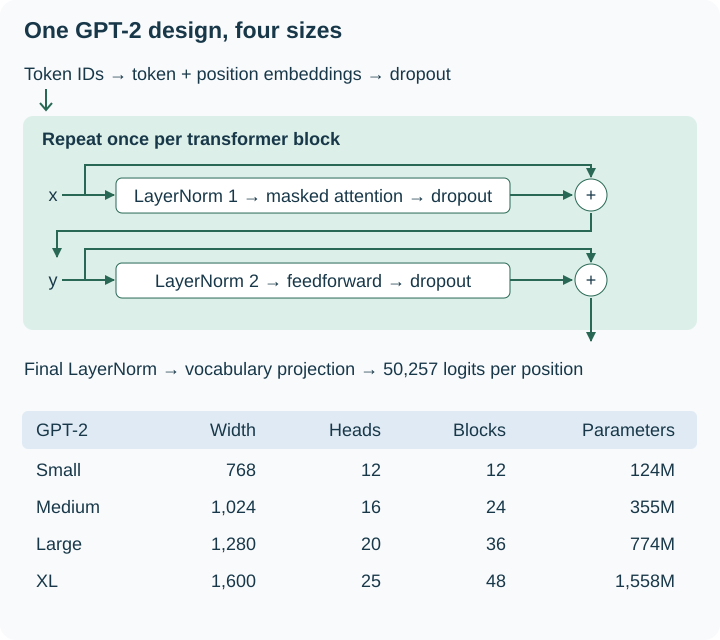](../assets/chapter-05/gpt2-family.svg)

<figcaption markdown="span">Original companion to Figure 5.17 (p. 163). Moving from small to XL widens each token row from 768 to 1,600 coordinates and deepens the stack from 12 to 48 blocks. Each head still gets 64 coordinates: 768 ÷ 12 and 1,600 ÷ 25 give the same result.</figcaption>
</figure>

**Where does Q/K/V bias enter?** On page 164, *after* Figure 5.17, Raschka sets `context_length=1024` and `qkv_bias=True` when constructing the receiving model. The five settings printed earlier have no bias flag. The checkpoint does contain learned attention projection biases, stored together inside each block at `params["blocks"][i]["attn"]["c_attn"]["b"]`. Enabling the flag gives our separate query, key, and value layers a place to load their respective slices.

!!! tip "Use the author’s PyTorch conversion"

    Raschka converted the original weights into state dictionaries for the book’s `GPTModel`. For GPT-2 small, use `gpt2-small-124M.pth` from his notebook. Start a fresh model with **1,024 positions** and **Q/K/V biases enabled**. Our short-story run used 256 positions and omitted those biases. The small model’s width (768), block count (12) and head count (12) already match. Then load the dictionary as in §5.4 and switch the model to evaluation mode. This route uses the PyTorch installation already in the project. [Author’s PyTorch loading notebook](https://github.com/rasbt/LLMs-from-scratch/blob/main/ch05/02_alternative_weight_loading/weight-loading-pytorch.ipynb)

### Build a model that fits the checkpoint

The size name selects three dimensions. `copy()` lets us keep the short-story configuration for later. Each `update()` replaces only the named entries.

```python
model_configs = {
    "124M":  {"emb_dim": 768,  "n_layers": 12, "n_heads": 12},
    "355M":  {"emb_dim": 1024, "n_layers": 24, "n_heads": 16},
    "774M":  {"emb_dim": 1280, "n_layers": 36, "n_heads": 20},
    "1558M": {"emb_dim": 1600, "n_layers": 48, "n_heads": 25},
}
new_config = GPT_CONFIG_124M.copy()
new_config.update(model_configs["124M"])  # Match the checkpoint we selected.
new_config.update({"context_length": 1024, "qkv_bias": True})
gpt = GPTModel(new_config)
gpt.eval()  # Switch off dropout. The parameters still have their initial values.
```

### Listing 5.5 — follow one weight into the model

Start inside the **first** block. OpenAI calls its attention output projection `params["blocks"][0]["attn"]["c_proj"]["w"]`. Our module calls it `gpt.trf_blocks[0].att.out_proj.weight`. Both mix the attention heads’ joined outputs. To see why the assignment needs a transpose, imagine the checkpoint stores a tiny matrix `[[1, 2], [3, 4]]`. Multiplying the input row `[10, 1]` by that matrix gives `[13, 24]`. PyTorch’s `nn.Linear` computes `x @ weight.T`, so we must **store** `[[1, 3], [2, 4]]` in its weight. Both matrices are square: checking dimensions alone would miss a forgotten transpose.

The helper below checks each destination shape before returning a trainable parameter. This walkthrough uses the original loader’s nested NumPy arrays. The author’s converted PyTorch checkpoint already has these names and layouts and goes directly through `load_state_dict`. [Author’s Chapter 5 notebook](https://github.com/rasbt/LLMs-from-scratch/blob/main/ch05/01_main-chapter-code/ch05.ipynb)

```python
import numpy as np
import torch
from torch import nn


def assign(destination: nn.Parameter, source: np.ndarray) -> nn.Parameter:
    """Copy a checkpoint array into a trainable parameter of the expected shape."""
    if tuple(destination.shape) != source.shape:
        raise ValueError(f"Expected {tuple(destination.shape)}, got {source.shape}")
    return nn.Parameter(torch.tensor(source, dtype=destination.dtype,
                                     device=destination.device))
```

```python title="Listing 5.5 companion — load_weights_into_gpt"
def load_weights_into_gpt(gpt: GPTModel, params: dict) -> None:
    """Populate a bias-enabled GPTModel from the book loader's GPT-2 arrays."""
    gpt.tok_emb.weight = assign(gpt.tok_emb.weight, params["wte"])
    gpt.pos_emb.weight = assign(gpt.pos_emb.weight, params["wpe"])

    # One checkpoint block maps to one model block, in the same order.
    for block, saved in zip(gpt.trf_blocks, params["blocks"], strict=True):
        packed = saved["attn"]["c_attn"]
        # Small GPT-2: [768, 2304] holds Q, K and V side by side.
        # Split columns into three [768, 768] matrices and the bias into thirds.
        qw, kw, vw = np.split(packed["w"], 3, axis=-1)
        qb, kb, vb = np.split(packed["b"], 3)
        for layer, weight, bias in (
            (block.att.W_query, qw, qb),
            (block.att.W_key, kw, kb),
            (block.att.W_value, vw, vb),
        ):
            layer.weight = assign(layer.weight, weight.T)
            layer.bias = assign(layer.bias, bias)  # Already a 1-D vector.

        # c_proj appears twice. Its parent tells us which projection it belongs to.
        # The attention output mixes heads. The MLP expands then shrinks each row.
        for layer, saved_layer in (
            (block.att.out_proj, saved["attn"]["c_proj"]),
            (block.ff.layers[0], saved["mlp"]["c_fc"]),
            (block.ff.layers[2], saved["mlp"]["c_proj"]),
        ):
            layer.weight = assign(layer.weight, saved_layer["w"].T)
            layer.bias = assign(layer.bias, saved_layer["b"])
        # ff.layers[1] is GELU. It has no learned parameters to transfer.

        for norm, saved_norm in ((block.norm1, saved["ln_1"]),
                                 (block.norm2, saved["ln_2"])):
            norm.scale = assign(norm.scale, saved_norm["g"])
            norm.shift = assign(norm.shift, saved_norm["b"])

    # Outside the loop: one final normalization and one vocabulary head.
    gpt.final_norm.scale = assign(gpt.final_norm.scale, params["g"])
    gpt.final_norm.shift = assign(gpt.final_norm.shift, params["b"])
    gpt.out_head.weight = assign(gpt.out_head.weight, params["wte"])


load_weights_into_gpt(gpt, params)
```

Why use `wte` twice? GPT-2 used the same learned table to look up input tokens and score output tokens. The listing copies its values into two parameters, which gives the intended inference values. To keep them tied during further training, both layers would need to reference the same parameter. Since this loader replaces parameter objects, create any new training optimizer **after** loading.

## Questions to bring to the chapter

<!-- Add actual questions during reading. -->

## End of chapter

<!-- Summarize what became clear, link exercises, and record unresolved questions. -->
