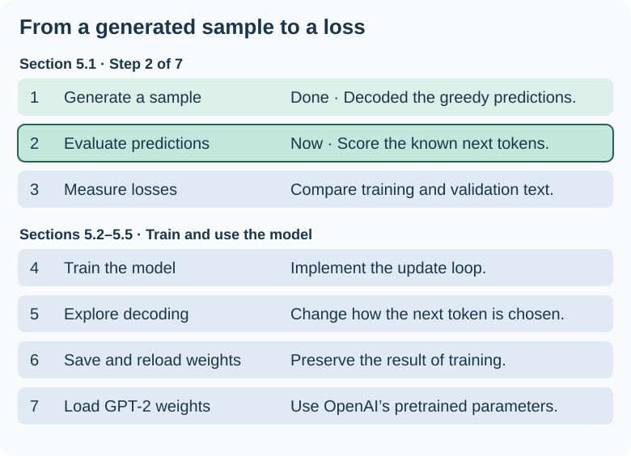
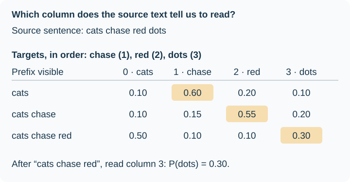
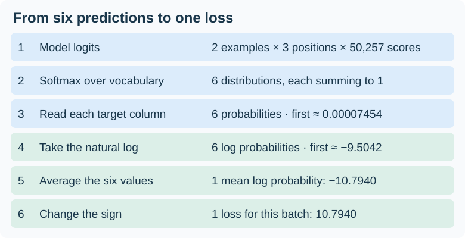
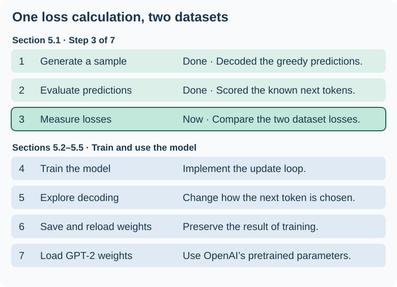

# Chapter 5 — Pretraining on Unlabeled Data

Our GPT could already extend `Hello, I am` by six tokens at the end of Chapter 4. Its random weights ranked ` Feature` highest for the first new token. Chapter 5 asks how to give that same architecture a learning signal. In **pretraining on unlabeled text**, the next token in the source supplies the target. Each training window therefore gives us predictions we can score before an optimizer updates the weights. [Chapter 4 generation example](04-implementing-a-gpt-model.md#47-generating-text)

<figure markdown="1">

[](https://sebastianraschka.com/images/LLMs-from-scratch-images/mental-model.jpg)

<figcaption markdown="span">Sebastian Raschka’s [book roadmap](https://sebastianraschka.com/llms-from-scratch/), embedded from his website. Figure 5.1 puts us at **Stage 2**. Step 4 is pretraining, supported by the training loop (5), evaluation (6), and loading weights (7).</figcaption>
</figure>

We will implement the training loop, monitor training and validation losses, and save what the model learns so we can reload it later. Then we will load OpenAI’s released GPT-2 weights into our implementation. Those weights give us a pretrained starting point for the fine-tuning chapters. [Author’s Chapter 5 code](https://github.com/rasbt/LLMs-from-scratch/tree/main/ch05)

!!! note "Weight parameters"

    In our GPT, “weights” often means all the numbers the optimizer can learn. PyTorch also uses `.weight` as a specific attribute. For example, `model.out_head.weight` is the vocabulary projection matrix we counted in Chapter 4. A linear layer configured with a bias also has a separate `.bias` parameter.

    `model.parameters()` iterates over the registered parameters throughout the model, including the embedding tables and LayerNorm’s learned scale and shift. We already used it to count the model’s parameters. In the training loop, we will pass those parameters to the optimizer so it can update them using the gradients computed by `loss.backward()`.

## 5.1 Evaluating generative text models

Reading a generated sample tells us something about that particular continuation. To track learning over many examples, we also need a numerical question: **How much probability did the model assign to the next token that actually occurred?** We will first revisit generation, then score predictions against known next tokens, and finally compare average losses on training and held-out validation text. A validation pass measures the current weights without taking an optimizer step.

<figure markdown="1">

[](../assets/chapter-05/chapter-plan.svg)

<figcaption markdown="span">Original companion to Figure 5.2. The first three steps establish how we will evaluate the model. The remaining four show where those measurements fit into the chapter.</figcaption>
</figure>

We saw this distinction in Character Logs. Generated text began to resemble log entries, while the validation loss helped us choose the epoch 8 checkpoint. Here we will build the evaluation code that produces those measurements. [Character Logs results](../preparation/training-comparison.md#reading-the-curves-together)

### 5.1.1 Using GPT to generate text

Chapter 4 gave us two pieces we can reuse: `GPTModel` maps IDs to logits, and `generate_text_simple` takes the last position’s logits, chooses the highest-scoring ID, and appends it to the prompt. For this walkthrough, use those [Chapter 4 definitions](04-implementing-a-gpt-model.md#47-generating-text) and make a copy of the configuration:

```python
cfg = GPT_CONFIG_124M.copy()
cfg["context_length"] = 256
torch.manual_seed(123)
model = GPTModel(cfg)
model.eval()  # Disable dropout while inspecting this initial model.
```

The width stays at 768, with 12 heads in each of 12 blocks. What changes is how many positions a training example can contain. With full-length examples and the same batch size, one attention head now forms a 256 × 256 score matrix instead of 1,024 × 1,024: one sixteenth as many score entries. This reduces memory and computation for the laptop exercise. A four-token prompt still occupies just four positions.

The new position embedding table has 256 rows. Later, to use GPT-2’s pretrained weights, we will construct a model with the original 1,024-position configuration and load the matching weights. Editing the dictionary after an instance exists does not resize that instance’s table.

#### Two helpers around the generation loop

<figure markdown="1">

[](../assets/chapter-05/text-id-helpers.svg)

<figcaption markdown="span">Original companion to Figure 5.3. This trace shows one verified greedy step with the chapter’s randomly initialized, 256-position model in evaluation mode. The output helper decodes the entire sequence, including the prompt.</figcaption>
</figure>

The two helpers in Listing 5.1 handle the boundary between a **Python string** and the **batch of integer IDs** that the generation loop accepts and returns. Both use the same GPT-2 tokenizer. The argument `allowed_special` lets the tokenizer recognize the literal end-of-text marker if present in the input.

```python title="Listing 5.1 companion — conversion for a single example"
import tiktoken


def text_to_token_ids(text: str, tokenizer: tiktoken.Encoding) -> torch.Tensor:
    """Encode one string as torch.long IDs [1,T], where T counts tokens."""
    ids = tokenizer.encode(text, allowed_special={"<|endoftext|>"})
    return torch.tensor(ids, dtype=torch.long).unsqueeze(0)  # [T] -> [1,T]


def token_ids_to_text(token_ids: torch.Tensor, tokenizer: tiktoken.Encoding) -> str:
    """Decode one sequence of integer IDs [1,T] into a string."""
    ids = token_ids.squeeze(0)  # [1,T] -> [T]: remove the single batch axis.
    return tokenizer.decode(ids.tolist())
```

For `Every effort moves you`, encoding produces the list `[6109, 3626, 6100, 345]`. Adding the batch axis gives `[[6109, 3626, 6100, 345]]`, shape `[1, 4]`. GPT returns shape `[1, 4, 50257]`. The generation loop reads the fourth row and appends its chosen ID. Only then does `token_ids_to_text` remove the outer axis and decode the resulting list. With several examples, decode each batch row separately.

Now run ten greedy steps with the model initialized above. At each step, the last position has one logit (an unnormalized score) per vocabulary entry. Softmax would turn those scores into probabilities. For greedy generation, the highest score already identifies the token ID to append.

```python
tokenizer = tiktoken.get_encoding("gpt2")
prompt_ids = text_to_token_ids("Every effort moves you", tokenizer)
result = generate_text_simple(model, prompt_ids, 10, cfg["context_length"])
print(token_ids_to_text(result, tokenizer))  # Four prompt IDs plus ten new IDs.
```

```text
Every effort moves you rentingetic wasnم refres RexMeCHicular stren
```

The tokenizer can decode every ID the model chose. The continuation reads like gibberish because the randomly initialized model has yet to learn which tokens tend to follow this prompt. To measure learning, we can give the model a passage with a known next token. Even if its top choice stays the same, raising the probability of the actual next token lowers the loss for that prediction. Section 5.1.2 develops that calculation.

### 5.1.2 Calculating the text generation loss

Suppose our source sentence is **cats chase red dots**. Give GPT the first three tokens. In one forward pass it produces three rows of logits. The causal mask lets the first position see only `cats`, the second see `cats chase`, and the third see the whole prompt. Each row answers the same question for a different prefix: **which token comes next?**

<figure markdown="1">

[](../assets/chapter-05/next-token-rows.svg)

<figcaption markdown="span">Original companion to Figure 5.4, using a four-token vocabulary and illustrative probabilities. Each column is one possible next token. Each row sums to one. Our GPT-2 tokenizer gives each row 50,257 columns.</figcaption>
</figure>

**For generation**, read the last row. Its highest probability is 0.50 in column 0, so greedy decoding appends `cats`. The earlier rows show predictions for shorter prefixes that were already supplied in the prompt.

**For loss**, the source sentence tells us the next tokens were `chase`, `red`, and `dots`. Read those columns in their respective rows and you get 0.60, 0.55, and **0.30**. That last number is the probability the model gave the actual next token, even though it would have generated `cats`. These three probabilities give us the starting point for the loss calculation.

#### Two examples, three next-token predictions each

The book uses seven vocabulary entries in Figure 5.4. In the code, the GPT-2 tokenizer has **50,257 tokens**, with IDs from 0 through 50,256. Take two four-token passages and slice each one twice, just as we did with the sliding windows in Chapter 2. The first three tokens are the input. The last three are the targets.

```python
inputs = torch.tensor([
    [16833, 3626, 6100],  # "every effort moves"
    [   40, 1107,  588],  # "I really like"
])
targets = torch.tensor([
    [3626, 6100,   345],  # " effort moves you"
    [1107,  588, 11311],  # " really like chocolate"
])

with torch.no_grad():
    logits = model(inputs)
    probabilities = torch.softmax(logits, dim=-1)
```

Both outputs have shape `[2, 3, 50257]`. The first two axes tell us **which example** and **which input position**. Inside the transformer, each of those six positions has 768 coordinates. The output head turns those coordinates into 50,257 logits, one score per possible next token. Softmax works across that last axis, so each position gets its own distribution that sums to one.

For example, `probabilities[1, 2]` contains all the next-token probabilities after `I really like`. The target at that position is ID 11311, so `probabilities[1, 2, 11311]` is the single probability assigned to `" chocolate"`. The leading space belongs to the token.

#### Read the predictions, then score the targets

Figure 5.4 ends by selecting an ID and decoding it. Here we do that at all six positions in one batch. Each position has its own row of 50,257 probabilities. `argmax` gives the column index of the largest probability in that row, and that index is a token ID.

```python
predicted_ids = probabilities.argmax(dim=-1, keepdim=True)  # [2, 3, 1]
rows = predicted_ids.squeeze(-1)  # [2, 3]: one winning ID per position
print(rows.tolist())  # [[16657, 339, 42826], [49906, 29669, 41751]]

# Take the first example, keeping the batch axis our decoding helper expects.
print(repr(token_ids_to_text(rows[:1], tokenizer)))     # ' Armed heNetflix'
print(repr(token_ids_to_text(targets[:1], tokenizer)))  # ' effort moves you'
```

Read the first prediction as “given `every`, the model chose ` Armed`.” For the second prediction it saw the supplied prefix `every effort` and chose ` he`. The three decoded pieces sit next to each other for inspection. Each came from a different position in the same forward pass.

<figure markdown="1">

[](../assets/chapter-05/evaluation-roadmap.svg)

<figcaption markdown="span">Original companion to Figure 5.5. Step 1 gave us text to inspect. In step 2 we keep the probabilities so we can measure how well each prediction fits its target.</figcaption>
</figure>

For the first position, the correct next token was ` effort`. The untrained model assigned it a probability of about **0.0000745**. If training raises that probability, the loss for this position falls, even if ` Armed` still wins. This is why the training loop will compute loss from the model’s scores and the known target IDs. During evaluation we record that loss. During training we also backpropagate through it so the optimizer can update the weights.

#### Read one target probability per position

Think of a CNN classifying an image labeled “cat.” The label tells us which class probability to inspect, even when the highest score goes to “dog.” In language modeling, the source text supplies a label at **each token position**. That label is an ID we use as a column index. The numerical distance between two IDs has no bearing on the loss.

<figure markdown="1">

[](../assets/chapter-05/target-probabilities.svg)

<figcaption markdown="span">Original companion to Figure 5.6. Compare the last row with our Figure 5.4. The probabilities are identical. The highlight moves from the model’s top choice, `cats`, to the observed next token, `dots`.</figcaption>
</figure>

The book illustrates this with seven tokens. If probability were spread evenly, each token would receive `1 / 7 ≈ 0.14`. With GPT-2’s 50,257 tokens the corresponding baseline is **about 0.0000199**. This is also the mean across vocabulary entries in each probability row, since they sum to one. Individual probabilities from a randomly initialized model vary around that scale.

Here is the same lookup for the batch above. Each list of three target IDs pairs up with the three positions in its example:

```python
positions = [0, 1, 2]
for example in range(len(targets)):
    target_ids = targets[example]
    # Pair position 0 with target_ids[0], position 1 with target_ids[1],
    # and position 2 with target_ids[2].
    print(probabilities[example, positions, target_ids])
```

```text
tensor([7.4541e-05, 3.1061e-05, 1.1563e-05])
tensor([1.0337e-05, 5.6776e-05, 4.7559e-06])
```

The last value is the probability assigned to `" chocolate"` after `I really like`. Raising that probability lowers the loss for this example’s last position. Greedy decoding will select `" chocolate"` once it has the highest score.

#### Turn six target probabilities into one loss

!!! note "Where backpropagation fits"

    During evaluation, the forward pass gives us a loss we can read. During training, we run the forward pass with gradient tracking enabled. Then `loss.backward()` computes how the loss changes with each trainable parameter, and the optimizer uses those gradients to update the weights.

<figure markdown="1">

[](../assets/chapter-05/batch-cross-entropy.svg)

<figcaption markdown="span">Original companion to Figure 5.7. Follow the count down the right side. Choosing each observed token leaves six numbers. Taking logs preserves that count. Averaging turns the six values into one measurement.</figcaption>
</figure>

Why take logs? The likelihood of a sequence multiplies the probabilities assigned to its successive tokens given their prefixes. Products of small probabilities quickly become tiny. Taking the natural log turns that product into a sum, and dividing by the number of targets gives a per-token average. A confident correct prediction contributes little loss: at probability 0.9, its negative log is about 0.105. At 0.01, the penalty is about 4.605.

```python
target_probs = probabilities.gather(-1, targets.unsqueeze(-1)).squeeze(-1)
# One selected probability per observed token, still arranged as two rows of three.
log_probs = target_probs.log()
manual_loss = -log_probs.mean()
print(manual_loss)  # tensor(10.7940)
```

!!! note "Cross-entropy loss"

    A single observed target gives all the label probability to one vocabulary entry. Cross-entropy therefore reads the model’s log probability at that entry and changes its sign. With one target ID per position and equal weight for all six positions, batch cross-entropy is exactly their mean negative log probability.

**Where does flattening come from?** Think of the CNN classification case: PyTorch can take a table with one row of class scores per image and a list with one class ID per image. Here, **each token position is one classification example**. The model has already computed its contextual representation and its logits. For the loss we can lay those predictions out as six rows:

| Flat row | Prefix that produced the scores | Target token | Target ID |
| ---: | --- | --- | ---: |
| 0 | every | ` effort` | 3626 |
| 1 | every effort | ` moves` | 6100 |
| 2 | every effort moves | ` you` | 345 |
| 3 | I | ` really` | 1107 |
| 4 | I really | ` like` | 588 |
| 5 | I really like | ` chocolate` | 11311 |

```python
# Merge the example and position axes. Keep all vocabulary scores in each row.
scores = logits.flatten(0, 1)  # [2, 3, 50257] → [6, 50257]
labels = targets.flatten()     # [2, 3] → [6], in the same row order
loss = torch.nn.functional.cross_entropy(scores, labels)
torch.testing.assert_close(loss, manual_loss)
```

For example, `scores[3]` contains exactly the logits from `logits[1, 0]`, and `labels[3]` still holds 1107. Flattening keeps that prediction paired with its target. It changes the layout after attention has finished. Give the function the raw logits so it can compute log probabilities in a numerically stable way.

!!! tip "An optional detour into Appendix B"

    Appendix B is a chapter-by-chapter reading list. For **why we take logarithms**, go to the Chapter 5 entry on printed page 293. For **why a single class ID is enough to compute cross-entropy**, the lecture and code example follow on page 294. [Logistic Regression Loss Function](https://www.youtube.com/watch?v=GxJe0DZvydM) · [OneHot Encoding and Multi-category Cross Entropy](https://www.youtube.com/watch?v=4n71-tZ94yk)

!!! note "Perplexity gives the same loss a different scale"

    Imagine the model gives the observed next token a probability of ¼ at every position. Its mean cross-entropy is `−ln(¼) ≈ 1.386`. Exponentiating that loss gives a perplexity of **4**. Its predictions score as well on this text as a uniform guess among four choices that include the correct token.

    In our actual batch the six target probabilities differ. Perplexity is the reciprocal of their **geometric mean**. Run `torch.exp(loss).item()` on the full-precision loss tensor and you get **48,725.82**. A uniform prediction over the GPT-2 vocabulary would give **50,257**. On these six targets, the untrained model scored a little better than that baseline. The number describes average performance across those positions. It does not count how many candidate tokens the model considered at any single position.

    Exponentiation preserves order, so a lower mean cross-entropy always gives a lower perplexity on the same evaluation tokens. Section 5.1.3 takes that measurement beyond our six predictions to the training and validation sets.

### 5.1.3 Calculating the training and validation set losses

We already know how to score six next-token predictions. Now we want two measurements from the same model. **Training loss** asks how well it predicts the text used to fit its weights. **Validation loss** asks how well those same weights predict held-out text. Both use the same cross-entropy calculation. The choice of text gives each number its meaning.

<figure markdown="1">

[](../assets/chapter-05/dataset-loss-roadmap.svg)

<figcaption markdown="span">Original companion to Figure 5.8. Step 3 takes the loss we worked out for one batch and applies it separately to each split. The training loop comes in step 4.</figcaption>
</figure>

Think back to our Character Logs checkpoint. Its epoch 8 validation loss was 1.9086. Exponentiating gives a perplexity of about **6.74**. That means its predictions on the held-out characters scored like uniform guessing among roughly seven choices containing the correct character. By epoch 30, validation loss reached 2.4473, or **11.56** effective choices. The optimizer used cross-entropy during training. Perplexity lets us read that same outcome on a different scale. [Character Logs comparison](../preparation/training-comparison.md#reading-the-curves-together)

#### Count the story before splitting it

We return to Edith Wharton’s public-domain short story *The Verdict* from Chapter 2. Download the author’s copy as `the-verdict.txt` in the directory where you run this snippet. The count depends on the exact text and tokenizer. [Story file](https://raw.githubusercontent.com/rasbt/LLMs-from-scratch/main/ch02/01_main-chapter-code/the-verdict.txt)

```python
from pathlib import Path
import tiktoken

text_data = Path("the-verdict.txt").read_text(encoding="utf-8")
tokenizer = tiktoken.get_encoding("gpt2")
print(len(text_data))                    # 20,479 characters
print(len(tokenizer.encode(text_data)))  # 5,145 tokens
```

One story keeps the training loop practical to run on a laptop. Later in this chapter we will load pretrained GPT-2 weights into our model implementation. For a larger corpus, Appendix D and the author’s supplement describe preparing Project Gutenberg books. [Project Gutenberg training supplement](https://github.com/rasbt/LLMs-from-scratch/tree/main/ch05/03_bonus_pretraining_on_gutenberg)

!!! note "What does a pretraining run cost?"

    The book’s Llama 2 7B example processed **2 trillion tokens** using **184,320 A100 GPU-hours**. At its historical assumption of $30 per hour for an eight-GPU server, the arithmetic is `184,320 ÷ 8 × $30 = $691,200`. Dividing by eight converts GPU-hours to server-hours. [Llama 2 report](https://arxiv.org/abs/2307.09288)

    A later open-weight example is **DeepSeek-V3** (December 2024). Its team reports **14.8 trillion tokens** and **2,664,000 H800 GPU-hours** for pretraining. They used their HAI-LLM framework with FP8 mixed precision and distributed the mixture-of-experts model across a cluster of 2,048 GPUs. Their assumed rate was already per GPU-hour, so the estimate is `2,664,000 × $2 = $5,328,000` for pretraining alone. This excludes later training stages and earlier research experiments. The models, hardware and accounting assumptions differ, so the two estimates show scale rather than relative efficiency. [DeepSeek-V3 technical report, Table 1 and §3](https://arxiv.org/abs/2412.19437)

## 5.2 Training an LLM

Notes to come as we read this section.

## 5.3 Decoding strategies to control randomness

Notes to come as we read this section.

## 5.4 Loading and saving model weights in PyTorch

Notes to come as we read this section.

## 5.5 Loading pretrained weights from OpenAI

Notes to come as we read this section.

## Questions to bring to the chapter

<!-- Add actual questions during reading. -->

## End of chapter

<!-- Summarize what became clear, link exercises, and record unresolved questions. -->
