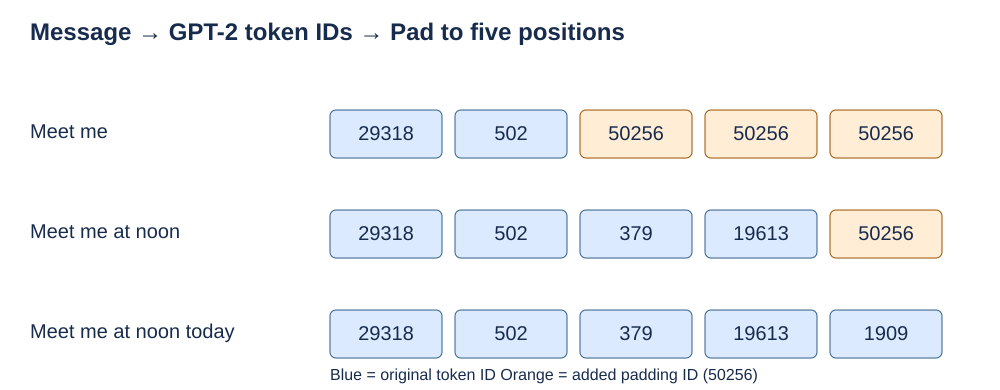
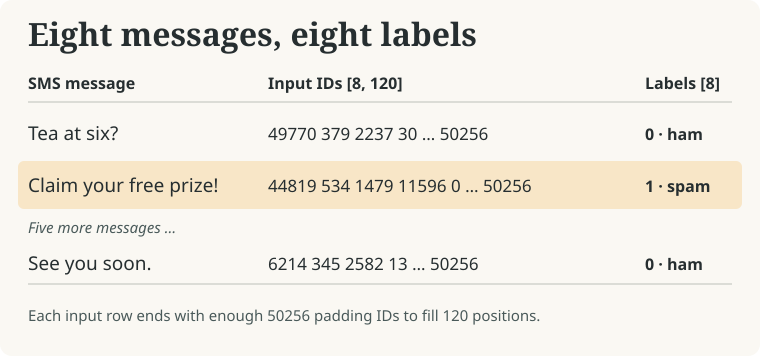
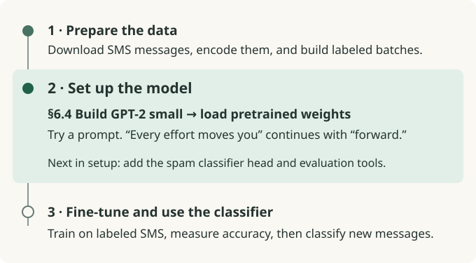
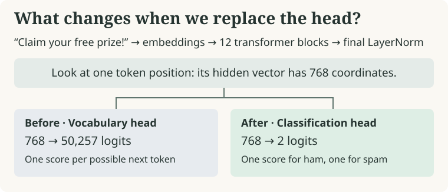

# Chapter 6 — Finetuning for Text Classification

At the end of [Chapter 5](05-pretraining-on-unlabeled-data.md), we loaded OpenAI’s pretrained GPT-2 weights and asked the model to continue a sentence. Here we keep what GPT-2 learned about language and change the question. Given a complete text message, can it decide whether the message is spam?

<figure markdown="1">

[](https://sebastianraschka.com/images/LLMs-from-scratch-images/mental-model.jpg)

<figcaption markdown="span">In Figure 6.1 we reach Stage 3 of [Sebastian Raschka’s roadmap](https://sebastianraschka.com/llms-from-scratch/). Follow the upper branch to the classifier in Chapter 6. The instruction-following branch leads to [Chapter 7](07-finetuning-to-follow-instructions.md).</figcaption>
</figure>

We’ll prepare labeled messages, adapt GPT-2 to produce a score for each class, and fine-tune it on those examples. Then we’ll measure accuracy on held-out messages and use the classifier on a new SMS.

## 6.1 Different categories of fine-tuning

Imagine a text arrives saying **“Claim your free cruise by midnight!”** What would one training example look like? Figures 6.2 and 6.3 in the book show two ways to use a pretrained model. Here they are side by side with the same message.

| Fine-tuning approach | What goes into the model | Target we train it to produce |
| --- | --- | --- |
| Instruction | “Is this spam? Answer yes or no.” + the cruise message | The text **Yes** |
| Instruction | “Translate this into Turkish.” + the cruise message | The text **Ücretsiz gemi seyahatinizi gece yarısına kadar talep edin!** |
| Classification | The cruise message alone | The class **spam** |

In **instruction fine-tuning**, each example pairs a prompt with a desired response. The instruction is part of the input. Changing just that instruction can turn a yes-or-no question into a translation task. The model learns by predicting the tokens of the desired response.

In **classification fine-tuning**, each example pairs a message with one label. The task stays the same across messages. “Can you meet me at the ferry?” would still go through the same two outputs, one score for *spam* and one for *not spam*. The higher score supplies the predicted label. If you’ve trained a CNN to identify plant species, this is the familiar part: it can recognize a new specimen, and its answer comes from the species you defined for training.

!!! tip "What makes this a yes-or-no decision?"

    Both systems could put the same message in a spam folder. In the instruction example, “answer yes or no” asks the model to express its decision in words. In the classifier, the two scores are built into the output layer. The application can act on the selected class directly.

!!! note "Choosing the right approach"

    For a spam filter, labeled messages give us exactly the examples we need, and we can check predictions against known labels. For an assistant that must translate, summarize, and answer questions, instruction–response pairs let us teach each of those tasks. Covering that broader range generally takes more varied data and more training compute than specializing the same starting model for a single task.

## 6.2 Preparing the dataset

Figure 6.4 divides the work into three stages. First we prepare labeled examples and group them into batches. Then we set up pretrained GPT-2 with an output for each class. Finally we train, evaluate, and classify new messages. This section takes us from a downloaded archive to three CSV files. The same workflow applies to email if we supply labeled emails.

**What is one example?** Figure 6.5 previews a table with two columns. Each row holds one complete SMS and the label someone assigned to it. *Ham* is the dataset’s term for a legitimate message. Download and unzip the [UCI SMS Spam Collection](https://archive.ics.uci.edu/dataset/228/sms+spam+collection). The archive member `SMSSpamCollection` is already tab-separated text, even though its name has no extension. From the directory containing that file:

```python
import pandas as pd

messages = pd.read_csv("SMSSpamCollection", sep="\t", header=None, names=["Label", "Text"])
print(messages.head())                   # Inspect the pairing before changing anything.
print(messages["Label"].value_counts())  # 4,825 ham and 747 spam.
```

Of the 5,572 messages, nearly 87% are ham. A filter that marked every message as ham would already be about 87% accurate here and miss every spam message. For this small teaching run we keep every spam example and draw an equal number of ham examples at random. This **undersampling** keeps training manageable, at the cost of leaving out 4,078 legitimate messages and changing how common spam looks.

```python
spam = messages[messages["Label"] == "spam"]
ham = messages[messages["Label"] == "ham"].sample(n=len(spam), random_state=123)
balanced = pd.concat([ham, spam], ignore_index=True)
balanced["Label"] = balanced["Label"].map({"ham": 0, "spam": 1})
```

**A class ID names the answer for the whole message.** Mapping `spam` to `1` resembles a vocabulary lookup because a name gets a stable integer. The two lookups serve different jobs. GPT’s tokenizer will turn the **text** into a sequence of input IDs in §6.3. The **label** is already one integer, telling the loss function which of the two class scores should be higher.

```python
# Mix the classes before taking slices. The seed makes this split reproducible.
rows = balanced.sample(frac=1, random_state=123).reset_index(drop=True)
train_end = int(0.70 * len(rows))
validation_end = train_end + int(0.10 * len(rows))

rows.iloc[:train_end].to_csv("train.csv", index=False)
rows.iloc[train_end:validation_end].to_csv("validation.csv", index=False)
rows.iloc[validation_end:].to_csv("test.csv", index=False)
```

| File | Messages | What we use it for |
| --- | ---: | --- |
| `train.csv` | 1,045 | Update the model weights. |
| `validation.csv` | 149 | Compare training choices before settling on a model. |
| `test.csv` | 300 | Evaluate the chosen model on held-out examples. |

The full pool contains 747 examples of each class. Shuffling and slicing gives approximate 70/10/20 splits without guaranteeing a perfect class balance inside each file. Since we balanced the pool *before* splitting, the test accuracy will describe a population with roughly equal numbers of spam and ham messages.

## 6.3 Creating data loaders

In Chapter 2, cutting a sliding window gave us equally long rows before batching. Here one SMS is one example, and its target is one class ID. One message might encode to three tokens and another to five. How do we stack both rows in one tensor without cutting off the end of the longer message?

| Message | Encoded input (illustrative IDs) | Input padded to five positions | Class ID |
| --- | --- | --- | --- |
| A | `11 12 13` | `11 12 13 50256 50256` | `0` (ham) |
| B | `21 22 23 24 25` | `21 22 23 24 25` | `1` (spam) |

The inputs now have shape `[2, 5]` and the labels have shape `[2]`. Truncating both messages to three tokens would save computation but discard the last two tokens of B. Padding preserves them and spends two extra input positions on A. The book reuses GPT-2’s end-of-text ID, `50256`, as the right-padding value. It sets the width from the longest **encoded training message** and reuses that width for validation and test, truncating any longer messages in those splits.

!!! tip "Think of letterboxing an image for object detection"

    Imagine fitting a wide photo onto a square canvas. Resizing changes the pixel grid. Letterboxing preserves the aspect ratio during resizing and fills the leftover space with a border. Adding padding IDs is like adding that border: the original token IDs stay in order, and the extra positions let PyTorch stack examples into a rectangular batch. The label still describes the whole message.

### From text to equally long token rows

We can ask the tokenizer which ID represents the special token. The `allowed_special` argument explicitly allows tiktoken to interpret this spelling as a special token.

```python
import tiktoken

tokenizer = tiktoken.get_encoding("gpt2")
print(tokenizer.encode("<|endoftext|>", allowed_special={"<|endoftext|>"}))
# [50256]
```

Once a message is encoded, we append the integer `50256` to its list of IDs. Each appended ID occupies one position and will receive an embedding when it enters the model.

<figure markdown="1">



<figcaption markdown="span">Our version of Figure 6.6, using three new messages and verified GPT-2 token IDs. Blue cells hold message tokens, orange cells hold padding. The longest row already fills all five positions.</figcaption>
</figure>

### A dataset supplies one message and its label

The class below adapts Listing 6.4. It encodes messages once in its initializer. PyTorch later asks for individual examples through `__getitem__` and the number of examples through `__len__`. Calling `dataset[0]` invokes `__getitem__(0)`. Calling `len(dataset)` invokes `__len__()`.

This listing uses pandas to read the CSV files, alongside PyTorch and tiktoken.

```python title="SpamDataset — prepare and retrieve one labeled SMS"
from pathlib import Path

import pandas as pd
import torch
from torch.utils.data import Dataset


class SpamDataset(Dataset):
    """Return (token IDs [T], scalar class ID), both torch.long.

    T is max_length, the shared number of token positions per message.
    Labels are 0 for ham and 1 for spam. Each CSV must contain at least
    one message and have Text and Label columns.
    """

    def __init__(
        self,
        csv_file: str | Path,
        tokenizer: tiktoken.Encoding,
        max_length: int | None = None,
        pad_token_id: int = 50256,
    ) -> None:
        self.data = pd.read_csv(csv_file)
        # Each message starts as a separate list with its own token count.
        self.encoded_texts: list[list[int]] = [
            tokenizer.encode(text) for text in self.data["Text"]
        ]

        if max_length is None:
            # Training chooses its width from the longest encoded SMS.
            self.max_length = self._longest_encoded_length()
        else:
            # Validation/test can reuse the width chosen for training.
            self.max_length = max_length
            self.encoded_texts = [
                token_ids[:max_length] for token_ids in self.encoded_texts
            ]

        # A row already at max_length gets zero extra IDs.
        self.encoded_texts = [
            token_ids + [pad_token_id] * (self.max_length - len(token_ids))
            for token_ids in self.encoded_texts
        ]

    def __getitem__(self, index: int) -> tuple[torch.Tensor, torch.Tensor]:
        """Return one padded message [T] and its scalar label."""
        token_ids = self.encoded_texts[index]
        label = int(self.data.iloc[index]["Label"])
        return (
            torch.tensor(token_ids, dtype=torch.long),
            torch.tensor(label, dtype=torch.long),
        )

    def __len__(self) -> int:
        """Return the number of messages available to the data loader."""
        return len(self.data)

    def _longest_encoded_length(self) -> int:
        """Find the largest token count before padding."""
        return max(len(token_ids) for token_ids in self.encoded_texts)
```

```python
train_dataset = SpamDataset("train.csv", tokenizer)
val_dataset = SpamDataset(
    "validation.csv", tokenizer, max_length=train_dataset.max_length
)
test_dataset = SpamDataset(
    "test.csv", tokenizer, max_length=train_dataset.max_length
)

print(train_dataset.max_length)  # 120 for the split from §6.2
token_ids, label = train_dataset[0]
print(token_ids.shape, label.shape)  # torch.Size([120]) torch.Size([])
```

Here 120 counts tokens after encoding. GPT-2 supports up to 1,024 positions. This dataset class has no knowledge of the model’s context limit, so we must choose a width that fits it. Setting `max_length=None` independently on validation or test chooses each split’s own longest row. Each split can still form rectangular batches, provided its chosen width fits the model.

### Exercise 6.1 — Increasing the context length

The exercise asks us to pad to the model’s maximum supported length and observe predictive performance. We can prepare that comparison now by giving every split the same explicit width.

```python
long_train_dataset = SpamDataset("train.csv", tokenizer, max_length=1024)
long_val_dataset = SpamDataset("validation.csv", tokenizer, max_length=1024)
long_test_dataset = SpamDataset("test.csv", tokenizer, max_length=1024)

short_ids, short_label = train_dataset[0]
long_ids, long_label = long_train_dataset[0]
assert len(long_ids) == 1024
assert torch.equal(short_ids, long_ids[:120])
assert short_label.item() == long_label.item()
assert torch.all(long_ids[120:] == 50256)
```

For our training split, this adds **904 padding positions per message**, with the original message and label preserved. The input width grows by about 8.5 times. An ordinary dense attention score matrix grows with the square of that width, about 72.8 times here. Actual runtime and peak memory also depend on the attention implementation and other parts of the model.

**Performance comparison to run after implementing fine-tuning:** train a fresh copy of the same pretrained model at each width, keeping the split, seed, optimizer, batch size, and epochs fixed. Record training time and validation accuracy. Use validation to select the setting, then evaluate the chosen model on the test set. The data preparation and assertions above have been checked. Classification accuracy for these two settings has yet to be measured.

More padding supplies additional positions for computation. Its effect on classification depends on how the classifier uses those positions, which we will see when adding its output head.

### From individual examples to batches

The dataset supplies one pair at a time. A data loader collects several pairs and stacks their input tensors and labels. With batch size 8, a full batch has inputs shaped `[8, 120]` and labels shaped `[8]`. Here **B = 8 messages** and **T = 120 token positions per message**. Each row has one class label.

<figure markdown="1">



<figcaption markdown="span">Companion to Figure 6.7. Follow the highlighted SMS across the page. GPT-2 encodes its exclamation mark as token ID 0. The separate 1 on the right labels the whole message as spam. These messages illustrate the layout of a batch.</figcaption>
</figure>

```python title="Create the training, validation, and test data loaders"
from torch.utils.data import DataLoader

torch.manual_seed(123)
batch_size = 8
num_workers = 0  # Load examples in the main process.

train_loader = DataLoader(
    train_dataset,
    batch_size=batch_size,
    shuffle=True,       # Draw a new order when we iterate over the dataset again.
    num_workers=num_workers,
    drop_last=True,     # Keep every training batch at eight messages.
)
val_loader = DataLoader(
    val_dataset,
    batch_size=batch_size,
    shuffle=False,
    num_workers=num_workers,
    drop_last=False,    # Evaluate the remaining messages in a smaller final batch.
)
test_loader = DataLoader(
    test_dataset,
    batch_size=batch_size,
    shuffle=False,
    num_workers=num_workers,
    drop_last=False,
)
```

A `DataLoader` is an **iterable**. Calling `iter(train_loader)` creates an iterator that remembers where it is in this pass. Calling `next()` on that iterator retrieves the next batch. Python’s `for` loop performs those steps for us and stops when the iterator raises `StopIteration`.

```python
batches = iter(train_loader)
input_batch, target_batch = next(batches)
print(input_batch.shape)   # torch.Size([8, 120])
print(target_batch.shape)  # torch.Size([8])
```

The book checks the **last** training batch by consuming the whole loader. The variables retain the final pair after the loop ends.

```python
for input_batch, target_batch in train_loader:
    pass  # Fetch each batch without training on it.

print(input_batch.shape)   # torch.Size([8, 120])
print(target_batch.shape)  # torch.Size([8])
```

With 1,045 training messages, 130 full batches use 1,040 messages. `drop_last=True` leaves five messages out of that pass. Since training shuffles, the omitted messages can change on the next pass. Validation and test keep their final partial batches.

| Loader | Messages | Batches | Last input shape | Last label shape |
| --- | ---: | ---: | --- | --- |
| Training | 1,045 | 130 | `[8, 120]` | `[8]` |
| Validation | 149 | 19 | `[5, 120]` | `[5]` |
| Test | 300 | 38 | `[4, 120]` | `[4]` |

```python
print(len(train_loader), len(val_loader), len(test_loader))
# 130 19 38
```

These counts and shapes were verified with the CSV splits from §6.2. Creating another iterator starts another pass through the loader. Iterating retrieves data, and the training loop will later use that data to compute a loss and update weights.

## 6.4 Initializing a model with pretrained weights

We have batches of SMS messages and their labels. Before an optimizer sees any of them, we can check our starting point. Can the model still complete a sentence the way GPT-2 did at the end of Chapter 5?

<figure markdown="1">



<figcaption markdown="span">Companion to Figure 6.8. The highlighted steps give us a working text generator. The SMS labels prepared in stage 1 will supply the targets when we train it as a classifier.</figcaption>
</figure>

Listing 6.6 reuses the book’s checkpoint loader and GPT implementation. The configuration gives the model its shape. Loading the checkpoint supplies the numbers learned during pretraining. We choose the small GPT-2 configuration with 12 blocks, 12 attention heads, and 768 coordinates per token. The checkpoint needs a position table with 1,024 rows even though our SMS batches use only 120 positions. [Chapter 5 checkpoint walkthrough](05-pretraining-on-unlabeled-data.md#55-loading-pretrained-weights-from-openai)

```python title="Initialize GPT-2 small with the book’s Chapter 6 helper modules"
from chapter05 import GPTModel, load_weights_into_gpt
from gpt_download import download_and_load_gpt2

config = {
    "vocab_size": 50257, "context_length": 1024,
    "emb_dim": 768, "n_layers": 12, "n_heads": 12,
    "qkv_bias": True,  # The checkpoint includes these projection biases.
    "drop_rate": 0.0,
}
_, params = download_and_load_gpt2(model_size="124M", models_dir="gpt2")
model = GPTModel(config)             # The layers start with random weights.
load_weights_into_gpt(model, params)  # Copy pretrained values into those layers.
model.eval()                         # Use evaluation behavior for generation.
```

The book then uses the same greedy generation helper twice. Both prompts go through the same tokenizer and model. What changes is the behavior we ask for.

| Prompt | What the book reports | What we learn |
| --- | --- | --- |
| “Every effort moves you” | The model adds “forward.” and continues with a grammatical sentence about work. | A plausible continuation is a quick smoke test for the loaded weights. |
| A cash-prize SMS with a request to answer yes or no about spam | The model echoes the question and starts repeating the prize message. | On this example, it continues the prompt without giving the requested decision. |

Pretraining rewarded GPT-2 for predicting the next token. The question and the promised prize are just more text for it to continue. This one prompt illustrates the gap between fluent completion and following an instruction. To measure spam classification accuracy, we will need predictions for many labeled messages. Section 6.5 begins by giving the model two output scores for that task.

## 6.5 Adding a classification head

If you have adapted an image classifier to a new dataset, you have already made this change. Imagine a pretrained ResNet whose final layer scores 1,000 ImageNet classes. To classify cats and dogs, you keep the network that extracts features from pixels and replace its final linear layer with one that scores your two labels. Training on labeled photos teaches the new layer how to use those features.

GPT-2 small gives us a similar place to make the swap. Run `print(model)` on the model loaded in §6.4. Follow the token and position embeddings through 12 transformer blocks (same architecture, each with its own weights), then find the final LayerNorm and `out_head`. You can inspect just that last module:

```python
print(model.out_head)
# Linear(in_features=768, out_features=50257, bias=False)
```

<figure markdown="1">



<figcaption markdown="span">Companion to Figure 6.9. Trace the embeddings through the two residual additions in each of the 12 blocks and the final LayerNorm. On the right, each row of the output weight matrix reads all 768 features at one position and produces one logit. Labeled messages teach the new head which combinations suggest spam.</figcaption>
</figure>

!!! note "Fine-tuning selected layers vs. all layers"

    Think of a CNN used as a feature extractor. Earlier GPT layers have already learned patterns that can be useful across tasks. We can reuse those features and train a small head to recognize spam. We can also let later blocks adapt the features themselves. How much that helps is an empirical question. Freezing the early blocks still runs their forward pass, but saves the work of computing and storing gradients for their weights.

Listing 6.7 relies on the order of two operations. First freeze every parameter currently in the model. Then create a new output layer. The new layer has its own parameters, which PyTorch makes trainable by default.

```python
for parameter in model.parameters():
    parameter.requires_grad = False

torch.manual_seed(123)  # Reproduce the starting values of the new head.
model.out_head = torch.nn.Linear(
    in_features=config["emb_dim"],  # 768 for GPT-2 small
    out_features=2,                 # ham and spam
)

print([name for name, p in model.named_parameters() if p.requires_grad])
# ['out_head.weight', 'out_head.bias']
```

PyTorch also offers `model.requires_grad_(False)` as a shorthand for the loop. Applying it before the swap freezes the existing parameters, including the old vocabulary head. Applying it after the swap would freeze the new head too. At this point the new head has 1,536 trainable weights (2 × 768) and two biases. Reading the width from the configuration lets the same code build a two-class head for a wider GPT-2 variant.

With only the head trainable, the classifier learns how to score the features GPT-2 already produces. Figure 6.10 shows the next choice. Let the last transformer block adapt those features to SMS messages, and let the final LayerNorm adapt its scale and shift before the head reads them.

```python
# Blocks are indexed 0 through 11. Python's [-1] selects block 11.
for parameter in model.trf_blocks[-1].parameters():
    parameter.requires_grad = True

# This LayerNorm follows the whole stack. The last block has its own norms too.
for parameter in model.final_norm.parameters():
    parameter.requires_grad = True
```

After these loops the trainable path is **block 11 → final LayerNorm → two-class head**. The head was already trainable when we created it. The embeddings and blocks 0 through 10 still participate in every prediction with their pretrained weights fixed.

Appendix B (p. 295) points to Raschka’s comparison. With pretrained GPT-2 small, 120 positions, and the last position used for classification, training only the head gave **72% test accuracy** (row 3). The last-block setup reached **95%** (row 1). These measurements are from the author’s SMS experiment. They motivate trying this particular group of layers and measuring the result on the task at hand. [Additional spam classification experiments](https://github.com/rasbt/LLMs-from-scratch/tree/main/ch06/02_bonus_additional-experiments)

One detail matters when carrying the CNN analogy over. A typical ResNet pools its feature map to produce one vector per **image**. GPT-2 produces one vector per **token position**. With the batch from §6.3, applying the new head gives logits shaped `[8, 120, 2]`. We still need to choose which position supplies the two scores for each whole SMS. Replacing the layer and deciding which parameters to fine-tune are separate steps.

!!! tip "How many outputs does a binary classifier need?"

    The book uses two logits and a class ID (0 for ham, 1 for spam) with cross-entropy. The same pattern extends to three news categories by giving the head three outputs. A binary classifier can also use a single logit for spam with PyTorch’s `BCEWithLogitsLoss` and a floating-point 0/1 target. Applying sigmoid to that logit gives the predicted spam probability.

## 6.6 Calculating the classification loss and accuracy

Notes to come as we read this section.

## 6.7 Fine-tuning the model on supervised data

Notes to come as we read this section.

## 6.8 Using the LLM as a spam classifier

Notes to come as we read this section.

## Questions to bring to the chapter

<!-- Add actual questions during reading. -->

## End of chapter

<!-- Summarize what became clear, link exercises, and record unresolved questions. -->
