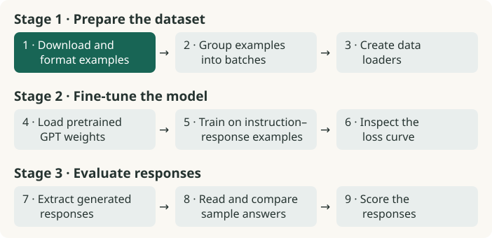

# Chapter 7 — Finetuning to Follow Instructions

We built a GPT architecture and [loaded pretrained weights into it](05-pretraining-on-unlabeled-data.md). In [Chapter 6](06-finetuning-for-text-classification.md), each SMS came with one correct label: spam or not spam. In Chapter 7, we start again from the pretrained language model. Each training example gives it an instruction and an example of the response we want it to write.

<figure markdown="1">

<figcaption markdown="span">Figure 7.1 places us at Stage 3 of [Sebastian Raschka’s roadmap](https://sebastianraschka.com/llms-from-scratch/). We completed step 8 on the upper branch with labeled SMS messages. Follow the lower branch for step 9, where an instruction dataset teaches the model to respond to requests.</figcaption>
</figure>

For example, suppose the request is “Rewrite this appointment reminder in a friendlier tone.” A training example includes the original reminder and a suitable rewrite. The model learns to generate that response one token at a time. This is one way to teach the behavior people expect from a chatbot or personal assistant.

We’ll prepare the instruction examples, group them into training batches, and fine-tune the pretrained model. Then we’ll give it held-out requests, extract and save the responses it generates, and evaluate how well those responses carry out the instructions.

## 7.1 Introduction to instruction fine-tuning

A pretrained GPT learns to predict the **next token**. If the prompt begins “The alert was sent by Mina,” a plausible continuation might describe what happened after the alert. Now put a request in front of that same sentence: “Rewrite in active voice.” A useful answer has to preserve the event and change its wording: **“Mina sent the alert.”** A fluent continuation can still miss the requested edit.

**Supervised instruction fine-tuning** gives the pretrained model worked examples of that distinction. During training, each instruction comes with a desired response. The model still predicts one token at a time; the examples teach it what kind of text should follow a request. When we later give it a new instruction, it has to generate the response itself.

<figure markdown="1">

<figcaption markdown="span">Companion to Raschka’s Figure 7.2. Read each row from left to right. The response demonstrates what counts as following that particular instruction. For the synonym task, several different answers could be valid.</figcaption>
</figure>

<figure markdown="1">

<figcaption markdown="span">Companion to Raschka’s Figure 7.3. Follow each stage from left to right, then move down a row. Inspecting loss shows how training is progressing. Reading and scoring generated answers tells us how well the model follows the requests.</figcaption>
</figure>

## 7.2 Preparing a dataset for supervised instruction fine-tuning

Notes to come as we read this section.

## 7.3 Organizing data into training batches

Notes to come as we read this section.

## 7.4 Creating data loaders for an instruction dataset

Notes to come as we read this section.

## 7.5 Loading a pretrained LLM

Notes to come as we read this section.

## 7.6 Fine-tuning the LLM on instruction data

Notes to come as we read this section.

## 7.7 Extracting and saving responses

Notes to come as we read this section.

## 7.8 Evaluating the fine-tuned LLM

Notes to come as we read this section.

## 7.9 Conclusions

Notes to come as we read this section.

## Questions to bring to the chapter

<!-- Add actual questions during reading. -->

## End of chapter

<!-- Summarize what became clear, link exercises, and record unresolved questions. -->
