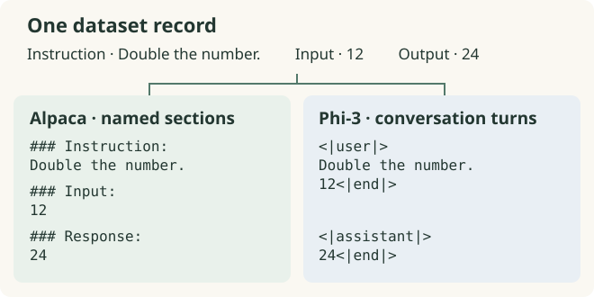
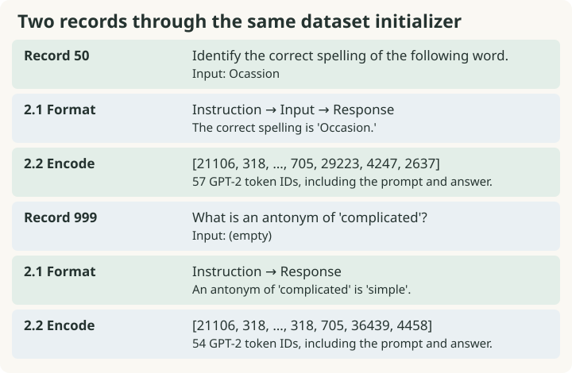
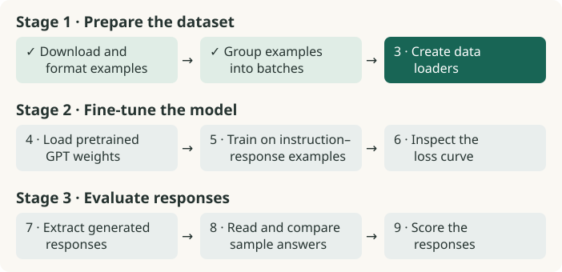
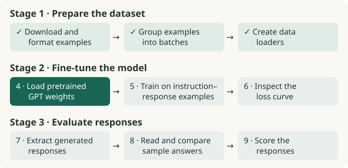
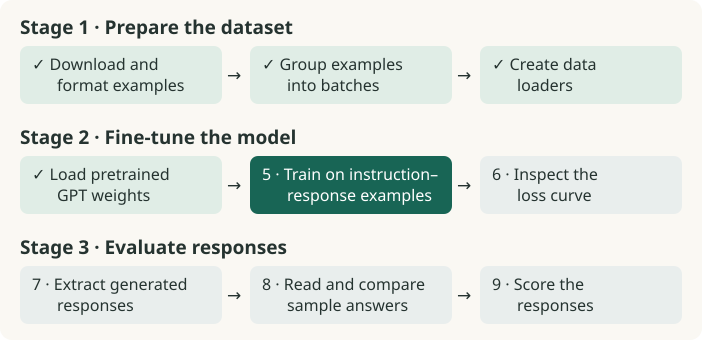
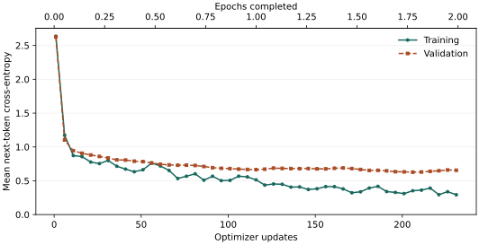
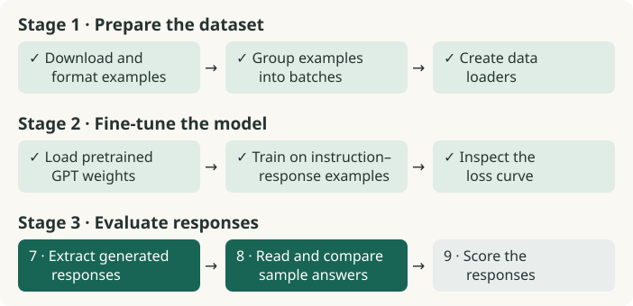
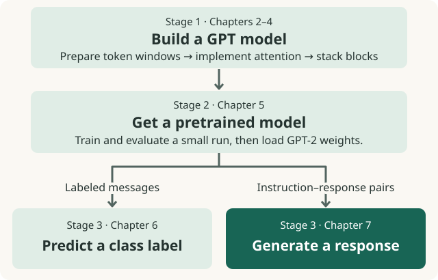

# Chapter 7 — Finetuning to Follow Instructions

We built a GPT architecture and [loaded pretrained weights into it](05-pretraining-on-unlabeled-data.md). In [Chapter 6](06-finetuning-for-text-classification.md), each SMS came with one correct label: spam or not spam. In Chapter 7, we start again from the pretrained language model. Each training example gives it an instruction and an example of the response we want it to write.

<figure markdown="1">

[](https://sebastianraschka.com/images/LLMs-from-scratch-images/mental-model.jpg)

<figcaption markdown="span">Figure 7.1 places us at Stage 3 of [Sebastian Raschka’s roadmap](https://sebastianraschka.com/llms-from-scratch/). We completed step 8 on the upper branch with labeled SMS messages. Follow the lower branch for step 9, where an instruction dataset teaches the model to respond to requests.</figcaption>
</figure>

For example, suppose the request is “Rewrite this appointment reminder in a friendlier tone.” A training example includes the original reminder and a suitable rewrite. The model learns to generate that response one token at a time. This is one way to teach the behavior people expect from a chatbot or personal assistant.

We’ll prepare the instruction examples, group them into training batches, and fine-tune the pretrained model. Then we’ll give it held-out requests, extract and save the responses it generates, and evaluate how well those responses carry out the instructions.

## 7.1 Introduction to instruction fine-tuning

A pretrained GPT learns to predict the **next token**. If the prompt begins “The alert was sent by Mina,” a plausible continuation might describe what happened after the alert. Now put a request in front of that same sentence: “Rewrite in active voice.” A useful answer has to preserve the event and change its wording: **“Mina sent the alert.”** A fluent continuation can still miss the requested edit.

**Supervised instruction fine-tuning** gives the pretrained model worked examples of that distinction. During training, each instruction comes with a desired response. The model still predicts one token at a time; the examples teach it what kind of text should follow a request. When we later give it a new instruction, it has to generate the response itself.

<figure markdown="1">


<figcaption markdown="span">Companion to Raschka’s Figure 7.2. Read each row from left to right. The response demonstrates what counts as following that particular instruction. For the synonym task, several different answers could be valid.</figcaption>
</figure>

<figure markdown="1">


<figcaption markdown="span">Companion to Raschka’s Figure 7.3. Follow each stage from left to right, then move down a row. Inspecting loss shows how training is progressing. Reading and scoring generated answers tells us how well the model follows the requests.</figcaption>
</figure>

## 7.2 Preparing a dataset for supervised instruction fine-tuning

Raschka prepared 1,100 examples for the book. Download the JSON file and inspect two records before thinking about tokens. Python reads its outer array as a list and each record as a dictionary. [Book dataset](https://github.com/rasbt/LLMs-from-scratch/blob/main/ch07/01_main-chapter-code/instruction-data.json)

```python
import json
from urllib.request import urlopen

url = (
    "https://raw.githubusercontent.com/rasbt/LLMs-from-scratch/main/"
    "ch07/01_main-chapter-code/instruction-data.json"
)
with urlopen(url, timeout=30) as response:
    data = json.load(response)

print(len(data))  # 1100
print(data[50])   # Spelling task with a separate word to correct
print(data[999])  # Antonym question with an empty input field
```

In the spelling record, the **instruction** asks for a correction, the **input** supplies `Ocassion`, and the **output** gives the corrected spelling, `Occasion`, in a sentence. In the antonym record, the instruction already contains the word *complicated*. An empty `input` makes sense here. The example still has a request and a target answer.

A **prompt template** tells us how to arrange those fields into the sequence the tokenizer will encode. During fine-tuning we include the worked answer. When asking the trained model a new question, we supply the request up to the response marker and let the model generate what follows.

<figure markdown="1">



<figcaption markdown="span">Companion to Raschka’s Figure 7.4. Follow the number 12 through both formats, then find where the answer 24 begins. The Alpaca excerpt omits its introductory sentence for space. [Stanford Alpaca templates](https://github.com/tatsu-lab/stanford_alpaca#data-release) · [Microsoft Phi-3 prompt format](https://huggingface.co/microsoft/Phi-3-mini-4k-instruct#input-formats)</figcaption>
</figure>

!!! tip "What changes with another model?"
    Keep the same request and answer. **Gemma 2 IT** opens the answer turn with `<start_of_turn>model` and closes it with `<end_of_turn>`. **Qwen2.5-7B-Instruct** opens it with `<|im_start|>assistant` and closes it with `<|im_end|>`. In both examples the answer text, **24**, follows the opening marker on a new line. These are excerpts. For an existing instruction-tuned model, use its tokenizer’s chat template to insert the full sequence of markers and line breaks it learned during training. [Gemma prompt formats](https://ai.google.dev/gemma/docs/core/prompt-structure) · [Qwen tokenizer and usage example](https://huggingface.co/Qwen/Qwen2.5-7B-Instruct/blob/main/tokenizer_config.json)

The chapter uses Alpaca as its baseline. Stanford published its training recipe and templates, so we can see exactly how a record becomes training text. In this version of Listing 7.2, `format_input` builds the request. The caller adds the response heading and, for a training example, the known answer. [Stanford Alpaca](https://github.com/tatsu-lab/stanford_alpaca) · [Chapter 7 notebook](https://github.com/rasbt/LLMs-from-scratch/blob/main/ch07/01_main-chapter-code/ch07.ipynb)

```python
def format_input(entry: dict[str, str]) -> str:
    sections = [
        "Below is an instruction that describes a task. "
        "Write a response that appropriately completes the request.",
        f"### Instruction:\n{entry['instruction']}",
    ]
    if entry["input"]:
        sections.append(f"### Input:\n{entry['input']}")
    return "\n\n".join(sections)


entry = data[50]
prompt = format_input(entry) + "\n\n### Response:\n"
print(prompt + entry["output"])
```

```text
Below is an instruction that describes a task. Write a response that appropriately completes the request.

### Instruction:
Identify the correct spelling of the following word.

### Input:
Ocassion

### Response:
The correct spelling is 'Occasion.'
```

The antonym question in `data[999]` stands on its own. The formatter skips the empty input field, so the response heading follows the instruction directly.

```python
model_input = format_input(data[999])
desired_response = f"\n\n### Response:\n{data[999]['output']}"
print(model_input + desired_response)
```

```text
Below is an instruction that describes a task. Write a response that appropriately completes the request.

### Instruction:
What is an antonym of 'complicated'?

### Response:
An antonym of 'complicated' is 'simple'.
```

### Exercise 7.1 · Changing the prompt style

Suppose the trained model spells *Occasion* correctly after seeing `### Response:`. Will it still do so after seeing `<|assistant|>`? Start with the **same Alpaca-tuned checkpoint** and the same held-out spelling questions. Start with Alpaca and Phi-3, then repeat each question in the additional formats below, with greedy decoding and the same output budget. Count correct spellings and record cases where the model continues the prompt or prints a role marker. This measures how sensitive that checkpoint is to the format used at inference.

Gemma and Qwen give us two more families of examples. A chat template determines how a conversation becomes a sequence of tokens. The supervised task is still to generate the worked answer. Keeping our GPT weights and tokenizer fixed lets us ask a narrower question: can the model find the start of its answer when we change the surrounding text?

Here are seven prompts for one request. We borrow the **single-turn text markers** and omit model-specific beginning-of-sequence tokens and default system messages. This keeps the comparison focused on the request and its answer boundary. GPT’s tokenizer may split a marker into several tokens even when the original model treats it as one.

```python
request = "\n".join(part for part in (entry["instruction"], entry["input"]) if part)
qwen_turn = f"<|im_start|>user\n{request}<|im_end|>\n<|im_start|>assistant\n"
prompts = {
    "Alpaca": format_input(entry) + "\n\n### Response:\n",
    "Phi-3": f"<|user|>\n{request}<|end|>\n<|assistant|>\n",
    "Mistral v0.1": f"[INST] {request} [/INST]",
    "Gemma 2 IT": f"<start_of_turn>user\n{request}<end_of_turn>\n<start_of_turn>model\n",
    "Gemma 4 E2B-it": f"<|turn>user\n{request}<turn|>\n<|turn>model\n",
    "Qwen2.5-7B-Instruct": qwen_turn,
    "Qwen3.8-27B": qwen_turn + "<think>\n\n</think>\n\n",
}
```

Compare the last two rows. Both open the assistant turn the same way. Qwen3.8’s published template adds an empty thinking block when direct-answer mode is requested. For our GPT checkpoint those characters are simply more input text. In the Gemma rows, even the spelling of the turn boundary changes between generations. [Gemma format reference](https://ai.google.dev/gemma/docs/core/prompt-structure) · [Gemma 4 template](https://huggingface.co/google/gemma-4-E2B-it/blob/main/chat_template.jinja) · [Qwen2.5 template](https://huggingface.co/Qwen/Qwen2.5-7B-Instruct/blob/main/tokenizer_config.json) · [Qwen3.8 template](https://huggingface.co/Qwen/Qwen3.8-27B/blob/main/chat_template.jinja) · [Mistral v0.1 format](https://huggingface.co/mistralai/Mistral-7B-Instruct-v0.1)

A second experiment asks whether the **training format** matters. Start each run from the same pretrained GPT weights, format the same training examples in one style per run, and evaluate each model in its own style. Keep the split, optimizer settings, seed, and decoding settings fixed. Score the same held-out requests for correctness and instruction following. The formatting examples can run now. The response-quality comparison comes after the fine-tuning run in §7.6.

### Splitting the 1,100 examples

Listing 7.3 assigns the first 85% to training, the next 10% to **testing**, and the remaining 5% to **validation**. The model learns from the 935 training pairs. We use the 55 validation pairs to monitor learning and reserve the 110 test pairs for evaluating responses after training. [Chapter 7 notebook](https://github.com/rasbt/LLMs-from-scratch/blob/main/ch07/01_main-chapter-code/ch07.ipynb)

```python
# The slice boundaries count whole instruction–response pairs.
train_end = int(0.85 * len(data))
test_end = train_end + int(0.10 * len(data))

# Keep the file order used in Listing 7.3. Each slice starts where the last ended.
train_data = data[:train_end]
test_data = data[train_end:test_end]
val_data = data[test_end:]  # Everything left over goes to validation.

print(len(train_data), len(test_data), len(val_data))  # 935 110 55
```

Each training record now has a place in the split, but the formatted requests and answers can still have different token lengths. Section 7.3 tackles how to combine them into a batch.

## 7.3 Organizing data into training batches

We now have 935 training records and a function to format each one. How do we turn a handful of them into the two tensors that our training loop expects?

<figure markdown="1">


<figcaption>Companion to Raschka’s Figure 7.5. We are at step 2. Here we define how to assemble a batch. In step 3 the data loader will call that code as it iterates over the dataset.</figcaption>
</figure>

**Collate** means “assemble the selected samples into one batch.” Think of one iteration of the Chapter 6 loader. The dataset handed it eight pairs, each containing a 120-token SMS tensor and one spam label. PyTorch’s default collate function stacked the eight tensors into a rectangular `[8, 120]` input and gathered the labels into `[8]`. That worked because the dataset had already padded each SMS to the same length.

Here, two instruction examples might arrive as lists of 57 and 54 token IDs. The loader chooses the examples. Our collate function will decide how to pad them to a common length and build a next-token target for each position. We can then pass it to the loader as `collate_fn`. [PyTorch’s batching documentation](https://docs.pytorch.org/docs/stable/data.html#loading-batched-and-non-batched-data)

<figure markdown="1">


<figcaption>Companion to Raschka’s Figure 7.6. Follow the short row. The target paired with 33 is END. The two later padding targets become −100, the value the loss function ignores. Listing 7.4 handles the first two steps.</figcaption>
</figure>

**One dataset item is one complete example.** The initializer calls our §7.2 formatter, appends the response heading and the known answer, and encodes that whole string once. Compare the spelling task and the antonym question below. Their section headings differ because only the spelling task supplies a separate input.

<figure markdown="1">



<figcaption>Companion to Raschka’s Figure 7.7. Each example keeps its own length. The ellipses stand for token IDs omitted from the drawing. Padding waits until we know which examples share a batch.</figcaption>
</figure>

```python title="InstructionDataset · Listing 7.4"
import tiktoken
from torch.utils.data import Dataset


class InstructionDataset(Dataset):
    def __init__(self, records: list[dict[str, str]], tokenizer: tiktoken.Encoding) -> None:
        self.encoded_texts: list[list[int]] = []
        for entry in records:
            # The answer belongs in the text we use for training.
            text = format_input(entry) + f"\n\n### Response:\n{entry['output']}"
            self.encoded_texts.append(tokenizer.encode(text))

    def __len__(self) -> int:
        return len(self.encoded_texts)

    def __getitem__(self, index: int) -> list[int]:
        return self.encoded_texts[index]
```

`__init__` is the Python **initializer**. After initialization, `dataset[i]` retrieves the stored IDs without tokenizing again. Try the two records from the figure together to see exactly what the collate function would receive. [Chapter 7 notebook](https://github.com/rasbt/LLMs-from-scratch/blob/main/ch07/01_main-chapter-code/ch07.ipynb)

```python
dataset = InstructionDataset([data[50], data[999]], tiktoken.get_encoding("gpt2"))
samples = [dataset[0], dataset[1]]
print([len(ids) for ids in samples])  # [57, 54]
```

### Pad to the longest example in this batch

The dataset already gives us integers, so we can append the end-of-text ID directly. GPT-2 has **50,257 vocabulary entries**, numbered from zero. Its end-of-text token has ID **50256**.

```python
tokenizer = tiktoken.get_encoding("gpt2")
print(tokenizer.encode("<|endoftext|>", allowed_special={"<|endoftext|>"}))
# [50256]
```

<figure markdown="1">


<figcaption>Companion to Raschka’s Figure 7.8. Read across each row. The tinted cells are the added copies of 50256. Batch B ends after four columns because its own longest example has four tokens.</figcaption>
</figure>

The loader will pass the selected lists to this function as `batch`. We can also call it directly. The slightly surprising part of the book’s first draft is that it temporarily makes each row **one position wider** than the desired inputs. That extra column will let the next draft build shifted targets from the same row. [Chapter 7 notebook](https://github.com/rasbt/LLMs-from-scratch/blob/main/ch07/01_main-chapter-code/ch07.ipynb)

```python
from collections.abc import Sequence

import torch


def custom_collate_draft_1(
    batch: Sequence[list[int]],
    pad_token_id: int = 50256,
    device: str | torch.device = "cpu",
) -> torch.Tensor:
    """Return int64 inputs shaped [examples, longest token count in this batch]."""
    working_width = max(len(ids) for ids in batch) + 1
    rows = []
    for ids in batch:
        # Build a fresh list so the dataset keeps its original token IDs.
        ended = ids + [pad_token_id]
        padded = ended + [pad_token_id] * (working_width - len(ended))

        # Leave out the final column when constructing the model inputs.
        rows.append(torch.tensor(padded[:-1], dtype=torch.long))

    return torch.stack(rows).to(device)
```

```python
batch = ([0, 1, 2, 3, 4], [5, 6], [7, 8, 9])
print(custom_collate_draft_1(batch))
```

```text
tensor([[    0,     1,     2,     3,     4],
        [    5,     6, 50256, 50256, 50256],
        [    7,     8,     9, 50256, 50256]])
```

The longest input already fits. The two-token input needs three padding positions and the three-token input needs two. Writing those five integers is cheap. The compute cost comes later when the model processes all 15 positions in this dense tensor.

### Pair each prediction with the next token

The response is already in the encoded example. Step 2.4 in Figure 7.9 gives the loss function a way to check each prediction: the target at column *i* is the token one place farther along in the padded sequence. For the short example `[5, 6]`, seeing token 5 should lead to a prediction of 6. After seeing both 5 and 6, the model should predict the end of the example.

<figure markdown="1">


<figcaption>Companion to Raschka’s Figure 7.10. Follow the arrow to see where the first target comes from. Then read vertically: each input column produces the prediction checked against the target directly below it.</figcaption>
</figure>

```python
def custom_collate_draft_2(
    batch: Sequence[list[int]],
    pad_token_id: int = 50256,
    device: str | torch.device = "cpu",
) -> tuple[torch.Tensor, torch.Tensor]:
    """Return int64 input and target tensors, both shaped [examples, tokens]."""
    width = max(len(ids) for ids in batch) + 1
    rows = []
    for ids in batch:
        # The first added ID marks the end. Further copies fill the row.
        rows.append(ids + [pad_token_id] * (width - len(ids)))

    padded = torch.tensor(rows, dtype=torch.long, device=device)
    # Use all rows. Slice the columns two ways to align predictions and labels.
    return padded[:, :-1], padded[:, 1:]
```

```python
inputs, targets = custom_collate_draft_2(batch)
print(inputs)
print(targets)
```

```text
tensor([[    0,     1,     2,     3,     4],
        [    5,     6, 50256, 50256, 50256],
        [    7,     8,     9, 50256, 50256]])
tensor([[    1,     2,     3,     4, 50256],
        [    6, 50256, 50256, 50256, 50256],
        [    8,     9, 50256, 50256, 50256]])
```

### Keep one stop signal per example

Consider the middle target row. Predicting the first `50256` answers a real question: *what comes after the last token of this example?* The next three copies exist only because a longer example shares the batch. Scoring those copies would reward the model three extra times for repeating the stop signal. Pairing the very same example with a longer neighbor would change how often we reward it.

<figure markdown="1">


<figcaption>Companion to Figures 7.11 and 7.12, step 2.5. Compare these rows with the target tensor above. Of the 15 predictions, ten count toward the mean loss, including three end-of-text predictions.</figcaption>
</figure>

!!! note "What does −100 do?"
    PyTorch cross-entropy uses `ignore_index=-100` by default. A target of −100 means “skip this prediction when calculating the loss.” On the middle row, the model still produces five sets of scores. Only the predictions for 6 and END contribute to the loss. The other three positions add nothing to the sum or the count used for the average. The model inputs contain valid token IDs throughout. In Chapter 6 the loss received just one spam label per message, so there were no padding targets to exclude.

This version of Listing 7.5 builds on draft 2. The original lengths tell us exactly where filler begins. For an example containing two tokens, target index 1 holds END and the filler starts at index 2. [Chapter 7 notebook](https://github.com/rasbt/LLMs-from-scratch/blob/main/ch07/01_main-chapter-code/ch07.ipynb)

```python
def custom_collate_fn(
    batch: Sequence[list[int]],
    pad_token_id: int = 50256,
    ignore_index: int = -100,
    allowed_max_length: int | None = None,
    device: str | torch.device = "cpu",
) -> tuple[torch.Tensor, torch.Tensor]:
    """Return aligned int64 [examples, tokens] inputs and masked targets."""
    inputs, shifted = custom_collate_draft_2(batch, pad_token_id, device)
    # The two slices share storage. Give targets their own copy before editing.
    targets = shifted.clone()
    for row, ids in enumerate(batch):
        targets[row, len(ids):] = ignore_index

    # Limit both tensors to the same context window, e.g. 1024 for GPT-2.
    return inputs[:, :allowed_max_length], targets[:, :allowed_max_length]
```

With the default length limit of `None`, both tensors retain the batch width. If truncation cuts through a long example, its true end may fall outside the window. We keep the observed next-token targets up to the cutoff.

Try the finished function on the same batch and read the row for `[5, 6]`:

```python
inputs, targets = custom_collate_fn(batch)
print(inputs[1].tolist())   # [5, 6, 50256, 50256, 50256]
print(targets[1].tolist())  # [6, 50256, -100, -100, -100]
```

### Which predictions enter the average?

Shrink the vocabulary to two tokens so we can see every score. Each row below is one prediction. Column 0 holds the score for token 0 and column 1 holds the score for token 1. All three rows favor token 1. The first target is 0, so the first prediction incurs a much larger loss.

```python
from torch.nn.functional import cross_entropy

logits = torch.tensor([[-1.0, 1.0], [-0.5, 1.5], [-0.5, 1.5]])
labels = torch.tensor([0, 1, 1])
print(cross_entropy(logits, labels, reduction="none"))  # One loss per row

print(cross_entropy(logits[:2], labels[:2]))           # 1.1269
print(cross_entropy(logits, labels))                   # 0.7936
print(cross_entropy(logits, torch.tensor([0, 1, -100])))  # 1.1269
```

| Positions graded | Losses entering the average (rounded) | Mean loss |
| --- | --- | ---: |
| First two | (2.1269 + 0.1269) / 2 | 1.1269 |
| All three | (2.1269 + 0.1269 + 0.1269) / 3 | 0.7936 |
| Third target set to −100 | (2.1269 + 0.1269) / 2 | 1.1269 |

Why would a target of 2 raise an error? It asks for the score in column 2, but this example has only columns 0 and 1. PyTorch explicitly reserves the configured `ignore_index` (default `-100`) to skip a position before looking up a score. That is why an ordinary out-of-range ID raises an error and −100 works. In the real GPT batch, 50256 has a score column and can teach the model when to stop. Only the surplus padding gets the skip marker.

### Exercise 7.2 · Should we grade the instruction too?

In “Double 12 → 24,” the model always sees the full request. The book’s baseline also scores how well it predicts the prompt tokens. For the exercise, assign `-100` to the shifted targets belonging to the instruction and optional input. Keep the first answer token and the end-of-text target scored, and keep surplus padding ignored in both runs.

NVIDIA’s published Nemotron 3 Nano supervised fine-tuning recipe gives user and system tokens zero loss weight and scores assistant responses. Meta also describes masking prompt loss for Llama 3 in §4.1.3 of its technical report. These disclosures describe specific training stages. A model’s chat template alone tells us how turns are written, leaving open which targets counted toward training loss. [NVIDIA’s SFT recipe](https://github.com/NVIDIA-NeMo/Nemotron/blob/main/docs/nemotron/nano3/sft.md) · [Meta’s Llama 3 report](https://arxiv.org/abs/2407.21783)

The 2024 study *Instruction Tuning With Loss Over Instructions* found that scoring instructions helped in its experiments, particularly with few training examples or long prompts paired with short answers. That makes the chapter’s 935 training examples an interesting place to test the choice. [NeurIPS paper](https://proceedings.neurips.cc/paper_files/paper/2024/hash/7ffb43adf37b3eeaba559098bc084cc6-Abstract-Conference.html)

**Return after §7.8.** Save the chapter’s baseline and its responses. Start a second run from the same pretrained GPT weights, keeping the split, template, batch order, optimizer, seed and epochs fixed. Change only the target mask. Score both models on the same held-out instructions with the same decoding settings and rubric. For a numerical comparison, compute held-out loss over answer tokens for both models. Their training losses average over different token sets.

## 7.4 Creating data loaders for an instruction dataset

The dataset supplies one encoded instruction and answer at a time. Our collate function can already turn eight of those lists into aligned input and target tensors. The loader connects the two: on each iteration, it picks indices, retrieves their examples, and passes that group to the collate function.

<figure markdown="1">



<figcaption>Companion to Raschka’s Figure 7.14. Step 3 puts the batching code to work on each split. Once the loaders are ready, we can load the pretrained model in Stage 2.</figcaption>
</figure>

First choose where the tensors will live. The book defaults to CUDA when available and otherwise CPU. Here we also enable **MPS** (Metal Performance Shaders) to use the Apple GPU on a supported Mac.

```python
from functools import partial

if torch.cuda.is_available():
    device = torch.device("cuda")
elif torch.backends.mps.is_available():
    device = torch.device("mps")
else:
    device = torch.device("cpu")

# The loader supplies the batch. These two arguments stay fixed for every call.
collate_batch = partial(custom_collate_fn, device=device, allowed_max_length=1024)
```

The 1,024-token limit caps the width at GPT-2’s context length. Shorter batches still end at their own longest example. With `num_workers=0`, fetching and collating happen in the main process when the loop asks for the next batch. Placing tensors on the device here makes them ready for the model when the loader returns. Overlapping transfers with GPU computation would require additional scheduling. [PyTorch data-loading documentation](https://docs.pytorch.org/docs/stable/data.html#single-process-data-loading-default)

```python title="Creating the three loaders · Listing 7.6"
from torch.utils.data import DataLoader

torch.manual_seed(123)
train_dataset = InstructionDataset(train_data, tokenizer)
val_dataset = InstructionDataset(val_data, tokenizer)
test_dataset = InstructionDataset(test_data, tokenizer)

settings = dict(batch_size=8, collate_fn=collate_batch, num_workers=0)
# Shuffle training rows each epoch and use full batches for updates.
train_loader = DataLoader(train_dataset, shuffle=True, drop_last=True, **settings)
# Keep file order and include the final partial batch when evaluating.
val_loader = DataLoader(val_dataset, shuffle=False, drop_last=False, **settings)
test_loader = DataLoader(test_dataset, shuffle=False, drop_last=False, **settings)
```

Inspect two successive batches from **one iterator**:

```python
batches = iter(train_loader)
for _ in range(2):
    inputs, targets = next(batches)
    print(tuple(inputs.shape), tuple(targets.shape), inputs.device)
```

The book’s first pair of shapes is `(8, 61)` for both inputs and targets. Its second pair is `(8, 76)`. Each group still contains eight instruction examples. The longest example sets a different width in each group, and every input position still has a corresponding target position. [Chapter 7 notebook](https://github.com/rasbt/LLMs-from-scratch/blob/main/ch07/01_main-chapter-code/ch07.ipynb)

## 7.5 Loading a pretrained LLM

The loaders are ready. Before changing any weights, we need a starting point for instruction fine-tuning. Chapter 6 used GPT-2 Small (124M) for its two-label spam task. Here the author chooses **GPT-2 Medium (355M)** for generating responses to varied requests. Medium has more capacity: each token has 1,024 features and passes through 24 transformer blocks. Whether that improves a particular answer is something we can evaluate after training.

<figure markdown="1">



<figcaption>Companion to Raschka’s Figure 7.15. Follow the highlighted step: load the starting weights now, fine-tune them in §7.6, then inspect the loss.</figcaption>
</figure>

Listing 7.7 reuses the [Chapter 5 weight-loading procedure](05-pretraining-on-unlabeled-data.md). Run this version alongside the helper modules in the author’s Chapter 7 notebook directory. The original downloader reads OpenAI’s TensorFlow checkpoint. [Chapter 7 code and helpers](https://github.com/rasbt/LLMs-from-scratch/tree/main/ch07/01_main-chapter-code)

```python title="Loading GPT-2 Medium · Listing 7.7 companion"
from previous_chapters import GPTModel, load_weights_into_gpt
from gpt_download import download_and_load_gpt2

# Match the architecture that produced the Medium checkpoint.
config = {
    "emb_dim": 1024, "n_layers": 24, "n_heads": 16,
    "vocab_size": 50257, "context_length": 1024,
    "qkv_bias": True, "drop_rate": 0.0,
}
_, params = download_and_load_gpt2(model_size="355M", models_dir="gpt2")
model = GPTModel(config)
load_weights_into_gpt(model, params)
model.to(device).eval()  # Ready for a baseline prediction with dropout disabled.
```

The book quotes about **1.42 GB** for the original Medium weight data. The author’s converted PyTorch checkpoint, `gpt2-medium-355M.pth`, is **1.73 GB** (decimal). These are alternative downloads. With the PyTorch file, instantiate the same architecture and load its state dictionary as in §5.5. Training will also need memory for gradients, optimizer state, and activations. [Converted checkpoint files](https://huggingface.co/rasbt/gpt2-from-scratch-pytorch/tree/main)

On our Mac, the converted file matched the publisher’s SHA-256 digest and loaded into the companion’s GPT model with every checkpoint key matched. A forward pass on MPS with three input IDs returned finite logits of shape `[1, 3, 50257]`. This checks loading and device placement before training.

### What does Medium do before fine-tuning?

Use the first validation record as a before-and-after check. Its instruction asks for a passive rewrite of “The chef cooks the meal every day.” The sentence to edit is inside the instruction itself. The separate `input` field is empty. The dataset supplies “The meal is cooked by the chef every day.” as the reference answer. We keep that answer aside while generating. [Chapter 7 notebook](https://github.com/rasbt/LLMs-from-scratch/blob/main/ch07/01_main-chapter-code/ch07.ipynb)

```python
from previous_chapters import generate

entry = val_data[0]
prompt_ids = torch.tensor([tokenizer.encode(format_input(entry))], device=device)
output_ids = generate(
    model, prompt_ids, max_new_tokens=35, context_size=config["context_length"],
    eos_id=50256,
)
# generate returns the prompt followed by the new IDs. Decode only the new part.
new_ids = output_ids[0, prompt_ids.shape[1]:]
print(tokenizer.decode(new_ids.tolist()).strip())
```

Our pretrained Medium checkpoint produced this continuation on the Mac GPU with greedy decoding:

```text
### Response:

The chef cooks the meal every day.

### Instruction:

Convert the active sentence to passive: 'The chef cooks the
```

The model supplied the response heading, copied the active sentence, and began another instruction before reaching the 35-token limit. The slice above makes the repetition visible: those words came from the model. It continued the pattern of the document but missed the requested change of voice. This gives us one concrete answer to revisit after §7.6.

## 7.6 Fine-tuning the LLM on instruction data

The first validation prompt gave us a visible starting point: pretrained GPT-2 Medium repeated the chef sentence in the active voice. Now we can ask two questions as the weights change. Does the model assign higher probability to the target tokens? And when we give it the same instruction, does it actually rewrite the sentence?

<figure markdown="1">



<figcaption>Companion to Raschka’s Figure 7.16. In step 5 the loader supplies the batches, the loss grades next-token predictions, and the optimizer updates the pretrained model.</figcaption>
</figure>

First, measure the losses **before the first update**. The loaders already return aligned inputs and targets, and Chapter 5’s cross-entropy helper already ignores the −100 padding targets. We can reuse it directly.

```python
from previous_chapters import calc_loss_loader, train_model_simple

model.eval()
torch.manual_seed(123)
with torch.no_grad():
    train_loss = calc_loss_loader(train_loader, model, device, num_batches=5)
    val_loss = calc_loss_loader(val_loader, model, device, num_batches=5)
print(f"Training {train_loss:.4f} | Validation {val_loss:.4f}")
```

On the Mac GPU, GPT-2 Medium started at **3.8259 training loss** and **3.7619 validation loss**. These are five-batch estimates on each split. The optimizer will use only training batches for updates. Falling validation loss is encouraging because it means the model also predicts held-out text better.

```python title="Listing 7.8 companion · Fine-tuning GPT-2 Medium"
from time import perf_counter

torch.manual_seed(123)
optimizer = torch.optim.AdamW(model.parameters(), lr=5e-5, weight_decay=0.1)
start = perf_counter()
train_losses, val_losses, tokens_seen = train_model_simple(
    model, train_loader, val_loader, optimizer, device,
    num_epochs=2,           # 116 training batches per epoch: 232 updates.
    eval_freq=5,            # Report after update 1 (step 0), then every 5 steps.
    eval_iter=5,            # Average 5 batches per split for each report.
    start_context=format_input(val_data[0]),  # Same chef prompt after each epoch.
    tokenizer=tokenizer,
)
print(f"Two epochs took {(perf_counter() - start) / 60:.2f} minutes")
```

In the book’s run, validation loss went from **0.665 at step 115** to **0.670 at step 120**, then reached **0.657 at step 230**. A small upward move is compatible with an improving overall trend. Read the samples alongside the losses: after epoch one the model rewrote the meal as being *prepared* by the chef. After epoch two it used *cooked* and kept the sentence passive. This shows progress on the example we inspected. Section 7.8 evaluates responses across more tasks. [Author’s Chapter 7 notebook](https://github.com/rasbt/LLMs-from-scratch/blob/main/ch07/01_main-chapter-code/ch07.ipynb)

!!! tip "Running the two epochs"
    Raschka reports about 15.8 minutes on an M3 MacBook Air CPU, 1.8 minutes on an NVIDIA L4, and 0.86 minutes on an A100 for Medium. These are reference timings for his setup. The partial Mac run reached a logged training loss of 0.776 and validation loss of 0.881 after 21 updates. We stopped before the first epoch sample and checkpoint. The RTX 3090 run started from the original pretrained weights. If memory is the constraint, the book also offers GPT-2 Small (124M); switching models calls for measuring a fresh baseline.

### Reading the two-epoch loss plot

The [RTX 3090 runner](https://github.com/kantarcise/learning-llms/blob/main/experiments/instruction-tuning/train.py) generates the companion to Figure 7.17 from the full run. Like the Chapter 6 plot, it places each measurement at its actual update and shows completed epochs on a second axis. With variable-length batches, each update can process a different number of token positions. The JSON records those counts separately. The final logged point comes after update 231; the saved model includes update 232.



On the Linux RTX 3090, GPT-2 Medium completed 232 updates on the chapter dataset in **53.8 seconds**. Before training, the five-batch loss estimates were 3.826 for training and 3.762 for validation. At update 231 they were **0.293** and **0.655**. The lowest recorded validation loss was **0.627 at update 206**. After the final update, the model answered the chef prompt with “The meal is cooked every day by the chef.” [Recorded metrics and before-and-after responses](../assets/chapter-07/rtx3090-metrics.json)

In the book, both losses fall rapidly early on. Validation improves more slowly in epoch two while training loss continues to fall. That supports stopping at two for this comparison. The chef example tests one observable behavior; §7.7 collects responses so we can judge correctness across more tasks.

### Exercise 7.3 · Fine-tune on the original Alpaca dataset

Stanford’s original dataset has 52,002 instruction examples. That is about 47 times the size of the book’s entire 1,100-example dataset, and sequence length also affects cost. For the RTX 3090 run, start from the same pretrained Medium checkpoint, keep a held-out split, and time a short series of updates including long batches. Use measured throughput and peak GPU memory to budget the full run. If memory is tight, reduce batch size first; a shorter context limit also fits more easily but can cut off part of a response. Compare the saved answers on common held-out prompts to see what the additional examples taught the model. [Stanford Alpaca dataset and training details](https://github.com/tatsu-lab/stanford_alpaca#data-release)

## 7.7 Extracting and saving responses

The two-epoch run lowered validation loss. Now give the fine-tuned model an instruction it did not train on and read what it writes. Keep the reference answer aside until the model has finished generating.

<figure markdown="1">



<figcaption>Companion to Raschka’s Figure 7.18. Reading a few answers helps us decide what a later evaluation should reward.</figcaption>
</figure>

### Read three held-out answers

The generation function returns the prompt and its continuation together. If the prompt contained 40 tokens, the first new token is at index 40. Slice there before decoding, then remove the response heading if the model wrote one.

```python
@torch.inference_mode()
def generate_response(entry: dict[str, str]) -> str:
    """Generate one continuation from the instruction and optional input."""
    prompt_ids = torch.tensor([tokenizer.encode(format_input(entry))], device=device)
    output_ids = generate(
        model, prompt_ids, max_new_tokens=256,
        context_size=config["context_length"], eos_id=50256,
    )
    new_ids = output_ids[0, prompt_ids.shape[1]:]
    response = tokenizer.decode(new_ids.tolist()).strip()
    return response.removeprefix("### Response:").strip()


model.eval()
for entry in test_data[:3]:
    print(format_input(entry))
    print("Reference:", entry["output"])
    print("Model:", generate_response(entry))
```

Here are the three comparisons from **the book’s run**, summarized in our own words.

| Task | Reference | Model answer | How would we grade it? |
| --- | --- | --- | --- |
| Write a simile for a fast car | Compares its speed to lightning | Compares its speed to a bullet | Both satisfy the instruction. An exact-text check would reject a valid answer. |
| Name the cloud associated with thunderstorms | Cumulonimbus | Cumulus | The terms are related, but the answer misses the specific cloud type. |
| Name the author of *Pride and Prejudice* | Jane Austen | Names Jane Austen in a sentence | Correct. The extra words preserve the answer. |

### Three ways to evaluate an instruction-following model

| Method | What gets measured? | What might it miss? |
| --- | --- | --- |
| Answer-key benchmarks | On a multiple-choice test such as MMLU, how often does the model select the keyed answer? | Knowing a fact says little about explaining it in a conversation. |
| Human evaluation | In a blind comparison such as Chatbot Arena, which response to the same prompt does a person prefer? | A reader may prefer a fluent answer that contains a factual mistake. |
| Automated conversational evaluation | In AlpacaEval, an evaluator model compares a candidate response with a reference model’s response. This makes it practical to repeat comparisons across many prompts. | The evaluator can favor a writing style or share the candidate’s mistake. |

For our instruction-tuned model, human review and automated judging let us credit both valid similes and still flag the cloud error. [MMLU paper](https://arxiv.org/abs/2009.03300) · [Chatbot Arena paper](https://arxiv.org/abs/2403.04132) · [AlpacaEval](https://tatsu-lab.github.io/alpaca_eval/)

!!! note "Conversational performance"
    Did the answer address the user’s intent, use the context correctly, and fit the requested style? We can inspect those qualities in one reply. To test consistency across turns, we also need a follow-up. For example, after the car simile, ask the model to make it gentler while keeping it a simile.

### Save the answers once, then judge them

This approach is called **LLM-as-a-judge**. One model answers the question. A second model later reads the question, reference answer, and candidate reply and assigns a score. People still decide what a good answer means and can spot-check the judge. For example, would it accept the bullet simile and catch the cloud error? Scoring the replies leaves the fine-tuned model’s weights unchanged.

Listing 7.9 repeats the three-answer preview across the **110 held-out instructions** from our 1,100-entry dataset. Keeping each reply beside its reference lets us try a different judge later on exactly the same answers. Raschka reports roughly one minute on an A100 and six minutes on an M3 MacBook Air for response generation. [Author’s Chapter 7 notebook](https://github.com/rasbt/LLMs-from-scratch/blob/main/ch07/01_main-chapter-code/ch07.ipynb)

```python title="Listing 7.9 companion · Collect the test responses"
import json
from pathlib import Path

model.eval()
for entry in test_data:
    # Keep the original “output” as the reference. Add the model's reply beside it.
    entry["model_response"] = generate_response(entry)

responses_path = Path("instruction-data-with-response.json")
responses_path.write_text(json.dumps(test_data, indent=2, ensure_ascii=False), encoding="utf-8")

# Read back the saved file and inspect one instruction, reference, and reply together.
saved_entries = json.loads(responses_path.read_text(encoding="utf-8"))
assert len(saved_entries) == len(test_data)
assert all("model_response" in entry for entry in saved_entries)
print(json.dumps(saved_entries[0], indent=2, ensure_ascii=False))
```

The JSON lets us revisit what the model said. To ask it a *new* question tomorrow, save the fine-tuned weights too. Our RTX 3090 training script already writes this state dictionary as `model.pth` in the run directory.

```python
torch.save(model.state_dict(), "model.pth")
```

In a fresh session, reuse the GPT-2 Medium configuration from §7.5, the GPT-2 tokenizer, and the same prompt formatter. Restore the weights before generating a reply.

```python
model = GPTModel(config)
weights = torch.load("model.pth", map_location="cpu", weights_only=True)
model.load_state_dict(weights)
model.to(device).eval()
```

## 7.8 Evaluating the fine-tuned LLM

In Figure 7.19 we reach step 9. We have read a few answers ourselves. Now a second model reads each held-out instruction, reference answer, and GPT-2 reply, and returns a score. The saved responses from §7.7 let us do this in a fresh Python session.

### Serve the judge locally

This is model serving on one machine. **Ollama is the server, Llama 3 is the judge, and our Python script is the client.** The server keeps listening between requests. Figure 7.20 shows two ways to start it: a desktop app can run it in the background, or a terminal can run it headlessly. For the Linux RTX 3090, use the terminal. [Ollama CLI](https://docs.ollama.com/cli) · [Linux installation](https://docs.ollama.com/linux)

```bash
# Start this only if the installed Ollama service is not already running.
ollama serve
```

In a second terminal, check that the service answers, then send one real prompt. The first model run downloads the weights if needed. An interactive session started with just `ollama run llama3:8b` accepts `/bye` to leave the chat.

```bash
curl --fail http://localhost:11434/api/tags
ollama run llama3:8b "What do llamas eat?"
```

The chapter uses the **8B instruction-tuned** variant, a 4.7 GB download. The larger Llama 3 variant is **70B**, a 40 GB download. Changing judges also changes the measuring instrument. Keep the same judge and prompt when comparing two GPT-2 runs. A hosted judge is another option, and Raschka provides a separate GPT-4 example. [Llama 3 model sizes](https://ollama.com/library/llama3) · [Optional OpenAI evaluation notebook](https://github.com/rasbt/LLMs-from-scratch/blob/main/ch07/03_model-evaluation/llm-instruction-eval-openai.ipynb)

### Ask for explanations first

Listing 7.10 sends one chat message over HTTP. Turning streaming off makes the server return a single JSON reply, which is convenient when the client needs the complete judgment. [Ollama chat API](https://docs.ollama.com/api/chat)

```python title="Listing 7.10 companion · Query the local judge"
import json
from pathlib import Path
from urllib.request import Request, urlopen


def query_model(prompt: str, model: str = "llama3:8b") -> str:
    payload = {
        "model": model,
        "messages": [{"role": "user", "content": prompt}],
        "stream": False,
        "options": {"temperature": 0, "seed": 123},
    }
    request = Request(
        "http://localhost:11434/api/chat",
        data=json.dumps(payload).encode(),
        headers={"Content-Type": "application/json"},
    )
    with urlopen(request, timeout=180) as response:
        return json.load(response)["message"]["content"].strip()


def judge_prompt(entry: dict[str, str]) -> str:
    return (
        f"Instruction: {entry['instruction']}\nInput: {entry['input']}\n"
        f"Reference answer: {entry['output']}\nCandidate answer: {entry['model_response']}\n"
        "Rate how well the candidate fulfills the instruction from 0 to 100. "
        "Allow correct answers with different wording."
    )


entries = json.loads(Path("instruction-data-with-response.json").read_text(encoding="utf-8"))
for entry in entries[:3]:
    print(entry["instruction"], query_model(judge_prompt(entry) + " Explain your score."))
```

In the **book’s run**, the judge awarded **85** for the bullet simile, **40** for naming cumulus clouds, and **95** for correctly naming Jane Austen. Read those judgments before scaling up. Would you give partial credit for naming a related cloud? Why deduct five points for a correct author? The score reflects the judge’s choices as well as the candidate’s answer.

### Ask for one integer per answer

Listing 7.11 changes the final sentence of the prompt. Check each reply before averaging so a malformed answer cannot silently disappear from the result.

```python title="Listing 7.11 companion · Score the held-out responses"
from statistics import mean


def generate_model_scores(entries: list[dict[str, str]]) -> list[int]:
    scores: list[int] = []
    for index, entry in enumerate(entries):
        reply = query_model(judge_prompt(entry) + " Reply with one integer only.")
        if not reply.isascii() or not reply.isdecimal() or not 0 <= int(reply) <= 100:
            raise ValueError(f"Invalid score for entry {index}: {reply!r}")
        scores.append(int(reply))
    return scores


scores = generate_model_scores(entries)
print(f"{len(scores)} of {len(entries)} scored. Mean: {mean(scores):.2f}/100")
```

Raschka reports **110 of 110 scored, mean 50.32/100**, in about a minute on his M3 MacBook Air. A mean of 50.32 could come from mostly partial answers or from a mixture of excellent and poor answers. Inspect individual replies to tell the difference. The book’s result is a reference for the upcoming Linux run. Our prompt is adapted, and even fixed decoding settings can give different scores across environments.

To measure variation in the judge, keep the saved GPT-2 replies fixed and score them several times. Record each run’s mean and the range before averaging. Repeating a judgment helps reveal variability. A judge that consistently rewards a fluent factual error can still make the same mistake on every run.

On page 247, Raschka reports **58.51/100 for Llama 3 8B Base** and **82.6/100 for Llama 3 8B Instruct** as candidates under the book’s evaluation method. Both checkpoints have the same nominal size. The instruct version has received additional training to follow requests. **8B** counts billions of parameters. **8-bit** describes numerical precision.

To investigate a weak score, read a few low-scoring replies first. If the model follows the wrong format, try a clearer prompt. If it struggles with a particular task, add more varied training examples of that kind. Learning rate, batch size, epoch count, and base model size are further experiments. Use validation examples to choose changes and reserve the test set for the final comparison.

### Exercise 7.4 · Compare full fine-tuning with LoRA

Appendix E shows how to freeze a pretrained weight matrix and train two smaller matrices whose product supplies an update. The next Linux experiment can start from the same pretrained GPT-2 Medium weights as our full fine-tune. Keep the split, two-epoch budget, and evaluation procedure fixed. Compare trainable parameter count, training time, and held-out reply quality. The full fine-tune took 53.8 seconds on the RTX 3090. The LoRA run and its scores are pending.

## 7.9 Conclusions

<figure markdown="1">



<figcaption>Companion to Raschka’s Figure 7.21. Follow the two arrows out of Chapter 5. The classifier learns to choose a label. The instruction follower keeps the vocabulary output and learns to write an answer.</figcaption>
</figure>

### What preference fine-tuning adds

Suppose an instruction asks for a friendly appointment reminder. Two replies both get the time right, but one sounds abrupt. In supervised instruction fine-tuning we supply an example reminder to imitate. In preference fine-tuning we can supply both replies and mark which one a reader prefers. Direct Preference Optimization (DPO) uses those pairs to train the model to favor the chosen reply relative to the rejected one. That changes future generations. The judge in §7.8 only scored answers already on disk. [Raschka’s preference-tuning walkthrough](https://github.com/rasbt/LLMs-from-scratch/tree/main/ch07/04_preference-tuning-with-dpo)

### Chapter summary

1. Instruction fine-tuning teaches a pretrained next-token predictor how to respond to a request by showing it worked examples.
2. Each dataset entry holds an instruction, optional input, and desired response. Format the entries consistently and split them into training, validation, and test sets.
3. The collate function pads each batch, shifts targets by one token, and marks surplus padding with `-100`. Keeping the first end-of-text target teaches the model when to stop.
4. Pretrained GPT-2 Medium gives us a starting point. Trying the chef prompt before training shows which behavior we want to change.
5. The Chapter 5 training loop works here too. After two epochs on the RTX 3090, our model rewrote the chef sentence in the passive voice.
6. Generate replies to held-out instructions and save each beside its reference. A person can inspect the answers, and several judges can evaluate the same file.
7. A locally served judge can turn those comparisons into scores. Report how many answers were scored, their mean, and examples that show what the judge rewarded.

### Where to look when a problem comes up

Use Appendix A for a PyTorch question, B for further reading, and C to check an exercise solution. Open D when a training run calls for warm-up, a learning-rate schedule, or gradient clipping. Return to E for the LoRA comparison. The author’s bonus material also includes KV caching and efficient attention implementations for the serving work ahead. For developments since publication, follow a concrete question from a paper to its code and measurements. [Bonus material](https://github.com/rasbt/LLMs-from-scratch#bonus-material) · [Recent machine learning papers](https://arxiv.org/list/cs.LG/recent) · [Raschka’s blog](https://sebastianraschka.com/blog/)

For larger fine-tuning projects, Raschka also points readers to [Axolotl](https://github.com/axolotl-ai-cloud/axolotl) and [LitGPT](https://github.com/Lightning-AI/litgpt).
