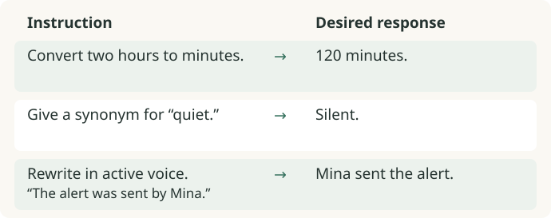
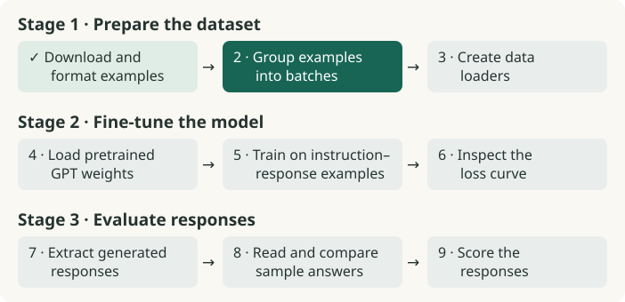
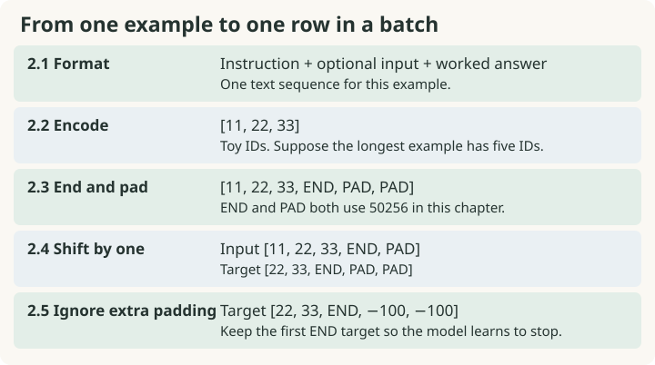
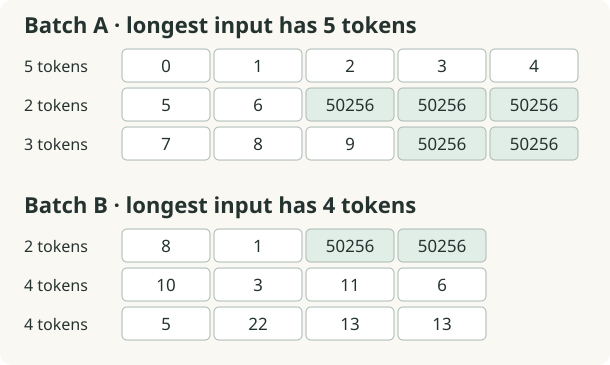
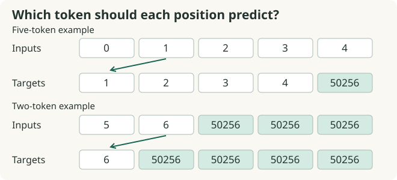
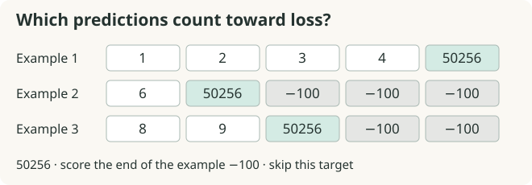

# Chapter 7 — Finetuning to Follow Instructions

We built a GPT architecture and [loaded pretrained weights into it](05-pretraining-on-unlabeled-data.md). In [Chapter 6](06-finetuning-for-text-classification.md), each SMS came with one correct label: spam or not spam. In Chapter 7, we start again from the pretrained language model. Each training example gives it an instruction and an example of the response we want it to write.

<figure markdown="1">

[](https://sebastianraschka.com/images/LLMs-from-scratch-images/mental-model.jpg)

<figcaption markdown="span">Figure 7.1 places us at Stage 3 of [Sebastian Raschka’s roadmap](https://sebastianraschka.com/llms-from-scratch/). We completed step 8 on the upper branch with labeled SMS messages. Follow the lower branch for step 9, where an instruction dataset teaches the model to respond to requests.</figcaption>
</figure>

For example, suppose the request is “Rewrite this appointment reminder in a friendlier tone.” A training example includes the original reminder and a suitable rewrite. The model learns to generate that response one token at a time. This is one way to teach the behavior people expect from a chatbot or personal assistant.

We’ll prepare the instruction examples, group them into training batches, and fine-tune the pretrained model. Then we’ll give it held-out requests, extract and save the responses it generates, and evaluate how well those responses carry out the instructions.

## 7.1 Introduction to instruction fine-tuning

A pretrained GPT learns to predict the **next token**. If the prompt begins “The alert was sent by Mina,” a plausible continuation might describe what happened after the alert. Now put a request in front of that same sentence: “Rewrite in active voice.” A useful answer has to preserve the event and change its wording: **“Mina sent the alert.”** A fluent continuation can still miss the requested edit.

**Supervised instruction fine-tuning** gives the pretrained model worked examples of that distinction. During training, each instruction comes with a desired response. The model still predicts one token at a time; the examples teach it what kind of text should follow a request. When we later give it a new instruction, it has to generate the response itself.

<figure markdown="1">



<figcaption markdown="span">Companion to Raschka’s Figure 7.2. Read each row from left to right. The response demonstrates what counts as following that particular instruction. For the synonym task, several different answers could be valid.</figcaption>
</figure>

<figure markdown="1">


<figcaption markdown="span">Companion to Raschka’s Figure 7.3. Follow each stage from left to right, then move down a row. Inspecting loss shows how training is progressing. Reading and scoring generated answers tells us how well the model follows the requests.</figcaption>
</figure>

## 7.2 Preparing a dataset for supervised instruction fine-tuning

Raschka prepared 1,100 examples for the book. Download the JSON file and inspect two records before thinking about tokens. Python reads its outer array as a list and each record as a dictionary. [Book dataset](https://github.com/rasbt/LLMs-from-scratch/blob/main/ch07/01_main-chapter-code/instruction-data.json)

```python
import json
from urllib.request import urlopen

url = (
    "https://raw.githubusercontent.com/rasbt/LLMs-from-scratch/main/"
    "ch07/01_main-chapter-code/instruction-data.json"
)
with urlopen(url, timeout=30) as response:
    data = json.load(response)

print(len(data))  # 1100
print(data[50])   # Spelling task with a separate word to correct
print(data[999])  # Antonym question with an empty input field
```

In the spelling record, the **instruction** asks for a correction, the **input** supplies `Ocassion`, and the **output** gives the corrected spelling, `Occasion`, in a sentence. In the antonym record, the instruction already contains the word *complicated*. An empty `input` makes sense here. The example still has a request and a target answer.

A **prompt template** tells us how to arrange those fields into the sequence the tokenizer will encode. During fine-tuning we include the worked answer. When asking the trained model a new question, we supply the request up to the response marker and let the model generate what follows.

<figure markdown="1">


<figcaption markdown="span">Companion to Raschka’s Figure 7.4. Follow the number 12 through both formats, then find where the answer 24 begins. The Alpaca excerpt omits its introductory sentence for space. [Stanford Alpaca templates](https://github.com/tatsu-lab/stanford_alpaca#data-release) · [Microsoft Phi-3 prompt format](https://huggingface.co/microsoft/Phi-3-mini-4k-instruct#input-formats)</figcaption>
</figure>

!!! tip "What changes with another model?"
    Keep the same request and answer. **Gemma 2 IT** opens the answer turn with `<start_of_turn>model` and closes it with `<end_of_turn>`. **Qwen2.5-7B-Instruct** opens it with `<|im_start|>assistant` and closes it with `<|im_end|>`. In both examples the answer text, **24**, follows the opening marker on a new line. These are excerpts. For an existing instruction-tuned model, use its tokenizer’s chat template to insert the full sequence of markers and line breaks it learned during training. [Gemma prompt formats](https://ai.google.dev/gemma/docs/core/prompt-structure) · [Qwen tokenizer and usage example](https://huggingface.co/Qwen/Qwen2.5-7B-Instruct/blob/main/tokenizer_config.json)

The chapter uses Alpaca as its baseline. Stanford published its training recipe and templates, so we can see exactly how a record becomes training text. In this version of Listing 7.2, `format_input` builds the request. The caller adds the response heading and, for a training example, the known answer. [Stanford Alpaca](https://github.com/tatsu-lab/stanford_alpaca) · [Chapter 7 notebook](https://github.com/rasbt/LLMs-from-scratch/blob/main/ch07/01_main-chapter-code/ch07.ipynb)

```python
def format_input(entry: dict[str, str]) -> str:
    sections = [
        "Below is an instruction that describes a task. "
        "Write a response that appropriately completes the request.",
        f"### Instruction:\n{entry['instruction']}",
    ]
    if entry["input"]:
        sections.append(f"### Input:\n{entry['input']}")
    return "\n\n".join(sections)


entry = data[50]
prompt = format_input(entry) + "\n\n### Response:\n"
print(prompt + entry["output"])
```

```text
Below is an instruction that describes a task. Write a response that appropriately completes the request.

### Instruction:
Identify the correct spelling of the following word.

### Input:
Ocassion

### Response:
The correct spelling is 'Occasion.'
```

The antonym question in `data[999]` stands on its own. The formatter skips the empty input field, so the response heading follows the instruction directly.

```python
model_input = format_input(data[999])
desired_response = f"\n\n### Response:\n{data[999]['output']}"
print(model_input + desired_response)
```

```text
Below is an instruction that describes a task. Write a response that appropriately completes the request.

### Instruction:
What is an antonym of 'complicated'?

### Response:
An antonym of 'complicated' is 'simple'.
```

### Exercise 7.1 · Changing the prompt style

Suppose the trained model spells *Occasion* correctly after seeing `### Response:`. Will it still do so after seeing `<|assistant|>`? Start with the **same Alpaca-tuned checkpoint** and the same held-out spelling questions. Start with Alpaca and Phi-3, then repeat each question in the additional formats below, with greedy decoding and the same output budget. Count correct spellings and record cases where the model continues the prompt or prints a role marker. This measures how sensitive that checkpoint is to the format used at inference.

Gemma and Qwen give us two more families of examples. A chat template determines how a conversation becomes a sequence of tokens. The supervised task is still to generate the worked answer. Keeping our GPT weights and tokenizer fixed lets us ask a narrower question: can the model find the start of its answer when we change the surrounding text?

Here are seven prompts for one request. We borrow the **single-turn text markers** and omit model-specific beginning-of-sequence tokens and default system messages. This keeps the comparison focused on the request and its answer boundary. GPT’s tokenizer may split a marker into several tokens even when the original model treats it as one.

```python
request = "\n".join(part for part in (entry["instruction"], entry["input"]) if part)
qwen_turn = f"<|im_start|>user\n{request}<|im_end|>\n<|im_start|>assistant\n"
prompts = {
    "Alpaca": format_input(entry) + "\n\n### Response:\n",
    "Phi-3": f"<|user|>\n{request}<|end|>\n<|assistant|>\n",
    "Mistral v0.1": f"[INST] {request} [/INST]",
    "Gemma 2 IT": f"<start_of_turn>user\n{request}<end_of_turn>\n<start_of_turn>model\n",
    "Gemma 4 E2B-it": f"<|turn>user\n{request}<turn|>\n<|turn>model\n",
    "Qwen2.5-7B-Instruct": qwen_turn,
    "Qwen3.8-27B": qwen_turn + "<think>\n\n</think>\n\n",
}
```

Compare the last two rows. Both open the assistant turn the same way. Qwen3.8’s published template adds an empty thinking block when direct-answer mode is requested. For our GPT checkpoint those characters are simply more input text. In the Gemma rows, even the spelling of the turn boundary changes between generations. [Gemma format reference](https://ai.google.dev/gemma/docs/core/prompt-structure) · [Gemma 4 template](https://huggingface.co/google/gemma-4-E2B-it/blob/main/chat_template.jinja) · [Qwen2.5 template](https://huggingface.co/Qwen/Qwen2.5-7B-Instruct/blob/main/tokenizer_config.json) · [Qwen3.8 template](https://huggingface.co/Qwen/Qwen3.8-27B/blob/main/chat_template.jinja) · [Mistral v0.1 format](https://huggingface.co/mistralai/Mistral-7B-Instruct-v0.1)

A second experiment asks whether the **training format** matters. Start each run from the same pretrained GPT weights, format the same training examples in one style per run, and evaluate each model in its own style. Keep the split, optimizer settings, seed, and decoding settings fixed. Score the same held-out requests for correctness and instruction following. The formatting examples can run now. The response-quality comparison comes after the fine-tuning run in §7.6.

### Splitting the 1,100 examples

Listing 7.3 assigns the first 85% to training, the next 10% to **testing**, and the remaining 5% to **validation**. The model learns from the 935 training pairs. We use the 55 validation pairs to monitor learning and reserve the 110 test pairs for evaluating responses after training. [Chapter 7 notebook](https://github.com/rasbt/LLMs-from-scratch/blob/main/ch07/01_main-chapter-code/ch07.ipynb)

```python
# The slice boundaries count whole instruction–response pairs.
train_end = int(0.85 * len(data))
test_end = train_end + int(0.10 * len(data))

# Keep the file order used in Listing 7.3. Each slice starts where the last ended.
train_data = data[:train_end]
test_data = data[train_end:test_end]
val_data = data[test_end:]  # Everything left over goes to validation.

print(len(train_data), len(test_data), len(val_data))  # 935 110 55
```

Each training record now has a place in the split, but the formatted requests and answers can still have different token lengths. Section 7.3 tackles how to combine them into a batch.

## 7.3 Organizing data into training batches

We now have 935 training records and a function to format each one. How do we turn a handful of them into the two tensors that our training loop expects?

<figure markdown="1">



<figcaption>Companion to Raschka’s Figure 7.5. We are at step 2. Here we define how to assemble a batch. In step 3 the data loader will call that code as it iterates over the dataset.</figcaption>
</figure>

**Collate** means “assemble the selected samples into one batch.” Think of one iteration of the Chapter 6 loader. The dataset handed it eight pairs, each containing a 120-token SMS tensor and one spam label. PyTorch’s default collate function stacked the eight tensors into a rectangular `[8, 120]` input and gathered the labels into `[8]`. That worked because the dataset had already padded each SMS to the same length.

Here, two instruction examples might arrive as lists of 57 and 54 token IDs. The loader chooses the examples. Our collate function will decide how to pad them to a common length and build a next-token target for each position. We can then pass it to the loader as `collate_fn`. [PyTorch’s batching documentation](https://docs.pytorch.org/docs/stable/data.html#loading-batched-and-non-batched-data)

<figure markdown="1">



<figcaption>Companion to Raschka’s Figure 7.6. Follow the short row. The target paired with 33 is END. The two later padding targets become −100, the value the loss function ignores. Listing 7.4 handles the first two steps.</figcaption>
</figure>

**One dataset item is one complete example.** The initializer calls our §7.2 formatter, appends the response heading and the known answer, and encodes that whole string once. Compare the spelling task and the antonym question below. Their section headings differ because only the spelling task supplies a separate input.

<figure markdown="1">


<figcaption>Companion to Raschka’s Figure 7.7. Each example keeps its own length. The ellipses stand for token IDs omitted from the drawing. Padding waits until we know which examples share a batch.</figcaption>
</figure>

```python title="InstructionDataset · Listing 7.4"
import tiktoken
from torch.utils.data import Dataset


class InstructionDataset(Dataset):
    def __init__(self, records: list[dict[str, str]], tokenizer: tiktoken.Encoding) -> None:
        self.encoded_texts: list[list[int]] = []
        for entry in records:
            # The answer belongs in the text we use for training.
            text = format_input(entry) + f"\n\n### Response:\n{entry['output']}"
            self.encoded_texts.append(tokenizer.encode(text))

    def __len__(self) -> int:
        return len(self.encoded_texts)

    def __getitem__(self, index: int) -> list[int]:
        return self.encoded_texts[index]
```

`__init__` is the Python **initializer**. After initialization, `dataset[i]` retrieves the stored IDs without tokenizing again. Try the two records from the figure together to see exactly what the collate function would receive. [Chapter 7 notebook](https://github.com/rasbt/LLMs-from-scratch/blob/main/ch07/01_main-chapter-code/ch07.ipynb)

```python
dataset = InstructionDataset([data[50], data[999]], tiktoken.get_encoding("gpt2"))
samples = [dataset[0], dataset[1]]
print([len(ids) for ids in samples])  # [57, 54]
```

### Pad to the longest example in this batch

The dataset already gives us integers, so we can append the end-of-text ID directly. GPT-2 has **50,257 vocabulary entries**, numbered from zero. Its end-of-text token has ID **50256**.

```python
tokenizer = tiktoken.get_encoding("gpt2")
print(tokenizer.encode("<|endoftext|>", allowed_special={"<|endoftext|>"}))
# [50256]
```

<figure markdown="1">



<figcaption>Companion to Raschka’s Figure 7.8. Read across each row. The tinted cells are the added copies of 50256. Batch B ends after four columns because its own longest example has four tokens.</figcaption>
</figure>

The loader will pass the selected lists to this function as `batch`. We can also call it directly. The slightly surprising part of the book’s first draft is that it temporarily makes each row **one position wider** than the desired inputs. That extra column will let the next draft build shifted targets from the same row. [Chapter 7 notebook](https://github.com/rasbt/LLMs-from-scratch/blob/main/ch07/01_main-chapter-code/ch07.ipynb)

```python
from collections.abc import Sequence

import torch


def custom_collate_draft_1(
    batch: Sequence[list[int]],
    pad_token_id: int = 50256,
    device: str | torch.device = "cpu",
) -> torch.Tensor:
    """Return int64 inputs shaped [examples, longest token count in this batch]."""
    working_width = max(len(ids) for ids in batch) + 1
    rows = []
    for ids in batch:
        # Build a fresh list so the dataset keeps its original token IDs.
        ended = ids + [pad_token_id]
        padded = ended + [pad_token_id] * (working_width - len(ended))

        # Leave out the final column when constructing the model inputs.
        rows.append(torch.tensor(padded[:-1], dtype=torch.long))

    return torch.stack(rows).to(device)
```

```python
batch = ([0, 1, 2, 3, 4], [5, 6], [7, 8, 9])
print(custom_collate_draft_1(batch))
```

```text
tensor([[    0,     1,     2,     3,     4],
        [    5,     6, 50256, 50256, 50256],
        [    7,     8,     9, 50256, 50256]])
```

The longest input already fits. The two-token input needs three padding positions and the three-token input needs two. Writing those five integers is cheap. The compute cost comes later when the model processes all 15 positions in this dense tensor.

### Pair each prediction with the next token

The response is already in the encoded example. Step 2.4 in Figure 7.9 gives the loss function a way to check each prediction: the target at column *i* is the token one place farther along in the padded sequence. For the short example `[5, 6]`, seeing token 5 should lead to a prediction of 6. After seeing both 5 and 6, the model should predict the end of the example.

<figure markdown="1">



<figcaption>Companion to Raschka’s Figure 7.10. Follow the arrow to see where the first target comes from. Then read vertically: each input column produces the prediction checked against the target directly below it.</figcaption>
</figure>

```python
def custom_collate_draft_2(
    batch: Sequence[list[int]],
    pad_token_id: int = 50256,
    device: str | torch.device = "cpu",
) -> tuple[torch.Tensor, torch.Tensor]:
    """Return int64 input and target tensors, both shaped [examples, tokens]."""
    width = max(len(ids) for ids in batch) + 1
    rows = []
    for ids in batch:
        # The first added ID marks the end. Further copies fill the row.
        rows.append(ids + [pad_token_id] * (width - len(ids)))

    padded = torch.tensor(rows, dtype=torch.long, device=device)
    # Use all rows. Slice the columns two ways to align predictions and labels.
    return padded[:, :-1], padded[:, 1:]
```

```python
inputs, targets = custom_collate_draft_2(batch)
print(inputs)
print(targets)
```

```text
tensor([[    0,     1,     2,     3,     4],
        [    5,     6, 50256, 50256, 50256],
        [    7,     8,     9, 50256, 50256]])
tensor([[    1,     2,     3,     4, 50256],
        [    6, 50256, 50256, 50256, 50256],
        [    8,     9, 50256, 50256, 50256]])
```

### Keep one stop signal per example

Consider the middle target row. Predicting the first `50256` answers a real question: *what comes after the last token of this example?* The next three copies exist only because a longer example shares the batch. Scoring those copies would reward the model three extra times for repeating the stop signal. Pairing the very same example with a longer neighbor would change how often we reward it.

<figure markdown="1">



<figcaption>Companion to Figures 7.11 and 7.12, step 2.5. Compare these rows with the target tensor above. Of the 15 predictions, ten count toward the mean loss, including three end-of-text predictions.</figcaption>
</figure>

!!! note "What does −100 do?"
    PyTorch cross-entropy uses `ignore_index=-100` by default. A target of −100 means “skip this prediction when calculating the loss.” On the middle row, the model still produces five sets of scores. Only the predictions for 6 and END contribute to the loss. The other three positions add nothing to the sum or the count used for the average. The model inputs contain valid token IDs throughout. In Chapter 6 the loss received just one spam label per message, so there were no padding targets to exclude.

This version of Listing 7.5 builds on draft 2. The original lengths tell us exactly where filler begins. For an example containing two tokens, target index 1 holds END and the filler starts at index 2. [Chapter 7 notebook](https://github.com/rasbt/LLMs-from-scratch/blob/main/ch07/01_main-chapter-code/ch07.ipynb)

```python
def custom_collate_fn(
    batch: Sequence[list[int]],
    pad_token_id: int = 50256,
    ignore_index: int = -100,
    allowed_max_length: int | None = None,
    device: str | torch.device = "cpu",
) -> tuple[torch.Tensor, torch.Tensor]:
    """Return aligned int64 [examples, tokens] inputs and masked targets."""
    inputs, shifted = custom_collate_draft_2(batch, pad_token_id, device)
    # The two slices share storage. Give targets their own copy before editing.
    targets = shifted.clone()
    for row, ids in enumerate(batch):
        targets[row, len(ids):] = ignore_index

    # Limit both tensors to the same context window, e.g. 1024 for GPT-2.
    return inputs[:, :allowed_max_length], targets[:, :allowed_max_length]
```

With the default length limit of `None`, both tensors retain the batch width. If truncation cuts through a long example, its true end may fall outside the window. We keep the observed next-token targets up to the cutoff.

Try the finished function on the same batch and read the row for `[5, 6]`:

```python
inputs, targets = custom_collate_fn(batch)
print(inputs[1].tolist())   # [5, 6, 50256, 50256, 50256]
print(targets[1].tolist())  # [6, 50256, -100, -100, -100]
```

### Which predictions enter the average?

Shrink the vocabulary to two tokens so we can see every score. Each row below is one prediction. Column 0 holds the score for token 0 and column 1 holds the score for token 1. All three rows favor token 1. The first target is 0, so the first prediction incurs a much larger loss.

```python
from torch.nn.functional import cross_entropy

logits = torch.tensor([[-1.0, 1.0], [-0.5, 1.5], [-0.5, 1.5]])
labels = torch.tensor([0, 1, 1])
print(cross_entropy(logits, labels, reduction="none"))  # One loss per row

print(cross_entropy(logits[:2], labels[:2]))           # 1.1269
print(cross_entropy(logits, labels))                   # 0.7936
print(cross_entropy(logits, torch.tensor([0, 1, -100])))  # 1.1269
```

| Positions graded | Losses entering the average (rounded) | Mean loss |
| --- | --- | ---: |
| First two | (2.1269 + 0.1269) / 2 | 1.1269 |
| All three | (2.1269 + 0.1269 + 0.1269) / 3 | 0.7936 |
| Third target set to −100 | (2.1269 + 0.1269) / 2 | 1.1269 |

Why would a target of 2 raise an error? It asks for the score in column 2, but this example has only columns 0 and 1. PyTorch explicitly reserves the configured `ignore_index` (default `-100`) to skip a position before looking up a score. That is why an ordinary out-of-range ID raises an error and −100 works. In the real GPT batch, 50256 has a score column and can teach the model when to stop. Only the surplus padding gets the skip marker.

## 7.4 Creating data loaders for an instruction dataset

Notes to come as we read this section.

## 7.5 Loading a pretrained LLM

Notes to come as we read this section.

## 7.6 Fine-tuning the LLM on instruction data

Notes to come as we read this section.

## 7.7 Extracting and saving responses

Notes to come as we read this section.

## 7.8 Evaluating the fine-tuned LLM

Notes to come as we read this section.

## 7.9 Conclusions

Notes to come as we read this section.

## Questions to bring to the chapter

<!-- Add actual questions during reading. -->

## End of chapter

<!-- Summarize what became clear, link exercises, and record unresolved questions. -->
