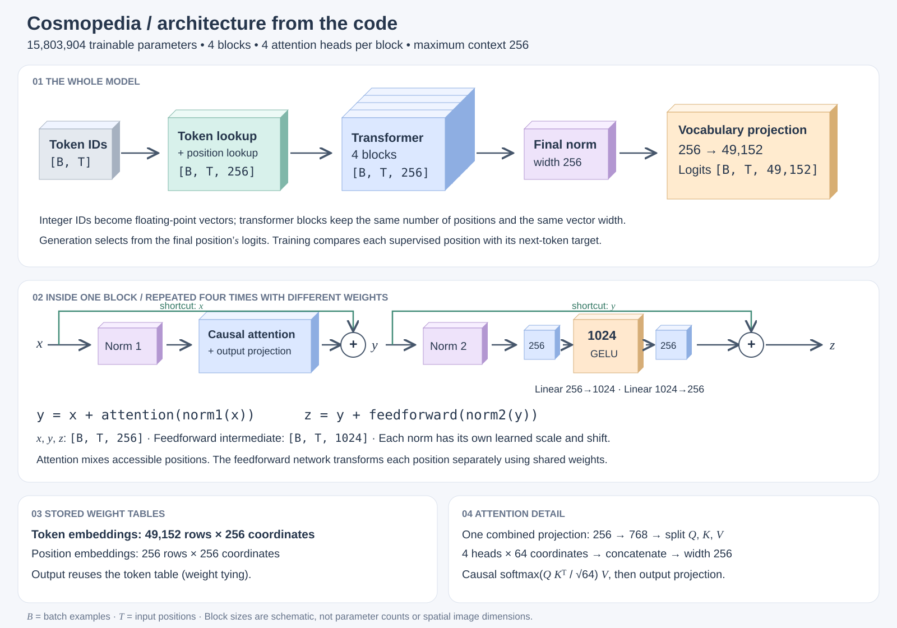

# A first Cosmopedia training check 🌱

After finishing the character-log preparation cycle, Sezai chose to try a larger public dataset immediately. This is a separate experiment; starting the book is still possible alongside it. The assistant implemented and ran the initial check, not Sezai.

[Cosmopedia v2](https://huggingface.co/datasets/HuggingFaceTB/smollm-corpus) contains synthetic educational text, including explanations, tutorials, and stories. We sampled its text and reused the SmolLM tokenizer. **All model weights were initialized randomly**; using a pretrained tokenizer does not import a pretrained model's language ability.

## Model architecture, drawn from the code 🧱

*Open the drawing for a full-size view. The three-dimensional blocks are schematic, like a CNN architecture drawing: their physical sizes do not measure parameter counts. They represent computation stages, not image height, width, or channels.*

This figure follows the default architecture in [`experiments/cosmopedia/model.py`](https://github.com/kantarcise/learning-llms/blob/main/experiments/cosmopedia/model.py). The upper row shows the whole model; the middle row opens one transformer block. The lower panels distinguish stored weights from the computed vectors flowing through the model.

For four full training windows, IDs `[4,256]` become vectors `[4,256,256]`, then logits `[4,256,49152]`. The two occurrences of 256 in the representation mean different things: input positions and coordinates per token. Four attention heads each use 64 coordinates; their outputs are concatenated back to width 256.

**Shape reminder:** `B` is the number of batch examples, `T` is input positions per example, and the final representation axis is vector width. Logits replace that width with the number of vocabulary candidates. Each position predicts the **next** token. Both residual additions preserve the representation shape. These diagrams end at logits: softmax and token selection are not part of these models' `forward` methods.

## From our tiny model to this one

| Component | Character-log model | Cosmopedia model |
| --- | ---: | ---: |
| Vocabulary | 25 characters | 49,152 subword entries |
| Maximum context | 24 characters | 256 tokens |
| Vector width | 32 | 256 |
| Transformer blocks | 1 | 4 |
| Attention heads per block | 1 | 4 |
| Feedforward width | 64 | 1,024 |
| Learned parameters | 10,848 | 15,803,904 |

The forward path is still token/position lookup → transformer blocks → final normalization → vocabulary scores. Each block still has attention and feedforward sublayers with normalization and residual additions. Context length and vector width are independent even though both happen to be 256 in this configuration.

Four attention heads arrange each token's 256 projected coordinates into four groups of 64, compute a separate attention mixture per group, and join the results back into 256 coordinates. We have implemented this, but have not yet walked through the new mechanism together. The input embedding and output projection share a single learned weight table to avoid duplicating the large vocabulary matrix.

## Data and first measured result

We prepared 1,000,000 training tokens across 1,393 documents, plus 65,536 validation tokens across 89 documents. Documents are assigned to splits before windowing, exact duplicate text is removed, and windows do not cross document boundaries. Dataset and tokenizer revisions and document hashes are recorded. Only a bounded source-order sample was used, not the entire corpus.

The assistant ran 100 optimizer updates with batches of four windows on the Mac GPU (MPS). These are randomly sampled windows with replacement, so 100 steps does not mean 100 epochs. Each window has up to 256 positions; padding targets are excluded from loss.

| Update | Recent training loss | Fixed-sample validation loss |
| --- | ---: | ---: |
| 0 | — | 10.8452 |
| 25 | 9.8804 | 9.0234 |
| 50 | 8.3737 | 8.0052 |
| 75 | 7.7016 | 7.7779 |
| 100 | 7.6274 | 7.6613 |

The training loop took about 12.8 seconds including periodic evaluation and checkpoint saving. Setup, download, initial evaluation, and generation are excluded. This measures this particular machine and run, not expected performance elsewhere.

The best-checkpoint continuation began `Once upon a time, and the the the ...` and remained repetitive. Falling loss verifies learning progress on this check; it does not show fluent language. The run saw only about 86,000 training targets with replacement. Validation uses 32 fixed sampled windows, not the full validation set. Training loss averages recent batches at changing weights, so it differs from the full-split evaluation procedure in the character-log experiment.

## Next: run longer and inspect, not assume

The [experiment README](https://github.com/kantarcise/learning-llms/tree/main/experiments/cosmopedia) contains runnable download/training commands, exact revisions, shapes, and limitations. The [initial report](https://github.com/kantarcise/learning-llms/blob/main/experiments/cosmopedia/results/smoke-100steps/run.json) preserves both generated samples verbatim. Local checkpoints and downloaded data are excluded from Git.

The proposed 1,000-update user run has now been completed; see the follow-up below. It may improve text quality; there is no promise of conversation or fluency. Synthetic text can contain errors, near duplicates are not removed, one seed is not a benchmark, and validation selected the checkpoint rather than serving as an untouched final test set.

Track this separate experiment in [issue #12](https://github.com/kantarcise/learning-llms/issues/12). The completed character-log cycle remains documented in the [training comparison](training-comparison.md).

## Data sizes and the user-run follow-up

The character-log experiment used **563 bytes of text**: 372 training bytes and 191 validation bytes across six sequences. Its JSON file is 1,037 bytes including structure and metadata.

Our selected Cosmopedia source documents contain **5,581,797 UTF-8 text bytes (5.58 MB)**: 5,234,080 training bytes and 347,717 validation bytes. The final document in each split may be truncated for tokenization. Prepared data, including integer input/target tensors, tokenizer, and manifest, totals **29,481,912 bytes (29.48 MB)**. Checkpoints, caches, and verification copies are separate. These are measured logical file sizes, not network traffic. The [experiment README](https://github.com/kantarcise/learning-llms/tree/main/experiments/cosmopedia) includes the breakdown and measurement record.

Sezai has now run **1,000 updates** himself. Validation loss reached **6.3611**, with the best checkpoint at step 1,000. The loop took 96.2 seconds and processed 866,275 training targets with repeated sampling. Output improved to repeated phrase fragments such as `I was a time`, but remained incoherent. The [saved report](https://github.com/kantarcise/learning-llms/blob/main/experiments/cosmopedia/results/user-1000steps/run.json) preserves the actual output.

**Current handoff:** before a multi-hour Linux/3090 experiment, implement resumable latest/best checkpoints and benchmark that machine. Existing weights do not preserve AdamW or sampling state. This additional experiment can proceed alongside Chapter 1; it is not a new prerequisite for the book.

Track the bounded Linux run in [issue #14](https://github.com/kantarcise/learning-llms/issues/14).
