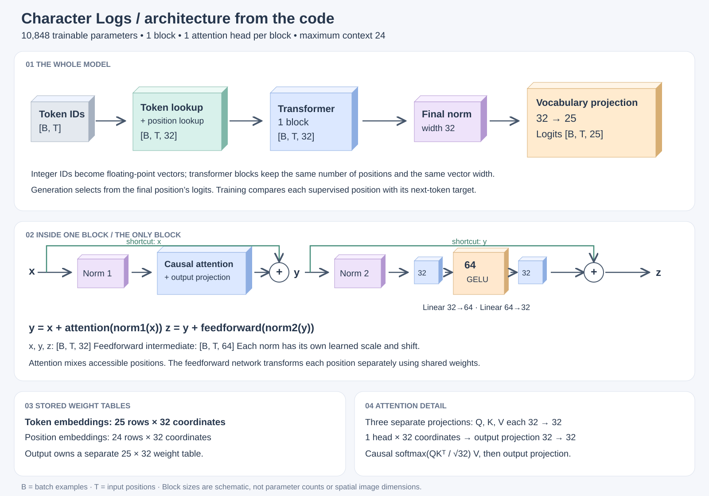
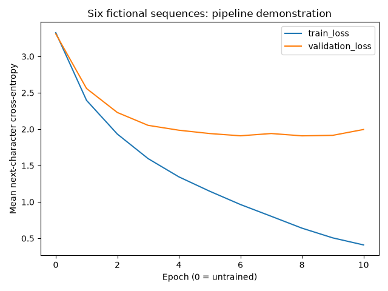
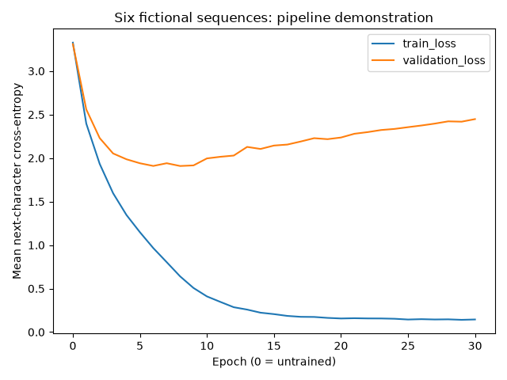

# Character-log experiment: architecture and training 📉

On October 15, 2026, Sezai ran the character-level tiny transformer from his terminal, read the losses, and compared the generated text. We then changed only the training duration to see whether more updates would help. These are preparation experiments, not completed book exercises.

**Result:** extending training from 10 to 30 epochs lowered training loss further but worsened final validation loss. Both runs selected epoch 8 as their best checkpoint.

## Model architecture, drawn from the code 🧱

[](../assets/model-architectures/character-logs.svg)

*Open the drawing for a full-size view. The three-dimensional blocks are schematic, like a CNN architecture drawing: their physical sizes do not measure parameter counts. They represent computation stages, not image height, width, or channels.*

This figure follows the default architecture in [`experiments/character-logs/model.py`](https://github.com/kantarcise/learning-llms/blob/main/experiments/character-logs/model.py). The upper row shows the whole model; the middle row opens one transformer block. The lower panels distinguish stored weights from the computed vectors flowing through the model.

The inspection batch has two examples and eight positions: IDs `[2,8]` become vectors `[2,8,32]`, then logits `[2,8,25]`. Training uses up to 24 positions. The feedforward network temporarily expands each vector from 32 to 64 coordinates before returning to 32.

**Shape reminder:** `B` is the number of batch examples, `T` is input positions per example, and the final representation axis is vector width. Logits replace that width with the number of vocabulary candidates. Each position predicts the **next** token. Both residual additions preserve the representation shape. These diagrams end at logits: softmax and token selection are not part of these models' `forward` methods.

## Before training: follow one learned number

The assistant first ran an isolated update using the two inspection inputs, `job=orde` and `job=user`, with seed 7 and the current model settings. No checkpoint was saved from this inspection. We watched `model.token_embedding.weight[12, 0]`: lowercase `j` has ID 12 in the sorted vocabulary, and coordinate 0 is the first of its 32 learned numbers.

| After operation | Weight (rounded) | Stored gradient (rounded) |
| --- | ---: | ---: |
| Clear gradients | 0.501100 | `None` |
| Forward pass and loss | 0.501100 | `None` |
| `loss.backward()` | 0.501100 | -0.016659 |
| `optimizer.step()` | 0.504085 | -0.016659 |
| Clear for the next batch | 0.504085 | `None` |

The batch loss was 3.040858. These values are recorded from the assistant's inspection output, separate from the saved full-run JSON evidence below. Sezai correctly explained that `step()` uses the gradient without clearing it. `set_to_none=True` clears the gradient slot, not the learned weight. The amount of change is an AdamW update, not the simple gradient-descent formula used earlier for intuition.

## What stayed the same?

| Setting | Both runs |
| --- | --- |
| Architecture | One transformer block, one attention head |
| Vocabulary | 25 characters |
| Context length / vector width / feedforward hidden width | 24 / 32 / 64 |
| Learned parameters | 10,848 |
| Training / validation windows | 276 / 143 |
| Batch size | 16 |
| Optimizer | AdamW, learning rate 0.003, weight decay 0.01 |
| Seed | 7 |
| Device / PyTorch | CPU / 2.14.1 |
| Generation | Greedy, prompt `job=`, 120 new characters, no end token |

The eight-character inputs printed during inspection are a small teaching fixture. Actual training uses windows of 24 positions. Each full training batch has 16 windows; the final batch has four. That makes **18 optimizer updates per epoch**, not the ten updates from our earlier hypothetical example with 100 examples and batch size 10.

Both runs started from scratch with the same seed. The longer run did not resume a checkpoint. The saved JSON records match **exactly for epochs 0–10**, including full-precision losses, and their recorded configurations match. The run records do not include a code commit or dataset hash; this is a comparison made in the same session, not a fully versioned benchmark.

## Commands Sezai ran

From the repository root:

```bash
uv run --locked --group experiments python experiments/character-logs/train.py \
  --epochs 10 \
  --batch-size 16 \
  --learning-rate 0.003 \
  --seed 7 \
  --output "experiments/character-logs/artifacts/run-$(date +%Y%m%d-%H%M%S)"
```

```bash
uv run --locked --group experiments python experiments/character-logs/train.py \
  --epochs 30 \
  --batch-size 16 \
  --learning-rate 0.003 \
  --seed 7 \
  --output "experiments/character-logs/artifacts/run-30epochs-$(date +%Y%m%d-%H%M%S)"
```

The original local output folders were `run-20261015-221101` and `run-30epochs-20261015-221602`. Their JSON reports and plots are preserved unchanged; model checkpoints remain local and ignored by Git.

## Reading the curves together

Epoch 0 measures the randomly initialized model before updates. After each training epoch, the code measures both datasets with the current weights fixed. Validation does not call `backward()` or `optimizer.step()`. The two curves are mean next-character cross-entropy, not accuracy percentages.

| Measurement | 10-epoch run | 30-epoch run |
| --- | ---: | ---: |
| Initial training loss | 3.3263 | 3.3263 |
| Initial validation loss | 3.3096 | 3.3096 |
| Final training loss | 0.4099 | 0.1448 |
| Final validation loss | 1.9957 | 2.4473 |
| Best validation epoch | 8 | 8 |
| Best validation loss | 1.9086 | 1.9086 |





Early training helps both datasets. Around epoch 6, validation improvement largely stops, while training loss keeps falling. Extending to epoch 30 makes that divergence clearer: training examples become easier for the model, but held-out predictions become worse on average. This is evidence of overfitting in this experiment. Small fluctuations are normal; the training loss does not decrease at every epoch either.

Epoch 8's validation loss of 1.9086 is only slightly lower than epoch 6's 1.9091. We select the numerical minimum without claiming that this tiny difference is meaningful beyond this run.

The inspection loss, 3.0409, uses just two eight-character examples. It is not expected to equal epoch 0's full-training-set loss of 3.3263.

## What did the model actually learn? 🌱

Sezai noticed that the untrained output repeated arbitrary characters, while the trained output contained recognizable pieces such as `job=users`, `status`, and `invoice`. Our vocabulary has individual characters, not whole-word entries. Producing `status` requires six successive next-character selections: `s`, `t`, `a`, `t`, `u`, `s`.

Here is the recorded output from the best checkpoint, verbatim:

```text
job=users status=sted
job=s status=invoinvoicetatusous=stustainvonvoinvoicetustainvoinvoicetatusous=tustainvonvoinvoicetusta
```

This shows learned fragments and some log structure, alongside malformed values and repetition. It does not demonstrate reliable log generation or broad language understanding.

**Why was the generated sample identical after 10 and 30 epochs?** Both scripts reloaded the best checkpoint, from epoch 8, before generating. The longer run's sample is not an evaluation of epoch 30's weights. We did not inspect generation from the final weights.

Checkpoint selection is the same idea Sezai remembered from CNN training: preserve the best measured validation result instead of assuming the final epoch is best. This script still runs all requested epochs; it does not perform early stopping.

## Evidence and limits

The unchanged reports contain every epoch's loss, configuration, and before/after generated samples:

- [10-epoch run.json](https://github.com/kantarcise/learning-llms/blob/main/experiments/character-logs/results/2026-10-15-comparison/10-epochs/run.json)
- [30-epoch run.json](https://github.com/kantarcise/learning-llms/blob/main/experiments/character-logs/results/2026-10-15-comparison/30-epochs/run.json)

This is one seed on a small synthetic dataset with shared log templates and overlapping windows within each split. The windows are not hundreds of independent real-world records. Validation was used to select the checkpoint, so it is not an untouched final test set. The experiment supports a narrow conclusion about longer training in this setup, not a universal recommendation for eight epochs or a generalization benchmark.

We deliberately kept the data unchanged for this comparison. More varied data, a stronger held-out split, multiple seeds, and an established tokenizer remain possible future experiments, not requirements for starting the book.

## Handoff: preparation wrap-up 📘

1. **Forward walkthrough:** discussed token and position lookup, attention, normalization, residuals, feedforward, and vocabulary scores.
2. **One update:** the assistant ran an isolated parameter inspection; Sezai followed and correctly explained that backpropagation computes gradients, the optimizer changes weights, and clearing gradients preserves learned weights. Sezai has not independently run that isolated inspection.
3. **User-run training:** Sezai ran ten epochs and interpreted the losses and generated fragments.
4. **Controlled comparison:** Sezai ran thirty epochs with the same settings and observed the training/validation divergence.
5. **Document the conclusion:** this page preserves the comparison for review. No new experiment is needed to close this preparation cycle.

**Resume after review:** begin the book's first chapter with Sezai's reading and questions. The chapter notes are still scaffolds; this experiment does not mark any chapter complete. Detailed AdamW arithmetic, a cross-entropy gradient derivation, KV caching, and multi-head attention remain topics to revisit when useful.
