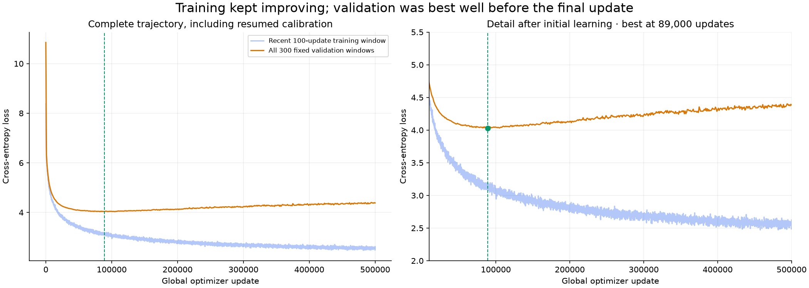
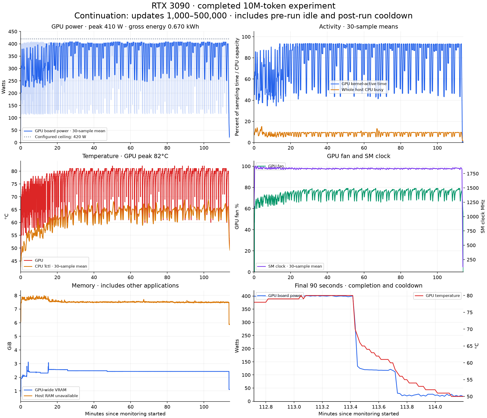
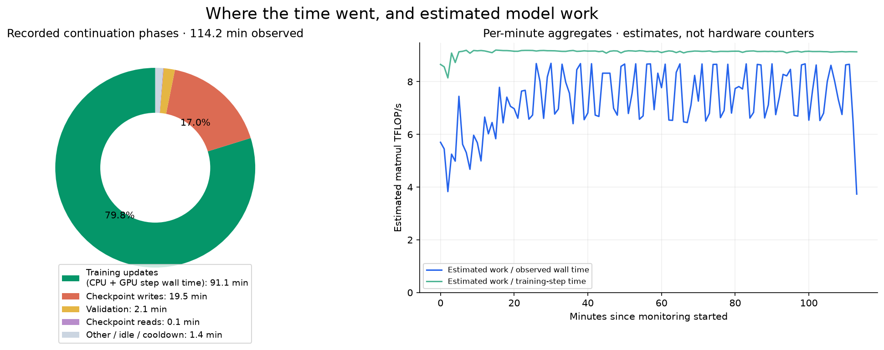

# Completed 10M-token run · November 14

The experiment reached **500,000 total updates**, ending normally at **15:22 Istanbul time** before its soft time cap. The 1,000-update calibration and continuation form one trajectory; `run.json` preserves the unchanged continuation report with cumulative loss history and samples. The [setup and data verification](../long-10m-setup/plan.json) describe the 10M-token training sample, same validation documents, and the switch from 32 to all 300 validation windows.

| Measurement | Result |
| --- | ---: |
| Initial validation loss | 10.8514 |
| Lowest measured validation loss | **4.0308 at update 89,000** |
| Final validation loss | 4.3837 at update 500,000 |
| Final recent training interval loss | 2.5712 |
| Continuation loop, including evaluation/saving | 113.53 minutes |
| Total loop time including calibration | 113.75 minutes |



Validation improved early, reached its recorded minimum at update 89,000, and then gradually worsened while training loss continued to fall. This is evidence of overfitting to this bounded sample. The final update is not the best validation checkpoint. The retained files are distinct: `best.pt` resumes update 89,000, `latest.pt` resumes update 500,000, and `best-weights.pt` exports the historical best weights for inference. The [checkpoint verification](checkpoint-verification.json) checks their update counts, AdamW counts and matching inference export, and records file fingerprints. Weights are not committed.

The report's greedy continuation is generated from the validation-best checkpoint, not the last update. It forms recognizable story fragments but still repeats phrases such as “strong and strong” and “unity and unity.” The complete unedited sample is in [run.json](run.json). This does not establish fluency, factual accuracy or broad generalization.

## Power, activity and cooldown



| Monitored continuation measurement | Result |
| --- | ---: |
| Sensor samples | 6,845 |
| Observation duration, including pre/post idle | 114.20 minutes |
| Time-weighted GPU board power | **351.8 W** |
| Sampled peak GPU board power | **410.04 W** |
| Configured GPU power ceiling | 420 W |
| Gross sampled GPU-board energy | **0.670 kWh** |
| Sampled peak GPU temperature | **82°C** |
| Sampled peak GPU fan setting | 79% |

The regular drops in power/activity align with checkpoint intervals in the [full phase timeline](timeline.png). The final zoom shows the decrease after training and during cooldown. These GPU-wide readings include the desktop and other applications. Board energy is integrated from adjacent power samples; it is not whole-machine wall energy, CPU energy, or a training-only energy attribution. CPU package energy remained permission-restricted. The plots use 30-sample means where labeled; peaks and energy use the original data.

## Work and time allocation



Across the observed continuation, phase markers attribute **91.1 minutes (79.8%) to training steps**, **19.5 minutes (17.0%) to checkpoint writes**, and **2.1 minutes to validation**. Remaining time includes checkpoint reads, setup, Python overhead, idle and cooldown. Training-step wall time includes CPU and GPU work; it is not isolated GPU kernel execution time. Setup is not added as another exclusive phase because it contains nested initialization/evaluation/save work.

Per-step model-based matmul work totals about **49.83 petaflops of estimated operations** for the 499,000-update continuation. Estimated rates are **9.13 TFLOP/s over recorded training-step durations** and **7.27 TFLOP/s over the whole observation**. The blue per-minute curve includes checkpoint/idle gaps; the green curve divides only by training-step durations in that minute. These are approximate algorithmic FLOP counts, not hardware instruction counters, Tensor Core utilization, SM occupancy or percentages of peak device performance. Formula and exclusions are documented in [MONITORING.md](../../MONITORING.md).

## Evidence and reproduction

- [run.json](run.json), [state.json](state.json), and [loss.svg](loss.svg): unchanged final training report, cumulative dashboard state and graph.
- [monitor-summary.json](monitor-summary.json): exact sensor peaks, energy and recorded phase durations.
- [operations-summary.json](operations-summary.json): estimated work totals and per-minute aggregates.
- `samples.jsonl.gz`: losslessly compressed original sensor records; decompressed SHA256 is recorded in [provenance.json](provenance.json).
- [monitor-metadata.json](monitor-metadata.json) and [monitor-lifecycle.jsonl](monitor-lifecycle.jsonl): exact launch command and observation boundaries.
- The 145 MB per-update phase/event log, checkpoints and standalone HTML/SVG hardware report remain in ignored local artifacts under `long-10m-20261114`.

Regenerate the three compact figures from this directory's committed evidence:

```bash
uv run --locked --group experiments --group cosmopedia python experiments/cosmopedia/results/long-10m-run/plot_figures.py
```

The original renderer attempted to create an individual Matplotlib artist for every update and became impractically slow on this long run. After recording and cooldown had completed, that renderer was stopped and the same raw records were rendered with one collection per phase and rasterized dense layers. No training was rerun and no telemetry was changed. A regression test verifies that thousands of intervals remain represented with bounded artist counts. The regenerated full report is available locally at `experiments/cosmopedia/artifacts/long-10m-20261114/training-observation/report.html`.
